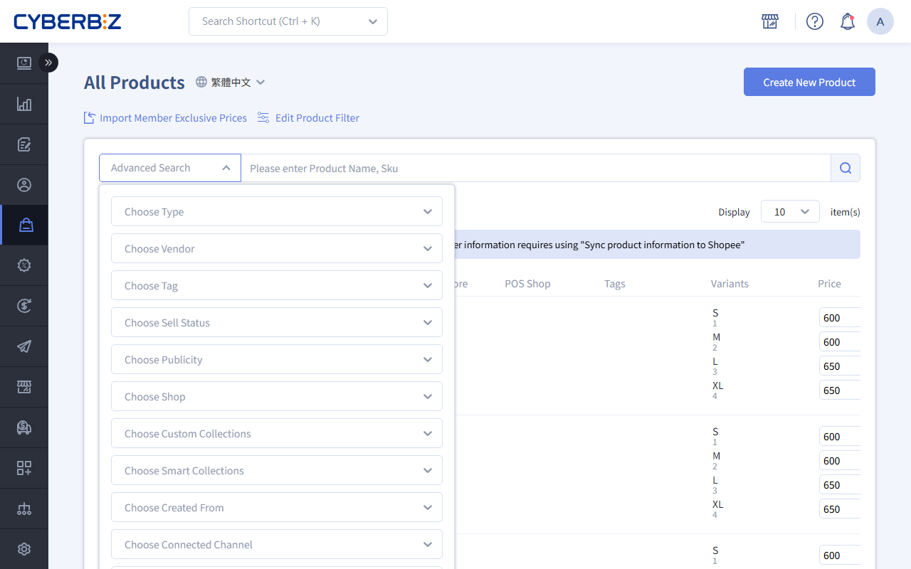

# Step 3: Sync Inventory Between Your Online Store and Shopee

Link products and turn on sync to keep inventory in your online store and Shopee shop connected. When an order is placed on either side or you change inventory in your online store, the system updates the remaining quantity on both sides automatically.
{ .subtitle }

[:lucide-lock:{ title="Applicable Plans" }](../../resources/conventions#適用方案) | All PLUS / Enterprise 
[:lucide-grid-2x2-plus:{ title="Applicable Add-ons" }](../../resources/conventions#適用擴充) | CYBERBIZ CHANNEL BRIDGE
{ .doc-badge }

{ .hero-page }

!!! tip "Use Cases"
    - **Prevent Overselling**: When an item sells in your online store, Shopee inventory is reduced at the same time, so the same stock is not sold twice across channels.
    - **Manage in One Place**: Update inventory only in your online store admin, and the change syncs to Shopee automatically.
    - **Flexible Control**: For specific promotional products, you can unlink them temporarily to manage stock allocation for each channel separately.

## Before You Start { #prerequisites-shopee-s3 }

- **Sync Rule**: Inventory syncs to Shopee **based on the quantity in your online store (EC)**. Make sure your online store inventory is correct before you turn on sync.
- **Unlimited Inventory**: If a product in your online store has unlimited inventory, Shopee is set to the maximum quantity it allows, and orders do not reduce it.
- **Negative Inventory Warning**: If a product allows selling with negative inventory (such as for pre-orders) and **its inventory is negative, we recommend not linking it**. Shopee does not support negative inventory, so the product may become unavailable on Shopee after syncing.

## How Inventory Sync Works { #specs-shopee-s3 }

Inventory sync works only when **the feature switch is on** and **the product is linked**:

| Inventory Sync Switch | Product Link Status | Result |
| :--- | :--- | :--- |
| On | Linked | **Syncs normally** |
| On | Not linked | Only this product does not sync |
| Off | (Any status) | Sync stops for the whole store |

- **Stop Sync for the Whole Store**: Turn off the store-wide sync master switch to stop data exchange for all products.
- **Stop Sync for One Product**: Unlink a specific product to stop syncing only that item.
- **Sync Specific Products**: Turn on the store-wide sync master switch, then link each product you want to sync.

### When Inventory Syncs { #specs-shopee-s3-sync }

| Action | Online Store (EC) | Shopee |
| :--- | :---: | :---: |
| **Order Placed** |  Triggers sync |  Triggers sync |
| **Order Canceled** |  Triggers sync |  Triggers sync |
| **Manual Inventory Change** |  Triggers sync | **Does not sync** |

- **Manual Changes**: After you turn on sync, **make all manual inventory changes in your online store admin**. Inventory changes made directly on Shopee do not sync back to your online store.

## Setup Steps { #operate-shopee-s3 }

### Step 1: Link Products { #operate-shopee-s3-step-1-create }

=== "Automatic Linking (Products Imported from Shopee)"

    When you use the [Create Online Store Products](step2-import-products-and-link/#operate-shopee-s2-step-2-create) feature in the Omnichannel Management Assistant, the system links products automatically.

    Go to **Products > All Products** and check that the Shopee icon is lit in the product's **Linked Channels** column.

    

=== "Manual Linking (Existing Online Store Products)"

    If you created your online store products manually instead of importing them with the migration tool, follow these steps to link them:

    1. Go to **Products > All Products**.
    2. Make sure the **SKU (product number)** of the online store product exactly matches the Shopee product.
    3. Select the products and click **Connect**.
    4. If the SKU does not match or you need to map multiple variants, select the matching Shopee product or variant manually in the pop-up.

    

### Step 2: Turn on Store-Wide Inventory Sync { #operate-shopee-s3-step-2-enable }

1. Go to **APP MARKET > My Apps > CYBERBIZ CHANNEL BRIDGE**.
2. Open the **Shopee Products** page and click the **Advanced Settings** tab.
3. Switch **Product Inventory** to `開啟 (ON)`.
4. The system starts syncing your online store inventory to all linked Shopee products.

### Step 3: Manage Sync Status for Specific Products { #operate-shopee-s3-step-3-manage }

To pause sync for specific products, you do not need to turn off the store-wide switch:

- **Batch Processing**: Select products in the **All Products** list and click **Disconnect**.
    
    - **Limitation**: If your selection includes **POS products**, **warehouse-connected products**, **store products**, or **fast delivery products**, the unlink button does not appear. Select only regular online store products.
- **Single Products/Variants**: Click the Shopee icon next to a variant to turn off its link manually.
    

## Management and Filtering Tips { #operate-manage }

On the **Products > All Products** page, use filters to manage products quickly:

- **Created From**:
    - Select `EC Website`: View products created manually.
    - Select `Shopee store`: View products created by importing them with the migration tool.
- **Linked Channels**: Select `Shopee store` to quickly find products whose inventory is currently synced with Shopee.
- **Not Connected Channel**: Select `Shopee store` to find online store products not yet linked to Shopee, so you can link them manually.

## FAQ { #faq-shopee-s3 }

??? quote "How does deleting a product affect its link?"
    - **Deleting a Product in Your Online Store**: The product and its "import records" are deleted from your online store, but **the product in your Shopee shop (Seller Centre) is not affected**. To import it again, click **Sync Shopee Products** in the Omnichannel Management Assistant.
    - **Deleting a Product in Shopee Seller Centre**: The matching online store product is automatically **Disconnect**, and inventory sync stops.

??? quote "Does inventory still sync if Shopee authorization expires?"
    No. Expired authorization breaks the API connection, and inventory sync pauses. Be sure to reauthorize before authorization expires.

