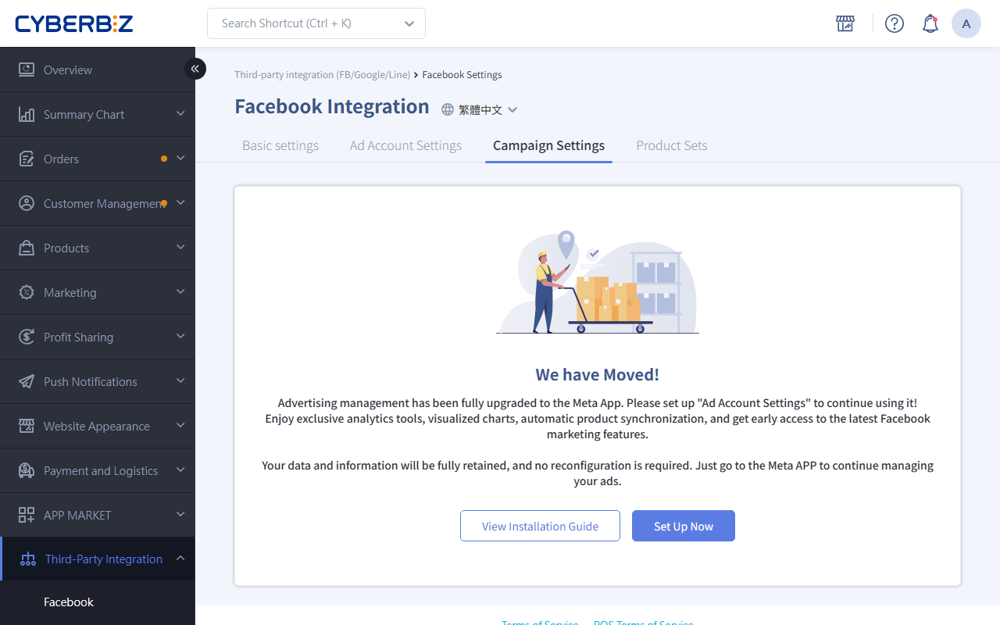

{ .hero-page }

## About the Meta Ads App { #overview-meta-ads }

The **Meta Ads App** is an add-on in the CYBERBIZ APP MARKET. It lets you create ads for your online store and run them on Meta platforms (Facebook, Instagram, and more) directly from your admin, and track ad performance at any time.

## Prerequisites { #prerequisites-meta-ads }

Before installing the Meta Ads App, complete the following steps in order. Otherwise, the system automatically redirects you to the related settings page:

- [x] **Connect [Meta Business Extension](../integrations/fb/mbe/setup-fbe-authorization.md){ title="Set Up FBE Account Authorization and Asset Connections" }**: Make sure your EC admin is connected to your Facebook assets (Page, Pixel, and catalog).
- [x] **Create a [Meta Ad Account](../integrations/fb/meta-ads/create-meta-ad-account-top-up.md){ title="Create a Meta Ad Account and Add Funds" }**: Create a dedicated ad account in the admin first.
- [x] **[Add Ad Funds](../integrations/fb/meta-ads/create-meta-ad-account-top-up.md#operate-meta-account-steps-ads){ title="Create a Meta Ad Account and Add Funds" }**: Add ad budget funds in the admin before you can start running ads.

## Installation Steps { #intro-meta-ads }

1.  **Open the Settings Page**: Log in to the CYBERBIZ admin and go to **Third-Party Integrations** > **Facebook Integration (Ads/Sign-Up and Login)** > **Campaign Settings**.
2.  **Start the Connection**: Click **Set Up Now** on the page.

    

3.  **Install the App**:
    *   On the Meta Ads description page, click **Install App**.
    *   *Note: If you have not connected the Business Extension or created an ad account, the system guides you to that settings page at this point.*

    

4.  **Confirm Authorization**: On the confirmation page, read and **agree to the privacy terms**, then click **Confirm Installation**.
5.  **Finish Installation**: After installation, use the admin path above and click **Go Now** to open the Meta Ads App and start [creating campaigns](../integrations/fb/meta-ads/setup-meta-ad-campaign.md#operate-meta-campaign-ads-flow){ title="Set Up Meta Ad Campaigns" }.

    

## Next Steps { #next-steps-meta-ads }

- :lucide-megaphone:{ .lg }
  [__Set Up Meta Ad Campaigns__](../integrations/fb/meta-ads/setup-meta-ad-campaign.md){ title="Set Up Meta Ad Campaigns" }
  Set up campaigns with the Meta Ads App and manage ad budgets, objectives, and creatives directly in your EC admin.

- :lucide-shopping-basket:{ .lg }
  [__Meta Ads Product Catalog__](../integrations/fb/meta-ads/setup-meta-ad-catalog-sets.md){ title="Set Up Catalog Product Sets for Meta Ads" }
  Set up the product sets for your ads. Filter specific products by tag, vendor, or type.

## FAQ { #faq-meta-ads }

??? quote "Will my existing ad data disappear after I switch to the Meta Ads App?"

    No. After you switch to running ads in the Meta Ads App, the ad data and settings you created on the EC platform are **kept**. Only where you manage them changes, and your ads keep running.

??? quote "What should I do if I see an error message during installation?"

    It depends on the type of error:

    - If you see `internal server error` or another system error message, try **reinstalling** first. If the problem continues, contact CYBERBIZ customer service for help.
    - If you see a permission error such as "You do not have permission to modify", contact CYBERBIZ customer service for help.

??? quote "Why can't I create ads after the app installs successfully?"

    If the app installs successfully but creating ads fails, it is usually related to Meta asset permissions. Try sharing the permissions with the CYBERBIZ Business Manager manually.

