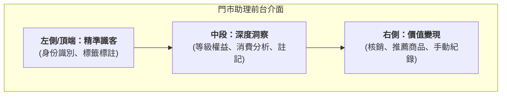

# Store Assistant
An OMO sales tool built for physical stores. It brings together your online store's member data and assets to help store staff recognize customers, gain deeper insights, and turn them into sales.
{ .subtitle }

[:lucide-tag:{ title="Applicable Plans" }](../../resources/conventions#適用方案) | All PLUS / Enterprise 
[:lucide-grid-2x2-plus:{ title="Applicable Add-ons" }](../../resources/conventions#適用擴充) | Store Assistant
{ .doc-badge }

Store Assistant connects your physical stores with your online store. On a tablet or phone, store staff can instantly see a member's purchase history across all channels and their available offers, turn walk-in shoppers into loyal fans, and use referral links to make sure every effort is credited through sales attribution.

---

## Interface Overview { #overview-storepal }

The Store Assistant frontend follows a sales flow that goes from simple to detailed and from left to right, with three main areas:

1.  **Customer Recognition (Left/Top)**: Quickly confirm who the customer is and see their tags.
2.  **Insights (Middle)**: See data on the customer's spending power, preferences, and current benefits.
3.  **Conversion (Right)**: Close the sale, including redeeming assets, generating referral links, or recording in-store purchases.

---

## Guides { #reference-storepal }

Choose the guide that matches what you need to do:

### Setup and Member Sign-Up { #reference-storepal-section }

- :lucide-user-plus:{ .lg }
  __Sign Up and Link Store Members__
  Guide customers to scan a QR code to sign up, and link them to store staff as their referrer. 
  [View Guide](search-and-create-members.md)

### Member Management and Data { #reference-storepal-member }

- :lucide-search:{ .lg }
  __01. Customer Recognition__
  Identify members and use tags. Quickly confirm VIP levels and understand customer traits. 
  [View Guide](member-identification.md)

- :lucide-bar-chart-3:{ .lg }
  __02. Data Insights__
  Analyze spending and benefits. Review past orders and carts to find potential needs. 
  [View Guide](member-data-warehouse.md)

- :lucide-shopping-cart:{ .lg }
  __03. Sales Conversion__
  Redeem assets and recommend products. Apply points or coupon discounts and generate referral links. 
  [View Guide](sales-conversion.md)

### Performance Tracking and Reports { #reference-storepal-report }

- :lucide-file-text:{ .lg }
  __View Store and Staff Sales Reports__
  Track referral sales, in-store purchase records, and individual performance. 
  [View Guide](view-sales-performance.md)

!!! info "Next Step"
    If this is your first time, start with [Search and Create Members](search-and-create-members.md) to learn how to bring customers into your OMO system.
