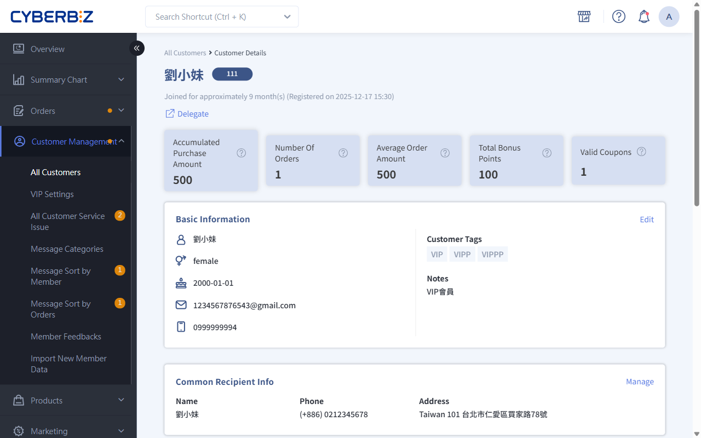

# Member Identification
Use Store Assistant to identify members quickly, understand their tags, and give personalized in-store service and greetings.
{ .subtitle }

[:lucide-tag:{ title="Applicable Plans" }](../../resources/conventions#適用方案) | All PLUS / Enterprise 
[:lucide-grid-2x2-plus:{ title="Applicable Add-ons" }](../../resources/conventions#適用擴充) | Store Assistant
{ .doc-badge }

!!! tip "Use Cases"
    - **Greet Customers Right Away**: When customers walk in, quickly check their VIP level and tags (such as regular customer or preferred product categories) and greet them warmly.
    - **Update Member Data on the Spot**: If you notice missing or incorrect information while talking with a customer, update it right away to keep marketing data accurate.

## How to Use { #operate-member-id }

This module is at the top of the interface. Use it to confirm member identity and sync traits collected in store.

{ .screenshot }

### View and Edit Basic Information { #operate-member-id-view-edit-data }

=== "Store Assistant Frontend"

	1. On the member information page, view basic details such as name, mobile number, gender, and birthday.
	2. Click the **Edit** icon in the upper-right corner to update member data other than the mobile number.

		> Mobile numbers are verified data, so store staff cannot change them.

	3. Click **Save Changes**.

	{ .screenshot }

=== "Store Assistant Admin"

	**Permission Settings**: Go to **Store Management**, select a store, click the **Roles and Permissions** tab, and set whether staff can **edit member basic information**.

	{ .screenshot }

=== "Online Store (EC) Sync"

	**Data Sync**: Data edited in the frontend is updated in **Customer Management > All Customers** in real time.

### Identify Member Tags { #operate-member-id-member }

=== "Store Assistant Frontend"

	1. The **Member Tags** selected and approved for display by headquarters appear below the member's name automatically.
	2. Store staff can use the tags to understand member traits quickly and offer matching service.

	{ .screenshot }

=== "Store Assistant Admin"

	**Choose What to Display**: Go to **設定 > 功能設定**, scroll down to the **Member Tags** section, and select the tags to show in the frontend (up to 10).

	{ .screenshot }

=== "Online Store (EC) Sync"

	**Tag Source**: Tags shown in the frontend come from the member tag system in the EC admin, which headquarters uses for retargeting.

	{ .screenshot }