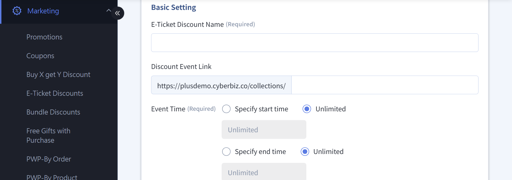
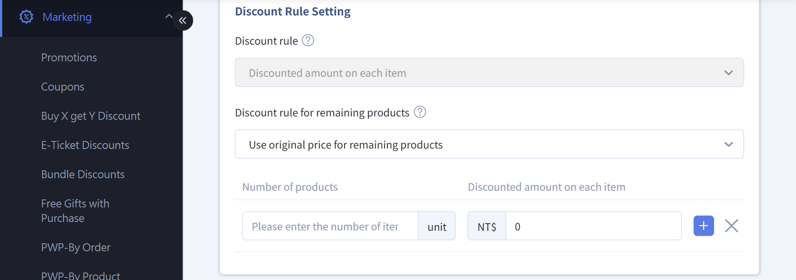

# Set up E-Ticket Promotions
Create mix-and-match discount promotions for e-tickets, set discount tiers and pricing rules, and learn how ticket refunds and payouts are calculated.
{ .subtitle }

[:lucide-tag:{ title="Available Plans" }](../../../resources/conventions#適用方案) | All PLUS / Enterprise
{ .doc-badge }

!!! info "Plan Differences"
    - On PLUS plans, "E-Ticket" is an optional module (choose 2 of 11). Make sure you have selected this module before using it. The Enterprise plan includes this feature.

{ .hero-page }

## About E-Ticket Promotions { #intro-ticket-promos }

### Limits and Scope { #prerequisites-ticket-promos-scope }

- E-ticket mix-and-match discounts **only support "a fixed amount off each item[^1]"**.  
- Each e-ticket product **can be added to only one mix-and-match discount group**.
- An e-ticket mix-and-match discount group name **can't be the same as a regular product mix-and-match discount group name**.
- Can't be combined with these marketing campaigns:
	- Store-wide discount
	- Coupon
	- Add-on purchase
	- Bonus redemption

[^1]: For example: buy any 3 e-tickets and get NT$50 off each.

---

### Promotion Period and Validity Period { #specs-ticket-promos-period }

If your e-ticket involves any of these situations, clearly state the validity period and redemption rules in the product description:

- Seasonal events, or a price difference is due after expiry
- Stock or quota limits
- Redeemable items have a price cap

!!! tip "Suggested Text Template"
    (NT$OOO is the ticket's price after discount)  
    :lucide-triangle-alert: This ticket's validity/promotion period ends on MM/DD/YYYY.  
    After the validity/promotion period ends, this ticket can only be redeemed for items priced at NT$OOO or less. If you order an item priced above NT$OOO, you must pay the difference when redeeming.  
    Item availability is subject to actual on-site supply.

??? example "Example"
	This ticket's validity/promotion period ends on October 31, 2022.  
	After the validity/promotion period ends, this ticket can only be redeemed for items priced at NT$120 or less. If you order an item priced above NT$120, you must pay the difference when redeeming. Item availability is subject to actual on-site supply.

	**Use cases:**

	- Customer A redeems the ticket on 2022/6/8 and gets one shaved ice.
	- Customer B redeems the ticket on 2022/12/14. The merchant no longer sells shaved ice in winter, so the customer can pay a difference of NT$20 and redeem one hot grass jelly dessert, originally priced at NT$140.

## Ticket Refund and Amount Calculation Rules { #specs-ticket-promos-refund }

### Basic Ticket Refund Rules { #specs-ticket-promos-refund-rules }

- Ticket refunds are processed per **single e-ticket code**.
- **Redeemed** e-tickets **can't be refunded**.
- If the order contains redeemed tickets:
	- Redeemed tickets count toward the used amount at their **original price**.
	- The actual refund may be lower than the customer expects.

---

### Refund Formula { #specs-ticket-promos-refund-formula }

The refund amount is calculated as follows:

`Refund amount = Amount paid for the order − (Redeemed tickets × Ticket unit price for calculation)`

Calculation rules:

- Redeemed tickets are always calculated at the **original price**.
- If the result is less than 0, the refund amount is **NT$0**.

---

### Refund Calculation Examples { #specs-ticket-promos-refund-example }

These examples show how refunds differ for **remaining items (tickets beyond the discounted quantity)** under different pricing methods.

=== "Example 1: Remaining Items at the Discounted Price"

	**Scenario**  

	- Original ticket price: NT$100  
	- Discount setting: Buy any 3, get NT$30 off each  
	- Quantity purchased: 5 tickets  
	- Order total: NT$350

	| Redeemed tickets | Refunded tickets | Refund amount | Calculation |
	|----------|--------|--------|---------|
	| 1 | 4 | NT$250 | `350 - (1 × 100)` |
	| 4 | 1 | NT$0 | `350 - (4 × 100) = -50`. The minimum refund amount is 0 |

=== "Example 2: Remaining Items at the Original Price"

	**Scenario**  

	- Original ticket price: NT$100  
	- Discount setting: Buy any 3, get NT$30 off each  
	- Quantity purchased: 5 tickets  
	- Order total: NT$410

	| Redeemed tickets | Refunded tickets | Refund amount | Calculation |
	|----------|--------|--------|---------|
	| 1 | 4 | NT$310 | `410 - (1 × 100)` |
	| 4 | 1 | NT$10 | `410 - (4 × 100)` |

## Payout Rules and Price Difference Calculation { #specs-ticket-promos-settlement }

### Payout Rules { #specs-ticket-promos-settlement-rules }

- E-tickets are **paid out after redemption**.
- When each ticket is redeemed, the system calculates the payout using the **actual discounted price**.
- If a ticket refund occurs, the system pays out the **discount difference** in the corresponding billing period.

---

### Price Difference Formula { #specs-ticket-promos-difference }

The system calculates the price difference payout with this formula:

`Price difference payout = Order total − Amount paid out − Refund amount`

- **Order total**: The total amount the customer paid (including discounts)
- **Amount paid out**: The amount the system has already paid to the merchant
- **Refund amount**: The amount already refunded to the customer

---

### Payout Calculation Example { #specs-ticket-promos-settlement-example }

**Scenario**

- Original ticket price: NT$100  
- Discount setting: Buy any 3, get NT$30 off each  
- Quantity purchased: 5 tickets  
- 2 of them are **remaining items (beyond the discounted quantity)** and are calculated at the discounted price  
- Order total: NT$350

| Redeemed tickets | Amount paid out | Refund amount | Price difference payout | Notes |
|----------|----------|--------|--------|------|
| 1 | 70 | 250 | 30 | `350 - 70 - 250 = 30` |
| 4 | 280 | 0 | 70 | `350 - 280 - 0 = 70` |

## Steps { #operate-ticket-promos }

### Create an E-Ticket Mix-and-Match Discount Group { #operate-ticket-promos-create-group }

1. Log in to the CYBERBIZ admin and go to **Marketing > E-Ticket Discounts**.
2. Click **New Ticket Discount**.
3. Fill in the basic settings:
	- **Ticket discount name** (can't be the same as a regular product discount group)
	- **Discount campaign URL**
	- **Campaign period**
4. [Set pricing and discount rules](#operate-ticket-promos-pricing)
5. Enter the discount description and click **Save**.

---

### Set Pricing and Discount Rules { #operate-ticket-promos-pricing }

- **Pricing rule**: Only **Discounted amount on each item** is supported.
- **Pricing for remaining items**:
	- At original price: Tickets beyond the discounted quantity aren't discounted.
	- At discounted price: The discount applies to all tickets.
- **Item quantity and discount per item**: Set "buy any N, get M dollars off each".
	- Click :lucide-plus: to set multiple discount tiers, such as buy any 2 and get NT$10 off each + buy any 3 and get NT$15 off each.

!!! note "**Remaining items** are tickets not counted toward the mix-and-match discount condition (that is, tickets beyond the discounted quantity)."

---

### Add E-Tickets to a Discount Group { #operate-ticket-promos-add }

1. In the **E-Ticket Discount List**, click the name of the discount you created to open its edit page.
2. Switch to the **Select E-Ticket** tab.
3. Select the e-tickets you want to add, click the action menu, and select **Add**.

	!!! warning "Each e-ticket product can be added to only one discount group. If you add it to another group, the settings can't be saved."

4. Check that the tickets appear in the **Selected E-Tickets** list below. Setup is complete.
5. Click **Remove Discount** to remove the discount from a ticket.

## FAQ { #faq-ticket-promos }

??? quote "Can one e-ticket be added to multiple mix-and-match discount groups?"
	No. Each e-ticket product **can be added to only one mix-and-match discount group**. If you try to add the same ticket to multiple groups, the system can't save the settings.

??? quote "Can e-ticket mix-and-match discounts be used with a coupon or bonus redemption?"
	No. E-ticket mix-and-match discounts **can't be combined with these marketing campaigns**:

	- Store-wide discount
	- Coupon
	- Add-on purchase
	- Bonus redemption

??? quote "What are “remaining items”?"
	**Remaining items** are **e-tickets beyond the mix-and-match discounted quantity**. For example, with "buy any 3, get NT$30 off each", if a customer buys 5 tickets, the 4th and 5th tickets are remaining items.

??? quote "Are remaining items always calculated at the original price?"
	Not necessarily. It depends on the discount group settings. When you set the discount rules, you can choose one of these pricing methods:

	- **At original price**: Only tickets within the discounted quantity get the discount.  
	- **At discounted price**: The discount applies to all tickets (including remaining items).

??? quote "Why are redeemed tickets calculated at the original price for ticket refunds?"
	To keep **ticket refund and payout calculations consistent**, all redeemed e-tickets count toward the used amount at their **original price** when the refund is calculated. So if some tickets in the order have already been redeemed, the actual refund may be lower than the customer expects.

??? quote "What happens if the calculated refund amount is less than 0?"
	If the formula gives a refund amount less than 0, the system uses **NT$0** as the refund amount. Refunds are never negative.

??? quote "When are e-ticket payments paid out to the merchant?"
	E-tickets use a **payout after redemption** model:

	- When each ticket is redeemed, the system pays out the **actual discounted price**.  
	- If a ticket refund occurs later, the system **pays out the discount difference** in the corresponding billing period.

??? quote "What is a “price difference payout”?"
	A **price difference payout** is when, after a ticket refund, the system recalculates the difference between the **order total** and the **amount paid out**, and pays it to the merchant in the billing period.  

	The calculation is: `Price difference payout = Order total − Amount paid out − Refund amount`
