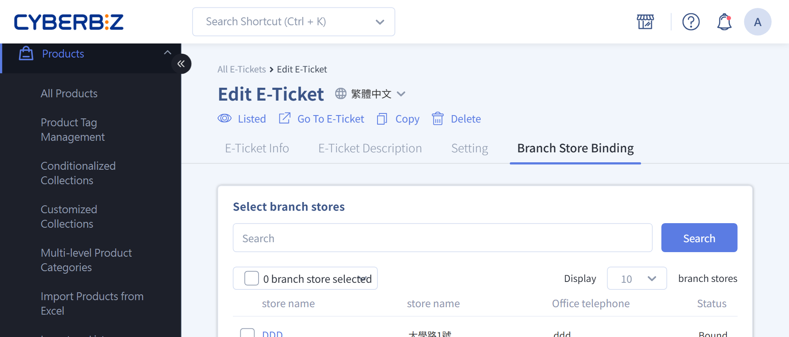
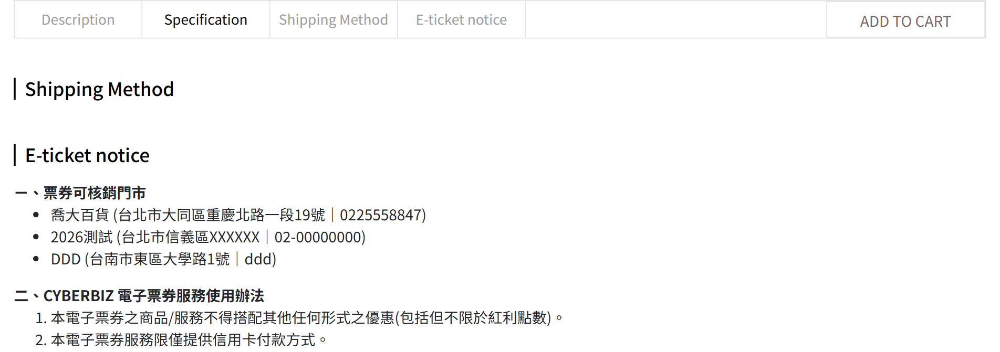

# Set up E-Ticket Store Permissions
Set e-ticket redemption permissions and binding rules for different stores and partner brands, and manage store staff accounts.
{ .subtitle }

[:lucide-tag:{ title="Available Plans" }](../../../resources/conventions#適用方案) | All PLUS / Enterprise
{ .doc-badge }

!!! info "Plan Differences"
    - On PLUS plans, "E-Ticket" is an optional module (choose 2 of 11). Make sure you have selected this module before using it. The Enterprise plan includes this feature.

{ .hero-page }


## About E-Ticket Store Permissions

E-ticket store management mainly supports OMO setups between a merchant and its "partner brands". Customers buy tickets online and then redeem them at specific physical stores. The store permissions and management rules are as follows:

## Partner Brands and Staff Permissions

**Partner brand definition**:  
If you work with other brands, you can create store accounts for each partner brand in the admin and limit their user permissions, so they can only operate on ticket products related to their own brand.

**Store staff permissions**:  
Accounts assigned as store staff have the following permissions:

- View ticket orders **bound to that store**.  
- Redeem tickets bound to that store.
- View that store's own redemption records.


## Store Permission Differences

Store permissions come in two types: "General Store" and "Management Store". They differ only in **the scope of redemption records they can view**. This does not affect which tickets they can actually redeem.

- **General Store**: Can view only the redemption records of that store. Other stores' redemption records are hidden.
- **Management Store**: Usually used by a partner brand's head office or regional management unit. Can view the redemption records of all sub-stores under that partner brand.

|**Feature**|**General Store**|**Management Store**|
|---|---|---|
|**View ticket orders**|Bound tickets only|Bound tickets only|
|**Redeem tickets**|Bound tickets only|Bound tickets only|
|**View redemption records**|Redemption records of **that store only**|Redemption records of **all bound tickets** at each store|

!!! info "To learn more, see [Example 1: Permission Differences Across Stores](#Example-1-Permission-Differences-Across-Stores)"

## Binding E-Tickets to Stores

### What Is Binding

Binding links an e-ticket product to specific stores. It determines which stores can redeem the ticket.

---

### Binding Rules

E-tickets and stores support many-to-many binding:

- One e-ticket product can be bound to multiple stores.
- One store can be bound to multiple ticket products.

---

### Binding Changes

When the binding between an e-ticket and a store changes, the system uses the setting "Allow sold tickets to still be redeemed at the originally bound store" to decide what happens next.

- **Add binding**: Newly bound stores can redeem tickets that were already sold.  
- **Unbind**: The system asks whether sold tickets can still be redeemed:
	- **Yes** → Existing ticket holders can still redeem. Newly sold tickets can't.  
	- **No** → No ticket holder can redeem at that store.

!!! info "To learn more, see [Example 2: Binding Changes When a Store Is Temporarily Closed](#Example-2-Binding-Changes-When-a-Store-Is-Temporarily-Closed)"

## Bind E-Tickets to Stores

You can bind tickets to stores in either of these two admin locations.

- [**Ticket product side**](#From-the-Ticket-Product-Edit-Page): Admin > Products > E-Ticket List > select a ticket > "Branch Store Binding".  
- [**Store side**](#From-the-Store-Edit-Page): Admin > Payment and Logistics > Store Pickup Settings > Edit > "Eticket Binding Setting".

### From the Ticket Product Edit Page

1. Log in to the CYBERBIZ admin and go to **Products > E-Ticket List**.
2. Click the ticket you want to edit.
3. Switch to the **Branch Store Binding** tab and select the stores.
4. Click the action menu and select **Bind**, or click the corresponding button.


---

### From the Store Edit Page

1. Log in to the CYBERBIZ admin and go to **Payment and Logistics > Store Pickup Settings**.
2. Select the store you want to edit and click **Edit**.
3. Switch to the **Eticket Binding Setting** tab and select the tickets.
4. Click the action menu and select **Join Binding**, or click the corresponding button.


## Unbind Tickets

When you unbind, the system asks whether sold tickets can still be redeemed at the original store.

**Steps**

1. Log in to the CYBERBIZ admin, go to **Products > E-Ticket List**, and select the ticket you want to unbind.
2. Click the name of the ticket to open its edit page.
3. Switch to the **Branch Store Binding** tab.
4. Clear the stores you want to unbind, click the action menu, and select **Unbind**.
5. In the confirmation window, choose whether sold tickets can still be redeemed at the original store:

    - **Select "Yes"**: Sold tickets can still be redeemed. Newly sold tickets can't. (Recommended, to reduce customer complaints)  
    - **Select "No"**: No sold ticket can be redeemed at that store.


## Set up a Management Store

1. Log in to the CYBERBIZ admin and go to **Payment and Logistics > Store Pickup Settings**.
2. Select the store you want to edit and click **Edit**.
3. Switch to the **Eticket Binding Setting** tab and turn on **ETicket management store**.


## Create E-Ticket Store Staff Accounts

!!! info "Store staff can only use the **E-Ticket Redemption List** and the **Redemption Page**. They can't change ticket settings or other permissions."

1. Log in to the CYBERBIZ admin and go to **Website Management > User Account Settings > Manager List**.
2. Click **New Branch Store Manager**.
3. Under the **Branch Store** type, select **E-Ticket Store**. E-ticket store staff permissions are system defaults and can't be changed[^1].
4. Enter the store staff member's user information. **Store staff** and **e-ticket store staff** are different roles and need separate accounts[^2].
5. Click **Add** to finish.

[^1]: If you try to change them, the system shows the message "Branch store user permissions cannot be changed".
[^2]: Use a different account and password.


## Storefront Display and Redemption

Customers can see the redemption store information of ticket products on the storefront.

- **Ticket product page**: Shows the list of stores where the ticket can be redeemed.



- **Member e-ticket order lookup**: After logging in, members can see the redemption stores in **My Account > E-Ticket Order Inquiry**.


## Examples

### Example 1: Permission Differences Across Stores

This example shows how store roles under the same partner brand differ in which redemption records they can view.

**Scenario**

- Merchant A partners with brands X, Y, and Z to launch SPA e-tickets.
- After buying an e-ticket on Merchant A's official website, customers can redeem it at physical stores of brands X, Y, and Z.
- Brand X has 3 physical stores (X-1, X-2, X-3) and 1 head office store, and sets the head office as a **Management Store**.
- The "Full-Body Aromatherapy Massage 60 Minutes" e-ticket is bound to all 4 stores of brand X.

**Permission differences**

- **Management Store (head office)**:  
    Can view the ticket's redemption records at all bound stores.
- **General Stores (X-1, X-2, X-3)**:  
    Can view only their own redemption records, not the redemption status of other stores.

??? note "Diagram: Redemption Record Permissions Across Stores"
	```mermaid
	graph TD
	    A["Management Store (Head Office)"] -->|Can view all redemption records| B[Store X-1]
	    A -->|Can view all redemption records| C[Store X-2]
	    A -->|Can view all redemption records| D[Store X-3]
	```

---

### Example 2: Binding Changes When a Store Is Temporarily Closed

This example shows the real impact of changing store bindings when a store is temporarily closed.

**Scenario**

- The "Full-Body Aromatherapy Massage 60 Minutes" e-ticket is bound to stores X-1, X-2, and X-3, and 100 tickets have been sold.
- Store X-1 is temporarily closed, so the merchant needs to change the ticket's binding with store X-1.

**Options and impact**

When unbinding, the merchant can choose one of these options:

- **Option A: Don't allow sold tickets to be redeemed at the originally bound store**

    - Store X-1 stops all redemptions immediately.  
    - Customers who already hold tickets must use them at other stores, which may increase complaints.

- **Option B: Allow sold tickets to still be redeemed at the originally bound store** (recommended)

    - Sold tickets can still be redeemed at store X-1.
    - Newly sold tickets no longer apply to store X-1. This reduces disputes and the customer service workload.

## FAQ

??? quote "Can store staff permissions be changed?"
    "E-ticket store staff" permissions are fixed and can't be changed. If you try to change them, a warning appears after saving: "Branch store user permissions cannot be changed".

??? quote "How many stores can one e-ticket be bound to?"  
	One e-ticket product can be bound to **multiple stores**. Once binding is set up, the ticket can be redeemed at all bound stores.

??? quote "Can one store be bound to multiple e-tickets?"  
	Yes. One store can be bound to **multiple e-ticket products** at the same time and redeem those tickets.

??? quote "What is the difference between a General Store and a Management Store?"  
	The difference is **the scope of redemption records they can view**:  

	- A General Store can view only **its own** redemption records.  
	- A Management Store can view the redemption records of **all bound stores**.

??? quote "Can a Management Store redeem tickets for all stores?"
	No. A Management Store only has **a wider view of redemption records**. The tickets it can actually redeem are still limited to **tickets bound to that store itself**.

??? quote "Can sold e-tickets be used after a new store binding is added?"  
	Yes. After you bind an e-ticket to a new store, **tickets that were already sold** can also be redeemed at the newly bound store.

??? quote "Can sold e-tickets still be redeemed after a store is unbound?"  
	It depends on your setting. When you unbind, the system asks whether sold tickets can still be redeemed at the original store:  

	- Select "Yes": Sold tickets can still be redeemed. Newly sold tickets can't.  
	- Select "No": No ticket can be redeemed at that store.

??? quote "Can store staff and e-ticket store staff use the same account?"  
	No. "Store staff" and "e-ticket store staff" are **different user roles**. You must create separate accounts. They can't be shared.
