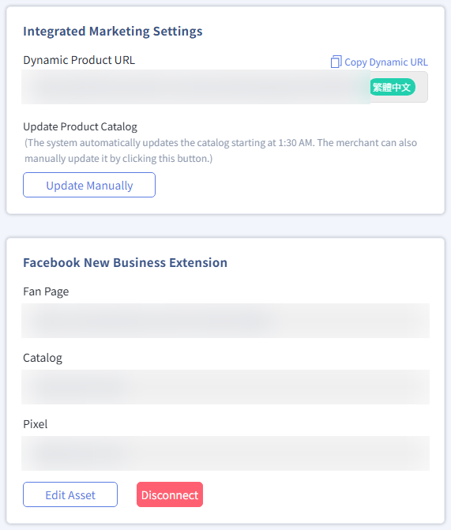
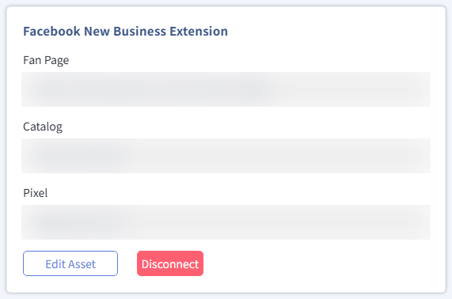

{ .hero-page }

## About the Facebook Business Extension

"**Facebook Business Extension**" (Facebook Business Extension, FBE) can connect **Conversions API**, **Facebook Pixel**, **Product Catalog**, **Instagram Shopping**, and **Facebook Page** assets at once. This helps merchants link these assets to the online store admin quickly and manage ad tracking, audience building, and product promotion in one place.

## Setup Path

1. Log in to the CYBERBIZ admin and click "**Third-Party Integrations** > **Facebook Settings (Ads / Sign-Up and Login)**".
2. Scroll to the bottom of the page, find the "Facebook New Business Extension" section, and click "**Start Setting**" to start the process.


## Step-by-Step Guide

!!! tip "Permission Check"

    - Before you start setup, we recommend checking your current [Business Manager status](#企業管理平台與廣告帳號){ data-preview }.
    - If you run into permission issues during setup, make sure your account is the owner of the asset or has sufficient admin permissions.

1.  **Log in to Facebook:** If your browser is not logged in, the system asks you to log in. Make sure the account has the [relevant asset setup permissions](#核心資產權限邏輯){ data-preview } in the Business Portfolio.

    

    !!! warning "Check Whether Your Browser Blocks Pop-ups"
        If the page does not redirect properly, make sure your browser has not blocked pop-ups. Setup guide: [Allow Pop-ups for Specific Sites in Chrome :lucide-external-link:](https://support.google.com/chrome/answer/95472?hl=zh-TW)

2.  **Grant Consent:** Click **Authorize** to allow CYBERBIZ to connect your online store data with your Facebook data. This does not affect your daily operations.

    

3.  **Link Business Assets:** Click an asset to choose the Facebook Page, catalog, ad account, and Pixel to connect.
    *   **Important:** The assets you select must [belong to this Business Portfolio](#核心資產權限邏輯){ data-preview }. Otherwise, you cannot select them correctly.
    *   You can also create new assets in this step.
    *   We recommend turning on "[Automatic Advanced Matching](#進階配對設定-advanced-matching){ data-preview }" for the best ad performance. (A Facebook Page must already exist.)

    === "Link Assets"
        
    === "Create New Asset"
        

4.  **Confirm Permissions:** If this step shows a required-field message or similar UI prompt, it is a display issue in the system. Click "Next" to continue.

    

5.  **Finish Linking:** Wait for the connection to complete, then click "Done." The system automatically returns you to the CYBERBIZ admin settings page.

    

## Post-Setup Checks and Maintenance

*   **Verify Connection Status:** Return to the admin page to confirm the linked Facebook Page, pixel, and catalog.
*   **Edit or Cancel:** To set up again or clear your settings, click "Edit Assets" or "Unlink."  
    - *Note: To do this, you must log in with **the same Facebook account you used for the initial setup***.



## Permission Details

### Business Manager and Ad Accounts

Before you connect, check your current situation and choose the matching action:

| Current Status | Recommended Action |
|------|-------------|
| **Already Have a Business Manager** | Connect directly to the CYBERBIZ admin using this Business Manager. Make sure the assets you want to connect, such as ad accounts, **must be owned by this Business Manager**. |
| **No Business Manager, but Previously Owned an Ad Account** | We recommend creating a Business Manager from that ad account first, then connecting it. <br>*Reason:* Pixels created under past ad accounts retain audience data, which directly affects the results of future ad campaigns. |
| **Neither** | You can create everything at once through the CYBERBIZ Business Extension. The system creates a Business Manager, Facebook Page, Instagram account, product catalog, ad account, and pixel at the same time. |

??? note-clean "Business Manager Connection Process"
    ```mermaid
    graph LR
        Q1{Already own<br/>Business Manager?}
        Connect[Via Business Extension<br/>Link Business Manager]
        Create[Create Business Manager]

        Q2{Already own<br/>Ad Account?}
        CreateViaAd[Create via ad account]
        CreateViaCyber[By CYBERBIZ<br/>Create via Business Extension]

        Q1 -- Yes --> Connect
        Q1 -- No --> Create

        Create --> Q2

        Q2 -- Yes --> CreateViaAd
        Q2 -- No --> CreateViaCyber

    ```

!!! info "Learn more about [How to create a Business Portfolio in Meta Business Suite :lucide-external-link:](https://zh-tw.facebook.com/business/help/1710077379203657)."

---

### Core Asset Permission Logic

Facebook asset management uses a **hierarchy**:

*   **Ownership Restriction:** A Business Manager manages all brand assets. If a "Facebook Page" or "Pixel" is **not owned by this Business Manager**, it cannot be selected in the setup flow.
*   **Key Checks:** Make sure the Facebook account you log in with has admin permissions for this Business Manager and its assets.

!!! info "Learn more about [Business Portfolios and Business Asset Permissions :lucide-external-link:](https://zh-tw.facebook.com/business/help/442345745885606)."

---

### Advanced Matching Settings <small>Advanced Matching</small>

This is an important permission setting for improving ad performance. We recommend checking it during setup:

*   **Automatic Advanced Matching (recommended):** No code is required. You can turn it on directly in "Events Manager" to help track audiences more accurately.
*   **Manual Advanced Matching:** A developer must modify the base pixel code to send website visitor data through parameters.

!!! info "Learn more about [Website Advanced Matching :lucide-external-link:](https://zh-tw.facebook.com/business/help/611774685654668?id=1205376682832142)."

<!--
*   **Conversions API (CAPI):** After setup, the system automatically starts sending server-side (Server to Server) pixel events. Go to [Meta Events Manager :lucide-external-link:](https://eventsmanager.facebook.com/) to check whether the connection method shows "Server."
-->

## Next Steps

<div class="grid cards" markdown>

- :lucide-shield:{ .lg }   
  [__Domain Verification and Event Setup__](setup-fbe-domain-verification.md)       
  After you finish linking FBE assets, complete domain verification before setting up event tracking to ensure accurate ad conversion data.

</div>

## FAQ

??? quote "What permissions do I need to set up FBE?"

    You need admin permissions for the Facebook Business Portfolio, either as an asset owner or with sufficient setup permissions. Without these permissions, you cannot correctly select the assets to link.

??? quote "How do I edit or remove linked assets?"

    Go back to the CYBERBIZ admin and click "Edit Assets" to choose the Facebook Page, catalog, ad account, and pixel again. To remove all links, click "Unlink." When you do either of these, you must log in with the same Facebook account you used for the initial setup.

??? quote "Why can't I find the Pixel I want to link?"

    The Business Manager you are using may not have been upgraded from a personal ad account, or you may not own the pixel. We recommend creating a new pixel and using your own pixel.

??? quote "Why am I not receiving permission invitations from an agency?"

    The Facebook Page's permissions may still be held by a past agency. You need to withdraw those permissions from the agency before you can set up again.

??? quote "What should I do if the page does not redirect properly?"

    If the page does not redirect properly, make sure your browser has not blocked pop-ups. For Chrome settings, see [Google's official instructions :lucide-external-link:](https://support.google.com/chrome/answer/95472?hl=zh-TW).

