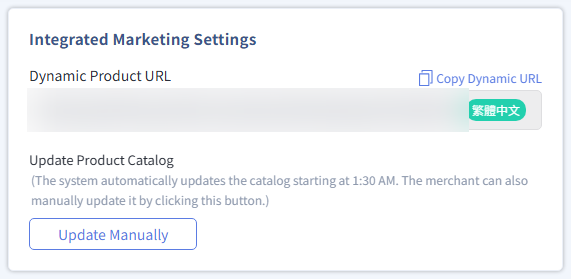

{ .hero-page }

## Meta Ad Catalog Set Overview

The **Meta Ad Catalog Set** feature lets merchants filter specific product sets directly from the CYBERBIZ back office for special promotions or specific sales needs, and precisely run them in Meta's [catalog ads or image ads](setup-meta-ad-campaign.md#廣告呈現效果){ title="Set Up a Meta Ad Campaign" }.

## Prerequisites and Restrictions

Before you add a product set, make sure you complete the following:

- [x] **[Reconnect FBE](../mbe/setup-fbe-authorization.md){ title="Set Up FBE Account Authorization and Asset Linking" }**: Due to Meta feature updates, merchants must reconnect the "New Facebook Business Extension" at least once.
- [x] **[Create and Top Up an Ad Account](create-meta-ad-account-top-up.md){ title="Create a Meta ad account and add ad funds" }**: Create an ad account and add ad funds before you set up delivery.

## Steps to Add a Catalog Product Set

1.  **Access Meta Ads App**: Log in to the CYBERBIZ admin, then go to **Third-Party Integration > Facebook > Product Set**.

    - If not yet connected: Click "Connect Now" to initialize (see [Install Meta Ads App](../../../app-market/install-meta-ads-app.md){ title="Install Meta Ads App" }).
    - If already connected: Click "**Go Now**."

2.  **Start Creating**: Click Catalog Product Sets > Create Catalog Product Set in the left navigation menu.

    

3.  **Name and Add**: Enter "Catalog Product Set Name," click "Add Products," and select how to add products:

    - **Quick Add**: Directly select the system-calculated TOP 10 / 20 / 50 popular products.
    - **Custom Product Selection**: Click it to open the advanced filter interface.

    

4.  **Filters and Limits**: If you select "Custom Product Selection," filter products precisely with the following logic:

    - **Flexible Filtering**: First, switch the scope to All Products or Popular Products, then search by type, tag, vendor, or keyword.
    - **Selection Limits**: You can only select products whose status is "Public" and "Listed."
    - **Automatic Exclusion**: Products tagged "Gift" or "Exclude product feed" can't be selected. Learn how to set up exclusion tags in [How to Set Up Product Exclusion Tags](../../../products/categories-and-tags/manage-product-tags.md#排除上傳至第三方平台標籤){ title="Manage Product Tags" }

    

    !!! info "For filter logic, see [Product Filter Settings in the Back Office](../../../products/create-and-manage/product-management-interface.md#篩選器使用邏輯){ title="Manage Products" }."

5.  **Confirm and Save**: Check that the product list is correct, click "Confirm Add" in the bottom-right corner, then click "Save" to finish creating the set.
6. **Manage and View**: After you save, view, edit, or delete the sets you created in the list on the Catalog Product Sets home page.

    

## Product Sync and Troubleshooting

### Manually Update the Catalog

If you just updated product data in the back office, the change may not appear in Meta right away. If selecting products causes an update to fail, follow these steps to manually update the catalog:

1.  **Access the Operation Page**: Log in to the CYBERBIZ admin, then go to **Third-Party Integration > Facebook > Basic Setting**.
2.  **Run a Manual Update**: In the "Product Catalog" section, click "Manual Update." The system immediately pushes the latest product data to Meta.

---

### Update on the Meta Side

If the sync still fails after you update on the CYBERBIZ side, you can also go to Meta Business Manager to force a data source update:

1.  **Access Meta Business Manager**: Log in to [Meta Business Manager](https://business.facebook.com/commerce_manager), then click the target catalog.
2.  **Select the Data Source**: After you open the target catalog, click **Catalog > Data Source**.
3.  **Request an Update**: Click "**Update**" to force a sync of product data.

## Use in Ad Campaigns

After you create a catalog product set, you can create ads based on it:

1.  In the **Campaign** tab in Meta Ads App, click "**Create Campaign**."
2.  In **Ad Creative Settings**, select the product set you just created in the "**Catalog Product Set**" field.
3.  You can also pair this with Meta's Advantage+ Shopping Campaign (ASC) to let AI automatically optimize audiences and placements.

## Next Steps

- :lucide-package-x:{ .lg }   
  [__Exclude Product Sync__](../../../products/categories-and-tags/manage-product-tags.md#排除上傳至第三方平台標籤){ title="Manage Product Tags" }       
  If you don't want a specific product to sync to Meta, add "Gift" or "Exclude product feed" to its tags. The system excludes it automatically.

- :lucide-rocket:{ .lg }   
  [__Create Ad Campaign__](./setup-meta-ad-campaign.md){ title="Set Up Meta Ad Campaign" }       
  After you finish setting up the catalog product set, create a Meta ad campaign. Choose "Catalog" or "Image" as the creative source to run ads.

## Frequently Asked Questions

??? quote "Which products can't be added to a catalog product set?"

    - Products whose status is not "Public" or "Listed"
    - Products tagged "Gift" or "Exclude product feed"

??? quote "How long after a catalog product set is created does it sync to Meta?"

    The system syncs automatically. If the change doesn't appear right away, go to "[Manually Update the Catalog](#手動更新目錄)" to force an update.

??? quote "How do I confirm that products have synced to the Meta catalog?"

    When you create an ad campaign, if you can select the products in "Catalog Product Set," they have synced successfully. You can also check the catalog data in [Meta Business Manager](https://business.facebook.com/commerce_manager).

