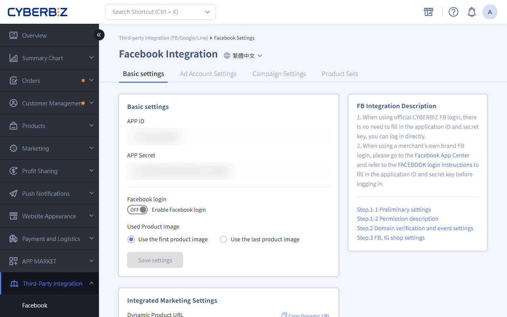
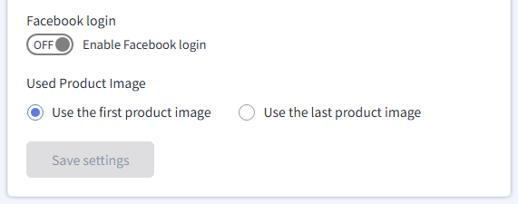

{ .hero-page }

## Facebook Quick Login Overview { #overview-facebook-quick }

**Facebook Quick Login** lets customers register or sign in to their member account on the "Member Registration" or "Checkout" page with their Facebook account. The system automatically retrieves the email address linked to their Facebook account and uses it as their account, then links the data to the storefront customer list, making it easier for merchants to filter audiences later.

## Before You Begin { #operate-facebook-quick }

- [x] **URL security:** Your storefront URL must have an **SSL certificate** (it must start with https://).
- [x] **Business verification:** The Meta Business Suite you use must first complete [verification :lucide-external-link:](https://www.facebook.com/business/help/159334372093366).
- [x] **Domain redirect:** In the admin's "Domain Management" page, make sure the domain selected for "[Always redirect customers here](../../website-management/domain-management.md#operate-domain-mgmt-add){ title="Domain Management" }" is the domain set in Facebook.
- [x] **Email restriction:** If customers use a Hinet email address, Hinet may block messages, so they might not receive system notifications such as password reset emails. We recommend asking them to use a different email address.
- [x] **Account merging:** If a customer's Facebook email address matches the one used for Google or LINE sign-in, the system automatically treats them as the same member and performs an **account merge**.

## Quick Login Settings { #operate-facebook-quick-settings }

Merchants can choose the "Default icon" or "Custom icon" to set the store logo shown on the login screen, based on their needs:

=== ":lucide-zap: Default Icon"

    

=== ":lucide-wrench: Custom Icon"

    

!!! note "The custom icon and default icon differ only in how the icon is displayed on the storefront."

### Use the Default Icon <small>Fastest</small> { #operate-facebook-quick-settings-use }

*   **Admin path:** "Third-party Integration" > "Facebook Settings (Ads / Registration & Login)".
*   **Steps:** Turn on "**Enable Facebook login**", then click "Save Settings" to finish. The storefront will display the system's default login button.

---

### Use a Custom Icon <small>Requires Creating a Meta App</small> { #operate-facebook-quick-settings-use-create-meta }

This method requires creating an app through **Meta for Developers**. It suits merchants who want to customize the login icon and collect more complete audience information.

!!! warning "Prerequisite: Register a Meta Developer Account"
    Before you create an app, complete [**Meta for Developers Account Registration** :lucide-external-link:](https://developers.facebook.com/docs/development/register). After you register, go to the Apps page to create your app.

#### Create an App { #operate-facebook-quick-settings-create }

1. Go to [Meta for Developers :lucide-external-link:](https://developers.facebook.com/apps/) and confirm that you are signed in to your developer account.
2. Click "**Create App**".
3. Enter a "Display Name" (the store name customers see when signing in) and click "**Continue**".
4. Select "**Authenticate and request data from users with Facebook Login**" as the use case.
5. Choose whether to connect a "[Business Portfolio :lucide-external-link:](https://www.facebook.com/business/help/486932075688253)" (if no option is available, select "I don't want to connect a Business Portfolio yet").
6. Follow the on-screen prompts to complete the [business verification](#operate-facebook-quick-settings-verification-bus) and [app review](#operate-facebook-quick-settings-app-review) requirements.
7. Review the overview and click "**Create App**" to finish.

{ .screenshot }

---

#### Set up the Facebook Login Product { #operate-facebook-quick-settings-settings-faceboo }

1. After the app is created, you are automatically taken to the App Dashboard.
2. In the "App Customization and Requests" section, click "Customize the use case" for "Authenticate and request data from users with Facebook Login."

    { .screenshot }

3. Go to the "Permissions and Features" tab and click the "Add" button next to `email` and `public_profile` to create the related permissions.

    { .screenshot }

4. Switch to the "Settings" tab and set a valid OAuth redirect URL. Keep the default values for other settings.

    !!! tip "Check your domain type first"

        Confirm your domain type so you can build the correct **OAuth redirect URL**. Admin path: **Website Management > Domain**.

        Based on your domain type, append `/customer/auth/facebook/callback` to the end of your domain:

        - **Custom domain:** `https://www.your-domain.com/customer/auth/facebook/callback`
        - **CYBERBIZ domain:** `https://your-store.cyberbiz.co/customer/auth/facebook/callback`

    !!! warning "After you enter the URL (press ++enter++), check whether it has automatically converted into a **blue tag** format. If it has not been converted, the URL will not take effect."

    { .screenshot }

5. Click **Save** to apply your changes.

---

#### Enter Basic App Information { #operate-facebook-quick-settings-data }

1. In the left menu, click "App Settings" > "Basic".
2. Enter the following fields:
    - **App Domains**: Enter your storefront's **custom domain**.
        - **Format requirement**: When you enter the URL, do not add the `https://` prefix.
          -  If your URL is `https://example.com`, enter `example.com`
        - **Subdomain compatibility**: If your URL includes the `www` subdomain, enter the root domain and the `www` subdomain separately.
          -  Root domain: `example.com`
          -  Subdomain: `www.example.com`
    - **Privacy Policy URL:** Enter the URL of your storefront's privacy policy page (it must be linked from the homepage). For example: `https://test.cyberbiz.co/pages/privacy`
    - **Terms of Service URL:** Enter the URL of your storefront's terms of service page (it must be linked from the homepage). For example: `https://test.cyberbiz.co/pages/terms`
    - **Data Deletion Instructions URL:** Select "Data Deletion Instructions URL" and usually enter the privacy policy page URL.
    - **App Icon:** Upload your store logo (1024x1024 pixels recommended).
    - **Category:** Select an app category, such as Business and Pages.
3. Click "Save Changes".

!!! warning "Check Required Information"
    If required information is missing, the eligibility message lists the missing items. Make sure all requirements are met.

{ .screenshot }

---

#### Get Permissions and Verification { #operate-facebook-quick-settings-permissions-veri }

After you complete the basic settings, you must finish "Business Verification" and "App Review" before you can publish the app. You can check the status of both on the App Dashboard.

{ .screenshot }

---

##### Business Verification { #operate-facebook-quick-settings-verification-bus }

1. On the dashboard, click "Business Verification." The system will guide you to connect a "Business Portfolio" to complete verification.

    { .screenshot }

2. If you do not have a Business Portfolio yet, create one first. Click "Create Business Portfolio" and fill in the following:
    - **Business name**: Enter your brand or company name
    - **Contact information**: Enter your name and email address to create an admin account for Meta Business Suite.

    

3. Select the Business Portfolio you created and click **connect** to link it. If the portfolio has not been verified, the page will guide you to the verification screen.

    

4. Click **Start Verification** to enter the verification process and follow the on-screen prompts. After verification is complete, your Business Portfolio status will show as "Verified".

    

5. Return to the app page, click "Connect Business Portfolio," select the verified Business Portfolio, and confirm the connection.

---

##### App Review { #operate-facebook-quick-settings-app-review }

7. After business verification is complete, click "App Review" to submit your app for review.
8. For the permissions you need (such as `email` and `public_profile`), provide the relevant data usage details:
    - Explain why your app needs access to this data
    - Provide the privacy policy URL
    - Explain how the data is stored and used
9. After you submit, wait for Meta to approve the review (usually 1-3 business days).

!!! tip "Check Verification and Review Status"
    Check the status of "Business Verification" and "App Review" anytime on the dashboard. Once both show "Completed" or "Approved," you can publish the app.

---

#### Integrate Data to CYBERBIZ { #operate-facebook-quick-settings-connect-data-cyb }

1. On the "Basic" page, get the **App ID** and **App Secret** (click "Show" to view the App Secret).

    

2. Return to the CYBERBIZ admin and go to "Third-party Integration" > "Facebook Settings (Ads / Registration & Login)".
3. Paste both values into the matching fields and turn on Facebook Login.

    { .screenshot }

4. Click "Save Settings" to apply your changes.

## Common Issues and Solutions { #specs-facebook-quick }

### Check the App Status { #specs-facebook-quick-status }

Facebook periodically reviews and updates apps, so we recommend that merchants regularly check the settings on the Meta for Developers Apps page:

1. **Check alert messages**: Look for alert messages at the top of the page.
2. **Check your inbox**: Click "Notification Inbox" on the left to check for settings that need updating. You can follow the on-screen steps to complete them.

    

3. **Common errors**:
      - **"Annual Data Check" not run and disabled**: Follow the prompts to complete the settings.
      - **"Policy violation"**: Click "Submit Appeal" to request a re-review from Facebook, and follow the prompts to complete the settings.
4. **Check the API version**: Go to "App Settings" > "Advanced" and check whether the API version is outdated.

    

---

### Unable to Get Email Permission { #specs-facebook-quick-permissions }

Check whether the `email` permission of your app is set to the "Advanced Access" level.

## FAQ { #faq-facebook-quick }

??? quote "Why do I see the error "This app does not currently support Facebook Login"?"

    This is usually related to FB app review or an outdated API version. We recommend checking Meta for Developers for alert messages or an unrun "Annual Data Check." For detailed steps, see "[Check the App Status](#specs-facebook-quick-status)" under "Common Issues and Solutions."

??? quote "What should I do if I cannot get the customer's email address?"

    Check whether the `email` permission of your app is set to the "Advanced Access" level.

??? quote "Is the login feature disabled?"

    When customers try to sign in from a mobile browser, they may see the following error message:

    - **Error message:** "Login is disabled. To protect your account, signing in to Facebook from an in-app browser has been disabled. To continue, download and sign in to the Facebook app on your device, then try again."

    - **Solution:** Facebook no longer supports sign-in verification in in-app browsers on Android. If customers encounter this issue, guide them to **download and use the Facebook app** to sign in. For details, see the [official documentation :lucide-external-link:](https://developers.facebook.com/blog/post/2021/06/28/deprecating-support-fb-login-authentication-android-embedded-browsers/?locale=zh_TW).

