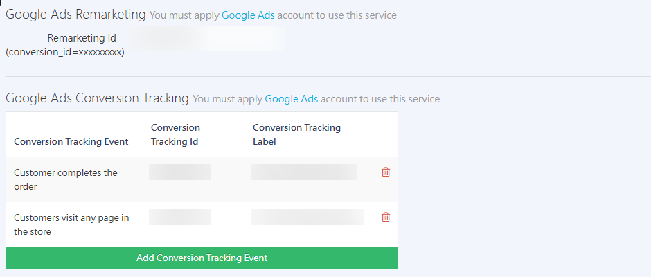
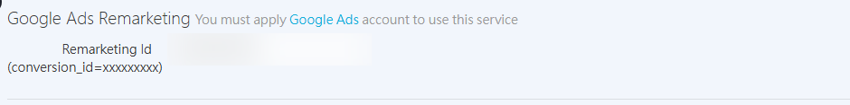
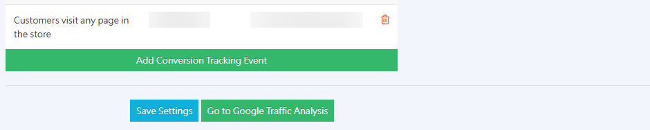

{ .hero-page }

## Google Ads Overview { #overview-google-ads-conversions }

Google Ads (formerly Google AdWords) is Google's online advertising platform. Merchants can bid to show ads in Google Search results, on Google partner websites, and on YouTube. Google Ads offers several ad formats, including search ads, multimedia ads, shopping ads, and video ads. Merchants can choose the ad types that best fit their products and marketing goals. [Learn more :lucide-external-link:](https://support.google.com/google-ads/answer/6146252).

## Why Set up Conversion Tracking { #operate-google-ads-conversions }

A "conversion" is a key action that a user completes on your website after clicking an ad, such as checking out, signing up as a member, or filling in a form.
Setting up conversion tracking in Google Ads helps merchants measure ad performance, understand customer behavior, and further refine ad targeting. CYBERBIZ integrates with Google conversion codes. Follow the detailed steps below to set it up:

## Prerequisites and Limitations { #prerequisites-google-ads-conversions }

- [x] **Create an ad campaign**: Merchants must first [create a Google Ads campaign :lucide-external-link:](https://ads.google.com/aw/campaigns?supportResource=google-ads/answer/10207423) before they can set up conversion tracking. For setup details, see the [official guide :lucide-external-link:](https://support.google.com/google-ads/answer/6324971?hl=zh-Hant).

## Create a Conversion Action in Google Ads { #operate-google-ads-conversion-create }

1.  **Go to the conversions page**: Sign in to the Google Ads admin. In the sidebar, click **Goal ** > ** Summary**, then click **Create conversion action**.
2.  **Select a category**: Select **Page view**.
3.  **Create a conversion**: Click **Create conversion**. For **Data source**, select the website URL you entered when you created the ad campaign.
4. **Conversion method**: Select **Manually using code**.

    

5.  **Set conversion details**:
    *   **Action optimization**: Select the action events to track based on your needs (for example, purchase or add to cart).
    *   **Conversion name**: Name this conversion based on your needs.
    *   **Value**: If you select the **Purchase** category, select **Use different values for each conversion**. For other categories, we recommend **Use the same value for each conversion**.
    *   **Count**: If you have no special requirements, we recommend selecting **Every**.

    

6.  **Finish and get the code**:
    *   After you finish the setup, click **Finish**. To track multiple actions, click **Add conversion action** again on this page. Do not create them separately.
    *   Click **Save and continue**.
    *   Select the **Use Google Tag Manager** tab to view and copy the **Conversion ID** and **Conversion label**.
    - After you confirm the information, click **Agree and finish** to complete the process.

    

## Enter the Conversion Code in the CYBERBIZ Backend { #intro-google-ads-conversions }

**Navigation path:** Sign in to the CYBERBIZ admin and go to "**Third-party integrations ** > ** Google settings**" > the Google Ads conversion section.

1.  **Google Ads remarketing**:
    *   Enter the **Conversion ID** provided by Google in the **Remarketing ID (numbers only)** field.

    

2.  **Google Ads conversion tracking**:
    *   Click **Add conversion tracking event**.
    *   **Conversion tracking event**: Based on the goal category you set up in Google, select the matching event in the backend (for example, select **Customer completes an order** for Purchase).

        ??? info "Goal category and conversion tracking event mapping table"

            | Google Ads Goal Category | CYBERBIZ Backend Tracking Event |
            |------------------|------------------|
            | Page view | Customer visits any page in the store |
            | Page view | Customer visits the store homepage |
            | Begin checkout | Customer visits the checkout page |
            | Sign-up | Customer signs up as a member |
            | Purchase | Customer completes an order |
            | Add to cart | Customer adds a product to the cart |

    *   **Conversion tracking ID**: Paste the **Conversion ID**.
    *   **Conversion tracking label**: Paste the **Conversion label** for the corresponding event.

    

3.  **Save settings**.

    

!!! warning "Notes"

    *   **Avoid duplicate tags**: If you previously set up Google Ads tracking through GTM, you **must remove the related tags in GTM** after you finish the setup in the CYBERBIZ backend. This prevents code conflicts that could make the data inaccurate.
    *   **Automated ads limitation**: If the merchant uses the [CYBERBIZ-managed](automated-ads-system.md#cyberbiz-代管適合新手){ title=" automated ads system setup" } "**Automated Advertising System**", then **you cannot** view data in a personal Google Ads account using the method above. Go to the CYBERBIZ backend to view the data.

## FAQ { #faq-google-ads-conversions }

??? quote "Can I set up conversion tracking for automated ads?"
    No. Automated ads are managed by the CYBERBIZ account, so you cannot view their data in Google Ads. Merchants can view the data in the backend.

??? quote "Why can't the conversion code track customer behavior on my website?"
    Check the related settings in the CYBERBIZ admin. The **Remarketing ID (numbers only)** and the **Conversion tracking ID** should be the same. If they differ, check whether you added the conversion action as described in step 7.

??? quote "I already set up Google Ads with GTM. Do I need to remove it?"
    Yes. If you previously set up ad tracking through Google Tag Manager (GTM), be sure to remove the related tags in GTM after you finish the setup in the CYBERBIZ backend. This prevents code conflicts that could make the data inaccurate.

??? quote "How do I track multiple conversion events?"
    To track multiple actions, click **Add conversion action** again on the same conversion action page in Google Ads to add more events. Do not create multiple conversion actions separately.
