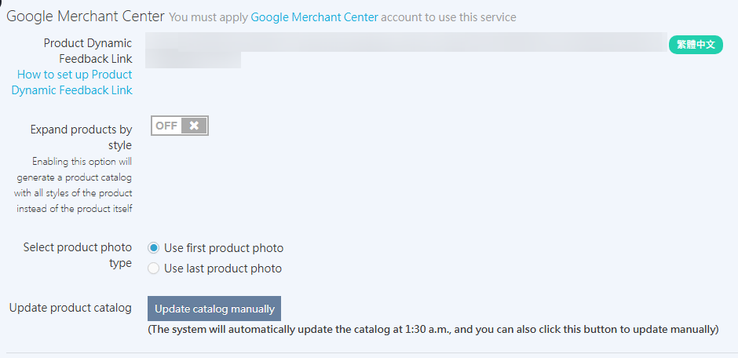

{ title="Connect GMC: Third-Party Integrations > Google > Google Merchant Center" .hero-page }

## Google Merchant Center Overview { #overview-merchant-center }

**Google Merchant Center (GMC)** [:lucide-external-link:](https://www.google.com/retail/solutions/merchant-center/) is Google's product data management platform. It syncs your product information to the Shopping section of Google Search results and to Google Shopping ads, which helps increase product exposure and conversions. [Learn more :lucide-external-link:](https://support.google.com/merchants/answer/12159157?hl=zh-Hant)

!!! tip "Why Use GMC"
    - **Boost product visibility**: Products appear in the Shopping section of Google Search results, increasing views from potential customers.
    - **Run targeted ads**: Promote products with Google Ads to reach your target audience and improve CVR.
    - **Automate management**: Automatically sync product inventory, prices, and images to reduce manual maintenance.
    - **Track and optimize data**: Collect user engagement and ad performance data to support analysis and optimization.

## Apply for Google Merchant Center <small>Steps on Google</small> { #operate-merchant-center }

### Create an Account { #operate-merchant-center-create }

!!! warning "Important"
    If you want to run **Google automated ads**, you can have CYBERBIZ manage the GMC account. Create it directly on the automated ads setup page to avoid permission conflicts or ad issues caused by applying on your own. Learn [how to set up automated ads](automated-ads-system.md){ title="set up the automated ads system" }.

1.  **Go to GMC**: Go to [Google Merchant Center :lucide-external-link:](https://www.google.com/retail/solutions/merchant-center/) and click "Get Started"
2.  **Select store type**: Select "Yes" if you have an online store, choose whether you have a physical store, and enter your store URL.
3.  **Go to Merchant Center**: After you read the "Free Listings" overview, click "Go to Merchant Center"

{ title="Create Account GIF" .screenshot }

---

### Set up Business Information { #operate-merchant-center-settings }

1.  **Enter business name**: In the "Business name" field, enter your business name.
2.  **Set business address**: Enter your company's registered address (city, state/province, postal code).
3.  **Finish setup**: Click "Go to Merchant Center" to open the main dashboard.

{ title="Set up Business Information GIF" .screenshot }

---

### Verify Your Website { #operate-merchant-center-verification }

1.  **Choose a verification method**: Select "Add HTML tag or file" > "Add HTML tag"
2.  **Copy the HTML tag**: Copy the meta tag that the system generates.

    { title="GMC Copy HTML Tag" }

3.  **Paste into the CYBERBIZ admin**: Go to "Website Appearance" > "Theme Management" > "CSS/HTML Editor", search for the `theme.liquid` file, and paste the tag above `</head>`

    { title="GMC Embed HTML Tag" }

4.  **Complete verification**: Return to GMC and click "Verify Online Store" to finish verification. After verification, you can click **Continue** to proceed to the [Add/Sync Product Data](#operate-merchant-center-sync-product-data) step.

    { title="GMC Verification Success" }

    ??? success "How do I check the store verification status?"
        After verification, you can check Business Information to confirm that your store is linked correctly.

        - **Navigation path**: Sign in to GMC, then go to "Settings" > "Business Information" > "Details" > "Your Online Store".
        - **Expected result**: Confirm that the field shows `Verified` and `Claimed ownership`. [Learn about verification and claiming :lucide-external-link:](https://support.google.com/merchants/answer/11586344?sjid=11682918307320921706-NC#zippy=%2C%E9%A9%97%E8%AD%89%E5%92%8C%E8%81%B2%E6%98%8E%E6%98%AF%E4%BB%80%E9%BA%BC%E6%84%8F%E6%80%9D)

        { title="GMC Store Verification Status" }
---

### Sync Product Data <small>Product Feed Setup</small> { #operate-merchant-center-sync-product-data }

1.  **Copy the feed link**: In the CYBERBIZ admin, go to **Third-Party Integration > Google Settings > Google Merchant Center** and copy the **Product Feed Link**.

    - **Expand products by variant**: If your products have multiple variant attributes, we recommend turning this on so that each option appears separately on Google, which increases visibility opportunities.

        *   **On (ON)**: Suitable for apparel, footwear, and other merchants who want each color or size shown separately.
        *   **Off (OFF)**: Suitable for electronics or merchants whose products have little style variation.

    - **Update the product catalog**: The system updates daily at 1:30 AM. If you need an immediate update, click "Manually Update Catalog" (limited to once per hour).

    { title="CYB GMC Product Feed" }

2.  **Upload products**: Return to the GMC admin, select "Add products using a file," and paste the link you copied into the "Enter file URL" field.

    { title="GMC Product Feed" }

    ??? success "How do I verify the product sync status?"
        After sync is complete, follow these steps to check the product data in the Google admin:

        - **Navigation path**: Go to the GMC admin, then go to "Products and Listings" > "Products" > "All Products".
        - **Expected result**: Confirm that your store products and their status appear in the list.
        - **Note**: After the first upload, product information may take several hours, up to 24 hours, to fully appear in the list.

        { title="GMC Products Page" }

---

### Set up Shipping Methods { #operate-merchant-center-shipping }

1.  **Select country/region**: Select "Taiwan" and click "Continue"
2.  **Set shipping time**: Set the order cutoff time, handling time (0–1 days), and transit time (0–1 days).
3.  **Set shipping cost**: Select "Free shipping" and click "Save"

{ title="Set up Shipping and Returns GIF" .screenshot }

---

### Set up Return Policy { #operate-merchant-center-returns }

1.  **Set return information**: Select the return window and return fees.
2.  **Finish setup**: Click "Continue" to complete the GMC account setup.

{ title="Set up Return Policy GIF" .screenshot }

## Integrate Google Ads Account { #operate-merchant-center-connect-google-ads }

1.  **Go to settings**: In the GMC admin, click "Settings" > "Access and services"
2.  **Add service**: Click the "Apps and services" tab, then click "Add service"
3.  **Select Google Ads**: Select the "Google Ads" service.
4.  **Link account**: Select the Google Ads account you want to link, then click "Link" to finish.

{ title="Connect Google Ads GIF" .screenshot }

---

## Product Detail Setup Recommendations { #operate-merchant-center-product-settings }

-   :lucide-shapes:{ .lg .middle } __Google Product Category Setup__

    ---

    We recommend that you manually select the correct category under "Google Product Category" on the product setup page. This makes ad targeting more precise.

    [:lucide-arrow-right: Setup guide](../../products/create-and-manage/edit-product-description-settings.md#operate-product-desc-settings-advanced){ title="Edit Product Descriptions and Settings" }

-   :lucide-image:{ .lg .middle } __Image Requirements__

    ---

    Choose images with **no price, no promotional text, and no brand watermark**. Otherwise, they may not meet [Google's guidelines](https://support.google.com/merchants/answer/6324350#Image_guidelines).

    [:lucide-arrow-right: Setup guide](../../products/create-and-manage/create-update-products.md#operate-product-create-media){ title="Add and Update Products" }

## Which Products Are Not Uploaded <small>Automatic Exclusion Logic</small> { #specs-merchant-center }

The system automatically excludes products in the following cases and does not upload them to GMC:

- **Unpublished products** (eye icon turned off).
- **Products that are delisted or have reached their delisting time**.
- **Products tagged "Gift"** or **"Exclude product feed"**.

## Next Steps { #next-steps-merchant-center }

- :lucide-activity:{ .lg }   
  [__Key Event Source Tracking and Auto-Tagging__](setup-gmc-conversion-tracking.md){ title="Set up GMC Key Event Source Tracking and Auto-Tagging" }     
  Track product purchases from specific sources, and turn on auto-tagging to accurately attribute ad conversions.

- :lucide-footprints:{ .lg }   
  [__Google Ads Conversion Tracking__](setup-google-ads-conversion-tracking.md){ title="Set up Google Ads Conversion Tracking" }     
  Set up the Google Ads conversion tracking code to report the order results from your ads and improve ad performance.

- :lucide-chart-column-increasing:{ .lg }   
  [__Google Analytics Tracking__](setup-gmc-conversion-tracking.md#operate-gmc-conversions-steps-ga4-merchant-cen){ title="Set up GMC Key Event Source Tracking and Auto-Tagging" }
  Link GA4 to Merchant Center to view purchase metrics from Google Search and Shopping ads.

## FAQ { #faq-merchant-center }

??? quote "What is the difference between CYBERBIZ managing the GMC account and applying for a GMC account yourself?"
    If you choose for CYBERBIZ to manage the GMC account, the system automatically handles related settings and maintenance, which prevents permission changes or ad delivery issues caused by manual actions. If you have already created an ad through the automated ads setup page and chose managed setup, do not apply for a separate GMC account.

??? quote "Which products are not uploaded to the Google Product Feed?"
    The system automatically excludes unpublished products, products that have reached their delisting time, and products tagged `Gift` or `排除product feed`.

??? quote "Can Google product categories be set in batch?"
    Currently, Google product categories must be set for each product individually and cannot be applied in batch.

??? quote "What are the requirements for product images?"
    Choose images with **no price, no promotional text, and no brand watermark**. Otherwise, they may not meet Google's specifications. For detailed requirements, see [Google image guidelines](../../products/create-and-manage/create-update-products.md#reference-gmc-picture-specs){ title="Add and Update Products" }.

??? quote "How often is product data updated?"
    The system updates automatically every day at 1:30 AM. If you need an immediate update, click "Manually Update Catalog" (limited to once per hour).
