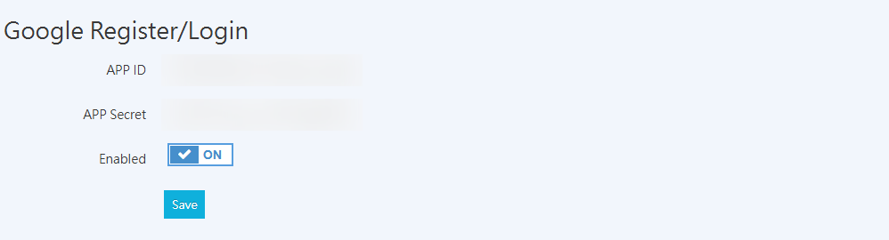

{ title="Google Quick Login Setup" .hero-page }

## Google Quick Login Overview { #overview-google-login }

**Google Quick Login** lets customers sign up or log in to their member accounts with one click using their Google account. The system automatically creates a member profile based on the email address the customer enters, or links the customer's Google account to an existing member profile.

## Steps { #operate-google-login }

### Google Cloud Platform Setup { #operate-google-login-google-cloud-platform }

Merchants must first create a project on the Google Developer Platform and obtain the credentials required for the integration.

1.  **Create a project**: See the official Google guide [Create a Google Cloud project :lucide-external-link:](https://developers.google.com/workspace/guides/create-project?hl=zh-tw#google-cloud-console) to complete the process.
2.  **Configure the OAuth consent screen**: Follow the instructions in [Set up the OAuth consent screen :lucide-external-link:](https://developers.google.com/workspace/guides/configure-oauth-consent?hl=zh-tw#configure_oauth_consent) to complete the setup.
    *   Click **Get started** to open the project setup page.
    *   **App information**: Enter the app name and the user support email address.
    *   **Audience**: Select **External**.
    *   **Contact information**: Enter a contact email address and complete the setup.

    { title="OAuth Project Setup" }

3.  **Create an OAuth client ID**: See the official [Create an OAuth client ID tutorial :lucide-external-link:](https://developers.google.com/workspace/guides/create-credentials?hl=zh-tw#oauth-client-id) and enter the following CYBERBIZ-specific parameters during setup
    *   Click **Overview** or **Credentials**, then click **Create OAuth client ID**.
    *   **Application type**: Select **Web application**.
    *   **Authorized redirect URLs**: Click **Add URL**, then enter `https://{your-store-url}/customer/auth/google_oauth2/callback`.

    { title="Create OAuth Client ID" }

4.  **Get your keys**: After you create the client, a dialog displays the **Client ID** and **Client secret**. Copy both values.

    { title="OAuth Client Creation Complete" }

---

### CYBERBIZ Backend Integration Setup { #operate-google-login-cyberbiz-backend-connect }

After you get your keys, return to the storefront admin panel to complete the final activation step.

1.  **Access path**: Go to the admin panel and select **Third-party Integration** > **Google Settings**.
2.  **Enter information**: Find the **Google Sign-up/Login** section.
    *   Enter the **Client ID** from Google Cloud in the **App ID** field in the admin panel.
    *   Enter the **Client secret** from Google Cloud in the **App Secret** field in the admin panel.

    { title="Google App ID Settings" }

3.  **Publish the app**: Return to the Google Cloud Platform sidebar, click **Audience**, then click **Publish App**. After you confirm the status is correct, the setup is complete.

    { title="Publish Google App" }

## Setup Completion Screen { #operate-google-login-settings }

Once setup is complete, customers can sign up or log in to the storefront using their Google account.

{ title="Google Quick Login Storefront View" }

## Important Notes and System Logic { #specs-google-login }

*   **Account merging**: If a customer uses Google, LINE, or Facebook quick login with the **same email address**, the system treats them as the same member and shows the account type on the member details page in the admin panel.
*   **Member label**: Members who sign up this way show **Google Quick Login** in the **Account type** field in the admin panel.

    { title="Member Details - Account Type" }

*   **Redirect error troubleshooting**: If a customer encounters an error when logging in, check that the **Authorized redirect URLs** in Google Cloud Platform contain the complete store URL in the correct format.

## FAQ { #faq-google-login }

??? quote "How long does it take for the setup to take effect?"

    After you complete the setup and publish the app, customers can log in with their Google account right away. There is no waiting period.

??? quote "What should I do if a customer encounters an error when logging in?"

    First, check that the **Authorized redirect URLs** in Google Cloud Platform contain the complete store URL (in the format `https://{your-store-url}/customer/auth/google_oauth2/callback`), and confirm that the status is Published.

??? quote "Can customers link an existing member account using Google quick login?"

    Yes. If a customer already has a member account and signs in with Google quick login using the same email address, the system automatically links the Google account to the existing member profile.

