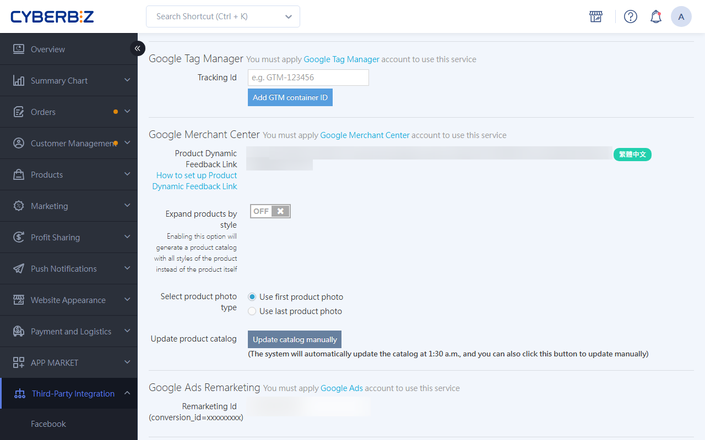
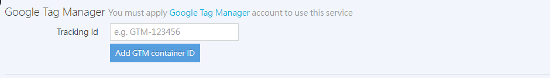

{ title="Google Tag Manager integration setup" .hero-page }

## What Is Google Tag Manager { #intro-tag-manager }

**Google Tag Manager (GTM)** is a free tag management system from Google. It helps webmasters install and update various tracking tags (such as event tracking and remarketing codes) quickly, without modifying the website's code.

## Create a GTM Account and Container { #operate-tag-manager }

1.  **Create an account**: Sign in to [Google Tag Manager :lucide-external-link:](https://tagmanager.google.com/) and click "Create Account". Enter an **Account name** (we recommend your company or brand name) and select your country.
2.  **Set up a container**: Enter a [container](#reference-tag-manager-gtm){ title="container " }**Name** (we recommend your storefront URL or name) and select "**Web**" as the target platform.
3.  **Accept the terms**: Select the checkbox to agree to the terms of service, then click "Yes".
4.  **Get the code**: The system displays an installation code window. Find the container ID in the **GTM-XXXXXX** format and copy it.

{ title="Create GTM account and container" }

## CYBERBIZ Admin Integration Settings { #operate-tag-manager-connect }

1.  **Access path**: Go to the admin and open **Third-Party Integrations ** > ** Google Settings**.
2.  **Enter the ID**: Find the **Google Tag Manager** section, paste the copied ID into the **Tracking ID (includes GTM)** field, and save.

{ title="GTM tracking ID field" }

## Important Notes <small>Avoid Data Anomalies</small> { #specs-tag-manager }

To ensure data accuracy, **the following tools already have dedicated integrations in CYBERBIZ. Always set them up directly in the system admin, and do not bind them separately through GTM**, to avoid tag conflicts or double counting:

*   **Google Analytics (GA4)**.
*   **Google Ads conversion tracking**.
*   **Meta Pixel (Facebook Pixel)**.

!!! warning "If you previously set up tracking for these tools through GTM, you must **remove the old tags from GTM** after switching to the CYBERBIZ admin integration. Otherwise, your ad data will be inaccurate."

## Check and Verify { #operate-tag-manager-verification }

After setup, you can use **Google Tag Assistant** (Chrome extension or web version) to [check whether the GTM code is installed on the site](verify-tracking-tag-installation.md){ title="Verify tracking code installation with Google Tag Assistant" }.

*   **Chrome extension**: Useful for quickly checking whether the code has loaded successfully.
*   **Web version**: Fully records your actions and verifies whether specific tags fire correctly.

## Frequently Asked Questions { #faq-tag-manager }

??? quote "Where do I find the GTM container ID?"

    After you create a GTM container, the system displays an installation code window, where you can find the container ID in the format "GTM-XXXXXX." The container ID also appears at the top of the interface whenever you open GTM.

??? quote "Which tools should not be set up through GTM?"

    We recommend connecting the following three tools directly through the CYBERBIZ admin to avoid tag conflicts or double counting:

    * Google Analytics (GA4)
    * Google Ads conversion tracking
    * Meta Pixel (Facebook Pixel)

??? quote "How do I verify that GTM is installed correctly?"

    You can use **Google Tag Assistant** to [verify](verify-tracking-tag-installation.md){ title="Verify tracking code installation with Google Tag Assistant" }:

    * **Chrome extension**: Quickly check whether the code has loaded successfully.
    * **Web version**: Fully records your actions and verifies whether specific tags fire correctly.

## References { #reference-tag-manager }

### GTM Core Glossary { #reference-tag-manager-gtm }

| Term | Technical Definition | Simple Analogy |
| :--- | :--- | :--- |
| **Account** | The highest level of GTM's management structure, typically representing a company or organization. | **Homeowner**: The person who manages all permissions. |
| **Container** | A JavaScript code snippet installed on the website that contains all tracking rules and tags for the site. | **Tool Boxes**: The container that holds all the tools. |
| **Tag** | A code snippet that performs the actual task (for example, GA4 tracking code or Meta Pixel). | **What does it do?**: Sends data. |
| **Trigger** | A rule that detects user behavior and determines when a tag runs (for example, clicking a button or submitting a form). | **When does it act?**: The activation switch. |
| **Variable** | A placeholder for accessing dynamic information (for example, URLs, product prices, or order IDs). | **Intel details**: The specific data values. |
| **Data Layer** | A relay point for exchanging information between the website and GTM, ensuring that dynamic data is transmitted reliably. | **Information envelope**: A standardized communication format. |
| **Preview/Debug** | An environment for testing how tags work before publishing. It does not affect real visitors. | **Rehearsal**: Confirm everything works before going live. |
| **Version** | A historical archive of container settings. A record is created each time you publish, so you can restore a previous version if something goes wrong. | **Save point**: You can always travel back in time. |

