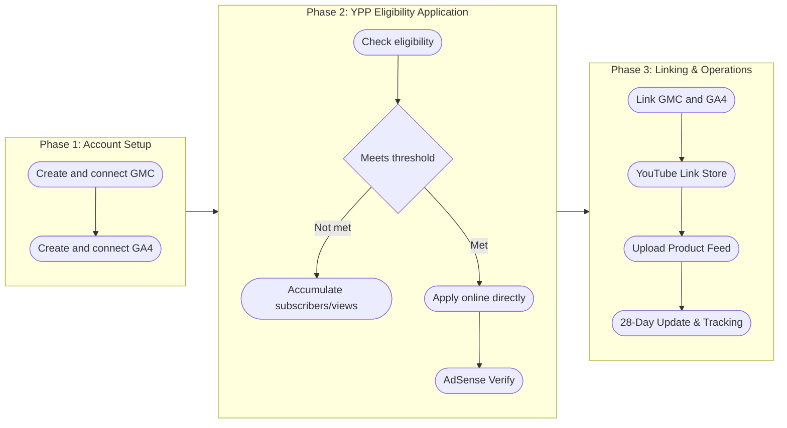
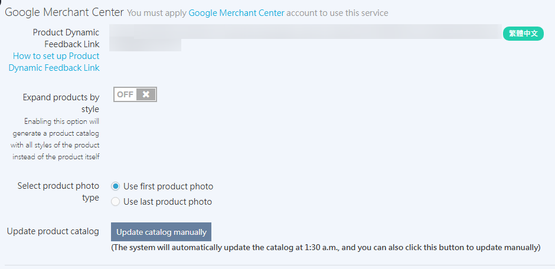

## What Is YouTube Shopping { #intro-youtube-shopping }

**YouTube Shopping** lets you embed product information and links from your storefront in YouTube videos, live streams, and Shorts. If you make videos, run a YouTube channel, or go live on YouTube, you can set up YouTube Shopping to increase product exposure and turn traffic into revenue. [Learn more :lucide-external-link:](https://support.google.com/youtube/answer/12257682?hl=zh-Hant)

!!! warning "Eligibility"
    YouTube Shopping is a feature of the **YouTube Partner Program (YPP)** for creators who have a YouTube channel that meets the monetization threshold (1,000 subscribers + 4,000 watch hours).

## YouTube Shopping Setup Process { #operate-youtube-shopping }

### 1. Account Setup and Back-End Linking { #operate-youtube-shopping-account-create-backend }

Before applying for YouTube Shopping, you must first integrate the two Google tools.

-   :lucide-tags:{ .lg .middle } __Create and Verify a GMC Account__

    ---

    Go to Google Merchant Center (GMC), complete your basic merchant information, and verify store ownership.

    [:lucide-arrow-right: Setup Guide](setup-google-merchant-center.md){ title="Set Up Google Merchant Center and Sync CYBERBIZ Products" }    

-   :lucide-chart-no-axes-column-increasing:{ .lg .middle } __Create and Connect a GA4 Account__

    ---

    In Google Analytics admin, get the "Measurement ID," then go to the CYBERBIZ admin and enter the Measurement ID to complete the integration.

    [:lucide-arrow-right: Setup Guide](ga/setup-google-analytics.md){ title="Create and Connect Google Analytics" }

---

### 2. YPP Eligibility Application { #operate-youtube-shopping-ypp-apply }

Your merchant channel must meet the monetization eligibility requirements of the [**YouTube Partner Program (YPP)** :lucide-external-link:](https://support.google.com/youtube/answer/72851?hl=zh-Hant&ref_topic=9153642) before you can turn on shopping features.

1.  **Check eligibility**: Sign in to [YouTube Studio :lucide-external-link:](https://studio.youtube.com/) and click **Monetization** in the left menu. If a green star appears, you are not yet eligible.

    { .screenshot }

2.  **Apply online**: When your channel reaches 1,000 subscribers and 4,000 watch hours (or 10 million Shorts views), you can apply for YPP eligibility directly through YouTube Studio. For eligibility and application details, see the [official documentation :lucide-external-link:](https://support.google.com/youtube/answer/72851?hl=zh-hk&co=GENIE.Platform%3DDesktop).

---

### 3. Apply and Connect Your Store { #operate-youtube-shopping-apply }

Once the accounts above and eligibility are ready, you can complete the final linking steps.

1.  **Apply for eligibility**: Fill in the [YouTube Shopping eligibility application form](https://docs.google.com/forms/d/e/1FAIpQLSeC92YTZOl0E-SO03SAv-QF_rRaWXNWdYLABZXEFwnfeXhzdQ/viewform), and CYBERBIZ will submit it to YouTube.
    - After your application is approved, CYBERBIZ will send an activation notice to the email address you provided on the application form. Continue with the next steps only after you receive the email.
2.  **Link GMC and GA4**: Enable auto-tagging in Merchant Center settings, and [link GA4 to Merchant Center](setup-gmc-conversion-tracking.md#operate-gmc-conversions-steps-ga4-merchant-cen){ title="Set up GMC key event source tracking and auto-tagging" }.
3.  **Link your YouTube channel and online store**: Go to [YouTube Studio :lucide-external-link:](https://studio.youtube.com/), open the **Monetization** > **Shopping** tab, click **Link store**, select **Other store**, and then specify your GMC account. For details, see the [official documentation :lucide-external-link:](https://support.google.com/youtube/answer/12258186?sjid=15941351074417695736-NC#)

    { .screenshot }

4.  **Upload Product Feed**:
    - **Get the link**: Sign in to the CYBERBIZ admin, go to Third-Party Integration > Google Settings > Google Merchant Center, and copy the "Product Feed Link."

        

    - **Import into GMC**: Go to the GMC admin, click **Products** > **All products** > **Add products** > **Add other product sources**, and paste the link you just copied.

        

    - **Enable the YouTube destination**: In the **Marketing method** settings, be sure to select **YouTube Shopping**, and click **Save** to make sure products sync to the YouTube platform.

        

    - **Finish and Manually Update**: Click **Continue** to finish setup. On the source detail page, click **Update** to force the system to fetch the latest product information.

        

        !!! warning "Automatic Product Removal Mechanism"
            If product information in the feed has **not been updated in GMC for over 30 days**, products will be automatically removed from YouTube. We recommend updating **every 28 days** to keep products active.

## Track YouTube Shopping Performance { #operate-youtube-shopping-tracking }

Use the GA4 Explore feature to track the website conversions that YouTube Shopping drives.

1.  **Create a new report**: In the GA4 left menu, click **Explore**, then click **Blank**.

2.  **Add Total Revenue and Sessions metrics**: Click **Metrics** > **Monetization** > select **Total revenue** and **Sessions** > select **Sessions**, and then click **Confirm**.

    

3.  **Add dimension**: Click **Dimensions** > **Traffic source** > select **Session manual term**, and then click **Confirm**.

    

4.  **Set filter conditions**:
    - Add **Session manual term** to **Rows**
    - Add **Sessions** to **Values**
    - Add **Total revenue** to **Values**
    - Add **Session manual term** to **Filters**, and set the condition to **Begins with** "UC"

    

6.  **Set date range**: Click the date menu to select a time range and view data for a specific period.

    

## **Live Streaming Tip** { #intro-youtube-shopping-overview-youtube-shopping }

When you live stream on YouTube, you can schedule the stream in advance and generate a link to promote it. During the live stream, we recommend using the **Live Pinning** feature to pin the link to a pre-built product page (such as a one-page store) in the comments, so viewers can shop more easily.

## Next Steps { #next-steps-youtube-shopping }

- :lucide-play:{ .lg }   
  [__Tag Products in Video Content__:lucide-external-link:](https://support.google.com/youtube/answer/10191533)  
  Tag products in uploaded YouTube videos so viewers can click to buy directly.

- :lucide-video:{ .lg }   
  [__Tag Products in Live Streams__:lucide-external-link:](https://support.google.com/youtube/answer/12299016)  
  Tag products in real time during YouTube live streams to promote them instantly.

- :lucide-megaphone:{ .lg }   
  [__Live Shopping Promotion Tips__:lucide-external-link:](https://support.google.com/merchants/answer/12375318)  
  Best practices and tips for promoting products with YouTube live shopping.

## FAQ { #faq-youtube-shopping }

??? quote "What are the eligibility requirements for YouTube Shopping?"

    YouTube Shopping is a feature of the **YouTube Partner Program (YPP)**. Merchants must have a YouTube channel and meet the monetization threshold (1,000 subscribers + 4,000 watch hours, or 10 million Shorts views) before they can apply.

??? quote "How do I sync CYBERBIZ products to YouTube?"

    Follow these steps in order:

    1. Get the **Product Feed Link** in the CYBERBIZ admin (Third-Party Integration > Google Settings > Google Merchant Center).
    2. Go to the GMC admin, add a product source, and paste the link.
    3. In **Marketing method**, select **YouTube Shopping** and save.

??? quote "Why are products automatically removed from YouTube?"

    If product information in the feed has **not been updated in GMC for over 30 days**, products will be automatically removed from YouTube. We recommend updating **every 28 days** to keep products active.

