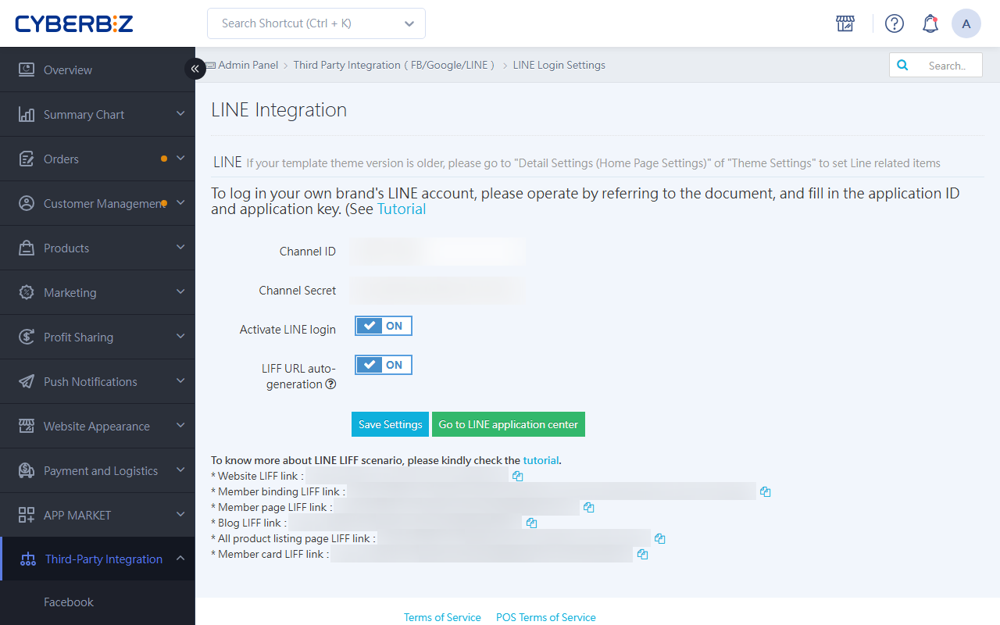

{ .hero-page }

## What Is LINE Official Account and Website Member Linking? { #operate-bind-line }

**LINE OA Website Member Binding** is the core feature for integrating online and offline member data and running targeted marketing. Through linking, merchants can collect members' **LINE UID**, which enables them to send automated order and shipping notifications.

The following provides a detailed explanation and tutorial on LINE OA website member linking:

## Prerequisites { #prerequisites-bind-line }

Merchants must first complete the following system integration settings before data can be shared:

- [x] [**Create and Connect the Messaging API**](connect-line-messaging-api.md){ title="Connect the LINE Messaging API" }  : Complete the API integration between the LINE Official Account and the CYBERBIZ admin backend.

- [x] [**Set Up LINE Login (Quick Login)**](setup-line-quick-login.md){ title="Set up LINE Quick Login" }  : Be sure to configure "LINE Login" and "Messaging API" under the **same LINE Developers Provider (service provider)**.

- [x] **Enable LINE Quick Login**: Customers must register or log in through LINE Quick Login to complete the linking process.

## Admin Backend Setup Methods { #operate-bind-line-backend-settings }

Merchants must provide specific links to guide customers. There are three main use cases:

### Set up Rich Menu { #operate-bind-line-backend-settings-settings }

This is the most commonly used guidance method.

- **Path**: Go to [LINE Official Account Manager :lucide-external-link:](https://manager.line.biz/) > **Chat-Related > Rich Menu**.

- **Set up the link**: We recommend using the "Member Profile" page as the redirect page. The link format is: `https://your-domain/customer/auth/line?line_action=line_login`.

- **Effect**: Customers who have not yet linked their account are prompted to link when they click the link. Customers who are already linked go directly to the designated page in a logged-in state.

!!! info "For detailed setup steps, see [LINE Rich Menu Setup](../marketing/setup-line-rich-menu.md){ title="Set Up LINE Rich Menu" }  or view the [LINE official documentation :lucide-external-link:](https://tw.linebiz.com/manual/line-official-account/oa-manager-richmenu/)."

---

### Set up the Welcome Message for New Friends { #operate-line-bind-welcome }

- **Path**: Go to [LINE Official Account Manager :lucide-external-link:](https://manager.line.biz/)  > **Chat-Related > Welcome Message for New Friends**.

- **Message content**: Include the binding link above in the message. This is most effective for members who add the official account for the first time.

!!! info "For detailed specifications for LINE add-friend messages, see [LINE official documentation :lucide-external-link:](https://tw.linebiz.com/manual/line-official-account/20200514welcomemessage/)."

---

### Auto-Bind Using LIFF <small>Recommended Method</small> { #operate-bind-line-backend-settings-use-liff-bind }

- **Key features**: Once enabled, when customers click the URL, their LINE account information is applied automatically. If a customer is not a friend or member, clicking the link can **add the friend, register as a website member, and complete binding at the same time**.

- **Path**: Admin backend **Third-Party Integration > LINE Login > Turn on Auto-Generate LIFF URL**.

- **Use case**: Merchants can copy the LIFF URL generated by the system and turn it into a QR Code for customers to scan.

!!! info "For detailed instructions, see [How to Set Up LIFF](setup-liff-auto-login-member-binding.md){ title="Set Up LIFF Auto-Login and Member Binding" }."  

## Customer-Side Linking Process { #operate-bind-line-bind-flow }

1. Click the **binding link** or **LIFF URL** provided by the merchant.

2. Open the **LINE User Data Authorization** page and click Allow.

3. The system performs a **quick redirect** (a loading screen appears) and redirects to the website homepage or the designated page.

4. Finally, the customer is redirected to the destination page. At this point, the customer is **logged in as a member** and linking is complete.

## Advanced Features and Benefits After Linking { #operate-bind-line-bind-advanced }

- :lucide-bell-ring:{ .lg }  
  [__Automatic Reminder Templates__](../../../notifications/manage-line-oa-templates.md){ title="Set up and manage LINE OA notification templates" }  
  Automatically reply with order confirmations, shipping notifications, in-store pickup reminders, and unpaid order reminders.

- :lucide-ticket-percent:{ .lg }  
  [__Bind-and-Send coupon__](setup-line-binding-coupon-gift.md){ title="Set up LINE binding member gifts coupon" }  
  Set up the "LINE @ binding gift coupon feature" to encourage customers to link.

- :lucide-scan-barcode:{ .lg }  
  [__Display Member Barcode (OMO Use Case)__](../marketing/setup-line-rich-menu.md#operate-line-rich-menu-settings-omo-store){ title="Set up LINE Rich Menu" }
  Customers can display their member barcode in the LINE menu for in-store POS scanning to apply bonus points or coupon redemption.

- :lucide-user-round:{ .lg }  
  [__Audience Integration and Push Messaging__](../marketing/setup-line-oa-audience.md){ title="Set up LINE OA audience integration" }  
  Merchants can filter members who have completed LINE linking in the admin backend, upload the audience to the LINE OA backend, and send targeted marketing messages.

## Important Notes { #intro-bind-line }

- **Non-friend restriction**: Customers who sign in with LINE Quick Login **may not necessarily be bound to LINE OA**. Only accounts that have added the LINE OA as a friend and have not blocked it can receive LINE push messages.

- **One-account-per-binding rule**: A customer's LINE account must first **bind an email address** in the LINE app before LINE Quick Login and linking can be completed.

- **Link accuracy**: If the URL includes the `/customer/auth/line?line_action` parameter, the linking screen appears every time the link is clicked. If you do not want repeated redirects, you only need to configure the "first-time binding" feature.

## FAQ { #faq-bind-line }

??? quote "Why does a member who has completed LINE Quick Login not appear in the LINE Official Account friend list?"

	**Cause**: LINE Quick Login (LINE Login) and the LINE Official Account (Messaging API) are two separate authorizations. If a member only logs in on the website and does not click "Add friend," the two cannot sync.

	**Solution**: We recommend turning on **[Add official account as a friend]** under **[Auto-login]** in the LINE Developers console. This prompts members to add the official account during the login flow.

??? quote "Customer Sees "Invalid Request" or an Error Page After Clicking the Binding Link"

	**Checklist**:

	1. **Provider check**: Confirm that "LINE Login" and "Messaging API" are under the same **Provider (service provider)**. If they belong to different providers, UIDs cannot be matched.
	2. **Callback URL setting**: Check that the `Callback URL` in the LINE Developers console has been filled in with the full path provided by CYBERBIZ.
	3. **SSL certificate**: Make sure the HTTPS protocol on the website is working properly.

??? quote "Can One LINE Account Be Linked to Multiple Website Member Accounts?"
	No. To ensure data uniqueness and security, **one LINE account can only be bound to one website member account**. If a customer tries to link a second account, the system shows that linking is already complete or redirects to the original linked account.

??? quote "How to Check Whether a Member Has Completed LINE Linking "

	**Admin view**: Merchants can go to the "Member Management" section of the CYBERBIZ admin backend and check the member data fields. If the member has **LINE UID** information, the linking was completed successfully.

	**Member view**: After a member logs in to the website, the "Personal Information" page should show that LINE is connected.

??? quote "Why Is a LIFF URL Recommended over a Regular URL Link for Linking?"

	**Technical advantages**:

	1. **Seamless authentication**: LIFF (LINE Front-end Framework) can obtain user authorization directly within the LINE app, reducing the friction of logging in again after redirecting to an external browser.
	2. **Multiple benefits in one**: With a LIFF link, the system can perform three actions at once: "add friend," "member registration," and "identity binding," which significantly improves conversion rates.
