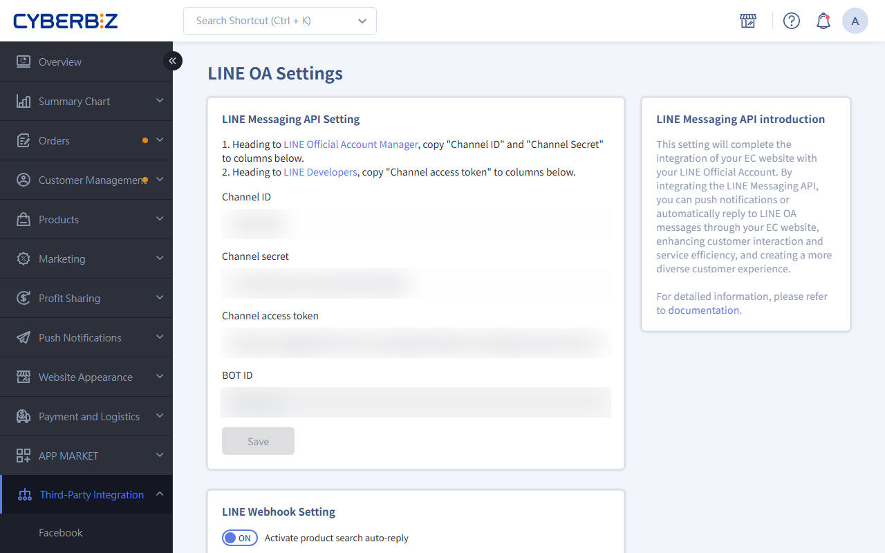
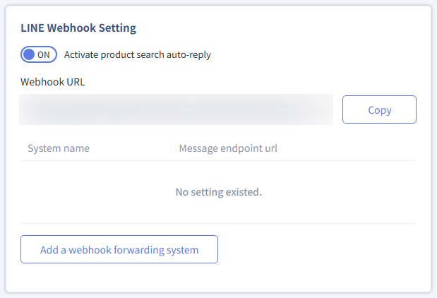

{ title="LINE OA integration" .hero-page }

## Connect LINE OA Messaging API Guide { #operate-line-messaging }

Integrate the LINE Official Account (OA) with the CYBERBIZ system to enable automated customer communication, including order status notifications, precise audience messaging, and product keyword search within LINE.

!!! info "What is the Messaging API?"
	 The Messaging API is a technical interface that LINE provides to developers. Through this integration, the CYBERBIZ system **automatically** sends personalized messages based on specific events (such as a customer placing an order or a payment reminder), without manual action.

## Prerequisites and Limitations { #prerequisites-line-messaging }

Before you start the integration, make sure to confirm the following:

- **Fees:** LINE push messaging is billed according to the message plan of your LINE Official Account. Automatically sent order notifications are also billable.

- **Sending requirements:** The system can only send messages to members who have completed **LINE account binding** or **LINE Quick Login** (their user UID is required).

Complete the following steps in order to make sure the system connects correctly:

## Step 1: Create and Set up a LINE Official Account { #operate-line-messaging-account }

1. **Create a LINE Official Account** Go to [LINE Official Account Manager](https://manager.line.biz/) and create an account.

    !!! warning "Note: For "Country/Region", be sure to select **Taiwan**."

2. **Enable Messaging API** In the admin dashboard, select the account you want to set up. After you open it, click the icon in the top-right corner **Settings > Messaging API > Enable Messaging API**.
3. **Configure Service Provider** Select an existing Provider[^provider] or create a new one.

    !!! warning "Once a LINE Messaging API channel is bound to a Provider, it cannot be changed. Make sure it is linked to the correct Provider."

4. **Basic information:** As needed, enter the URLs for your website's Privacy Policy and Terms of Service.

[^provider]: A Provider is the brand entity that provides the service. To make sure LINE Login and Messaging API data can be shared (for example, to sync member UIDs), set both under the **same Provider**. For details, see [LINE official documentation :lucide-external-link:](https://tw.linebiz.com/manual/line-official-account/line-porvider-and-channel-intro/).

{ title="Enable Messaging API" }

## Step 2: Get the Integration Keys and Enter Them in CYBERBIZ { #operate-line-messaging-connect-cyberbiz }

1. **Go to LINE Developers Console** Sign in to [LINE Developers Console](https://developers.line.biz/console/) and select the Messaging API channel you created earlier.

2. **Get Channel Credentials** Copy the following information from each tab:

    - **Basic settings tab:** Copy the **Channel ID** and **Channel secret**.

    - **Messaging API tab:** Scroll to the bottom of the page, click **Issue** in the “Channel access token” field, and copy the generated token.

	{ title="Get Channel Credentials" }

3. **Enter the Credentials in the CYBERBIZ Admin** Open the CYBERBIZ admin and go to **Third-Party Integration > LINE OA Settings**.

    - Enter the three items above (Channel ID, Channel secret, and Channel access token) in the corresponding fields.

    - Click **Save** to complete the key configuration.

## Step 3: Turn on the Webhook Feature { #operate-line-messaging-enable-webhook }

1. **Get the Webhook URL** Go to the CYBERBIZ admin **Third-Party Integration > LINE OA Settings** and copy the system-generated **Webhook URL**.

    - **URL example:** `https://[your-domain]/line_chat_bots/send_event`

2. **Set up the Webhook in LINE** We recommend working directly in the **[LINE Developers](https://developers.line.biz/console/)** console to make sure the feature is fully enabled:

    - **Enter the URL:** Under the Messaging API tab, find the **Webhook URL** field, click “Edit,” paste the URL, and save.

    - **Turn on the toggle (critical):** Be sure to switch **Use webhook** to **On**. Only then can the system receive message replies.

    - **Verify the connection:** Click the **Verify** button. If “Success” appears, the integration is working.

3. **Adjust the response settings** Go to **LINE Official Account Manager > Settings > Response Settings**:

    - **Response mode:** Be sure to set it to **Chatbot**.

    - **Auto-response messages:** We recommend setting this to **Disabled**, so that messages are sent consistently by CYBERBIZ or your customer service system, which avoids duplicate replies.

{ title="Set Up Webhook Connection" }

## Step 4: Advanced Features <small>Optional</small> { #intro-line-messaging }

After you complete the basic integration, you can further configure the following advanced features based on your brand's operational needs:

### LINE Keyword Product Search { #intro-line-messaging-line-search-product }

- **Feature description:** When enabled, customers can enter keywords in the LINE chat window (for example, necklace or coffee beans), and the system automatically replies with a list of related products from your online store.

- **Value:** Shorten the shopping path and turn your LINE Official Account into a mobile product discovery entry point.

{ title="LINE Keyword Product Search" }

---

### Third-Party System Data Forwarding <small>Webhook Relay</small> { #intro-line-messaging-data-webhook-relay }

- **Feature description:** If your LINE OA is also connected to other third-party platforms (for example, **Omnichat**, **Smarter**, or **Easychat**), you can set up a forwarding system in CYBERBIZ.

- **Technical specifications:** The system forwards the events it receives from LINE to the URLs you specify.

 	- **Limit:** You can configure up to **5** forwarding URLs.

{ title="Webhook Relay Settings" }

### Automated Notification Templates { #intro-line-messaging-notifications }

- **Feature description:** When an order or member status changes, the system automatically sends standardized notifications.

- **Supported categories:**

	- **Order:** Order placed, payment successful, order canceled.

	- **Logistics:** Shipped, store pickup reminder, delivered.

	- **Customer:** Registration successful, birthday gift, and bonus points updates.

- **Prerequisite:** Consumers must first complete **LINE account binding** so the system can identify the UID and send personalized notifications.

For instructions, see [**LINE OA Message Template Setup**](../../../notifications/manage-line-oa-templates.md){ title="Set Up and Manage LINE OA Notification Templates" }.

## Related Actions { #operate-line-messaging-operate }

- :lucide-layout-template:{ .lg }  
  [**LINE OA Message Templates**](../../../notifications/manage-line-oa-templates.md){ title="Set Up and Manage LINE OA Notification Templates" }  
  Set up automated notification templates for order, logistics, and customer events.

- :lucide-link-2:{ .lg }  
  [**Link LINE Account to Website Member**](bind-line-oa-store-members.md){ title="Link LINE Official Account to Website Member" }    
  Learn how members complete LINE binding to receive notifications.

## Frequently Asked Questions { #faq-line-messaging }

??? quote "Why does an error appear when I click “Verify” to validate the Webhook?"
	Check whether the **Webhook URL** contains `https` and whether there is a space at the beginning. LINE requires the Webhook to use the encrypted `https` protocol. Also, make sure the **Use webhook** toggle is set to **On**, and that the Webhook URL path is complete (for example: `/line_chat_bots/send_event`).

??? quote "After setup, why are order notifications still not sent?"
	The main cause is usually that **the member has not completed LINE binding.** The Messaging API relies on the consumer's `UID` to identify the recipient. If a customer only follows the OA but has not bound their website member account, the system cannot retrieve the UID. We recommend placing a **LINE Quick Login** option in a prominent spot on your online store to improve binding rates.

??? quote "Can Chat mode and Webhook coexist in LINE's response settings?"
	To have CYBERBIZ send automatic notifications, you must set the mode to **Chatbot (Webhook)**. Once this mode is enabled, LINE's standard chat features are limited. If you need both manual customer service chat and automatic notifications, we recommend using the **Webhook Relay** feature to route messages to a customer service platform (for example, Omnichat).

??? quote "Do I need to reconfigure when I switch LINE Official Accounts?"
	Yes. **Credentials are unique.** The Channel ID, Secret, and Token are all bound to a single LINE Channel. If you change accounts, you must re-enter the new credentials in the CYBERBIZ admin and update the Webhook URL to make sure data is routed correctly.

