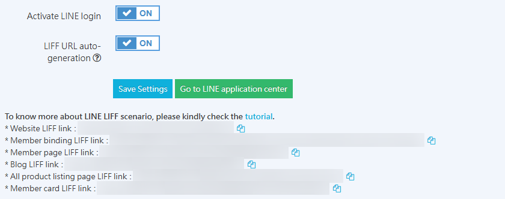

{ title="Generate LIFF URL" .hero-page }

## What Is LIFF { #intro-liff-binding }

**LINE Front-end Framework (LIFF)** is a web app embedding framework provided by LINE. It lets website pages open directly inside the LINE app and access LINE user identity information.

Pages opened through LIFF can be considered "websites running in the LINE environment," with the following capabilities:

- Get LINE user identification information

- Automatically complete member login

- Bind friends through the official account

## Why Use LIFF { #intro-liff-binding-use-liff }

The main purpose of using LIFF is to **reduce friction in member login and shopping guidance flows**:

- **Automatic login:** When a member clicks a link inside LINE, the system can automatically recognize their LINE identity and complete login without manual entry of an account and password.

- **Synchronized binding:** On their first click, customers can simultaneously trigger three actions: "Add the official account as a friend," "Register a website member account," and "Bind accounts."

- **Avoid redirect issues:** Resolve the experience problem where regular URLs in LINE must go through an external browser redirect.

## Back-Office Setup Steps { #operate-liff-binding }

1. **Access path:** Log in to the back office, then go to **Third-Party Integration > LINE Login**.

2. **Verify the connection:**

	- [x] Completed [LINE Quick Login setup](setup-line-quick-login.md){ title="Set Up LINE Quick Login" }.  

	- [x] Completed [Link LINE OA with LINE Login Channel](setup-line-quick-login.md#intro-line-quick-advanced-overview-line-quick){ title="Set Up LINE Quick Login" }.

4. **Enable LIFF:** Turn on the **Auto-generate LIFF URL** toggle, then click **Save settings**.

5. **Copy the URL:** After saving, the site-wide LIFF URL appears at the bottom of the page. Click the blue :lucide-files: icon to copy it.

	{ title="Generate Site-Wide LIFF URL" }

	??? note "LIFF URL Notes"

		After you enable "Auto-generate LIFF URL" and save, the system automatically generates a dedicated **site-wide LIFF URL**.

		This URL has the following characteristics:

		- It is generated automatically by the system and requires no manual setup.
		- It is bound to the current store and the LINE Login Channel.
		- It can be used directly as the "entry URL" for all shopping guidance links.

6. **LINE Developers sync status:** After you complete the steps above, the corresponding LIFF settings are automatically synced and generated in the LINE Developers console.

	{ title="LINE Developers LIFF Settings" }

    !!! warning "Use only the LIFF links generated in the CYBERBIZ back office. Do not change the dedicated LIFF settings in the LINE Developers console, as this can break the redirect mechanism."

    !!! tip "Want to also get the member's mobile phone number in the LIFF flow?"
      If you have LINE Certified Provider qualification (see [Apply for LINE Certified Provider documentation :lucide-external-link:](https://drive.google.com/file/d/1oSF07fHFdx_s4gXVhDv0zw81Su3usQKY/view)), you can further enable the `phone` permission. For detailed setup, see [How to Get Member Mobile Numbers During LINE Quick Login](setup-line-quick-login-phone-number.md#intro-line-phone-login-liff){ title="Get Member Mobile Number During LINE Quick Login" }.

## How to Create LIFF Links for Specific Pages { #intro-liff-binding-page-liff }

To direct customers to a specific campaign page or product page, follow these replacement rules:

- **Rule:** Replace the "domain part" of the original target URL with the "LIFF URL prefix."

- **Example (using a one-page store):**

	- Original URL:`https://shop.com/events/sales`

	- LIFF URL:`https://liff.line.me/20011118364-jwZ5bzq7/events/sales`

## Storefront User Flow { #operate-liff-binding-frontend-use-flow }

1. **Tap the link:** The consumer taps the LIFF URL inside LINE.

2. **Authorization page:** The first time the page opens, the user passes through the LINE user data authorization page. Certified Providers can pre-select "Add friend" on this page.

3. **Quick redirect:** The screen shows a loading state and redirects quickly.

4. **Go to the target page:** The member enters the specified page in a **logged-in state**.

{ title="LIFF Automatic Login Flow" }

## Use Case Examples { #intro-liff-binding-overview-liff-binding }

Merchants can embed LIFF links in the following locations:

- [**LINE Rich Menu**](../marketing/setup-line-rich-menu.md){ title="Set Up LINE Rich Menu" }  : Set up a "Member Center" link so customers can check their points and tier with one tap.

- **Message push:** Send an "Order History" link so customers can quickly track shipping status.

- **Offline OMO:** Create a **QR Code** and place it in physical stores to guide passersby to become digital members and bind their accounts with one tap.

- **Social shopping:** Share links to specific product pages or one-page stores in LINE groups or chats.

## Notes and Limitations { #prerequisites-liff-binding }

- **iOS browser setting:** If an iOS user has turned on "Open links in default browser" under "LINE Labs" in the LINE app, LIFF automatic login will not work.

- **Certification badge:** Only merchants with **LINE Certified Provider** certification can pre-select "Add friend" on the authorization page.

- **Eligibility restriction:** LINE Certified Provider is open only to companies, commercial firms, and business establishments. Individuals and foundations cannot apply.

## Frequently Asked Questions { #faq-liff-binding }

??? quote "Why doesn't the system automatically add the user as a friend after they tap a LIFF link?"
	This is usually related to **LINE channel settings** or **merchant eligibility**:

	- **Linkage check:** Confirm that "Linked OA" in the Login Channel of the LINE Developers console is correctly set to your official account.

	- **Certification eligibility:** Only merchants approved as **LINE Certified Provider** can display the "Add friend" checkbox on the authorization page. Standard developer accounts can only perform login and identity verification.

??? quote "What should I do if users see a 404 error or an invalid page after tapping a LIFF link?"

	Check the following items in order:

	1. **URL format:** Confirm that the LIFF ID is correct (the format should be `https://liff.line.me/APP_ID/path`).

	2. **Endpoint URL:** Check whether the LIFF Endpoint URL in the LINE Developers console points to the correct storefront domain and includes `https://`.

	3. **Save again:** Try turning the "Auto-generate LIFF URL" toggle off and back on in the CYBERBIZ back office to trigger the system to resync settings.

??? quote "Can I use LIFF links in an external browser (such as Chrome or Safari)?"

	Yes, but the behavior differs:

	- **Inside the LINE app:** Users get a seamless automatic login experience.

	- **In an external browser:** The system directs users to the LINE login page. After entering their LINE account and password or logging in with a mobile barcode, users are redirected back to the original page.

??? quote "Why does an iOS user get redirected to Safari after tapping a link instead of opening it inside LINE?"

	This happens because the user has enabled the **"Open links in default browser" feature under "LINE Labs"**. When this setting is on, all URLs (including LIFF) are forced to open in the system browser, so the authorization environment inside the LINE app cannot be accessed directly. We recommend that merchants remind users in event descriptions to turn this setting off for the best experience.

??? quote "If I change my LINE Official Account (OA), can the original LIFF URL still be used?"

	**No.** LIFF URLs are bound to a specific LINE Login Channel. If you change the linked OA or Login Channel, you must reconfigure the linkage in the CYBERBIZ back office and regenerate or publish a new LIFF URL. The old URL will no longer work.
