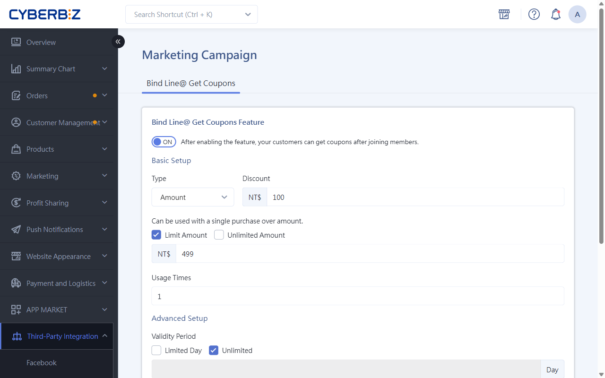
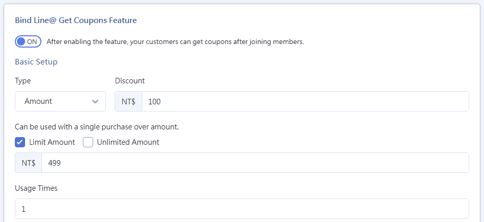
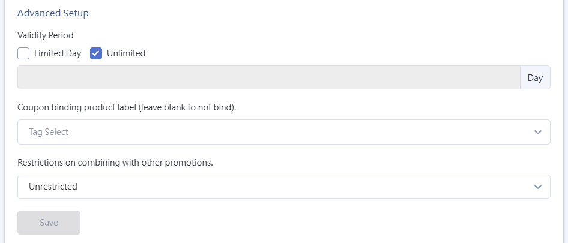

{ .hero-page title="LINE Binding Member Gift coupon" }

## LINE Member Linking Gift Coupon Overview { #operate-line-coupon }

**LINE Binding Member Gift coupon** is designed to increase customers' willingness to link their LINE Official Account to their website member account by offering coupon as an incentive. This strengthens the connection between the brand and its customers.

The following sections explain how this feature works and how to set it up:

## Prerequisites { #prerequisites-line-coupon }

Before enabling this feature, merchants must complete the following:

- [x] [**Connect Messaging API**](connect-line-messaging-api.md){ title="Connect LINE Messaging API" }  : Complete the LINE Messaging API settings first.

- [x] **Binding Flow Check**: Customers must complete the full [**LINE Official Account to Website Member Binding**](bind-line-oa-store-members.md){ title="Bind LINE Official Account to Website Member" }   process before they can receive coupon.

## Admin Setup Steps { #operate-line-coupon-backend-settings-step }

1. **Go to the Settings Page:** Access the admin panel and click **Third-Party Integration > LINE OA Marketing Campaigns**.

2. **Enable the Feature:** On the page, find "**LINE @ Binding Gift coupon Feature**" and switch the toggle to **ON**. Once enabled, customers who complete linking automatically receive the default coupon.

3. **Basic Setup**

	- **Type**: Choose "**Amount**" or "**Percentage**" (for example, a discount of NT$100 or a price set at 90% of list price).

	- **Single-Order Spend Threshold**: Set either "Limited Amount" (the discount applies only when the purchase reaches the specified threshold) or "Unlimited Amount."

	- **Usage Limit**: Set the maximum number of times each customer can use this coupon.

	{ title="Binding Gift coupon - Basic Settings" }

4. **Advanced Setup**

	- **Validity Period**: Set either "Limited Days" or "Unlimited Period."

	- **coupon Product Tag Binding**: Merchants can limit this coupon to products with specific tags.

	- **Combination Restrictions with Other Promotions**: Set whether this coupon can be used together with store-wide promotions or other offers.

	!!! info "Combination Logic Overview"
		Merchants can set whether coupon can be used together with other marketing campaigns, such as item-level discounts or store-wide promotions. The following shows how the system determines combinations across three scenarios:

		- **Unrestricted** This coupon has the highest compatibility and can be used together with all marketing offers on the website.

		- **coupon Used With Non-Designated Promotions:** The system evaluates **on a per-product basis**.
        > If a single product already qualifies for a designated promotion, that product cannot use this coupon. However, other products in the cart that are not part of the promotion can still receive the discount.

		- **If a Designated Promotion Does Not Allow This coupon:** The system evaluates **per entire order**.
        > If an order contains any product that qualifies for a designated promotion, the entire order is blocked and cannot use this coupon.

	{ title="Binding Gift coupon - Advanced Settings" }

5. **Apply Settings:** After completing the settings, click **Save** to apply the changes.

## Key to Guiding Customers to Link { #operate-line-coupon-bind }

To ensure the system correctly identifies linking behavior and sends coupon, merchants **must** have customers link through the following specific link:

- **Exclusive Binding Link**: `https://your-domain/customer/auth/line?line_action=line_login`.

- **Suggested Use**: Merchants can place this link in the [LINE **Rich Menu**](../marketing/setup-line-rich-menu.md){ title="Set Up LINE Rich Menu" }  or in the [**Welcome Message for New Friends**](bind-line-oa-store-members.md#operate-line-bind-welcome){ title="Bind LINE Official Account to Website Member" }, encouraging new friends to click and link immediately.

## Advanced Tips { #intro-line-coupon }

If many registered members have not yet linked their LINE OA, merchants can use the "**LINE OA Friend Invitation**" feature. This feature sends invitation messages with incentives via SMS or Email, encouraging members to complete linking and claim the offer.

- :lucide-user-plus:{ .lg }   
  [__LINE Friend Invitation__](../../../notifications/send-line-friend-invitation.md){ title="Send LINE Friend Invitation" }       
  Send a referral link via SMS or Email to invite customers to add the LINE Official Account, converting regular members into brand friends.

<!--
- :lucide-ban:{ .lg }     
  [____]()  
  .
-->

## FAQ { #faq-line-coupon }

??? quote "Why didn't customers receive coupon after completing linking?"
	Check the following troubleshooting steps in order:

	1. **Link Accuracy**: Check whether the customer linked through the exclusive link `?line_action=line_login`. If they only logged in normally without this parameter, the system cannot identify the event as a "binding campaign."
	2. **Feature Toggle**: Confirm that the "LINE @ Binding Gift coupon Feature" is switched to **ON**.
	3. **Messaging API Status**: Check whether the API integration in `Third-Party Integration > LINE Settings` shows as normal.
	4. **Claim History**: Check whether the customer previously unbound and then linked again. Each member account can usually claim only once.

??? quote "If a customer is already a LINE friend and links now, can they still claim the coupon?"
	**Yes.** As long as the member's website account is not yet linked to a LINE UID and they complete the "binding process" through the designated path, the system triggers the coupon issuance mechanism. This feature is not limited to "new friends." It applies to "new binding actions."

??? quote "What is the specific difference between "per product" and "per order" in combination restrictions?"

	- **Per Product**: More flexible. For example, if product A has a discount and product B does not, coupon applies only to product B, and product A keeps its original discount.  
	- **Per Order**: Strict exclusion. If the cart contains any promotional product (such as store-wide 80% of list price products), the entire order cannot enter or redeem this coupon, regardless of the order amount.
