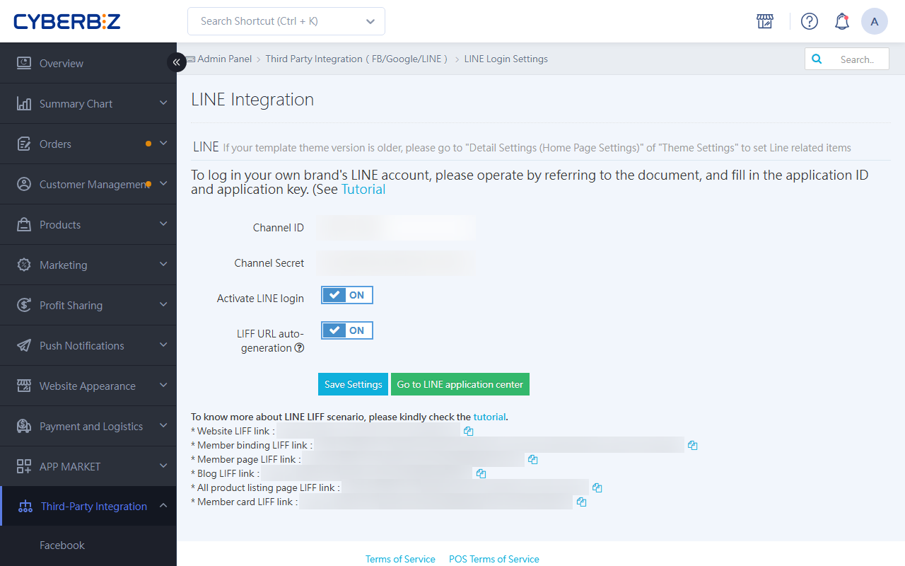

{ .hero-page }

## What Is LINE Quick Login { #intro-line-quick }

**LINE Quick Login** lets customers log in or register as members directly with their LINE accounts. The system automatically retrieves the "Email" linked to the customer's LINE account to match accounts. This not only simplifies the shopping process but also increases the exposure of your official account, and lets merchants filter members who log in through LINE in the admin.

The following is a detailed setup tutorial for LINE Quick Login:

## Setup Prerequisites and Notes { #prerequisites-line-quick }

- **Email Binding**: The customer's LINE account **must first have an Email bound** before they can use LINE Quick Login.

- **Provider Consistency**: If you already have a LINE Official Account (Messaging API), make sure the **LINE Login Channel** and the **Messaging API Channel** are under the **same Provider (service provider)**. [Learn About Providers and Channels :lucide-external-link:](https://tw.linebiz.com/manual/line-official-account/line-porvider-and-channel-intro/).

- **Hinet Email Restriction**: If a customer registers with a Hinet email address, they may be unable to reset their password because Hinet blocks the messages.

## LINE Developers Setup Steps { #operate-line-quick }

!!! info "You need a LINE account first. Learn [how to create a LINE Official Account :lucide-external-link:](https://help2.line.me/official_account_tw/web/pc?contentId=20013137&lang=zh-Hant)"

1. **Create a Login Channel**: Log in to [LINE Developers :lucide-external-link:](https://developers.line.biz/), select the correct Provider, then click **Create a LINE Login channel**.

2. **Enter Basic Information**:

	- **Region**: Select "Taiwan" (Taiwan site) / "Japan" (Japan site).

	- **App types**: Select the "Web app" checkbox.

	- Enter the channel name, channel description, Email, and the website's privacy policy and terms of service URLs.

	

3. **Apply for OpenID Connect**:

	- At the bottom of the "Basic settings" tab, find "OpenID Connect" and click "Apply".

	- Select the content as needed, upload the merchant logo, and then click Submit. This step is critical for **ensuring the customer's Email can be retrieved**.

	

4. **Set the Callback URL (Critical Step)**:

	- Switch to the "LINE Login" tab, and enter the following in the **Callback URL** field:`https://your-store-url/customer/auth/line/callback`.

	- **Tip**: If you have your own domain, be sure to enter both the CYBERBIZ domain and your own domain. Cross-border customers only need to enter the general domain, without adding `zh-TW`.

	

5. **Publish the Channel**: Change the channel status from "Developing" to "**Published**".

	

## CYBERBIZ Back-End Integration Steps { #operate-line-quick-cyberbiz-backend-connect-step }

1. **Get the Keys**: On the "Basic settings" tab in LINE Developers, copy the **Channel ID** and **Channel Secret**.

2. **Enter Credentials in the Back Office**: Go to the CYBERBIZ admin **Third-Party Integration > LINE Login**.

3. **Enable the Feature**: Paste the Channel ID and Channel Secret, turn on the "**Enable LINE Login**" toggle, and save. The login button then appears on the storefront.

## Advanced and Value-Added Features { #intro-line-quick-advanced }

### Prompt Customers to Add Friends { #intro-line-quick-advanced-overview-line-quick }

- In the **Basic settings > Linked LINE Official Account** in LINE Developers, select the Official Account under the same Provider.

	

- After setup, the "Add Friend" option appears on the customer's screen during quick login.

	

## Next Steps { #next-steps-line-quick }

- :lucide-phone:{ .lg }   
  [__Sync Member Phone Numbers__](setup-line-quick-login-phone-number.md){ title="Set up retrieval of member phone numbers during LINE quick login" }       
  After you apply for LINE verification permissions, the system uses the phone number as the primary identifier. This ensures the accuracy and uniqueness of the member database.

- :lucide-link:{ .lg }     
  [__Configure LIFF One-Tap Login__](setup-liff-auto-login-member-binding.md){ title="Set up LIFF auto-login and member binding" }    
  Enable LIFF redirect technology so customers can log in automatically by tapping a link inside LINE. This also completes friend tracking and account linking.

## FAQ { #faq-line-quick }

??? quote "A 400 Bad Request Error Page Appears"
	This is usually caused by an incorrect **Callback URL** configuration. Check the settings in the LINE Developers admin, and make sure the URL you enter exactly matches the path provided by the system, including the correct `https://` protocol and trailing format. Even minor character differences, such as extra spaces or slashes, can cause API verification to fail and return a 400 error.

??? quote "Customers report that they cannot automatically jump to the LINE App on iOS devices"
	This is caused by the privacy protection mechanism in iOS browsers. We recommend guiding customers to use the **Safari browser** first. When the system displays the prompt "Open in LINE?", be sure to tap "Open". If the automatic redirect fails, customers can also tap the "Log in with LINE App" button at the bottom of the page to start authorization manually.

??? quote "How the System Handles Account Linking Logic Across Social Accounts"
	The system uses **Email** as the unique identifier. When a customer's Facebook and LINE accounts are registered with the same Email, the system automatically consolidates them into one member identity and links them together. If the two Emails are different, the system treats them as separate member accounts. Merging accounts across different Emails is not currently supported.
