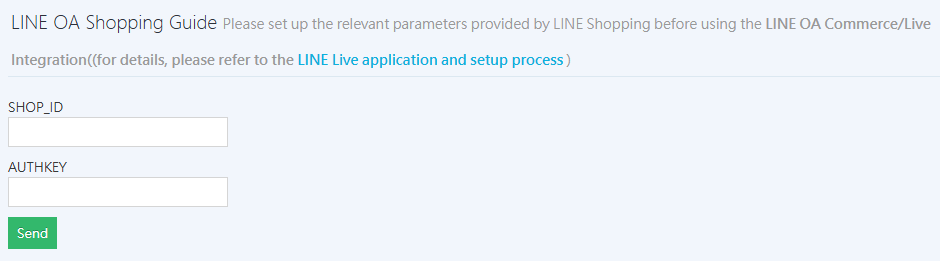

## LINE Live Overview

**LINE Live** (Watch & Buy mode) lets merchants host live shopping streams directly on their LINE Official Account and send viewers to the website to place orders.

!!! info "For more information about LINE Live features, see [LINE LIVE official documentation :lucide-external-link:](https://tw.linebiz.com/service/account-solutions/line-live/)."

## Eligibility and Notes

- **Account type restriction**: Only **verified accounts (blue shield)** may apply. For the verification process, see [official instructions :lucide-external-link:](https://tw.linebiz.com/column/line-lac-id-0418/).
    *   **Standard accounts (gray shield)**: Applications are not currently accepted.
    *   **Enterprise accounts (green shield)**: Access is by invitation only, and these accounts are also eligible.
- **Official account friend count**: We recommend **1000 or more friends** to ensure viewing and conversion results.
- **Customer restriction**: Customers must be friends of the official account and [have linked their website member account with LINE OA](account-integration/bind-line-oa-store-members.md){ title="Link LINE Official Account with website member" }, to enter the live room and place orders.
- **Live frequency recommendation**: We recommend at least 4 live sessions per month to build viewing habits with your friends.

## Application and Launch Process

1.  **Submit the form**: Request and complete the [LINE Live eligibility application form :lucide-external-link:](https://docs.google.com/forms/d/e/1FAIpQLSeaMKpcK0DOaTvZDy_229oV3mV_k50-oKKTljdGh9sUXuRD1A/viewform) from CYBERBIZ.
2.  **Activation waiting period**: After you confirm your application, CYBERBIZ helps enable back-office integration and requests parameters from LINE. This process takes **about 30 days**.
3.  **Enable permissions**: Go to the back office **Website Management > User Account Settings > Manager List** and **turn on Back-office Assistant Permission**. A CYBERBIZ specialist will help set up the back-office parameters.
4.  **Official launch**: LINE sends an email confirming activation. After you receive it, you can start live streaming. LINE also provides tutorials for the LINE Live back office.

##  Set up the Back Office and Enter Parameters

If you have received the parameter email, enter the parameters in the back office yourself, or ask a specialist to help:

*   **Setting location**: Log in to the CYBERBIZ back office and go to **Third-Party Integration > LINE Shopping > the LINE OA Shopping Guide section at the bottom of the page**.
*   **Fill in fields**: Enter the **SHOP_ID** and **AUTHKEY** provided by the system, and save.

{ title="LINE OA Shopping Guide Settings" }

## Product Integration and Sync Logic

To make sure products can be found during a live stream, they must meet these requirements:

1.  **Product status**: Must be **Published** and **Listed**.

    { title="Filter for published and listed products" }

2.  **Tag exclusion**: The product tags field **must not** include "Gift" or "Exclude product feed".

    { title="Product tag settings" }

3.  **Sync times**:
    *   **CYBERBIZ automatic update**: The product catalog is generated automatically at 4:45 AM and 4:45 PM daily.
    *   **LINE automatic sync**: Catalog information syncs to the LINE Live back office at 5:00 AM daily.
    *   **Manual update**: If you need to sync edited product information right away, go to **LINE Shopping Settings** and click **Manually Update Catalog** (one click per hour only).
4.  **Product search tip**: When searching for products in the LINE Live back office, we recommend **Product ID (PID)** for the most accurate results.
    *   *How to get the PID: open the product edit page in the back office (Product Info tab) and check the number at the end of the URL, or view the ID column in the [exported product list](../../products/bulk-operations/excel-import-products.md#determine-add-or-update){ title="Bulk Import Products via Excel" }.*

    { title="Product edit page PID" }

## View Orders

Orders completed through LINE Live referrals can be viewed and managed in the back office under **Orders ** > ** LINE OA Orders**.

{ title="View LINE OA orders" }

## Next Steps

- :lucide-book:{ .lg }   
  [__LINE Live Application Manual__ :lucide-external-link:](https://drive.google.com/file/d/1cOVeAlq9l55rjU2yR_8krxWafSXOzZ2P/view)     
  A complete guide for CYBERBIZ merchants that covers LINE Live market trends, interface features, and back-office operations.

- :lucide-book:{ .lg }     
  [__Live Streaming Tools Manual__ :lucide-external-link:](https://drive.google.com/file/d/1hiAUhEv0TA-N4jBb3HZmuZPQqDT4qOur/view)  
  Explains live referral tactics for platforms such as FB, IG, and YT, and shows how to use the one-page store and UTM tracking to measure results.

## Frequently Asked Questions

??? quote "Why can't I find a product I just listed?"
    Products take time to sync to the LINE Live back office. The CYBERBIZ system generates the catalog at 4:45 AM and 4:45 PM daily, and LINE syncs at 5:00 AM.

    If you update products outside the sync windows, go to **LINE Shopping Settings** and click **Manually Update Catalog**, then check the LINE back office one hour later.

??? quote "My LINE Official Account has a gray shield. Can I apply?"
    No. LINE Live is currently available only to verified accounts (blue shield) or enterprise accounts (green shield). If you have a standard account (gray shield), you must first apply for account verification with LINE.

??? quote "Do customers need to link a website member account to place orders in the live room?"
    Yes. To ensure that orders are sent correctly to the CYBERBIZ back office and that bonus points or promotions are calculated, customers must:

    1. Be a friend of your LINE OA.
    2. Link their LINE account to a website member account.

    Without this link, customers cannot complete checkout in the Watch & Buy flow.

??? quote "How do I tell whether an order came from LINE Live?"
    All orders from this feature are tagged with their source. Go to Orders > LINE OA Orders. Every order on that tab was completed through LINE Live referrals.

??? quote "How long after I submit the application form can I start live streaming?"
    Because LINE must issue the parameters (SHOP_ID and AUTHKEY), the whole process takes about 30 business days. We recommend planning your marketing calendar early.
