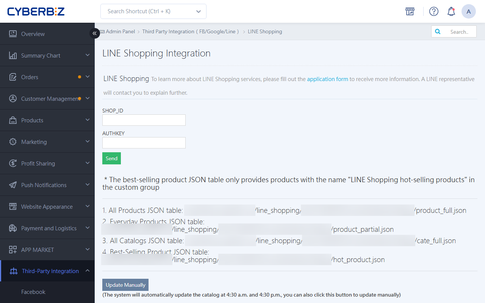
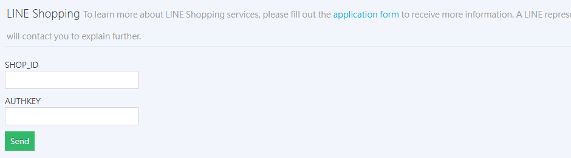

{ title="LINE Shopping Referral Setup" .hero-page }

## LINE Shopping Overview

**LINE Shopping** is an e-commerce platform that combines referrals, points rewards, and price comparison. By connecting your website to LINE Shopping, merchants can use the LINE Shopping app or its official account entry point to refer customers to the website to place orders.

## Important Notice

*   **Applicable Plans**: This feature is available only to **PLUS and Enterprise** plan users.
*   **Open Platform**: LINE Shopping is a public platform. Consumers do not need to be friends with the merchant's LINE Official Account or link an OA to place an order.
*   **Precise Product Search**: When searching for products in LINE Live or related back-office tools, using **Product ID (PID)** is the most precise option. The PID can be found at the end of the product edit URL or in the exported product report.

## Application and Activation Process

1.  **Fill Out the Application Form**: Merchants must first complete the [application form :lucide-external-link:](https://docs.google.com/forms/d/e/1FAIpQLSeaMKpcK0DOaTvZDy_229oV3mV_k50-oKKTljdGh9sUXuRD1A/viewform) to get more information. A LINE representative will then contact you to explain the next steps.
2.  **Eligibility Review**: LINE handles initial contact and eligibility review. After approval, LINE notifies CYBERBIZ to activate eligibility.
3.  **Enable Support Access**: Merchants must enable support access in the CYBERBIZ back office so that a specialist can help configure the parameters.
    *   **Path**: Management Center > Website Permissions > Administrator List.
4.  **Enter Parameters**: A CYBERBIZ specialist will help enter the **SHOP_ID** and **AUTHKEY** provided by LINE into the system.
    *   **Path**: Third-Party Integration > LINE Shopping Settings > the LINE Shopping section at the top of the page.

{ title="LINE Shopping Settings Page" }

## Product Feed Logic and Requirements

A product must meet all three of the following conditions to appear in the product catalog:

- [x] **Status is set to "Public"**.
- [x] **Status is set to "Listed"**.
- [x] **Tag exclusion**: Product tags must **not** contain the keywords "Gift" or "Exclude product feed".

!!! tip "To verify the pages and paths, see [Product Feed and Sync Logic](apply-setup-line-live-stream.md#商品串接與同步邏輯){ title="Apply for and set up LINE Live Feature" } in the LINE Live documentation."

## Catalog Update and Sync Timing

*   **Automatic Update**: The CYBERBIZ back office generates the product catalog automatically at **4:45 AM and 4:45 PM daily**. LINE then syncs the information to its back office at **5:00 AM daily**.
*   **Manual Update**: To sync product changes immediately, go to LINE Shopping Settings and click the **Manually Update Catalog** button (limited to one click per hour).
*   **Prerequisite**: Complete all product setup at least **one day before** the live stream or event to ensure the catalog syncs smoothly.

## Order Viewing and Management

*   **Order Attribution**: Orders placed through LINE Shopping referrals can be viewed in **Orders > LINE Shopping Orders** at [this page](group-buy/setup-line-group-buy-group.md#訂單查看與紀錄管理){ title="Set up LINE Group Buying Groups" }.
*   **Referral Source Tracking**: Merchants can also check whether an order came from LINE Shopping by [viewing the Referral Source column](../../orders/reports/export-order-report.md#步驟一選擇報表欄位){ title="Export Order Report" } in an exported order report.

## FAQ

??? quote "Why did an order show as placed but not appear in LINE Shopping Orders?"
    There are usually several possible reasons:

    1. **Broken Customer Path**: Although the customer entered the website from LINE Shopping, they may have switched browsers, opened private browsing mode, or clicked another ad source (such as FB or Google ads) before placing the order. This overwrites the tracking code (cookie).
    2. **Expired Cookie**: LINE Shopping tracking windows are time-limited (depending on LINE's policies). If the customer places an order long after clicking, the order is not attributed as a referral order.
    3. **Manually Entering the URL**: If the customer sees a product on LINE Shopping and then opens a browser and types the website address manually, this activity cannot be tracked.

??? quote "Why are product prices on the LINE Shopping platform still outdated after I changed them?"
    LINE Shopping does not sync in real time. The system updates on a fixed schedule:

    * **Automatic Sync**: Updates daily at 5:00 AM. If you change a price at 10:00 AM, the change will not appear until the following morning at the earliest.
    * **Manual Sync**: You can go to LINE Shopping Settings and click "Manually Update Catalog" to force an update (limited to once per hour).

??? quote "If a customer cancels an order or returns items, will the LINE POINTS be reclaimed?"
    Yes. When a merchant updates an order status to "Cancelled" or "Return Completed" in the CYBERBIZ back office, the system sends this information to LINE. LINE then does not issue (or reclaims) the LINE POINTS for that order.

??? quote "Why do certain products never appear in the LINE Shopping catalog?"
    Check whether the product was mistakenly tagged with "Gift" or "Exclude product feed". These tags trigger a filter that keeps the product out of the sync list.
