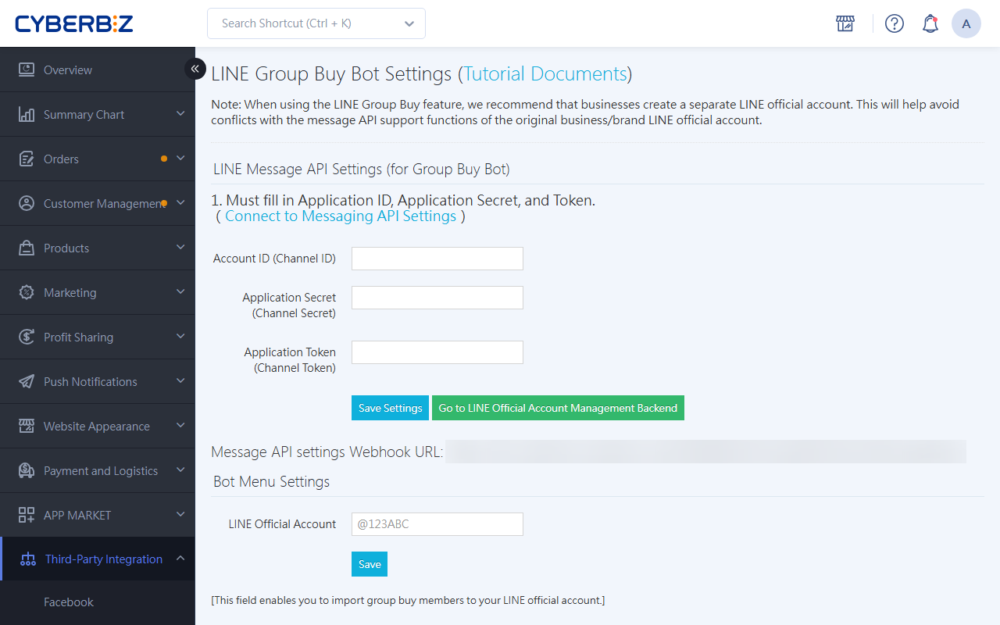
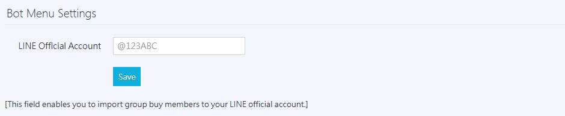

{ title="LINE Group Buy Bot Setup" .hero-page }

## What Is the LINE Group Buy Bot { #intro-line-group-bot }

**LINE Group Buy Bot Setup** is the foundation for running group buying in LINE groups. Set up a dedicated group buy bot and add it to a LINE group so that members can shop directly within the group.

The following is a detailed guide to **LINE Group Buy Bot Setup**:

## Use Cases and Limitations { #prerequisites-line-group-scope }

*   **Purpose**: Helps merchants run group buying activities in LINE groups and invites members to add the brand's official account as a friend.
*   **Supported environment**: Only **LINE groups** or **multi-person chats** are supported. LINE communities (OpenChat) are not supported due to anonymity restrictions.
*   **Recommended practice**: Create the brand official account and the group buy bot account separately to avoid functional conflicts. Both should use the **same LINE Provider (service provider)** so that user data can flow between them.

??? info-clean "LINE Official Account and Group Buy Bot Routing Diagram"
    ```mermaid
        graph LR
            %% Define Node Styles
            classDef provider fill:#76B947,stroke:#5E9639,color:#fff,font-weight:bold;
            classDef officialAccount fill:#5B9BD5,stroke:#4A80B1,color:#fff,font-weight:bold;
            classDef notes fill:none,stroke:none,color:#333,text-align:left;

            %% Nodes
            P("Service Provider<br>(LINE Provider)<br>ex. CYBERBIZ Provider"):::provider

            OA1("LINE Official Account 1<br>(Brand Official Account)<br>ex. CYBERBIZ Brand Official Account"):::officialAccount

            OA2("LINE Official Account 2<br>(Group-Buy Bot Official Account)<br>ex. CYBERBIZ Group-Buy Official Account"):::officialAccount

            N1("Member Management<br>Message Push<br>Segment Marketing<br>Interactive Games<br>FAQ..."):::notes

            N2("Group-Buy Campaign"):::notes

            %% Connections
            P --> OA1
            P --> OA2

            %% Attach Notes (Invisible lines to position text)
            OA1 -.- N1
            OA2 -.- N2
    ```

## Prerequisites { #prerequisites-line-group-setup }

Before you begin, make sure you have the following:

- [x] A LINE Provider
- [x] A brand LINE official account
- [x] A group buy bot LINE official account
- [x] CYBERBIZ admin access
---

## Bot-Specific Messaging API Setup { #operate-line-group-bot }

1.  **Create an account**: Go to [LINE OA Manager :lucide-external-link:](https://manager.line.biz/) and create a dedicated LINE official account for group buying.

    { title="Create a new account" }

2.  **Account Settings**: In **Settings > Account Settings**, set **Accept Invitations to Groups or Multi-Person Chats** to **Accept Invitations to Groups or Multi-Person Chats**.

    { title="Account settings: accept group invitations" }

3.  **Response settings**: In the Response settings section,
    - Enable the **Chat** feature.
    - Set **Response mode** to **Manual chat + automatic response messages**.
    - **Disable** the welcome message that is sent when users add the account as a friend.

    { title="Group buy bot response settings" }

4.  **Enable Messaging API**: Click "Enable Messaging API", and select the same **LINE Provider** as your brand website.

    { title="Enable Messaging API" }

    !!! warning "Ensure Consistent Customer Identity (UID)"
        If your brand already has a LINE Provider (service provider), select "Existing provider" and **do not create a new Provider**.

        **Reason**: LINE user identifiers (UIDs) are managed per Provider. If the bot and the brand official account belong to different Providers, the system cannot recognize them as the same user.

        **Impact**: Creating the brand official account and the group buy bot under the **same Provider** keeps member identity consistent and prevents data integration failures.

5.  **Connect to the back office**:

    *   Copy the LINE Channel information to the CYBERBIZ admin (path: **Third-Party Integrations ** > ** LINE Group Buy Bot Setup**).

        { title="Copy and paste the Messaging API" }

    *   Paste the **Webhook URL** provided by CYBERBIZ back into the Messaging API settings in LINE OA Manager, then click **Save**.

        { title="Paste the Webhook URL" }

6.  **Get the Access Token**:
    - Go to [LINE Developers Console :lucide-external-link:](https://developers.line.biz/console) and open the account, or click the guide link directly from the Messaging API page in LINE OA Manager.

        { title="Open the Developers Console" }

    - On the "Messaging API" tab, turn on **Use webhook**, and paste the Webhook URL copied from the CYBERBIZ admin.

        { title="Turn on the Webhook and paste the URL" }

    - Click **Issue** to get the **Channel access token**, paste it back into the CYBERBIZ admin, and save.

        { title="Paste the Channel Access Token" }

---

## Bot Menu Setup { #operate-line-group-bot-settings }

*   If you already operate a brand LINE official account, enter its **Account ID** in the admin.
*   During group buying (for example, in the main menu, the order completion page, and thank-you messages), the system guides users to add the brand as a friend, which helps grow your membership.

{ title="Group buy bot official account settings" }

## LIFF Setup <small>Key Steps</small> { #operate-line-group-bot-liff-settings-step }

This setting allows the bot to open the shopping interface within the group:

1.  **Create a Login Channel**: Sign in to [LINE Developers Console :lucide-external-link:](https://developers.line.biz/console), click "Create a new channel" under the same LINE Provider, and select "**LINE Login**".

    - **Region** and **Company or owner's country or region**: Select Taiwan.

    { title="Create a LINE Login channel" }

2.  **Request permissions**: Open the Basic settings tab of the channel. Under OpenID Connect, click **Apply** next to Email address permission, select the required items, upload a screenshot of the privacy policy, and then click **Submit**.

    { title="Request OpenID Connect permissions" }

3.  **Add a LIFF app**: Open the LIFF tab, click Add, and configure the following:
    *   **Size**: Select Tall.
    *   **Endpoint URL**: Enter `[your-domain]/liff`.
    *   **Scopes**: Select all, and make sure to turn on **`chat_message.write`** under view all.
    - After you finish the settings, click **Add** to create the LIFF app.

    { title="Add a LIFF app" }

4.  **Link the OA**: Under Basic settings, select your group buy bot account in **Linked OA**, and click Update.

    { title="Linked OA setting" }

5.  **Publish**: Paste the **LIFF ID** and **LIFF URL** into the CYBERBIZ admin. Finally, change the LINE Developers status from "Developing" to "**Published**".

    { title="Copy and paste the LIFF ID and URL" }

## Next Steps { #next-steps-line-group-bot }

After you finish the bot setup, complete the following two settings before going live:

<div class="grid cards" markdown>

- :lucide-package:{ .lg }   
  [__Group Buy Product Setup__](setup-line-group-buy-products.md){ title="Set Up LINE Group Buy Products" }  
  Select products from the website and set the group buy price.

- :lucide-users:{ .lg }     
  [__Group Buy Group Setup__](setup-line-group-buy-group.md){ title="Set Up LINE Group Buy Groups" }  
  Add the bot to a group, and set up the revenue-sharing plan and event schedule.

</div>

## FAQ { #faq-line-group-bot }


??? quote "Why can't the group buy bot be used in LINE communities (OpenChat)?"
    LINE communities anonymize member identities by default to protect privacy and do not support full Messaging API integration. As a result, the group buy bot currently supports only regular LINE groups and multi-person chats.

??? quote "Why does an error appear when I click Verify after setting up the Webhook?"
    Check the following two items:

    1.  URL accuracy: Make sure the Webhook URL copied from the CYBERBIZ admin is complete and has no extra spaces.
    2.  HTTPS certificate: Your website must have a valid SSL certificate (HTTPS) for LINE to deliver events successfully.
    3.  Save in the admin: Confirm that you have pasted the Channel information into the CYBERBIZ admin and clicked Save before you return to LINE to verify.

??? quote "Why can't customers open the shopping interface after tapping in the group?"
    This is usually related to the LIFF settings. Check the following:

    1.  Published status: The channel status in the LINE Developers Console must be Published (green), not Developing.
    2.  Scopes permission: Confirm that chat_message.write is selected in the LIFF settings and saved.
    3.  Linked OA: Confirm that the LIFF is linked to the official account of the group buy bot.

??? quote "Important: Why must the same Provider be used?"
    If the brand account is under Provider A and the group buy bot is under Provider B, the same user will have completely different UIDs (Unique IDs) on each side, from LINE's perspective. This causes the following:

    * The system cannot determine whether the person making a group purchase is an existing member of the website.
    * bonus points, coupon cannot be accumulated or redeemed across platforms.
    * Order data in the admin cannot be correctly attributed to customers.
