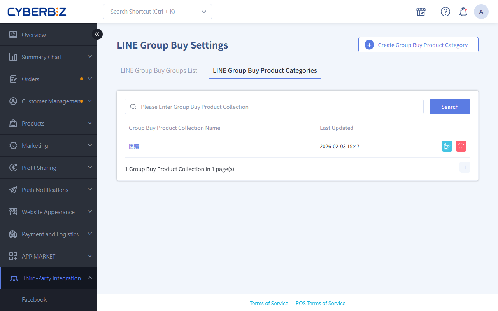

{ title="LINE Group-Buy Product Setup" .hero-page }

## LINE Group-Buy Product Overview { #overview-line-products }

**LINE Group-Buy Product Setup** lets merchants select products from the storefront's public products, build a dedicated group-buy product list, and set a separate **group-buy price**.

## Create Group-Buy Product Categories and Set Group-Buy Prices { #operate-line-products }

1.  **Path:** Log in to the CYBERBIZ admin dashboard and go to **Third-Party Integration > Line Group Buy Settings**.
2.  **Add a category:** Click the "**Create Group Buy Product Category**" button.
3.  **Name the category:** Enter a name for this group-buy product category. **The name cannot be changed after it is saved.** To rename it, you must add a new category or use the copy feature.
4.  **Select Product** Select the products to add to the group buy from the list, click the action menu, and select "Add Selected Products".

    - Confirm status: Products that are added successfully automatically appear in the "Selected Products" list below.
    - Products with multiple variants: If a product has multiple variants (specifications), the system automatically expands them and lists each one separately. Merchants can set a different group-buy price for each variant.

    { title="Add Selected Products" }

5.  **Edit the price:** In the **Selected Products** list, enter the group-buy price for each product sold in the LINE group, then save.

    { title="Edit Group-Buy Price" }

---

## Copy Group-Buy Product Category <small>Advanced Use</small> { #intro-line-products }

If you want to offer the same product combination to different group organizers at different prices, you can use the copy feature to save setup time:

1.  **Make a copy:** Go to the category edit page and click "**Copy Group Buy Product Category**" next to the category you created.
2.  **Rename** Name the copied category (for example, add the group organizer's name to make it easier to identify). After you save, you can open the category.
3.  **Adjust prices:** Based on the discount strategy for this group organizer, update the group-buy prices of the products in the category.

{ title="Copy Group-Buy Product Category" }

---

## Important Notes { #intro-line-products-overview-line-products }

*   **Product source:** Only products with a status of "Public" in the storefront can be selected.
*   **Name restriction:** After a group-buy product category is saved, its name is locked. To change it, you must add a new category or use the copy feature.
*   **Variant display:** In the LINE group-buy interface, each variant of a product appears separately in the list for group members to choose from.
*   **Marketing campaign restriction:** The group-buy cart does **not** support general storefront marketing campaigns (such as store-wide discount or spend-threshold gifts).

## Next Steps { #next-steps-line-products }

- :lucide-users:{ .lg }     
  [__Group-Buy Group Setup__](setup-line-group-buy-group.md){ title="Set Up a LINE Group-Buy Group" }  
  Add the bot to the group, then set up the profit-sharing plan and campaign schedule.

## FAQ { #faq-line-products }

??? quote "Why can't I find a product in the "Select Products" list?"
    Check whether the product's status in the storefront admin is "Public." The system only pulls products that are listed and public, so customers can submit orders normally.

??? quote "What should I do if I entered the wrong name for a group-buy product category?"
    Because the system does not allow the name to be edited after it is saved, we recommend that you use the "Copy Group-Buy Product Category" feature, enter the correct name, save it, and then delete the original category.

??? quote "Can the group-buy price be set higher than the original storefront price?"
    Yes. The system allows custom group-buy prices. However, to maintain the group-buy CVR, we recommend setting the group-buy price lower than or equal to the storefront price.

??? quote "Can customers use coupon or bonus redemption from the storefront when they submit orders through LINE group-buy?"
    No. As described in "Important Notes," LINE group-buy uses a separate checkout process and currently does not support general storefront marketing campaigns (such as coupon, bonus points, or store-wide spend-threshold discounts).
