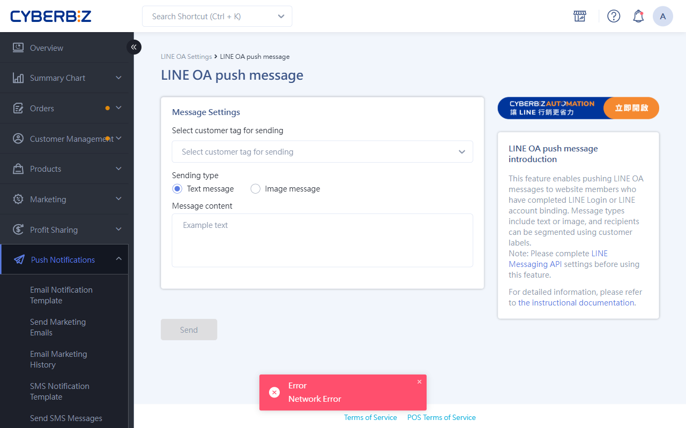

{ .hero-page title="LINE OA Segment Messaging" }

## LINE OA Segment Messaging Guide { #overview-line-segment }

**LINE OA Segment Messaging** lets merchants send targeted messages to members with specific tags, improving conversion rates and reducing unnecessary messaging costs.

Below are detailed instructions and a walkthrough:

## Prerequisites { #prerequisites-line-segment }

Before using segment messaging, make sure you complete the following setup:

- [x] [**Connect Messaging API**](../account-integration/connect-line-messaging-api.md){ title="Connect LINE Messaging API" }: Merchants must first complete the LINE Messaging API connection setup before they can send messages from the CYBERBIZ admin.
- [x] **Collect member UIDs**: Messages can only be sent to website members who have previously completed **"[LINE Quick Login](../account-integration/setup-line-quick-login.md){ title="Set up LINE Quick Login" }"** or **"[Linked LINE OA](../account-integration/bind-line-oa-store-members.md){ title="Bind LINE Official Account to Website Member" }"**, because only these actions leave the UID needed for sending messages in the website system.
- [x] **Confirm friend status**: Only **LINE OA friends** (who have not blocked the Official Account) can successfully receive messages.
- [x] **Messaging fees**: The LINE push service bills according to the message plan you set for your LINE Official Account. Manual pushes and automated notifications are both paid items, and only successfully sent messages are billed.

## Steps to Send Segment Messages Manually { #operate-line-segment }

1.  **Admin path**: Go to the admin dashboard and click **Push Notifications > LINE OA Send Messages**.
2.  **Set customer tags**: In the "Customer Tags" field, select the tags for the audience you want to message (required). The system automatically filters members who match the tags and have a UID.
3.  **Select a Sending Type** (only one mode can be selected at a time):
    *   **Text Message**: Supports line breaks and **emoji**, with no character limit. Click Send to schedule the message for immediate delivery.
    *   **Image message**: Upload a single image (recommended: **within 1MB, 1000x1000px**; supports JPG/PNG/JPEG/GIF). You can also set a link that opens when the image is clicked.

{ title="Segment Message Sending Steps" }

## Next Steps { #next-steps-line-segment }

- :lucide-zap:{ .lg }   
  [__Advanced Automated Messaging__](../../../app-market/automation/automation-push-flow.md){ title="Create automated messaging flows with AUTOMATION" }  
Set up automatic messages to "VIP Members," "Potential Loyal Customers," or "Dormant Customers," or send reminders for "Abandoned Carts."

## Frequently Asked Questions { #faq-line-segment }

??? quote "Why do members have UID records but not receive LINE push messages?"
    Message delivery failures usually fall into three main causes. Check them in order:

    1. Customer Status Restrictions (User Side)

        - **Friend relationship ended**: The member once bound a UID, but has since **blocked** the Official Account or **Delete** it from their friend list.
        - **Account is not a friend**: The member only signed in to the website with LINE but has never added your LINE Official Account.

    2. Merchant Settings and Quotas (Merchant Side)

        - **LINE message quota used up**: Check "Message Usage" in the LINE Official Account Manager dashboard. If the free or paid quota for the month has reached its limit, messages cannot be sent.
        - **API connection failure**: Confirm that the Messaging API Channel Access Token is valid. Also check whether a setting was changed in the LINE console and caused the connection to break.

    3. Sending Logic Filters (System Side)

        - **Duplicate sending limit**: If you use an AUTOMATION flow, check whether "Do not resend within a specified number of days" is set. The system automatically excludes members who have recently received a message.

??? quote "How are message quotas calculated for manual sends and AUTOMATION sends?"
    Whether you send a manual push or trigger one through AUTOMATION, both count as Messaging API push messages.

    * Billing follows the LINE Official Account plan you signed up for (low, medium, or high usage).
    * Only successfully sent messages are billed. Messages that fail to send because the member blocked the account are not billed.
