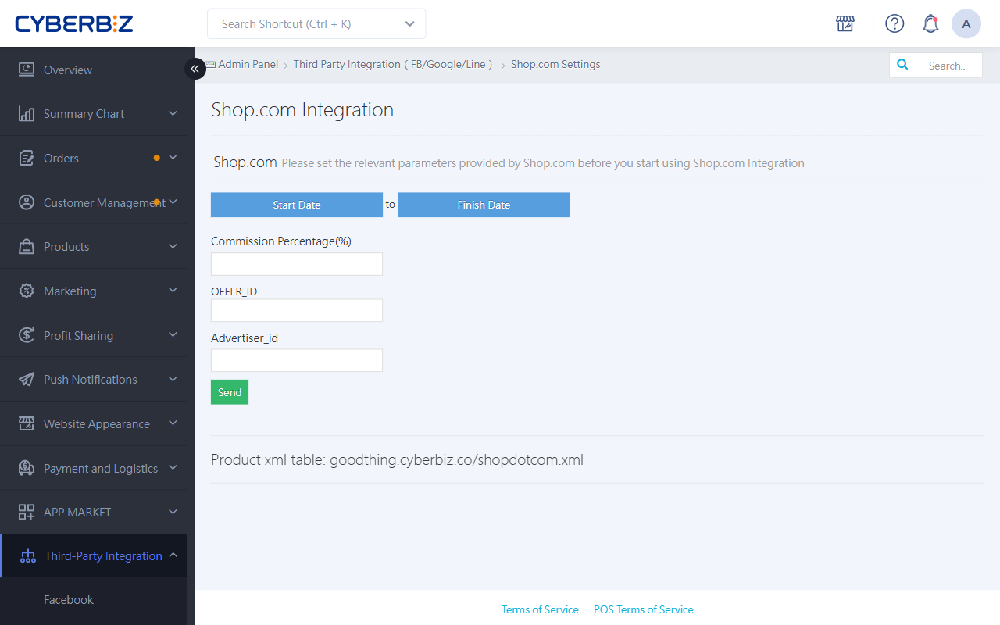
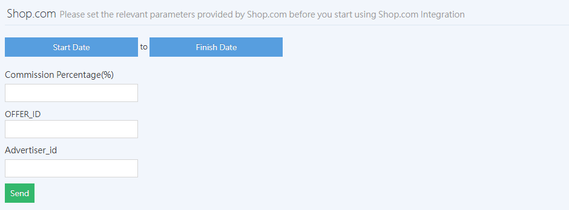
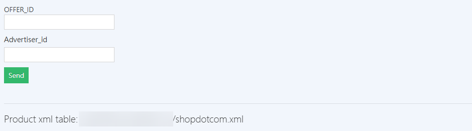

{ title="Third-Party Integration - SHOP.COM" .hero-page }

## SHOP.COM Integration Guide { #intro-setup-shop-com }

Integrate your CYBERBIZ website with **SHOP.COM** to boost brand exposure and sell products through its active dealer member channel.

## Prerequisites and Restrictions { #prerequisites-setup-shop-com }

1.  **Sign the contract**: Merchants must first contact the SHOP.COM Partner Store team and complete the contract.
2.  **Provide basic information**: Merchants must provide the following to SHOP.COM: Unified Business Number, mailing address, contact information, commission rate, website name, and **website URL**.
    *   **Note**: The URL must be an **independent, self-owned domain** (for example, `https://www.yourname.com.tw`). CYBERBIZ subdomains (for example, `xxx.cyberbiz.co`) cannot be used.
3.  **Get parameters**: Within about 5 business days after receiving the information, SHOP.COM will provide your dedicated **OFFER_ID** and **Advertiser_id**.

!!! info "SHOP.COM Referral Attribution Mechanism"
    After a customer clicks a SHOP.COM referral link, attribution remains valid until **the consumer closes the browser**.

    - **Consecutive orders in the same browser**: All orders are successfully attributed.
    - **After the browser is closed**: Tracking expires, and the customer must click the referral link again to be attributed.

## Steps { #operate-shop-com }

### Admin Settings { #operate-shop-com-backend-settings }

!!! warning "If you integrated with SHOP.COM before 2022, contact CYBERBIZ Customer Support to enable the **SHOP.COM API** feature before it can work."

1.  **Enter the identifiers**: Go to **Third-Party Integration > SHOP.COM Settings** in the CYBERBIZ admin, and enter the OFFER_ID and Advertiser_id you received.

    { title="SHOP.COM ID" }

2.  **Check product information**: Make sure products meet SHOP.COM requirements. Otherwise, the XML feed will produce errors:
    *   **Required fields**: Product name, URL, short description, image, selling price, list price, product number (SKU), and group.
    *   **URL rules**: URLs may contain only **English letters and numbers**. Chinese characters are not allowed.
    *   **Image rules**: Images must be **JPG files in RGB mode**.
    !!! info "For field settings, see [Basic Product Settings](../products/create-and-manage/create-update-products.md#operate-product-create-basic){ title="Add and Update Products" } or [Bulk Product Import from Excel](../products/bulk-operations/excel-import-products.md){ title="Bulk Product Import from Excel" }."
3.  **Provide the XML file**: On the same admin page, copy the **Product Data XML Table** URL and provide it to SHOP.COM.

    { title="SHOP.COM Product XML" }

4.  **Report the host IP**: If SHOP.COM asks for the host IP to log transactions and cancellations, reply with this IP: `52.194.101.168`.

    ??? tip "How do I verify the accuracy of the XML data?"
        To check whether the XML content is complete, we recommend the following methods:

        - Direct preview: Paste the XML URL into a browser and check that it loads correctly.
        - Offline review: Download the XML file and convert it to Excel format so you can quickly check required fields for many products.

---

### Exclude Products from Upload { #operate-shop-com-upload-product }

If you do not want certain products (such as free gifts or items not suitable for SHOP.COM) to appear on SHOP.COM, enter **贈品** (free gift) in the product tags field. This has the following effects:

- The product will not appear on SHOP.COM and will not affect the CYBERBIZ website.
- When an order is placed, the amount of products tagged **贈品** will not sync to SHOP.COM.
- When an order is canceled or returned, the negative amount for products tagged **贈品** will not sync to SHOP.COM.

Learn [How to Exclude Products from Third-Party Platform Uploads](../products/categories-and-tags/manage-product-tags.md#operate-product-tags-exclude){ title="Manage Product Tags" }.

!!! warning "SHOP.COM integration currently **does not support** the "排除product feed" tag. Products can only be excluded with the **贈品** tag."

---

### Order Testing Process { #operate-shop-com-order-flow }

Before going live, SHOP.COM will run order tests:

1.  **Place test orders**: SHOP.COM will place three orders under the name "SHOP.COM Test" (usually two are attributed and one is not) and notify the merchant by email.
2.  **Return the report**: Log in to the CYBERBIZ admin, go to **SHOP.COM Settings**, export the order report for that period, and send it to SHOP.COM. The report must include RID, Click ID, and other information.

    { title="SHOP.COM Order Export Date" }

3.  **Cancel the order**: After confirming success, go to **Orders > SHOP.COM Orders** and cancel the test order.
    *   **Note**: When canceling, keep the **order amount** that the system fills in automatically (excluding shipping). Do not enter 0.

    { title="SHOP.COM Cancel Order" }

!!! info "Contact and Support"
    If you have questions about integration progress or actions on the SHOP.COM side, contact the SHOP.COM Partner Store team directly:

    * **Email**: [twunfranchiseservices@markettaiwan.com.tw](mailto:twunfranchiseservices@markettaiwan.com.tw)
    * **Customer service phone**: 02-87125598
    * **Service hours**: Monday to Friday, 09:30 – 18:30 (closed on weekends and national holidays)

## FAQ { #faq-shop-com }

??? quote "Integration testing is complete, but later orders are not being counted"
    { #faq-shop-com-attribution }
    This is caused by SHOP.COM's single-click attribution mechanism, not an integration error:

    1. **Only the first completed order is attributed**: Each time a customer clicks a SHOP.COM referral link and goes to your website, the system **attributes only the first completed order after that click**. If a customer places multiple orders in the same browsing session, only the first order is attributed.

    2. **Click the link again**: To attribute every order, remind customers to click the SHOP.COM referral link **before each order (checkout)** and then go to your website to complete the purchase.

??? quote "What should I do if uploading the product data XML file fails?"

    Check the product data XML for missing required fields. Fill them in and send the file again.

??? quote "If I list new products on my website, do I need to re-import the product data XML file?"

    You only need to import the product data XML file once during integration. SHOP.COM updates automatically. Product updates on the SHOP.COM side depend on when SHOP.COM fetches the data, so they are not real-time.

??? quote "If I issue a partial refund on the Enterprise plan, will SHOP.COM refund the commission on the refunded portion?"

    Partial refunds do not affect the commission. The commission is calculated on the full order amount.

??? quote "Questions about SHOP.COM test orders?"

    CYBERBIZ only provides system integration and does not handle SHOP.COM operational services.

??? quote "Can recurring billing orders and one-page store orders earn SHOP.COM rewards?"

    Recurring billing orders do not qualify. One-page store orders do.

??? quote "Are there any restrictions on order numbers sent from the admin to SHOP.COM?"

    Currently, order numbers are checked as follows: If an order number contains only a-z, A-Z, #, and similar marks, the full order name is sent to SHOP.COM. If it contains any other characters, only the numeric part of the order number is sent.

