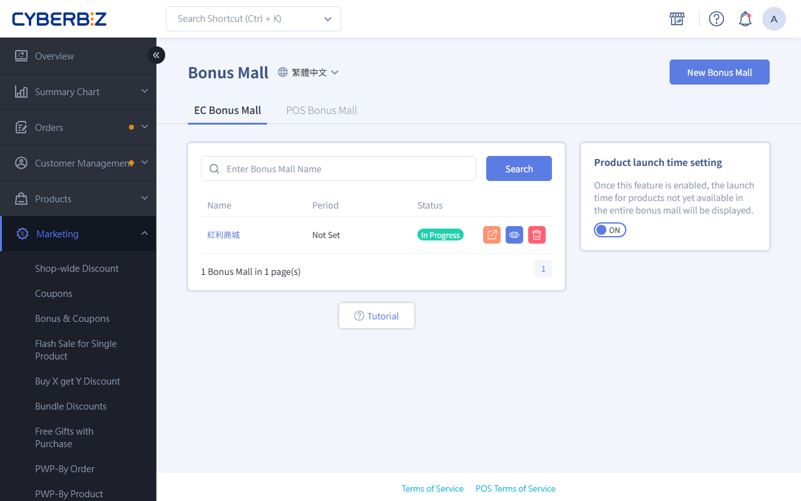
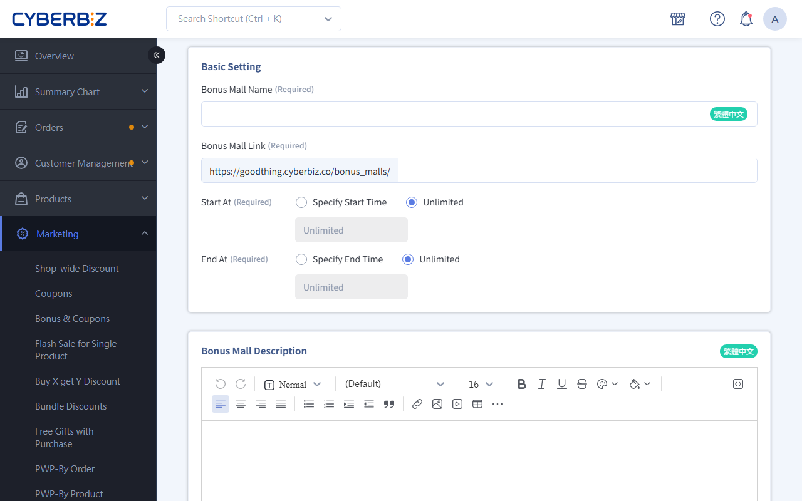

# Bonus Mall (EC)

Create your own online bonus point store, set the points needed for each product, and use points to bring members back and build loyalty.
{ .subtitle }

[:lucide-tag:{ title="適用方案" }](../../../resources/conventions#適用方案) | All PLUS / Enterprise
{ .doc-badge }

!!! info "Version Differences"
    - Both **Online Store (EC)** and **Retail Store (POS)** support Bonus Mall. This article covers only **Online Store (EC)** Bonus Mall settings.
    - On PLUS plans, Bonus Mall is part of the "Marketing A" add-on module (choose 2 of 11). Make sure you have selected this module before using it. Enterprise includes it by default.

{ .hero-page }

## About Bonus Mall

Bonus Mall gives you a separate space to show and redeem products, so members can turn the Bonus they earn into real products. "Redeem only" or "points only" items put members' point balances to use and build long-term brand loyalty.

The same product can be sold for cash in your regular store and redeemed for points in Bonus Mall. Both share the same stock.

!!! tip "Use Cases"
    - **Member rewards**: Offer high-value products that can only be redeemed with points, so members keep shopping to earn more.
    - **Use up points**: For points about to expire, run a limited-time Bonus Mall promotion to bring members in to redeem them.
    - **New product trials**: Add samples to Bonus Mall so loyal members can try them first with points, and collect feedback.

## Before You Start
- **Storefront display**: Products must be "Listed" and "Published" to appear in Bonus Mall.
- **Multi-variant products**: If a product in Bonus Mall has several variants (such as colors or sizes), the storefront only shows its "first main image," and customers can't switch to see other variants' images. Choose single-variant products or make sure the main image is representative.
- **Color theme**: Bonus Mall pages don't support color swatches.
- **Returns**: The system returns the Bonus automatically.

    This applies when:

    - An order with only bonus point products is returned.
    - An order with both regular and bonus point products is returned (fully or partly).

## Steps

### Step 1: Create Bonus Mall Basic Information

1. Log in to the CYBERBIZ admin and go to **Marketing > Bonus Mall**.
2. Click **New Bonus Mall** in the top-right corner.
3. Fill in these fields:
    - **Bonus Mall Name**: The store title used in the admin and shown on the storefront.
    - **Bonus Mall Link**: A custom URL path (such as `vip-rewards`).
    - **Start/End Time**: Check the box and set when it's active.
4. **Bonus Mall Description**: Use the editor to write store rules or copy. It appears above the product list.
  > Upload limit: All Images uploaded to one store (style and description) can't exceed **10 MB** in total.
5. **SEO Setting**: Set as needed.
6. Click **Save**.

### Step 2: Add Products To Redeem

=== "Add Manually"

    1. On the store edit page, go to the **Select Products** tab.
    2. Search for products by name, SKU, or Tags.
    3. Click **Not In Mall** next to a product (it changes to "Added").
    4. To add several products at once, select the checkboxes on the left and click **Add to Mall**.

        

    5. On the **Select Products** tab, scroll down to the **Selected Products** section.
    6. In the **Bonus** field, enter the points needed to redeem the product (the original price is filled in by default).
    7. Press **Enter** or click elsewhere to Save automatically.

        

=== "Bulk Import with Excel"

    1. To add, edit, or remove many products at once, click **Import Products By Excel** in the top-right menu:

        

    2. Choose an action and fill in each product's **SKU** and **bonus point Price** using the template.
        - Only **.xlsx** files are supported.
        - Each file can't exceed **2 MB**.
        - Each upload is limited to **200 rows** (split larger files).
    3. The import runs in the background. You'll get an email when it's done.

### Step 3: Test And Publish The Store

1. Check that all products and points are correct.
2. Click **Unpublished** in the top-right corner to switch the Status to **Published**.
3. Click **Go To This Mall** in the drop-down menu to preview it in a new tab.

## How Customers Redeem

Learn how customers browse, choose, and check out in Bonus Mall so your promotion works as expected.

### 1. Log In And Check Balance
Customers must log in to their member account on the Bonus Mall page.

- **Point information**: The page shows the member's total bonus points and points used.
- **Login prompt**: If customers try to "Add to Cart" without logging in, they're sent to the login page and then back to Bonus Mall after logging in.

{ .screenshot }

### 2. Browse And Choose Products
- **Point prices**: Products only show the points needed, not the original price.

    { .screenshot }

- **Source tracking**: If customers choose products from several Bonus Mall groups, the cart records each product's group name with a Link back to that group's page.

    { .screenshot }

### 3. Check Out And Use Points
- **Not enough points**: If the cart needs more points than the member has, the checkout button is disabled and shows "You don't have enough Bonus."

    { .screenshot }

- **Point deduction order**: When the cart has both bonus point products and regular products, points go to bonus point products first. Any remaining points can then be used on regular products.

    { .screenshot }

- **Points only**: Bonus Mall products can only be redeemed fully with Bonus. Customers can't pay the difference in cash.

## Advanced Settings

### Return Bonus When Orders Are Canceled
Choose whether points are returned automatically when a bonus point order is canceled:

1.  Go to **Payment and Logistics > Checkout Page & Logistics > 訂單相關設定**.
2.  Find **Order Cancellation and Return Bonus Points Settings** and turn it on or off as needed.

### Product Launch Countdown
In **Marketing > Bonus Mall**, turn on **Product launch time setting**. When a product has a future start time, the storefront shows a countdown timer.

!!! info "Plan Availability for Product Launch Countdown"
    This feature is available on Enterprise only.

{ .screenshot }

- **Requirement**: Requires a **drag-and-drop theme**.
- **Scope**: All products in Bonus Mall that are **not yet listed**. Both published and unpublished products show the countdown.
- **Color**: The countdown background uses the **accent color** of your drag-and-drop theme.

    > Path: Website Appearance > Theme Management > Website Settings > Color Settings

- **Where it appears**:

    - The **product list page** in Bonus Mall

        { .screenshot }

    - The **product pop-up** in Bonus Mall

        { .screenshot }

## Multi-Language Settings

Set multi-language names for Bonus Mall so the storefront shows the right text for each language.

!!! warning "Notes"
	- To edit the English version, **switch to English** first.
	- Only fields with a **language tag** change text when the storefront language changes. For example: **Collection name** Bonus Mall `繁體中文`.
	- If a language field is empty, the storefront shows the **繁體中文** content by default.

### Steps

1. Log in to the CYBERBIZ admin and go to **Marketing > Bonus Mall**
2. In the language menu, switch to the language you want to edit (for example, Traditional Chinese or English).
3. Expand the group, click the group name field to edit it, and press ++enter++ to Save.

## FAQ

??? quote "Why does the store page show a 404 error?"
    Check that: 1. The store Status is "Published." 2. Today is within the "Period." 3. The store URL Link is correct.

??? quote "Why doesn't a product I added appear on the storefront?"
    Make sure the product is "Listed" and "Published" in **Product Management**. If it's unlisted, Bonus Mall hides it automatically.

??? quote "What happens if Bonus is 0 or blank?"
    If points are 0 or blank, customers can't click the redeem button. Enter a positive whole number for every product.

## More Actions

- :lucide-hash:{ .lg }
    [__POS Bonus Mall__](../../../pos/check/bonus-point-mall.md)
    Create a Bonus Mall for POS retail stores and learn how checkout works.

