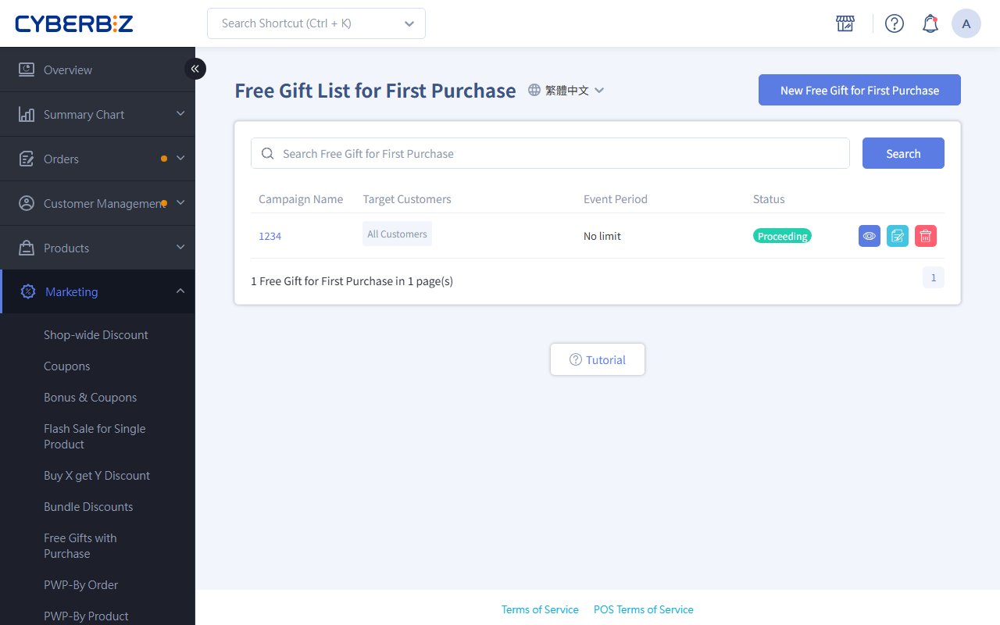
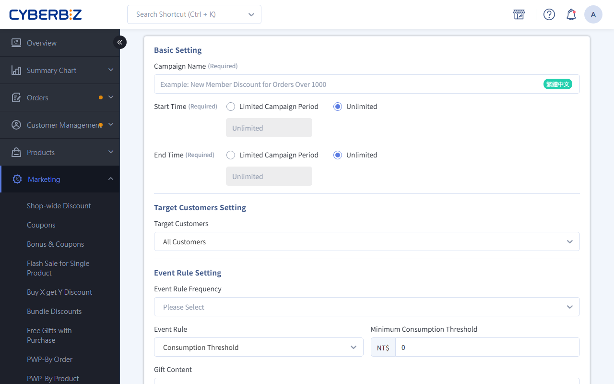

# Limited-time First-purchase Gift

A limited-time first-purchase gift is a promotion for new members' first purchase. When an eligible member pays for their first order, the system gives them a selected gift automatically.
{ .subtitle }

[:lucide-tag:{ title="適用方案" }](../../../resources/conventions#適用方案) | All PLUS / Enterprise
{ .doc-badge }

!!! info "Version Differences"
    On PLUS plans, the limited-time first-purchase gift is part of the Marketing B add-on module (choose 2 of 11). Make sure you have selected this module before using it. Enterprise includes it by default.

{ .hero-page }

!!! tip "Use Cases"
    - **Attract new customers storewide**: With no minimum, give every new customer a small branded gift or a NT$50 coupon on their first purchase.
    - **Reward specific groups**: Give high-value gifts or large Bonus amounts to members with specific tags on their first purchase.
    - **Seasonal campaigns**: Offer a limited-time first-purchase gift to members who sign up in a specific month (such as 11.11) to boost that month's conversions.

---

## Before You Start

Before setting up a first-purchase gift, understand these key rules:

- **first-purchase definition**: The first order under a member's account whose Status changes to `已付款`. Even long-time members qualify if they've never had a successful payment.
- **Login required**: Members must **log in** before checkout so the system can confirm the first purchase and send the gift.
- **Multiple promotions**: You can schedule several first-purchase gift promotions at once. If a member qualifies for more than one, the system **sends them all**.
- **When gifts are sent**: Depends on the gift type:
    - **Bonus points / coupons**: Sent when the order is **completed**, within the promotion period and frequency. Eligibility is based on the purchase time, and the order can be completed after the promotion ends.

        For full conditions and scenarios, see [coupon and Bonus Point Crediting Rules](../references/coupon-and-bonus-credit-rules.md).

    - **Products / cash discounts**: Applied to the member's **first placed** order within the promotion period and frequency.

System logic and limits:

- **Product changes**: If a product is set as a **first-purchase gift gift**, don't change its **variant settings** on their own. This causes a 404 error on the checkout page. To change variants, remove the gift setting first, then add it back afterward.
- **Not supported**: This feature doesn't support **subscriptions, POS, CYBERBIZ NOW express delivery, e-tickets**, or **LINE group-buy orders**.
- **temperature zone handling**: first-purchase gift gift products any temperature zone. Decide whether to ship them together or split the order, and watch product freshness Status.
- **Multiple carts**: If a customer has two carts that both qualify, both show the first-purchase gift. After one cart checks out, the other still shows the gift, but the system won't add it at checkout because it's no longer a first purchase.
- **Disqualification**: If the first order **fails payment, is canceled, or is returned**, the member loses first-purchase eligibility. The system won't resend the gift during the promotion.

    !!! info "Returns and Order Completion"
        - **Returned orders**: If an order is marked `Returned`, clicking **Complete** does **not** send the first-purchase gift. The member must wait for the next "Event Rule Frequency" period to qualify again.
        - **Return in progress Status**: If an order's Status is `Returning` or `Reviewing Return`, clicking **Complete** still triggers the first-purchase gift. To avoid sending gifts by mistake, make sure the order process is fully finished before clicking "Complete."

## Steps

### Step 1: Create A First-purchase Gift Promotion And Basic Setting

1. Log in to the CYBERBIZ admin and go to **Marketing > Free Gift for First Purchase**.
2. Click **New Free Gift for First Purchase**.
3. Enter the **Promotion Name**.
4. Choose the **Start and End Time**.
  > Once you Save the promotion, you can't change its period. Check the dates and times before you submit.

### Step 2: Set Target Members And Thresholds

1. **Target Members** (choose one):
    - **All Customers**: All new members making their first purchase.
    - **Member Tags**: Only members with specific tags (you can select multiple tags).
    - **Specific Registration Period**: Only members who signed up within a specific time range.
2. **Event Rule Frequency**: Limit how many times a member can get the gift.
3. **Rule Type** (sets the threshold):
    - **Consumption Threshold**: The order amount (excluding shipping) must reach the minimum.
    - **Product Tags**: The order must include products with the specified tags.

{ .screenshot }

### Step 3: Set Up The Gift

Choose one of these four gift types:

=== "Free Product"

    Give a physical or virtual product as a gift.

    - **Priority**: Select up to 10 products. The system sends them in list order.
    - **Automatic backup**: When the first gift is out of stock, the next gift on the list is automatically sent.
    - **Price**: Gifts are counted as NT$0 in the order.
    - **Out of stock**: If all gifts on the list run out, the system stops sending the first-purchase gift but **doesn't end** the promotion. Watch your gift stock and restock in time.

=== "Cash Discount"

    A discount applied directly to the order.

    - **Type**: Set a "Fixed Amount" or "Percentage Discount" (such as 90% of list price).
    - **Usage**: Eligible members see the first-purchase gift cash discount on the checkout page.

=== "Send coupon"

    Send a coupon with preset rules.

    - **Settings**: coupon name, discount value, minimum spend, valid days, and eligible products.
    - **Combining**: Choose whether it can combine with other promotions such as "store-wide discount" and "VIP Discount."

=== "Bonus Points"

    Send Bonus.

    - **Settings**: Enter the number of points and the validity period (0 means they never expire).

## FAQ

??? quote "Can an existing member who has never bought anything get the first-purchase gift?"
    Yes. As long as their **paid order count** in the admin is 0 and they match the promotion's **Target Members**, they get the gift after their first order.

??? "If an order is canceled or returned after the gift is sent, does the system take back the coupon or bonus points?"
    The system **doesn't automatically take back** coupons or bonus points already sent.

    If an order is canceled or returned after bonus points are sent and you want to take back the coupon or bonus points, go to **Customer Management > 會員管理**, open the member's account, and deduct them manually.

