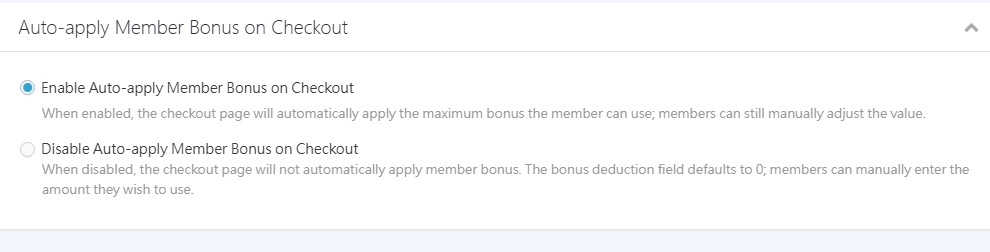

# Set Up Bonus Points
Build a member rewards program with bonus points to win first purchases and bring customers back.
{ .subtitle }

{ .hero-page }

!!! tip "Use Cases"
	- **Build loyalty**: Reward purchases so customers earn points every time they buy and have a reason to come back.
	- **Holiday promotions**: Send vouchers to every member to create urgency for a limited-time sale.
	- **Compensation or rewards**: Use send manually to give points to specific members as service compensation or special rewards.

## Before You Start

- **Calculation basis**: bonus points are earned based on the checkout amount **excluding shipping**.
- **When changes apply**: Changes to bonus point rules only apply to activity **after the change**. Points already sent aren't affected.
- **Import limits**: Once bonus points are sent or removed, the system can't undo it. Proceed carefully.

### Order Bonus Point Crediting Rules

Purchase reward points are credited only when the order is **Completed** and the return status is **Return Not Needed**. They aren't credited when a return is in progress, under review, or rejected.

For full conditions and scenarios, see [coupon and Bonus Point Crediting Rules](../references/coupon-and-bonus-credit-rules.md).

## Steps

1. Log in to the CYBERBIZ admin and go to **Marketing > 全館折扣-紅利 & 優惠券**.
2. Scroll down to the **Member Bonus Points (Vouchers)** section and turn it `Enable`.
3. Set the key options:
    - **Credit(s) conversion**: Set `X 點 = NT 1` (1:1 by default).
    - **Minimum Consumption Threshold**: The order amount required to use bonus points.
    - **Send purchase bonus points for valid orders from other channels**: Whether to send bonus points when you manually add [valid orders from other channels](../../members/manage-member-profiles.md#2-其他通路訂單) for a member. **(Enterprise only)**
    - **Single Order Discount Limit**: Set a fixed amount or a Percentage of Revenue. **(PLUS and Enterprise only)**
    - **Bonus point is valid for:**: Set how many days points stay valid (0 means they never expire).
    > This validity also applies to bonus points sent as a "registration gift."

   { .screenshot }

## Ways To Send Bonus Points

### A. Storewide Purchase Rewards (Automatically Sent)

In the **Member Bonus Points (Vouchers)** section, set the "spend threshold" and the points earned.

- **Example**: Earn 10 points for every NT$100 spent.
- **Logic**: Points are earned in proportion. Spending NT$1000 earns 100 points; spending NT$999 earns 90 points.

### B. Send To All Members (Store-wide) (All Members)

1. On the same page, click **Send vouchers to every member** to expand the fields.
2. Enter the points, validity, and name, then click **Confirm**.
3. The system adds the points to all registered member accounts.

{ .screenshot }

### C. Send Manually (Specific Members)

Go to **Customer Management > All Customers**.

=== "One Member"

    Open a member's profile and click **Add bonus points** in the "bonus points" field.

    { .screenshot }

=== "Filtered Members"

    Use filters to select a group (such as VIP members) and add points in bulk.

    

    - { .screenshot }
    - { .screenshot }

    

### D. Bulk Send With Excel

!!! info "Before You Start"
    - This feature is available on **Enterprise Plan** only.
    - If **external bonus points** are turned on, you can't bulk import bonus points. Send them from your external system instead.

1. Download the template and fill in the fields as specified.

    { .screenshot }

2. Enter each member's email or phone, the promotion name, and the bonus points to send.

    { .screenshot }

3. Upload the Excel file. You'll get the import results by email, and bonus points are sent to the members right after a successful import.

## Set A Product-Level Redemption Cap

You can set a Credit(s) cap for each product. **To allow Credit(s) on a product, enter the number of points that can be used**. **If the field is 0, the product doesn't allow Credit(s)**.

1. Go to **Products > All Products** and open a product.
2. In **Manage Variants**, enter the maximum "points" for the variant in the **Credit(s)** field.
> **System logic**: When both a storewide redemption cap and a product redemption cap exist, the **stricter** (lower) limit applies.

!!! tip "How to Edit This Field in Bulk"
    [Export products to Excel](../../products/bulk-operations/batch-update-product-descriptions-shipping.md#匯出商品-excel-表格), edit the `商品款式紅利最高折抵` column, then [import the Excel file](../../products/bulk-operations/batch-update-product-descriptions-shipping.md#上傳-excel-檔案).

=== "Admin Settings"

    { .screenshot }

=== "Storefront Checkout"

    { .screenshot }

## Auto-Apply Bonus Points At Checkout

**Auto-apply Member Bonus on Checkout** is **on** by default. You can choose whether the system automatically fills in the maximum bonus points a member can use when they reach checkout.

1. Go to **Payment and Logistics > Checkout Page & Logistics**.
2. Expand the **Shopping Cart Settings** section and find **Auto-apply Member Bonus on Checkout**.
3. Choose an option:
    - **Enable Auto-apply Member Bonus on Checkout** (default): Checkout fills in the maximum bonus points the member can use. Members can still enter a different amount.
    - **Disable Auto-apply Member Bonus on Checkout**: Checkout doesn't fill in bonus points. The "Enter member Credit(s) points" field shows `0` by default, and members enter the points they want to use.

=== "Admin Settings"

    { .screenshot }

=== "Storefront Checkout"

    { .screenshot }

## How It Works

### Discount Order

bonus points are applied **after all other discounts**. The system first calculates all promotions and coupons, then deducts bonus points last.

### Cancellations

You or the customer can cancel an order before it ships. Bonus points are handled as follows:

| Scenario | Points Used in the Order | Points Earned |
| :--- | :--- | :--- |
| **Canceled order** | Returned to the customer's account | Not sent if the order isn't completed Not taken back if the order is completed and points were used |

### Returns

You can choose how bonus points are handled for returns:

| Scenario | Points Used in the Order | Points Earned |
| ---- | -------------- | ------------- |
| **Returned order** | Choose whether to return them (not returned by default) | Not sent when completed |
| **Partially returned order** | Choose whether to return them (not returned by default) | Choose whether to send them (not sent by default) |

!!! info "Plan Availability"
    - The return toggle for **returned orders** is available on **PLUS and Enterprise** only.
    - The return toggle for **partially returned orders** is available on **Enterprise Plan** only.

Set this in **Payment and Logistics > Checkout Page & Logistics > 訂單相關設定**.

{ .screenshot }

!!! warning "Note for Warehouse-Integrated Merchants"
    Automatic return isn't supported for warehouse-integrated merchants. When those orders are returned, bonus points aren't returned or sent automatically.

### Returns After Completion

If an order is returned after it's completed, the bonus points earned **aren't automatically deducted** from the member's account.

!!! tip "Recommendations"
    - Go to the member's profile and [remove the bonus points manually](../../members/manage-member-profiles.md#1-紅利點數派發與管理).
    - Wait until the return period ends before clicking **Complete Order** so bonus points are sent accurately. For full rules on how completion and returns affect crediting, see [coupon and Bonus Point Crediting Rules](../references/coupon-and-bonus-credit-rules.md).

## Management And Reports

### Look Up Bonus Points

=== "Merchant"

    You can look up, add, or remove bonus points for individual members in the admin.

    1. Go to **Customer Management > All Customers**, Search for the member, and open their profile.
    2. View the **bonus points list** on the member's profile.

    { .screenshot }
    { .screenshot }

=== "Member"

    Members can check their point history on the storefront.

    1. Go to **我的帳戶 > 紅利點數**.

    { .screenshot }

### Bonus Points Exchange Rate

The system converts points and shows the matching amount based on the rate you set:

#### Before You Start

- This feature is available on **Enterprise** only.
- The exchange rate only applies to "Credit(s)."
- Changing the rate directly changes the cash value of points already in customers' accounts.

#### Storefront Examples

- **Member center**: Shows available points and their approximate value.

    { .screenshot }

- **Product page**: Shows the maximum points usable on the product and their approximate value.

    > When you set a product's "bonus points redemption cap" in the admin, enter **Bonus Points**, not an amount.

    { .screenshot }

- **Checkout page**: Shows the points used and the actual amount deducted.

    { .screenshot }

#### Report Export Fields

When you [export order reports](../../orders/reports/export-order-report.md), these Credit(s) and amount conversion fields are included:

- **Credit(s)**: In bonus points.
- **Total Product Bonus Point Discount Amount**: The actual discount after converting bonus points at the exchange rate.

{ .screenshot }

### View And Export Reports

1. Go to **Summary Chart > Marketing Campaign Analysis > 紅利分析**.

2. Click **Export Bonus Data**.

    { .screenshot }

3. The Excel report is sent to the admin email.

    > The export range can't exceed 180 days.

    { .screenshot }

## More Actions

- :lucide-bell-ring:{ .lg }
  [__Set Up bonus points Expiration Notifications__](../purchase-restrictions/coupon-and-bonus-points-expiry-notification.md)
  Set bonus points expiration reminders to bring customers back to use points before they expire.

