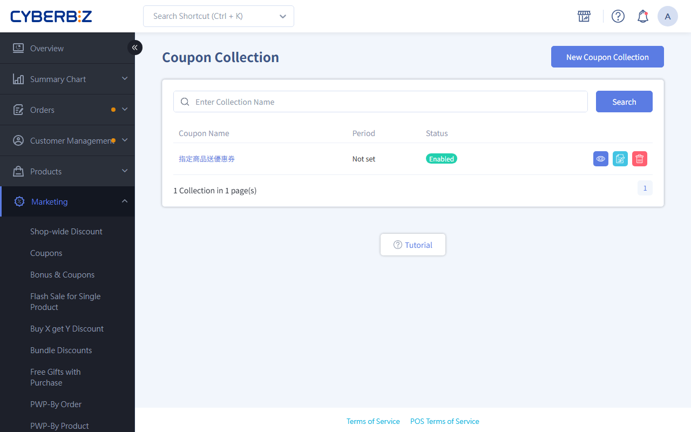
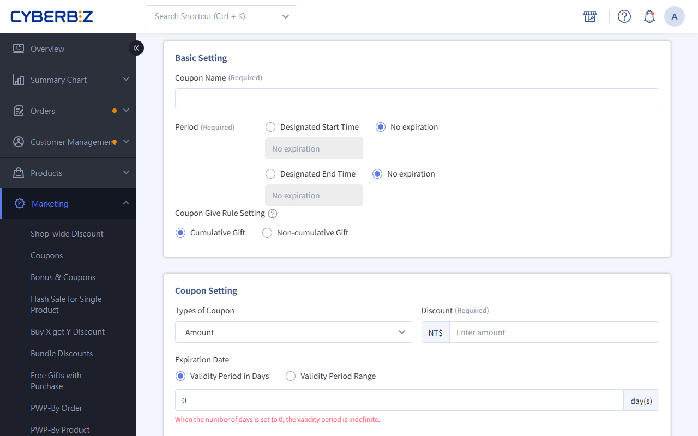
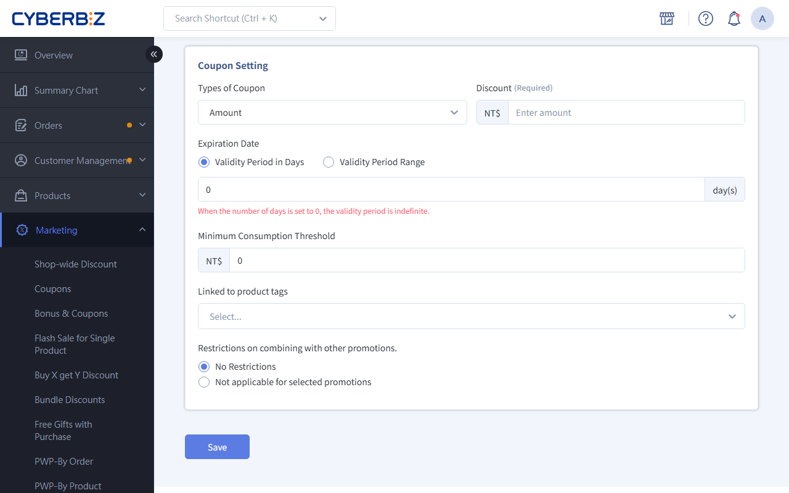

# Send Coupons For Specific Products

Create a coupon group. When a member buys selected products and completes the order, the coupon is automatically sent to their account, boosting repeat purchases and loyalty.
{ .subtitle }

[:lucide-tag:{ title="適用方案" }](../../../resources/conventions#適用方案) | Enterprise
{ .doc-badge }

{ .hero-page }

## About Sending Coupons For Specific Products

Send coupons for Specific Products (coupon groups) sends coupons automatically. You choose specific products or product tags, and members who buy them get a preset coupon. Use it to encourage repeat purchases, cross-sell, or clear inventory faster.

!!! tip "Use Cases"
    - **Drive repeat purchases with new arrivals**: Give a NT$100 discount coupon with "2024 Spring New Arrivals" to bring customers back.
    - **Cross-sell categories**: Give a makeup coupon with skincare purchases to get customers to try other categories.
    - **Clear inventory faster**: Give a high-value coupon with clearance items to motivate customers to buy slow-moving stock.

## Before You Start

- **Number of coupons**: Choose "Cumulative" (one coupon per item bought) or "Non-cumulative" (one coupon per order).
- **Multiple groups**: A product can be in more than one coupon group. After purchase, the system sends the coupons from every group the product belongs to.
- **Cross-channel use**: coupons that members get from online purchases can be used at checkout for POS store orders.
- **POS product limitation**: Only products sold online are eligible. POS-only products don't support automatic coupon sending.
- **Stacking limits**: In the settings, you can specify whether the coupon can be used with promotions such as store-wide discount and single-product discounts.

## Steps

### Step 1: Create A Coupon Group

1. Log in to the CYBERBIZ admin and go to **Marketing > Issue Coupon for Selected Product**.
2. Click **New Coupon Collection**.

### Step 2: Enter Basic Settings And Sending Rules

1. **Basic information**:
    - **Coupon Name**: A name to identify it in the admin (such as 2024 Spring Coupon Promotion).
    - **Period**: Select it and set the start and end dates. If you leave it unselected, the promotion starts right away and runs indefinitely.
2. **Coupon Give Rule Setting**:
    - **Cumulative Gift**: One coupon per item (the more customers buy, the more they get).
    - **Non-cumulative Gift**: One coupon per order (to control costs).

### Step 3: Set The Coupon Rules

In the **coupon Rules** section, define the coupon to send:

1. **Types of Coupon**: Choose "Amount discount" or "Percentage discount" and enter a value.
2. **Expiration Date**:
    - **Validity Period in Days**: Counted from the date the coupon is sent (for example, `30` days).
    - **Validity Period Range**: A fixed date range. All coupons expire on the same date.
3. **Minimum Consumption Threshold**: The minimum order amount needed to use the coupon (for example, `500`).
4. **Link product tags** (optional): Limit the coupon to products with specific tags.

### Step 4: Set Stacking Limits

1. Select **No Limit** (works with all promotions) or **Not applicable for selected promotions**.
2. If you choose the latter, select the promotion types that can't be combined (such as store-wide discount, single-product discounts, and VIP discounts).

## More Actions

- :lucide-wallet:{ .lg }
  [__coupon / Bonus Points Crediting Rules__](../references/coupon-and-bonus-credit-rules.md)
  Explains when purchase rewards are credited to accounts (import members), and how order completion and returns affect crediting of bonus points and coupons.

