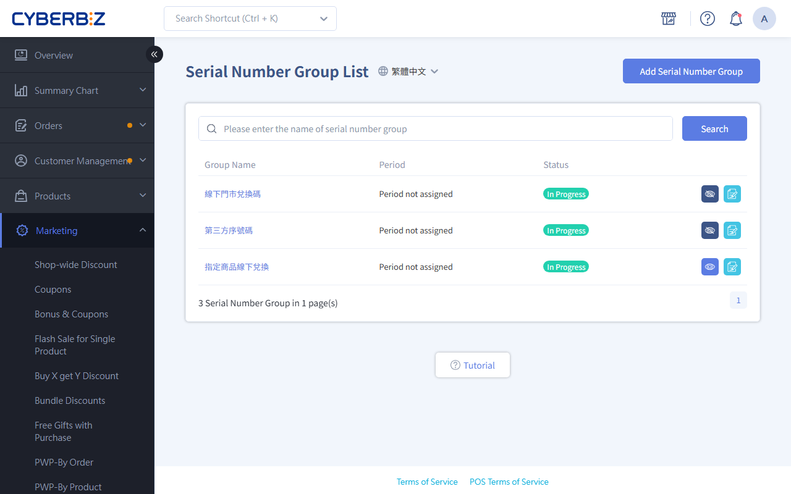

# Send Serial Numbers For Specific Products

Create a "serial number group." When customers buy and pay for specific products, the system sends a unique Serial Number, automatically sent. Use it for tickets, redemption codes, or prize draws.
{ .subtitle }

[:lucide-tag:{ title="適用方案" }](../../../resources/conventions#適用方案) | Enterprise
{ .doc-badge }

{ .hero-page }

## About Sending Serial Numbers For Specific Products

"Send Serial Numbers for Specific Products" (serial number groups) is a marketing tool that sends serial numbers automatically. When a customer buys a specific product and pays, the system adds a unique serial number to the Order details. This helps you handle virtual products or promotional gifts without issuing codes by hand.

!!! tip "Use Cases"
    - **Tickets**: Sell tickets for live events (such as concerts, exhibitions, or classes). Entry codes are automatically sent after payment.
    - **Third-party redemption**: Provide game credits, streaming Customer codes, or redemption codes for other platforms.
    - **Prize draws**: Customers get a draw number after buying a promotional product.
    - **Warranty and registration**: Include a unique warranty serial number with a product for customers to register on your website.

## Before You Start

- **Order payment method**: Only supports Orders without cash on delivery.
- **Redemption tracking**: This feature only sends Serial Numbers. To track redemption on a third-party platform, use that platform's system. Manage serial number usage Status according to the third party's rules.
- **When codes are sent**: Serial numbers are assigned as soon as the Order Status changes to **Completed**.
- **Order returns**: If an Order is returned after the serial number is sent, the system can't recall or void it.
- **Generation method is final**: Once you choose how serial numbers are generated, **you can't change it**. To change it, create a new group.
- **Low Inventory Alert**: When you **upload an Excel file**, set an alert quantity so the promotion doesn't stop when codes run out.

## Steps

### Step 1: Create A Serial Number Group

1. Log in to the CYBERBIZ admin and go to **Marketing > Serial Number Groups**.
2. Click **Add Serial Number Group**.

### Step 2: Set Basic Information And Generation Method

1. **Basic settings**:
    - **Serial Number Group List Name**: The promotion name used in the admin.
    - **Period**: Set the start and end dates. If unchecked, it takes effect now and runs indefinitely.
2. **Choose how serial numbers are generated**:
    - **Generated by the system**: The system creates a random 8-character alphanumeric code when the Order is placed.
    - **Upload your own Excel serial numbers**: Prepare a file of serial numbers (such as third-party redemption codes) and set a **low stock alert quantity**.

### Step 3: Import Serial Numbers (Upload Only)

If you chose "Upload an Excel file," do the following:

1. Go to the **Serial Number List** tab and click **Import from excel**.
2. Download the sample file and enter serial numbers in the `Serial Number` column (one per row, up to 10,000 rows per upload).
3. Upload the file. When the import finishes, a notification is sent to the admin email.

### Step 4: Select Products

1. Go to the **Select Product** tab.
2. Use filters (type, tag, vendor) or search to find the products for the promotion.
3. Select the products and click **Add**. Check that they appear in the **Select Product** list.

### Step 5: Publish And Save

1. In basic settings, turn the **Public Status** to `開啟` (the eye icon turns blue).
2. Click **Save** to finish.

## How Serial Numbers Are Sent

### Multiple Codes Within A Group

Within one serial number group, the system counts qualifying items. If several items are bought in one Orders, it sends **one serial number per item**.

### Codes Across Groups

A product can be linked to several serial number groups. When the purchase is completed, each group's serial numbers are **sent at the same time**.

### Example

| Items Bought | Linked Groups | Serial Numbers Received | Note |
| ------- | -------- | ---------- | ---- |
| Product A ×1 | Group a | 1 | Basic |
| Product A ×2 | Group a | 2 | Multiple in one group |
| Product A + B | Both in group a | 2 | Multiple in one group |
| Product A ×1 | Group a + group b | 2 | Across groups |

## Manage Serial Number Status

In the **Serial Number List** tab, track the sending progress and current Status of all serial numbers.

=== "Generated by the System"
    1. When the Order is completed, the system creates a serial number and sends it to the Customer.
    2. Once sent, the serial number shows as **Sent** in the list.

=== "Uploaded via Excel"

    1. After import, the initial Status is **Not Sent**.
    2. When a code is assigned to a Customer, it updates to **Sent** automatically.

## View Serial Numbers For An Order

=== "Customer View"

    - Customers can log in to the website, go to **會員中心 > 我的訂單**, and open the Order details for the product to see the **Serial Number**.
    - Customers can also find it in the **Serial Number notification email**.
      > Turn on the **Customer Receives Specific Product Serial Number** notification in **Push Notifications > Email Notification Template**.

=== "Merchant View"

    - Log in to the admin, go to **Orders > All Orders**, and check the **Serial Number** column.
      > If the column isn't shown, click **Edit Columns** and select **Serial Number**.
    - You can also open an Order and see the **Serial Number** on the Order details page.

## FAQ

??? quote "Should I generate serial numbers automatically or upload them?"
    If serial numbers are only for internal tracking or prize draws, use "Generated by the system." If they must be validated on a third-party platform (such as game credits or Netflix codes), use "Upload" so the format is correct.

??? quote "What happens if serial numbers run out during the promotion?"
    Orders are still placed, but no serial numbers are assigned. The system notifies the admin that codes have run out. You can add more codes and send them to affected customers manually.

??? quote "What happens to unsent serial numbers when the promotion ends?"
    No more serial numbers are sent. The admin shows the unsent serial numbers.

??? quote "Can I upload two files with Excel import?"
    Yes. Serial numbers from the second file are added after those from the first.

??? quote "Can I delete a promotion?"
    Yes. Serial numbers already sent stay recorded in the Order.
