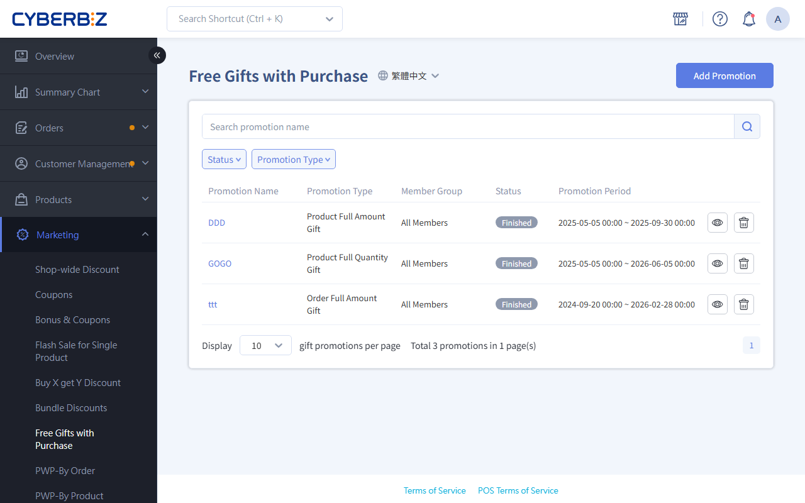
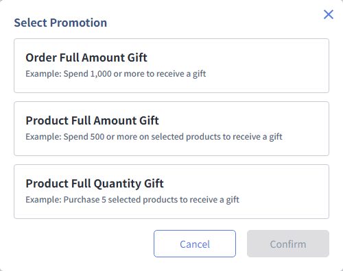

# Threshold Gifts / Quantity Gifts

Create spend-threshold and quantity-threshold gift promotions. Set amount or item-count thresholds for orders or products with specific Tags, have gifts automatically sent, and manage stacking rules.
{ .subtitle }

[:lucide-tag:{ title="適用方案" }](../../../resources/conventions#適用方案) | Advanced / Expert / All PLUS / Enterprise
{ .doc-badge }

{ .hero-page }

## About Threshold And Quantity Gifts

Free Gifts with Purchase is a promotion that gives customers a gift automatically when they reach a threshold. It can count "all order items" or "products with specific Tags," and supports multiple tiers.

!!! tip "Use Cases"
    - **Summer apparel gift**: For products tagged `夏季服飾`, give a cooling towel when spending NT$2000.
    - **Supplement quantity gift**: For products tagged `保健食品`, give a sample pack when buying 3.
    - **Anniversary sale**: Storewide, give a reusable bag for orders over NT$3000 and a thermos for orders over NT$5000.
    - **Buy 3, get 1**: Buy 3 of a specific product and get 1 of the same or another selected gift.

**:lucide-info: Plan Availability**

| Feature | Standard | PLUS | Enterprise |
|------|-------|--------|--------|
| Product spend (quantity) gifts | ✕ | Add-on | ✓ |
| Order spend gifts | Advanced and Expert | Add-on: Professional PLUS Included: Advanced PLUS, Expert PLUS | ✓ |

## Gift Rules

=== "Other Plans"

    - Unpublished products can be gifts, but unlisted products can't.
    - All gifts in the group are given together.
    - If a gift has multiple Variants, **customers can't choose the variant**.

=== "Enterprise"

    - Unpublished products can be gifts, but unlisted products can't.
    - All gifts in the group are given together.
    - If a gift has multiple variants, **customers can choose the variant at checkout**.

        - The first variant is selected by default.

        !!! tip "How to Offer a Choice of Gifts"
            - **Correct setup**: Go to **Products > All Products**, create one product as the gift, and add several variants as gift options. Add that product to the gift promotion, and the storefront shows a drop-down menu for customers to pick one of three.
            - **Incorrect setup**: If you create three separate products and add all three to the promotion, the system gives all three.
            - **Example**: To offer **one of three tableware gifts**, create one product `餐具贈品` with 3 variants: `杯子`, `盤子`, and `碗`. Customers can then choose a Variants at checkout.

        - **Notes**:
            - POS doesn't support this feature.
            - Multi-variant gifts show a variant menu automatically.
            - If the customer doesn't choose a variant, the default gift is given.
            - Only variants in stock are shown. Variants with 0 stock are hidden.

        - **Customer checkout steps**:
            1. At checkout, click the drop-down menu in the "Threshold / Quantity Gifts" section.
            2. In the pop-up, choose variants for the number of gifts received.
            

## Steps

### Step 1: Create A Promotion And Choose A Type

1. Log in to the CYBERBIZ admin and go to **Marketing > Free Gifts with Purchase**.
2. Click **Add Promotion** and choose a Promotion Type:
    - **Order Full Amount Gift**: Counts the total order amount.
    - **Product Full Amount Gift**: Counts the total amount of products with specific Tags.
    - **Product Full Quantity Gift**: Counts the total quantity of products with specific Tags.

{ .screenshot }

### Step 2: Set Basic Information

1. **Basic Settings**: Enter the Promotion Name and choose the **Start/End Date**.
2. **Promotion period**: Set the promotion **Start Date** and **End Date**.
3. **Member Group**: Choose which members the promotion applies to.

    - To create a Member Group, go to **Customer Management > All Customers** and [create a segment](../../members/member-filters-and-groups.md).

    !!! info "Member Group Availability"
        This feature is available on **Enterprise** only.

{ .screenshot }

### Step 3: Set Conditions And Rules

1. **Tags**: Choose the product Tags to count from the drop-down menu.

      > This field is only for product spend (quantity) gifts.

2. **Stacking rule**: Choose how gifts are given (5 options). See **Stacking and Accumulation Rules** below.

{ .screenshot }

### Step 4: Set Gift Thresholds

1. **Add a rule**: Click **Add Threshold**.
2. **Set the threshold**:
    - Spend gift: Enter an amount (for example, `1000`).
    - Quantity gift: Enter a quantity (for example, `3`).
3. **Add gifts**: Click **Add Gift** and choose products.

{ .screenshot }

### Step 5: Save And Order

1. For multiple thresholds, repeat Step 4 to build tiers.
2. Check that the gift list is correct.
3. Click **Save** to finish.

## Stacking And Accumulation Rules

### Plan Availability

| Gift Rule | Standard | PLUS | Enterprise |
| -------- | ----- | ------- | ----- |
| No stacking + no accumulation | ✕ | ✓ | ✓ |
| Stacking + no accumulation | ✓ | ✓ | ✓ |
| No stacking + repeating accumulation | ✕ | ✓ | ✓ |
| Stacking + repeating accumulation | ✕ | ✓ | ✓ |
| Stacking + multiple accumulation | ✕ | ✓ | ✓ |

> Stacking decides "which gifts are given"; accumulation decides "how many times gifts are given."

### Stacking

When an order meets several gift thresholds, the "stacking" setting decides what's given:

| Value | System Behavior |
| --- | --- |
| Stacking | Gives every qualifying gift |
| No stacking | Gives only the highest-value gift |

### Accumulation

When an order exceeds the highest gift threshold, the "accumulation" setting decides whether gifts are given in multiple rounds:

| Value | System Behavior |
| --- | --- |
| Accumulation | If the order exceeds the highest threshold, it can earn multiple rounds of gifts |
| No accumulation | The order earns only one round of gifts; the remaining amount isn't counted |

"Accumulation" has two options:

| Value | Calculation | Formula |
| --- | --- | --- |
| Repeating accumulation | Subtract the highest gift threshold from the order, send gifts and check the remaining balance again | Order amount − highest gift threshold → send (stacking / no stacking)   Remaining amount − highest gift threshold → send (stacking / no stacking)   Remaining amount − highest gift threshold → send (stacking / no stacking)   Until remaining amount < highest gift threshold |
| Multiple accumulation | Each gift's quantity is calculated separately | Order amount ÷ gift A threshold = gift A quantity   Order amount ÷ gift B threshold = gift B quantity   Order amount ÷ gift C threshold = gift C quantity   And so on |

### Examples

These examples use order spend gifts:

- Gift A: Given for orders of 500 or more
- Gift B: Given for orders of 1000 or more
- Gift C: Given for orders of 1500 or more

#### No Stacking + No Accumulation

| Gift / Order Amount | 500 | 1000 | 1500 |
| --- | --- | --- | --- |
| A(500) | 1 |  |  |
| B(1000) |  | 1 |  |
| C(1500) |  |  | 1 |

The system checks in this order:

1. Find all gift thresholds the order amount meets.
2. Choose the gift with the highest threshold. (No stacking)
3. Give that gift once. The remaining amount isn't used for more gifts. (No accumulation)

#### Stacking + No Accumulation

| Gift / Order Amount | 500 | 1000 | 1500 | 2000 |
| --- | --- | --- | --- | --- |
| A(500) | 1 | 1 | 1 | 1 |
| B(1000) |  | 1 | 1 | 1 |
| C(1500) |  |  | 1 | 1 |

The system checks as follows:

1. Find all gift thresholds the order amount meets.
2. Give every qualifying gift. (Stacking)
3. Give each gift once. The remaining amount isn't used for more gifts. (No accumulation)

####No Stacking + Repeating Accumulation

| Gift / Order Amount | 500 | 1000 | 1500 | 2000 | 2600 |
| --- | --- | --- | --- | --- | --- |
| A(500) | 1 |  |  | 1 |  |
| B(1000) |  | 1 |  |  | 1 |
| C(1500) |  |  | 1 | 1 | 1 |

The system checks as follows:

| Order | Round 1 | Round 2 | Result |
| --------| ------ | --------| ------ |
| NT$500 | 1. Thresholds met: A 2. No stacking: give only the highest, A | - | 1 A |
| NT$1000 | 1. Thresholds met: A, B 2. No stacking: give only the highest, B | - | 1 B |
| NT$1500 | 1. Thresholds met: A, B, C 2. No stacking: give only the highest, C | - | 1 C |
| NT$2000 | 1. Thresholds met: A, B, C 2. No stacking: give only the highest, C 3. After subtracting NT$1500, NT$500 remains | 1. Remaining NT$500 meets the A threshold  2. No stacking: give A  | 1 C + 1 A |
| NT$2600 | 1. Thresholds met: A, B, C 2. No stacking: give only the highest, C 3. After subtracting NT$1500, NT$1100 remains | 1. Remaining NT$1100 meets the A and B thresholds  2. No stacking: give B  | 1 C + 1 B |

#### Stacking + Repeating Accumulation

| Gift / Order Amount | 500 | 1000 | 1500 | 2000 | 2600 |
| --- | --- | --- | --- | --- | --- |
| A(500) | 1 | 1 | 1 | 2 | 2 |
| B(1000) |  | 1 | 1 | 1 | 2 |
| C(1500) |  |  | 1 | 1 | 1 |

The system checks as follows:

| Order | Round 1 | Round 2 | Result |
| --------| ------ | --------| ------ |
| NT$500 | 1. Thresholds met: A 2. Stacking: give all qualifying gifts 3. After subtracting NT$500, NT$0 remains; stop | - | 1 A |
| NT$1000 | 1. Thresholds met: A, B 2. Stacking: give all qualifying gifts 3. After subtracting NT$1000, NT$0 remains; stop | - | 1 A + 1 B |
| NT$1500 | 1. Thresholds met: A, B, C 2. Stacking: give all qualifying gifts 3. After subtracting NT$1500, NT$0 remains; stop | - | 1 A + 1 B + 1 C |
| NT$2000 | 1. Thresholds met: A, B, C 2. Stacking: give all qualifying gifts 3. After subtracting NT$1500, NT$500 remains | 1. Remaining NT$500 meets the A threshold  2. Stacking: give all qualifying gifts  3. After subtracting NT$500, NT$0 remains; stop  | 2 A + 1 B + 1 C |
| NT$2600 | 1. Thresholds met: A, B, C 2. Stacking: give all qualifying gifts 3. After subtracting NT$1500, NT$1100 remains | 1. Remaining NT$1100 meets the A and B thresholds  2. Stacking: give all qualifying gifts  3. After subtracting NT$1000, NT$100 remains; stop  | 2 A + 2 B + 1 C |

#### Stacking + Multiple Accumulation

| Gift / Order Amount | 500 | 1000 | 1500 | 2000 | 2600 |
| --- | --- | --- | --- | --- | --- |
| A(500) | 1 | 2 | 3 | 4 | 5 |
| B(1000) |  | 1 | 1 | 2 | 2 |
| C(1500) |  |  | 1 | 1 | 1 |

The system checks as follows:

| Calculation | A | B | C |
| --------| ------ | --------| ------ |
| NT$500 | 500 ÷ 500 = 1  Give 1 A | Below threshold, none | Below threshold, none |
| NT$1000 | 1000 ÷ 500 = 2   Give 2 A | 1000 ÷ 1000 = 1   Give 1 B | Below threshold |
| NT$1500 | 1500 ÷ 500 = 3   Give 3 A | 1500 ÷ 1000 = 1   Give 1 B | 1500 ÷ 1500 = 1   Give 1 C |
| NT$2000 | 2000 ÷ 500 = 4   Give 4 A | 2000 ÷ 1000 = 2   Give 2 B | 2000 ÷ 1500 = 1   Give 1 C |
| NT$2600 | 2600 ÷ 500 = 5   Give 5 A | 2600 ÷ 1000 = 2   Give 2 B | 2600 ÷ 1500 = 1   Give 1 C |

## Multi-Language Settings

Set multi-language names for threshold and quantity gifts so the storefront shows the right text for each language.

### Steps

1. Log in to the CYBERBIZ admin and go to **Marketing > 滿額贈滿件贈**.
2. In the language menu, switch to the language you want to edit (for example, Traditional Chinese or English).
3. Expand the group, click the group name field to edit it, and press ++enter++ to save.

{ .screenshot }

!!! warning "Notes"
	- To edit the English version, **switch to English** first.
	- Only fields with a **language tag** change text when the storefront language changes. For example: **Group Name** Threshold / Quantity Gifts `繁體中文`.
	- If a language field is empty, the storefront shows the **繁體中文** content by default.