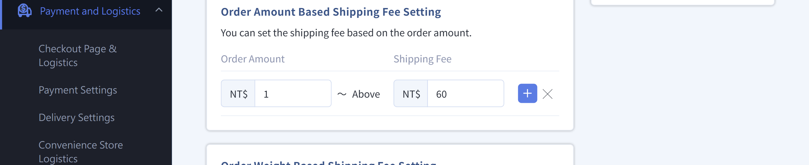
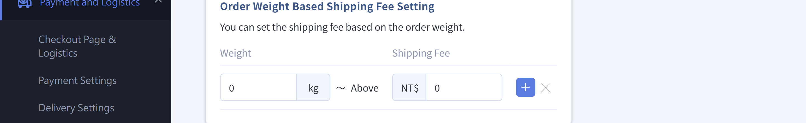
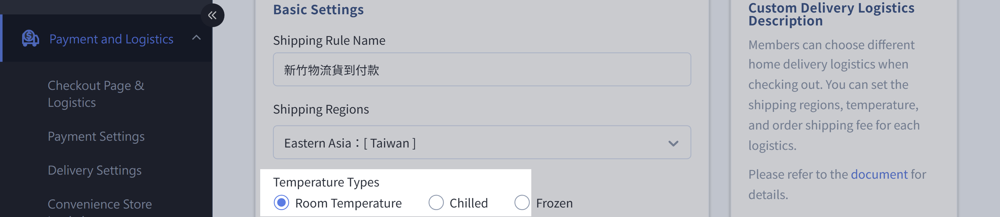
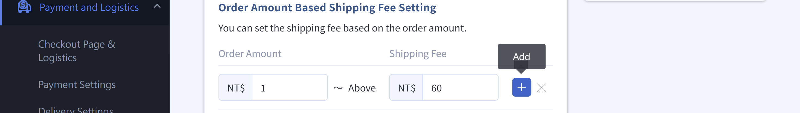
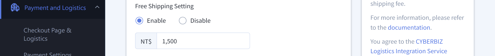
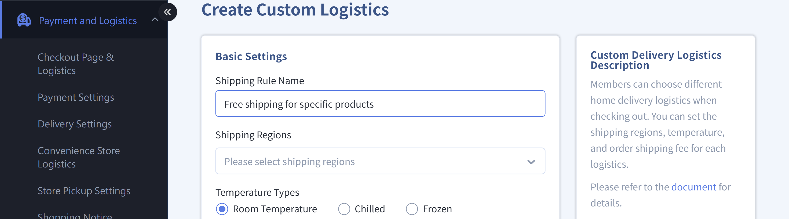

## About Free Shipping { #intro-free-shipping }

Free shipping is a key marketing tool for getting customers to order and raising order value. Choose the free shipping method that fits your goal:

- **Encourage bigger orders**: "Storewide Shipping Fee Threshold Free Shipping"
- **Promote specific products**: "Free Shipping for Specific Products"

You can use each method alone or together.

!!! info "Tip"
    Free shipping settings are spread across several pages. Storewide and shipping-related free shipping is set under "Payment and Logistics." This article brings these together to help you find the settings you need.

## Free Shipping Overview { #overview-free-shipping }

| Method | Use Case |
| :-- | :-- |
| [Storewide Shipping Fee Threshold Free Shipping](#operate-free-shipping-home-threshold) | Encourage customers to reach a set amount or weight for free shipping |
| [Free Shipping for Convenience Store Pickup](#operate-free-shipping-cvs) | Free shipping above a set amount for convenience store pickup |
| [Free Shipping for Integrated Carriers](#operate-free-shipping-integrated) | Free shipping above a set amount for carriers such as T-Cat, Hsinchu Logistics, and Pelican |
| [Free Shipping for Specific Products](#operate-free-shipping-product) | The whole order ships free when it includes specific products |

## Requirements And Limits { #prerequisites-free-shipping }

!!! plan "Plan Requirements"
    * **Free shipping for specific products**: Requires Expert, any PLUS plan (Advanced PLUS, Expert PLUS, Professional PLUS), or Enterprise.
    <!-- * **Free shipping coupons (promo codes)**: Requires PLUS or Enterprise. -->
    <!-- * **Auto-apply free shipping coupons**: Requires Expert PLUS or Enterprise. The system applies them at checkout, so customers don't need to enter a code. -->
    <!-- * **VIP free shipping**: Requires VIP member tiers (Enterprise). -->

## Steps { #operate-free-shipping }

Free shipping settings are spread across the "Payment and Logistics" and "Products" pages. Each scenario is explained below.

### Storewide Shipping Fee Threshold Free Shipping { #operate-free-shipping-home-threshold }

??? info "Not Available for Integrated Carriers"
    The "Order Amount / Order Weight" switch below only appears on the edit page for **custom Delivery Settings**. Integrated carriers (T-Cat, Hsinchu Logistics, Pelican, and others) **don't** have these options and use a single order amount threshold. See [Set Up Free Shipping for Integrated Carriers](#operate-free-shipping-integrated).

For Delivery Settings, give customers storewide free shipping when their order reaches a set amount or weight.

> In the admin, go to "Payment and Logistics" "Delivery Settings" > "Custom Logistics" and click "Edit" for the shipping method:

1. **Choose the free shipping basis:** In the Shipping Fee settings, choose **Order Amount Based Shipping Fee Setting** or **Order Weight Based Shipping Fee Setting**. We recommend using only one[^both-conditions].

    === "Order Amount"

        { title="訂單金額運費設定" }

        ??? example "Example"

            For storewide free shipping at any order amount, enter 0 as the starting amount and 0 as the Shipping Fee.

            After saving, orders of $0 or more aren't charged a Shipping Fee.

    === "Order Weight"

        { title="訂單重量運費設定" }

        ??? example "Example"

            For storewide free shipping at any order weight, enter 0 as the starting weight in the order weight Shipping Fee settings and 0 as the Shipping Fee.

            After saving, orders of 0 kg or more aren't charged a Shipping Fee.

    ??? warning "temperature zone Limits"
        If the free shipping method has a temperature zone set, only products in that temperature zone get free shipping.

        { title="溫層限制示意" }

2. **Set the free shipping threshold:** Click **"Add Shipping Fee"**, enter the starting amount (or weight) for free shipping, and set the "Shipping Fee" for that range to 0. Orders that reach it ship free.

    { title="設定免運門檻" }

3. **Set free shipping at any amount:** For storewide free shipping on all orders, set the starting amount (or weight) to 0 and the Shipping Fee to 0, then save.
4. **Save:** Save to apply the settings.

[^both-conditions]: If you set both "Order Amount" and "Order Weight," the system uses whichever is better for the customer (the lower Shipping Fee).

---

### Free Shipping For Convenience Store Pickup { #operate-free-shipping-cvs }

Set free shipping above a set amount for customers who pick up at convenience stores. Each Convenience Store Logistics method is set separately.

> In the admin, go to "Payment and Logistics" "Convenience Store Logistics" and click "Edit" for the Convenience Store Logistics method:

1. **Turn on free shipping:** Switch "Free Shipping" to **"On."**
2. **Enter the threshold:** Enter the order amount for free shipping. Convenience store pickup orders that reach it ship free[^cvs-threshold].

    { title="超商免運門檻設定" }

3. **Turn off free shipping:** To stop offering free shipping, switch "Free Shipping" back to **"Off."**
4. **Save:** Save to apply the settings.

[^cvs-threshold]: Free shipping for convenience store pickup uses a single "Order Amount" threshold, unlike home delivery, which can have several ranges.

---

### Free Shipping For Integrated Carriers { #operate-free-shipping-integrated }

Set free shipping above a set amount for each carrier integrated with CYBERBIZ, such as T-Cat, Hsinchu Logistics, and Pelican.

> In the admin, go to "Payment and Logistics" "Delivery Settings" > "Integrated Carriers" and click "Edit" for the carrier (such as T-Cat Cash on Delivery):

1. **Turn on free shipping:** Enter the threshold amount in "Free Shipping."

    { title="串接物流免運設定" }

2. **Set the Shipping Fee:** In the Shipping Fee settings below, enter the Shipping Fee for orders below the threshold. The system considers both the free shipping settings and the Shipping Fee settings, and shows customers whichever free shipping threshold is better at checkout[^integrated-priority].

    { title="串接物流運費設定" }

3. **Show a checkout notice (optional):** Turn on **"Show Free Shipping Threshold at Checkout"** to show the threshold amount on the checkout page.

    { title="結帳頁免運門檻提示" }

4. **Save:** Save to apply.

[^integrated-priority]: "Better threshold" means that when the free shipping settings and Shipping Fee settings differ, the checkout page shows the threshold that's better for the customer.

---

### Free Shipping For Specific Products { #operate-free-shipping-product }

[:lucide-tag:{ title="適用方案" }](../../../resources/conventions#適用方案) | Expert / PLUS / Enterprise
{ .doc-badge }

Give free shipping on the whole order when customers buy specific products. First create a shipping method with a Shipping Fee of 0, then link products to it.

> In the admin, go to "Payment and Logistics" "Delivery Settings" > "Custom Logistics" and click **Create Custom Logistics**:

1. **Create a free shipping method:** Following [Storewide Shipping Fee Threshold Free Shipping][operate-free-shipping-home-threshold]{ data-preview }, add a shipping method with a Shipping Fee of 0 (by order amount or weight) to use as the "free shipping method."

    { title="建立免運物流" }

    !!! info "Automatic Rules"
        All products that match the "Shipping Regions" / "Temperature Types" get the free shipping rule automatically.

2. **Link one product:** 前往「商品」> [編輯商品](../products/create-and-manage/create-update-products.md#operate-product-edit-entry){ data-preview } > [「設定」分頁](../products/create-and-manage/create-update-products.md#operate-product-edit-settings){ data-preview }，捲動至 **"temperature zone and Shipping Settings"**, enable the free shipping method under "Shipping Method Status," and save.

    { title="單一商品綁定免運物流" }

3. **Link products in bulk:** Use **"Export Products"** to download the Excel file, enter the free shipping method name in the **"Product Shipping Name"** column, then update products with Excel import[^product-excel]. For details, see [Bulk Import Products with Excel](../products/bulk-operations/excel-import-products.md){ title="Excel 大量匯入商品" }.

    { title="大量商品綁定免運物流" }

    ??? success "Check the Import Results"
        After importing, you can check that the settings worked (optional):

        1. On the product edit page, open the [Settings tab](../products/create-and-manage/create-update-products.md#運送溫層與物流配送) and check that "Shipping Method Status" shows the free shipping method.

            { title="單一商品綁定免運物流" }

        2. On your storefront, add a linked product to the cart, go to checkout, and check that free shipping is shown.

            { title="前台結帳免運驗證" }

[^product-excel]: Separate multiple names in the "Product Shipping Name" column with commas. When creating products, leaving it blank means all shipping methods apply. When updating products, leaving it blank keeps the current shipping methods.

---

<!-- ### Free Shipping Coupons <small>Promo Codes</small> { #operate-free-shipping-coupon }
[:]
 [:lucide-tag:{ title="適用方案" }](../../../resources/conventions#適用方案) | PLUS / Enterprise
{ .doc-badge }

Free shipping coupons can be limited to specific shipping methods, products, or Tags. They're a common tool to drive orders.

> In the admin, go to "Marketing" "Promo Codes" > "Add Promo Code":

1. **Choose Free Shipping:** Select **Free shipping coupon** as the "Promo Code Type."
2. **Set a threshold:** Enter the order amount in **"Minimum Spend."** Customers must reach it to use the code.
3. **Link products or Tags (optional):** Use **Link to products or product tags** so the order ships free only when it includes specific products.
4. **Link shipping methods (optional):** Use **"Linked Shipping"** to limit free shipping to specific methods. Leave it blank for all methods.
5. **Save and share:** Save, then share the code with customers or give it out in a promotion.

!!! tip "Tip"
    On Expert PLUS or Enterprise, you can also turn on "Auto-Apply Free Shipping Coupons." The system applies storewide free shipping coupons at checkout, so customers don't need to enter a code. This setting is in the checkout settings under "Payment and Logistics."

---

### VIP Free Shipping { #operate-free-shipping-vip }

Offer free shipping to members of specific tiers to reward loyal customers (requires VIP member tiers).

Go to VIP member tier settings and edit a tier:

1. **Turn on free shipping:** In the tier's benefit settings, turn on **"Free Order Shipping Fee."**
2. **Set a threshold:** Enter the tier's free shipping amount in **"Free Shipping Threshold."** If left blank, members of the tier always get free shipping[^vip-threshold].
3. **Set combining rules:** In **"Combining with Other Promotions,"** choose whether VIP free shipping combines with store-wide discount, product discounts, and other promotions.
4. **Save:** After saving, it applies automatically when eligible members check out.

[^vip-threshold]: If no threshold is entered, members of that VIP tier get free shipping on any amount.
 -->

## Key Rules And Limits { #specs-free-shipping }

!!! warning "Note"
    * **Shipping methods must match:** If an order includes "upsell" or "threshold gift" products, they must be linked to the same shipping method (carrier and temperature zone) as the free shipping product. Otherwise, the cart is split and free shipping won't apply.
    * **Missing weight counts as 0:** If you use "Order Weight" for free shipping and a product has no weight, it counts as 0, which may give free shipping on everything by mistake. Make sure all product weights are filled in.
    * **Best threshold shown:** When several free shipping conditions exist, checkout shows the one that's better for the customer.

## FAQ { #faq-free-shipping }

??? quote "I set up storewide free shipping. Why are some orders still charged a Shipping Fee?"
    { #faq-free-shipping-still-charged }
    There are two likely reasons: the order amount or weight doesn't reach your threshold, or the order includes products linked to a different shipping method (such as upsells or threshold gifts), which splits the cart. Check that:

    - The customer's chosen shipping method has free shipping set up.
    - Upsell and threshold gift products are linked to the same shipping method and temperature zone as the main product.

<!-- ??? quote "I can't find the Free Shipping type when creating a coupon"
    { #faq-free-shipping-coupon-type-missing }
    The "Free Shipping" type only appears on PLUS or Enterprise. If "Promo Code Type" has no "Free Shipping" option, your plan doesn't include free shipping coupons. Contact your CYBERBIZ sales representative. -->

??? quote "How do I set up free shipping for many products at once?"
    { #faq-free-shipping-product-bulk }
    Use "Export Products" to download the Excel file, enter the free shipping method name in the "Product Shipping Name" column (separate multiple names with commas), then update products with Excel import. Leaving it blank means all shipping methods apply.

<!-- ??? quote "Can VIP free shipping be combined with discounts?"
    { #faq-free-shipping-vip-combine }
    Yes. In the VIP tier's "Combining with Other Promotions" setting, choose whether VIP free shipping combines with store-wide discount, product discounts, and other promotions. -->
