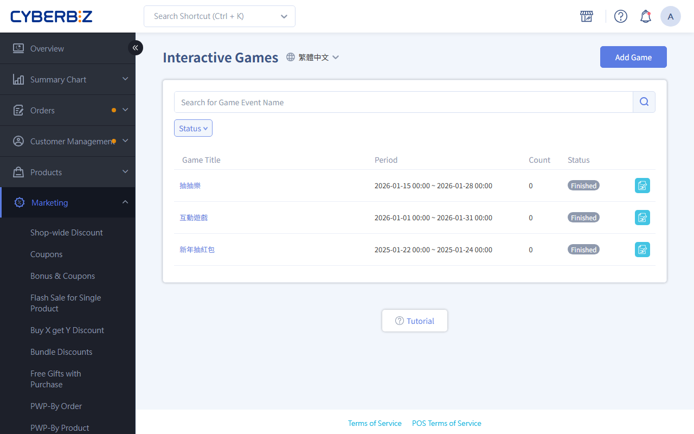
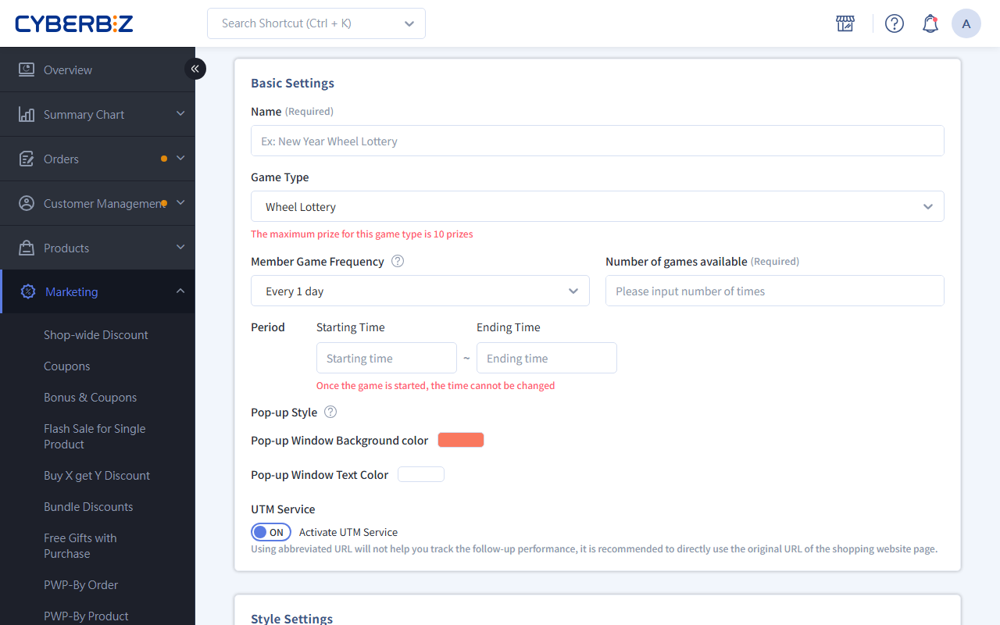
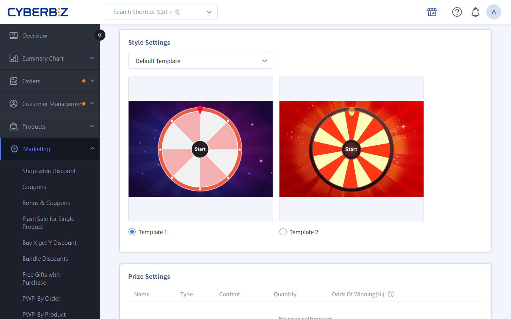
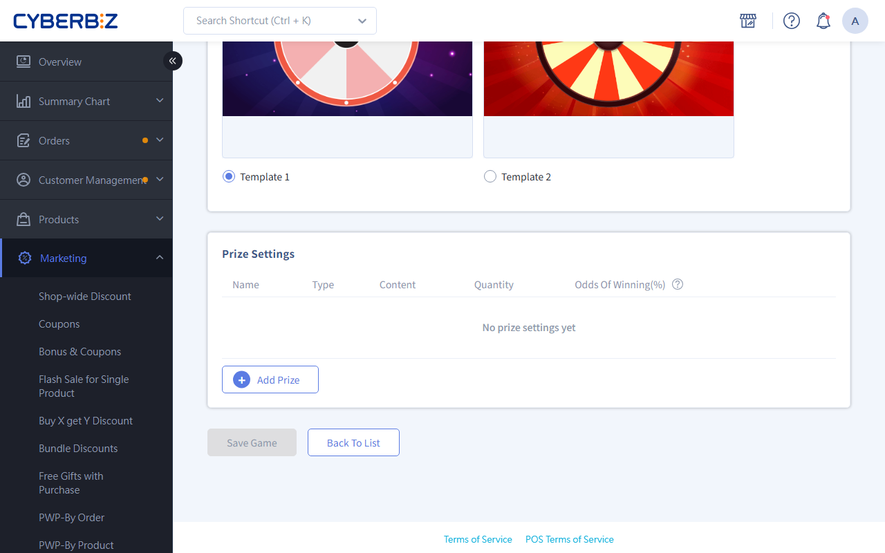
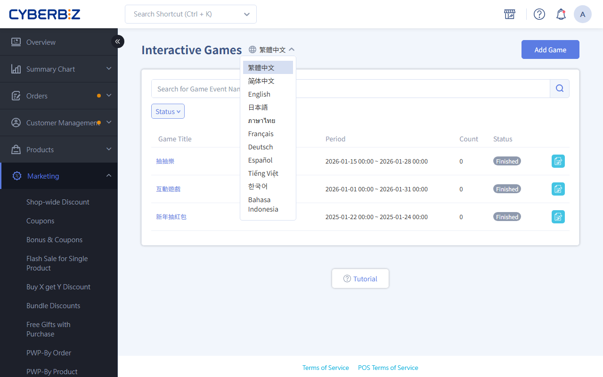

# Interactive Games (EC)

Give out coupons, bonus points, or gifts through fun games like spin wheels, red envelopes, and treasure chests to boost member engagement and conversions.
{ .subtitle }

[:lucide-tag:{ title="適用方案" }](../../../resources/conventions#適用方案) | All PLUS / Enterprise
{ .doc-badge }

{ .hero-page }

!!! info "Version Differences"
    - Both **Online Store (EC)** and **Retail Store (POS)** support Interactive Games. This article covers only **Online Store (EC)** Interactive Games settings.
    - On PLUS plans, Interactive Games is part of the Marketing B add-on module (choose 2 of 11). Make sure you have selected this module before using it. Enterprise includes it by default.

## About Interactive Games

Interactive Games is a powerful marketing tool that gives out rewards through games such as spin wheels and red envelopes. It brings members back more often and raises order conversion.

!!! tip "Use Cases"
    - **Daily check-in**: Allow 1 play per day so members visit daily to claim small bonus points or coupons.
    - **Holiday events**: Run a Lunar New Year red envelope rain to set a festive mood and give out high-value coupons.

## Before You Start

- **Editing limits**: Once a game's Status is "In Progress," you can't change the **pricing rules, play frequency, play count, or prizes**. You can still shorten or extend the end time.
- **Ending a game**: Games can't be deleted after they're created. To end a game now, set its end time to a time before now.
- **Extending a game**: If a game is about to end and prizes are left, change the end time to extend it.
- **Login required**: Interactive Games is for online store members only. Members must log in to play.
- **Instant credit**: Prizes are credited to the member's account right away and can be used immediately.
- **Prizes run out**: When a prize runs out, it still appears in the game, but landing on it counts as "No Prize."

## Steps

### Step 1: Add Game Basic Information

1. Log in to the CYBERBIZ admin and go to **Marketing > Interactive Games**.
2. Click **Add Game** and enter an **Name**.
3. Choose a **Game Type**:
    - **Wheel Lottery**: A classic wheel. The prize is wherever the pointer stops.
    - **Red Envelope Lottery**: Click a red envelope or treasure chest to reveal a prize.
4. **Play frequency and count**: Set the period (every 1, 7, 30, or 90 days) and the number of plays.
5. **Start and end time**: Set the dates the game appears in the online store or retail store.
6. **Pop-up settings**: Set the background color and button text of the prize pop-up.

!!! info "Prize Links"
    Set a prize link and turn on UTM tracking to measure how many winners click "Go Shopping."

### Step 2: Set The Game Style

1. **Template**: Choose "Default Template" or "Custom Template."
2. **Colors and images**:

    === "Default Template"
        - **Wheel Lottery**: Choose a built-in template.
        - **Red Envelope Lottery**: Choose a built-in template.

    === "Custom Template"
        - **Wheel Lottery**: Customize the slice colors, text color, pointer color, and background image.
        - **Red Envelope Lottery**: Upload a "Draw Image" (closed) and a "Reveal Image" (opened).

        > **Upload limit**: All images in one game (style and prize images) can't exceed **10 MB** in total.

### Step 3: Manage Prizes

Click **Add Prize** and set up each prize:

| Prize Types | Key Settings |
| :--- | :--- |
| coupons, bonus points, free shipping coupons, gift coupons | Prize name, quantity, win rate, prize link |

!!! info "Setting Notes"
    - **Win rates**: The win rates of all prizes (including "No Prize") **must add up to exactly 100%**.
    - **Display tip**: Keep prize names within **10 characters** so the wheel text isn't shrunk to fit.

### Step 4: Preview And Publish

1. **Preview**: Click **Preview** to check that the game and prizes display correctly.
2. **Publish on the storefront**:
    - **Option 1: Automatic pop-up**: Go to **Website Appearance > Theme Setting > 網站設定 > 彈窗廣告**, add a block, and select the Interactive Games.
    - **Option 2: Embed on a page**: Click **iframe Grammar** at the top of the game settings page, copy it, and paste it into the source editor of a custom page, blog post, or product description.
3. **Save and publish**: Click **Save**. If the Status is "Public," the game goes live at the set time.

## Multi-Language Settings

Set multi-language names for Interactive Games so the storefront shows the right text for each language.

!!! warning "Notes"
	- To edit the English version, **switch to English** first.
	- Only fields with a **language tag** change text when the storefront language changes. For example: **Group Name** Interactive Games `繁體中文`.
	- If a language field is empty, the storefront shows the **繁體中文** content by default.

### Steps

1. Log in to the CYBERBIZ admin and go to **Marketing > Interactive Games**
2. In the language menu, switch to the language you want to edit (for example, Traditional Chinese or English).
3. Expand the group, click the group name field to edit it, and press ++enter++ to save.

## FAQ

??? quote "Does the number of prizes affect how the wheel looks?"
    Yes. With an **odd** number of prizes, the system adds a "Start" slice as the starting point. With an **even** number, only your prizes appear. Keep prize names short so the text displays well.

??? quote "Why can't members see the game pop-up?"
    Check that: 1. The game Status is "Public." 2. The current date is within the Period. 3. The member hasn't used up their play Count for the period.

??? quote "How do I change prize win rates for a game in progress?"
    You can't change win rates for a game in progress. Instead, "Pause" the game, click "Copy Game" to create a new one, change the win rates, and publish it again.
