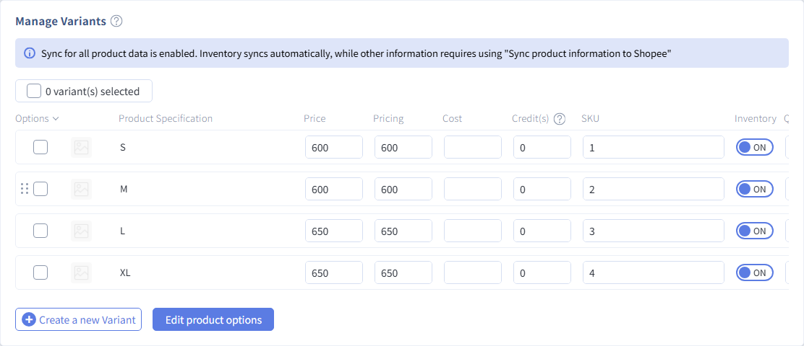
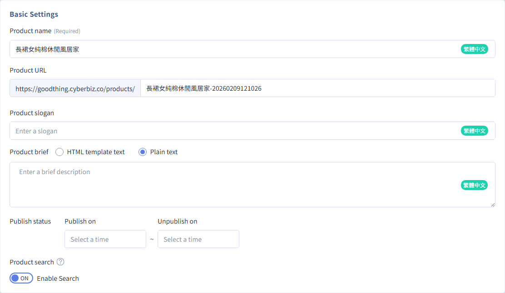

# Auto-Select Variants With A SKU In The Product Link

Add the `?sku=` parameter to a product page URL. When customers click the link, the product page opens with the matching Variants selected. Use it for social media and EDM campaigns that promote a specific variant.
{ .subtitle }

[:lucide-tag:{ title="適用方案" }](../../../resources/conventions.md#適用方案) | Enterprise
{ .doc-badge }

!!! tip "Use Cases"
    - **Promote a variant on social media**: Promote the "red" or "size L" option in a LINE or Instagram post. One click preselects that Variants.
    - **Targeted EDM**: Send different SKU links to different audiences in your newsletter so customers don't have to switch options themselves.
    - **Match ad creatives**: Give each ad creative its own Variants link for easier tracking and conversion.


## Before You Start

- **Scope**: This link opens the **product page** (`/products/...`) with the Variants preselected. Customers still need to add it to the cart themselves. To **add specific products straight to the cart** from a link, use [Create a Cart Link with Specific Products](create-cart-link-specific-products.md) instead.
- **Requirement**: The target Variants must have a **SKU**. A blank SKU can't be matched.
- **Case sensitivity**: The SKU in the URL must **exactly match** the Variants SKU in the admin, including case and symbols.
- **Test before publishing**: Before sharing the link, open it in a private window and make sure the storefront selects the correct Variants.


## Steps

### Step 1: Make Sure The Variants Has A SKU (Settings)

1. Log in to the CYBERBIZ admin and go to **Products > All Products**.
2. Open the product and scroll to **Manage Variants**.
3. Make sure the Variants you want to promote has a **SKU**.

    { .screenshot }

    !!! tip "No SKU in Settings Yet?"
        Enter the SKU in the Variants field and save. For Settings details, see [Create New Product: Variants, Prices, and Inventory](../../products/create-and-manage/create-update-products.md#operate-product-create-variants).

### Step 2: Get The Product Page URL

Use either method:

=== "Copy from the Storefront"

    1. Open the product page on your store.
    2. Copy the full URL from the browser's address bar (parameters aren't needed).

    ```http title="商品頁網址示意"
    https://www.example.com/products/example-product
    ```

=== "Check in the Admin"

    1. On the product edit page, check the **Product URL** field.
    2. Combine them as `https://您的網域/products/` + `商品網址路徑`.

    { .screenshot }

### Step 3: Add The SKU Parameter To The URL

Add the parameter to the end of the product page URL in this format:

```http
[商品頁網址]?sku=[款式的SKU]
```

| Part | Description | Example |
| --- | --- | --- |
| `[商品頁網址]` | Full path of the product page on your store | `https://www.example.com/products/example-product` |
| `?sku=` | Fixed parameter name (lowercase) | `?sku=` |
| `[款式的 SKU]` | Product code of the Variants in the admin | `red-sample` |

!!! example "Full Example"
    If the product page is `https://store123.cyberbiz.co/products/example-product` and the red variant's SKU is `red-sample`:

    ```http
    https://store123.cyberbiz.co/products/example-product?sku=red-sample
    ```

    When customers click the link, the product page automatically selects the red Variants.

### Step 4: Test, Then Share

1. Open the link in a private window or on another device.
2. Make sure the product page preselects the correct Variants (color, size, and so on).
3. Once it's correct, use the link in social posts, EDMs, ad creatives, or SMS.


## Advanced Use

### One Link Per Variants Of The Same Product

Create a separate link for each Variants you want to promote, changing only the value after `sku=`:

```http title="紅色款"
https://www.example.com/products/tshirt?sku=TSHIRT-RED-M
```

```http title="藍色款"
https://www.example.com/products/tshirt?sku=TSHIRT-BLUE-M
```


## Related Articles

<div class="grid cards" markdown>

- :lucide-shopping-cart:{ .lg }
  [__Create a Cart Link with Specific Products__](create-cart-link-specific-products.md)
  Add specific products and quantities to the cart in one click for faster ordering.

- :lucide-package:{ .lg }
  [__Add and Manage Products__](../../products/create-and-manage/create-update-products.md)
  Settings for Variants, prices, inventory, and product codes (SKU).

</div>
