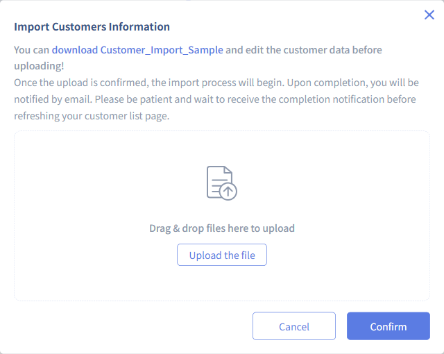
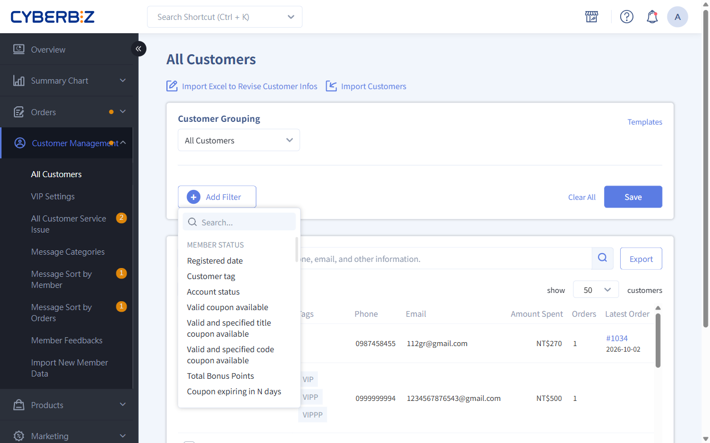
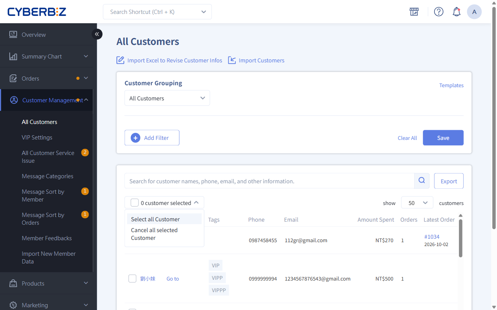
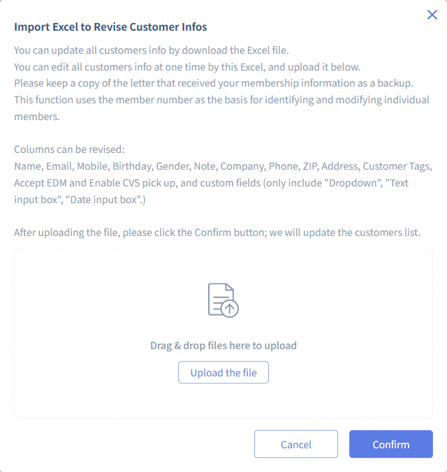

# Batch Import / Edit Members

Use an Excel file to quickly create or update member data in bulk, including contact information, bonus points initialization, and marketing tag management.
{ .subtitle }

{ .hero-page }

!!! tip "Use Cases"
    - **System Migration**: Move the member list from your previous platform to CYBERBIZ in one batch when initially setting up your store.
    - **Complete Missing Data**: Export members with missing addresses or birthdays in bulk, complete the data, and upload the file again.

## Important Notes { #prerequisites-batch-members }

Before importing or editing data in bulk, review the following restrictions and requirements:

- **Testing Recommendation**: Imported data cannot be deleted in bulk. Before processing a large amount of data, test with 3–5 records to confirm that the format is correct.

- **Formatting Requirements**:

    - Do not change the content or order of the headings in the first row of the Excel template. Doing so will cause the import to fail.
    - Complete every field and do not insert blank rows between data rows. If a blank row appears, the system imports only the data before that row.

- **Field Restrictions**:

    - **bonus points**: This can be imported only when **adding new members**. To adjust the bonus points of existing members, manually edit each member on the member edit page.
    - **Password**: Set a default value based on member needs. Avoid overly simple passwords that could create security risks.

!!! tip "Important Notes When Migrating From an Existing Site"
    When migrating members from an existing site to CYBERBIZ, note the following:

    - **Import Timing**: import members a few days before the official migration. This prevents ongoing changes to bonus points or VIP status on the existing site during migration from requiring repeated manual reconciliation.
    - **Remaining Bonus Points**: Include unused bonus points from the existing site in this import. If omitted, they must be added individually on each member's edit page.

## Site Setup And Integrations { #prerequisites-batch-members-site }

###  Required Mobile Number And Email Settings { #prerequisites-batch-members-required }

If you set both **Email** and **Mobile Number** as **required** in [Customer Registration Settings](../website-management/customer-registration-flow-and-fields/#operate-customer-reg-fields), both fields must be completed during import.

If the member list has inconsistent data completeness, first divide the member data into three batches:

- Members with an email address but no mobile number
- Members with a mobile number but no email address
- Members with both a mobile number and an email address

Before importing each batch, adjust **Customer Registration Settings** to match that batch's data. Confirm that the required-field rules match the list, and then import the batch:

1. **Email address only; no mobile number**
   Go to Customer Registration Settings → **clear the Mobile Number required checkbox** → import this batch

2. **Mobile number only; no email address**
   Go to Customer Registration Settings → **clear the Email required checkbox** → import this batch

3. **Both a mobile number and an email address**
   Go to Customer Registration Settings → **select both the Mobile Number and Email required checkboxes** → import this batch

!!! info "Versions Supporting Mobile Number Field Settings"
    - **Professional and Advanced Editions**: This field is required by default and cannot be changed.
    - **Other Editions**: Merchants can set this field as required or optional.

### Member VIP { #prerequisites-batch-members-vip }

- Test With a Small Batch FirstTo apply a VIP level, first complete the VIP level settings and confirm that they are active. Then import a small set of test data, such as employee accounts. Verify that the members are assigned to the correct level before importing actual members in bulk.
- Use **Orders from Other Channels** to add purchase records. The system **includes them in VIP eligibility calculations** and determines eligibility based on the **Order Date** entered. If no specific date is required, enter the import date.

### Marketing Campaigns { #prerequisites-batch-members-campaigns }

If you plan, when import members, to send **bonus points, coupon, or birthday gift**, **complete the site setup and turn on the features first.**

A complete shopping experience ensures that members can follow the notification to your site and place an order. If the site is not ready, members may be disappointed and traffic may be wasted, reducing the likelihood of repeat purchases.

## Procedure { #operate-batch-members }

### Task 1: Import New Members In Bulk { #operate-batch-members-import }

Use this task to add a list of new members who do not yet exist in the system.

1. Log in to the Admin, then go to **Customer Management > All Customers**.
2. Click **import members** in the top-right corner.
3. In the pop-up window, click **Download Customer Import Sample**.
4. Enter the data in the template format, then delete the default `May Chang` example row.
5. Click **Upload the File** to upload the completed file, then click **Confirm** to run the import.

    > The system runs the import task in the background and emails the results when complete.

### Task 2: Edit Existing Member Data In Bulk { #operate-batch-members-edit }

Use this task to update members already in the system, such as adding birthdays, changing mobile numbers, or updating tags.

1. Go to **Customer Management > All Customers** and filter the members to edit.

    === "Use the Member Filter"

          1. Click **Add Filter**.
          2. Select the required conditions.
          3. The system automatically filters the members and displays matching members in the list below.
          4. Click :lucide-square: **0 customer Selected** to select all matching members.

          

    === "Manual Selection"

          1. **Select Specific Members**: Select the checkbox next to each member in the list.
          2. **Select All Members**: Click :lucide-square: **0 customer Selected**, then click **Select All Customer**.

          

2. Click **Export** and accept the data protection terms.

      > The file is sent to the email address associated with your login account.

3. Open the file in Excel and edit the data.
    - **Editable Fields**: Name, email address, mobile number, birthday, gender, notes, tags, company, telephone number, address, Subscribed to Marketing, CVS Pickup, and [custom fields](../website-management/customer-registration-flow-and-fields/#operate-customer-reg-custom) (Enterprise Edition only).
4. Return to **Customer Management > All Customers** in the Admin and click **Import Excel to Revise Customer Infos**.
    
5. Upload the edited file and click **Confirm**.

     > The system matches records by **Email** or **Mobile Number** and overwrites the data. An email notification is sent whether the update succeeds or fails.

## Key Excel Field Descriptions { #specs-batch-members }

Ensure that the following key fields use the correct format:

| Field Name | Format Requirements | Description |
| :--- | :--- | :--- |
| **Name** | Text | The member's display name |
| **Email Address** | Text (Email) | The primary identifier used by the system to identify members. The format must include `@` and a domain name |
| **Mobile Number** | Number | The primary identifier used by the system to identify members. For regions outside Taiwan, include the country code; for example, enter `+85261234567` for Hong Kong |
| **Birthday** | Date (YYYY/MM/DD) | Gregorian calendar format only; for example, `1990/01/01` |
| **Remaining bonus points** | Positive integer | **Effective only when importing new members** |
| **Tags** | Text (comma-separated) | Multiple tags can be assigned to the same member; for example: `VIP, 實體店, 潛在客` |
| **Birthday Gift** | Yes/No | Issues birthday gift from marketing campaigns. birthday gift in VIP settings are not subject to this restriction |

!!! info "birthday gift Feature Availability by Edition"
    This feature is available only for the PLUS and Enterprise Editions. Other editions do not include this field.

To add [Orders from Other Channels](manage-member-profiles/#operate-member-profiles-other-orders), follow the instructions for your system edition:

=== "Enterprise Edition"

      Switch to the **Orders from Other Channels** tab and enter the relevant information.
      

=== "Other Editions"
      Enter the information directly in the **Other Channel Accumulated Amount** and **Accumulated Amount Date** fields.
      

## Frequently Asked Questions { #faq-batch-members }

??? quote "Will Editing Data in Bulk Create Duplicate Accounts?"
    No. The system uses **Email Address** and **Mobile Number** as the primary matching IDs. If an email address or mobile number already exists, the system updates that record.

??? quote "How Do New Accounts Imported in Bulk Through Excel Log In Without a Default Password?"
    If no password was set when a new account was imported, the member must click **Forgot Password** when logging in for the first time. The system guides the member through password setup. After setup, the member can log in normally.
