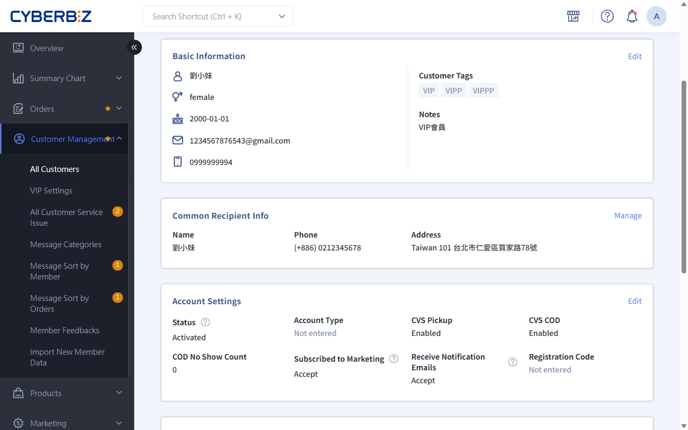
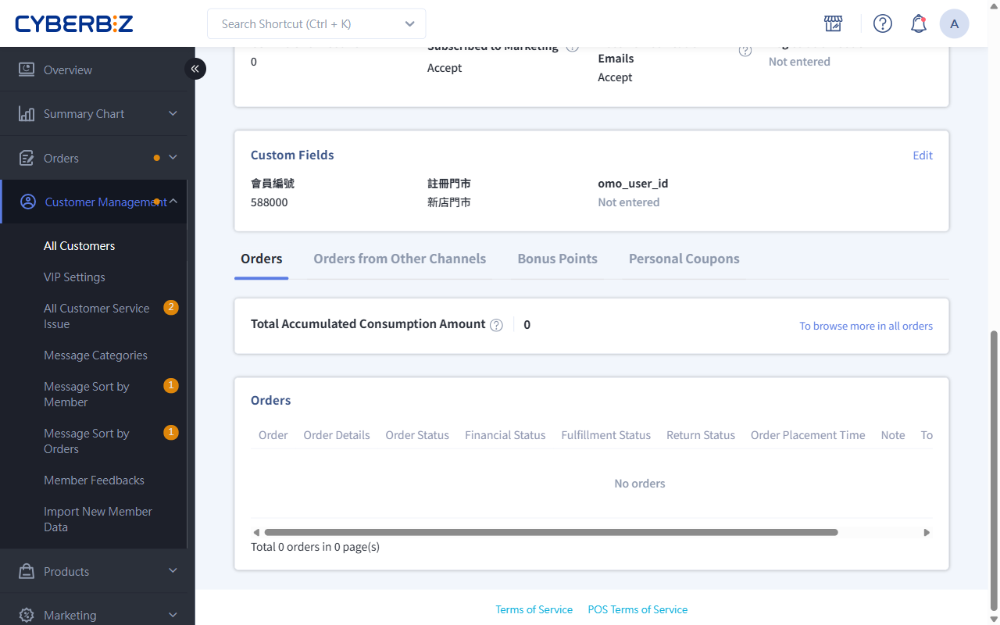
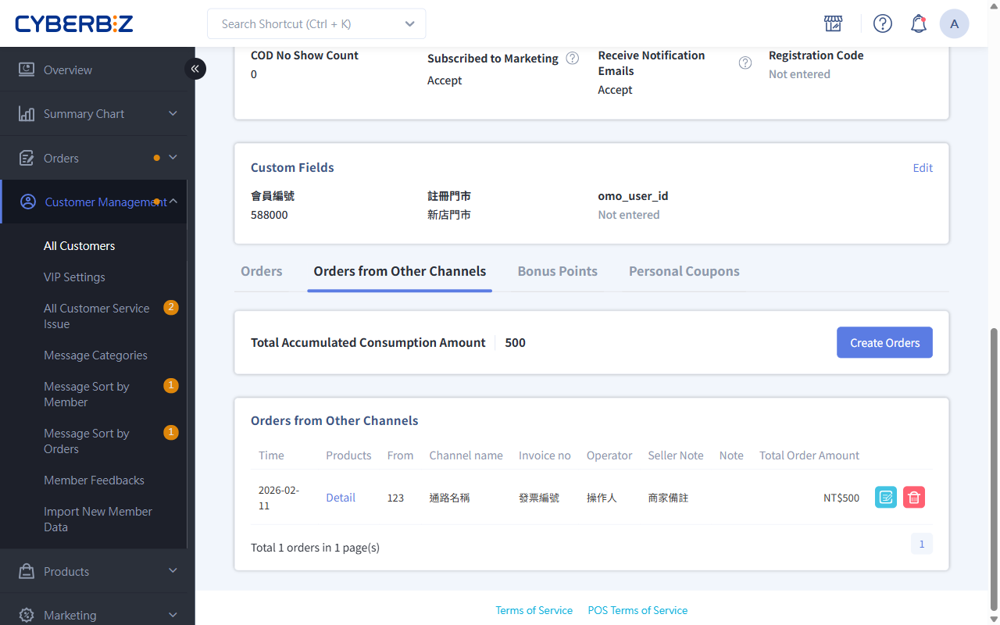
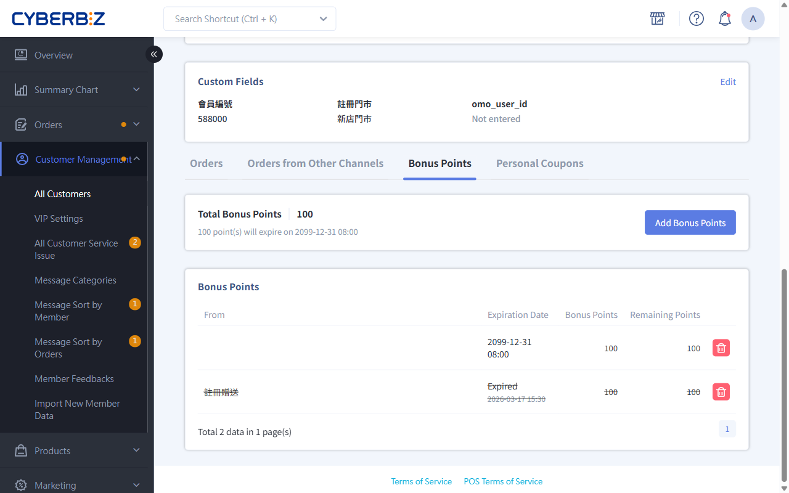
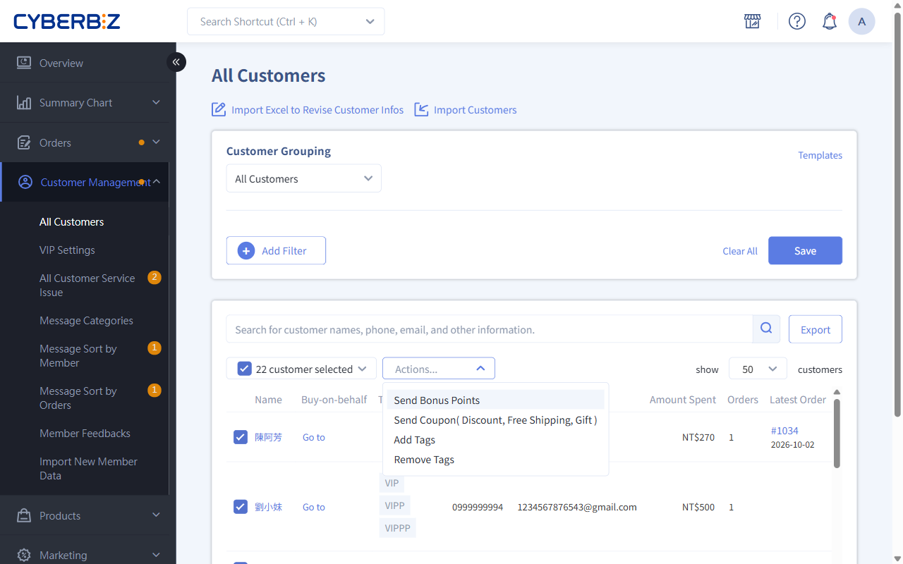
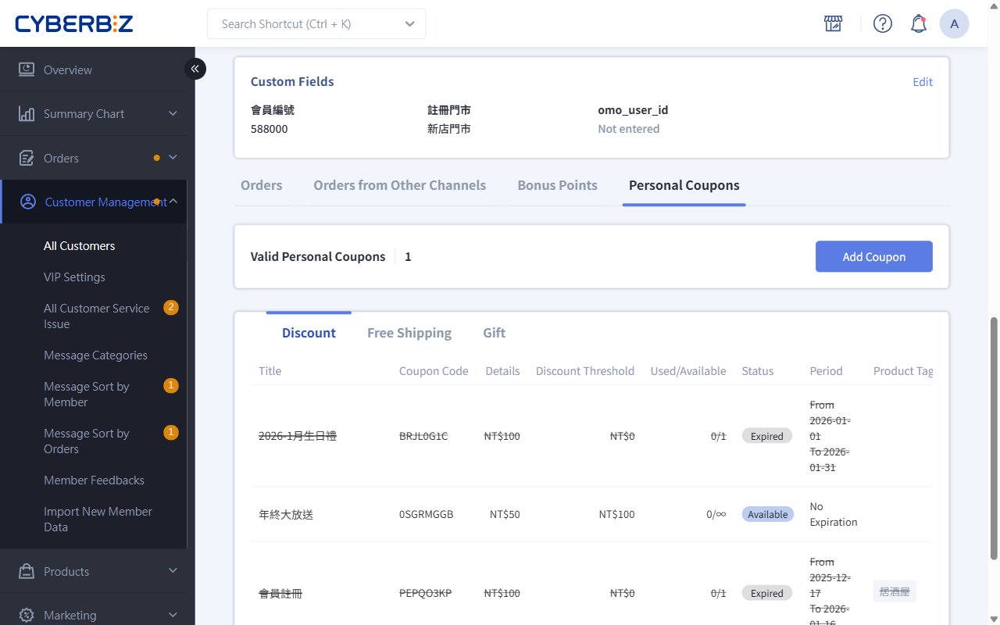
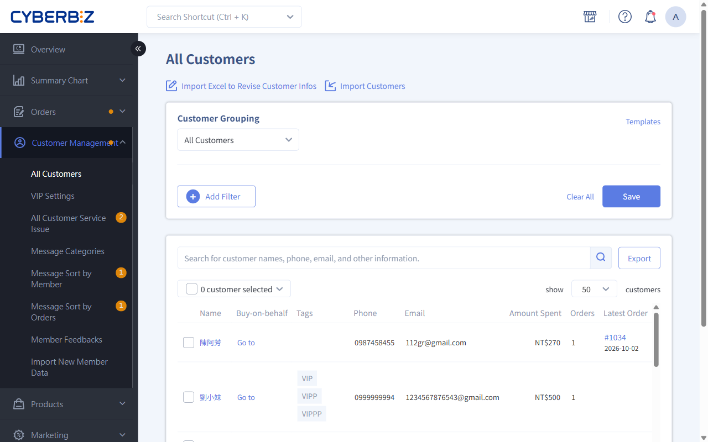

# Manage Member Profiles

When a member's information or permissions change, their points or coupon allocation needs adjustment, or they need help placing an order, administrators can use the Member Details page for one-stop customer service and data maintenance.
{ .subtitle }

{ .hero-page }

!!! tip "Use Cases"
    - **Routine Data Maintenance**: Correct a member's incorrectly entered name, phone number, or birthday.
    - **Complaint Compensation and Rewards**: Manually reissue bonus points or coupon for a specific order dispute.
    - **Risk Control and Segmentation**: Suspend members who maliciously abandon orders, or manually add a VIP tag to high-value members.
    - **Advanced Customer Support**: Place orders on behalf of members who are unfamiliar with the website, or guide them through resetting their password.

## Before You Begin

Before managing member information, understand the following system behavior:

- **Data Synchronization**: Updating contact information on the Member Details page **does not** automatically update recipient information on **existing orders**.
- **Irreversible Actions**: Once bonus points is issued or revoked, the system immediately updates the member's assets. Confirm the amount and reason before proceeding.

## Task 1: View Member Behavior And Asset Data

After opening the details page, use the data overview at the top to quickly assess the member's spending power and current engagement status:

| Metric | Evaluation Dimension | Formula |
| ------- | ------- | -------- |
| **Total Cumulative Spending** | Loyalty Contribution | Total value of valid EC orders + POS orders + orders from other channels |
| **Number of Orders** | Purchase Frequency | Total number of valid EC orders + POS orders + orders from other channels |
| **Average Valid Order Value** | Average Order Value | Total Cumulative Spending ÷ Number of Orders |
| **Total bonus points** | Return Incentive | Total bonus available to the member |
| **Valid coupon Held** | Purchase Intent | Total available coupon held by the member |

Data is more than a static record. It guides marketing decisions. The following examples show how to apply the data:

| Metric | Operational Insight | Practical Application |
| ------- | ------- | ----------- |
| **Total Cumulative Spending** | Prioritize Resource Allocation | 1. Send vouchers to members who are about to Upgrade to encourage another purchase 2. Provide dedicated outreach to win back high-value lapsed members |
| **Number of Orders** | Assess Brand Reliance and Repurchase Momentum | 1. Predict replenishment timing based on order cycles 2. Use different push notification strategies for bulk stock-up customers and frequent buyers who are sensitive to free-shipping offers |
| **Average Valid Order Value** | Set Product Bundle Values and Free-Shipping Thresholds | 1. Promote products priced for the member's spending level 2. Use this metric as a reference when setting gift-with-purchase thresholds |
| **Total bonus points** | Measure Asset Value and Return Incentive |An excessive points balance suggests that purchasing power has not been redirected to the store. Promote points-plus-cash offers to encourage redemption. |
| **Valid coupon Held** | Final Purchase Driver | Send limited-time order reminders to members who claimed a coupon but did not make a purchase |

!!! tip "From Data Insights to Precision Marketing"
    In addition to viewing detailed data for an individual member here, use the member filter to select members in bulk based on specific metrics. This enables more precise broadcast notifications and marketing strategies.

## Task 2: Maintain Basic Information And Accounts

### 1. Edit Basic Member Information

1. Go to **Customer Management > All Customers**, search for the member, and click the member's name to open the details page.
2. In the **Basic Information** section, click **Edit** in the upper-right corner.
3. Edit the name, email address, mobile number, birthday (Gregorian calendar format only), address, and other information.
4. Click **Save**.

### 2. Manage Account Permissions And Status

Use the **Account Settings** section to control permissions based on member behavior:

- **Account Status**:
    - `禁用帳號`: The member cannot log in (for malicious users).
    - `Set as Warning Account`: The member can still place orders, but a prominent marker appears in the admin order list to alert fulfillment staff.
- **Account Type**:
    - **Identify Registration Source**: Check whether the member used a third-party platform such as LINE, Google, or Facebook for quick registration.
    - **Quick Login Support**: Recorded sources include LINE, Google, and Facebook. If the field is **blank**, the account was registered with a standard email address.
- **Shipping Restrictions**:
    - **View Unclaimed Pickup Records**: Review the member's previous **number of unclaimed paid orders** as a reference when evaluating shipping permissions.
    - **Control Convenience Store Pickup Permissions**: For members with repeated unclaimed pickups, switch `CVS Pickup` or `CVS COD` to **Disabled**.
- **Notifications and Push Messages**:
    - **Manage Marketing Subscription Status**: Confirm whether the member agrees to receive promotions and newsletters from the merchant.
    - **Set System Notification Permissions**: Confirm whether the member agrees to receive automatically sent emails about order status, returns, shipping progress, and other updates.

    !!! info "Important Notes on Notification and Push Settings"
        The member sets the original preferences for **Subscribe to Merchant Promotions** and **Receive Notification Emails**. Before changing them manually, the merchant must reach an agreement with the member and obtain consent to avoid email disputes.

- **Registration Code**: Displays the revenue-sharing registration code linked to the member.

    !!! info "Plan Availability"
        The referrer revenue-sharing feature is unavailable on the Professional plan, so this field does not appear in its admin interface.

!!! info "Additional Custom Information"
    - **Common Recipient Info**: View the member's saved delivery recipients.
    - **Custom Fields**: View the merchant's [custom registration fields](../website-management/customer-registration-flow-and-fields.md#步驟-4-建立與管理自訂欄位) and the member's responses.
      > This feature is available only to customers on the Expert PLUS and Enterprise plans.

## Task 3: Manage Purchase Behavior And Orders

To help merchants accurately assess member value, the system consolidates **real-time online store and retail store orders** with **manually added orders from external channels**. This provides a comprehensive overview of spending data and ensures that VIP tiers and benefits continue seamlessly wherever the member shops.

### 1. Online Store And Retail Store Purchases

Scroll to the **Orders** section. This section automatically consolidates valid spending totals from the online store (EC) and POS retail stores as the primary basis for assessing member contribution.

-   **Use Case**: Click the **Order Number** to view the transaction's item details and shipping status.
-   **Data Update**: The amount is added to the **Online Store and Retail Store Spending Total** as soon as the order is placed.

### 2. Orders From Other Channels

Scroll to the **Other Channels Accumulated Amount**/**Orders From Other Channels** section. This section consolidates spending from platforms that are not integrated with the system, such as marketplaces and private-community referrals. Manually add fragmented external-channel data to the system to manage the member's assets throughout their lifecycle.

The following two management methods are available depending on your plan:

=== "One-Time Entry (Professional and Advanced)"

    -   **Use Case**: Add a historical total in one entry.
    -   **Feature**: Quickly enter the total amount and avoid adding multiple entries.
    -   **Steps**:
        1. Scroll to the **Other Channels Accumulated Amount** section and click **Edit**.
        2. Enter the member's historical **Total Amount** and **Created At** time.
        3. Click **Confirm** to add the entry.
    -   **Limitation**: Only the total amount is recorded. Individual order details cannot be traced.

    

=== "Detailed Record Management (Expert, PLUS, and Enterprise)"

    -   **Use Case**: Accurately record the source of each external order, such as a Taipei pop-up store or LINE group buy, for reconciliation.
    -   **Feature**: Record the date, source, and amount of each order as evidence of member tier growth.
    -   **Steps**:

        1. Scroll to the **Orders From Other Channels** section and click **Create Orders**.
        2. Enter **Created At**, **Order Source**, and **Total Spending** in order.
        3. Click **Confirm** to create a separate record.

        !!! tip "Enterprise-Only Field"
            The Enterprise plan exclusively supports the **Notes** field. Its information appears on the member-facing page. Merchants can add **Reminder Information** and **Shipping Information** to help customers identify the order source.

            

    -   **Limitation**: Individual records can be edited or deleted, but the **Order Source** cannot be changed after confirmation.

    

    !!! tip "Storefront Display Name"
        The name “Valid Orders From Other Channels” displayed to members on the storefront can be changed in the dictionary file. See [Change the Storefront Display Name for “Valid Orders From Other Channels”](../website-appearance/code-customization/customize-other-channel-order-label.md).

        [:lucide-tag:{ title="適用方案" }](../../../resources/conventions#適用方案) | Enterprise

        

## Task 4: Allocate Assets

### 1. Issue And Manage Bonus Points

=== "Issue or Revoke an Individual Entry"

    #### Issue

    1. Scroll to the **bonus points** section and click **Add bonus points**.
    2. Enter the **Point Name** (for example, Complaint Compensation) and **Point Value**.
    3. Set the **Expiration Date** (0 means the points never expire).
    4. Click **Confirm** to immediately credit the points to the member's account.

    #### Revoke

    1. Scroll to the **bonus points** section and click :lucide-trash-2: to remove a specific points entry.

    

=== "Issue in Bulk"

    1. Go back to **Customer Management > All Customers**.
    2. Select the specified members in the list (multiple selections allowed).
      > Use the member filter to select all members who meet specified criteria in one click.
    3. Under **Actions...**, select **Send Bonus Points**.

    

### 2. Issue And Manage Coupon

=== "Issue or Revoke an Individual Entry"

    #### Issue

    1. Scroll to the **Member-Exclusive coupon** section and click **Add Member-Exclusive coupon**.
    2. Enter the **coupon Name** (for example, Complaint Compensation), then configure the remaining issuance conditions and restrictions.
    3. Click **Confirm** to immediately credit the coupon to the member's account.

    #### Revoke

    1. Scroll to the **Member-Exclusive coupon** section and click :lucide-trash-2: to remove a specific coupon entry.

    

=== "Issue in Bulk"

    1. Go back to **Customer Management > All Customers**.
    2. Select the specified members in the list (multiple selections allowed).
      > Use the member filter to select all members who meet specified criteria in one click.
    3. Under **Actions...**, select **Issue coupon**.

    

!!! info "Plan Availability"
    The coupon issuance and management feature is unavailable on the Professional and Advanced plans, so this interface does not appear in their admin panels.

- :lucide-hash:{ .lg }
    [__Free-Shipping Coupon Specifications__](../marketing/coupon/free-shipping-coupon-spec.md)
    Review free-shipping coupon restrictions and the checkout process.

- :lucide-hash:{ .lg }
    [__Gift Coupon Specifications__](../marketing/coupon/gift-coupon-spec.md)
    Learn about gift coupon restrictions and inventory rules.

## Task 5: Manage Marketing Tags And Segments

Use tags to categorize individual members in greater detail:

=== "Add or Remove an Individual Tag"

    1. Find the **Tags** field on the Member Details page.
    2. **Add Tags**: Enter a new tag name and press Enter, or select it from the menu.
    3. **Remove Tags**: Click the `X` icon next to an existing tag and confirm.
        > When a tag is no longer assigned to any member, the system automatically removes it from the tag list.

    

=== "Add or Remove Tags in Bulk"

    1. Go back to **Customer Management > All Customers**.
    2. Select the specified members in the list (multiple selections allowed).
      > Use the member filter to select all members who meet specified criteria in one click.
    3. Under **Actions...**, select **Add Tags** or **Delete Tag**.

    

## Task 6: Place Orders On Behalf Of Members

Use this feature to help members complete an order or place a new order when a shipping label has expired.

=== "From the Member List Page"

    Go back to **Customer Management > All Customers**, find the `Buy-on-behalf` field in the member list, and click **Go to**.

    

=== "From the Member Details Page"

    Click **Place Order on Behalf of Member** in the upper-right corner of the Member Details page.

1. The system logs in to the member-facing storefront as the member.
2. Search for the products and add them to the cart.
3. Click the **Cart Icon** to complete checkout.
4. Set the shipping method, such as home delivery, and payment information.
5. (Optional) Enter an administrator note for future reference.
6. Obtain the **Payment Link** from the admin panel and send it to the member for online payment.

!!! info "Plan Availability"
    The order-on-behalf feature is unavailable on the Professional plan.

## Task 7: Help Members Who Forgot Their Password

For security reasons, administrators cannot directly view or change member passwords.

- **Instructions**: Tell the member to go to the storefront login page, click **Forgot Password**, and enter their email address to receive a password reset email automatically sent by the system.
- **Bulk-Imported Accounts**: If a new Excel import account does not have a password, the member must also use **Forgot Password** to initialize it when logging in for the first time.

!!! warning "HiNet Email Delivery Issue"
    If a customer registers with a **HiNet email address**, the carrier may block the password reset email. Recommend using another email provider.

## Frequently Asked Questions

??? quote "Why Didn't the Recipient Information on an Existing Order Change After I Updated the Member's Phone Number?"
    Changes to member information affect only **future** orders. Recipient information for **existing** orders is fixed in the order record.

??? quote "Will the Member Receive a Notification After Bonus Points Are Issued?"
    If the merchant has enabled the bonus update template under **Email Notifications** or **SMS Notifications**, the system will automatically sent the notification to the member.

??? quote "Can an Order Placed on Behalf of a Member Use bonus redemption From the Member's Account?"
    Yes. On the admin checkout page for an order placed on behalf of a member, the administrator can select and enter the member's remaining bonus points to apply them as a discount.

