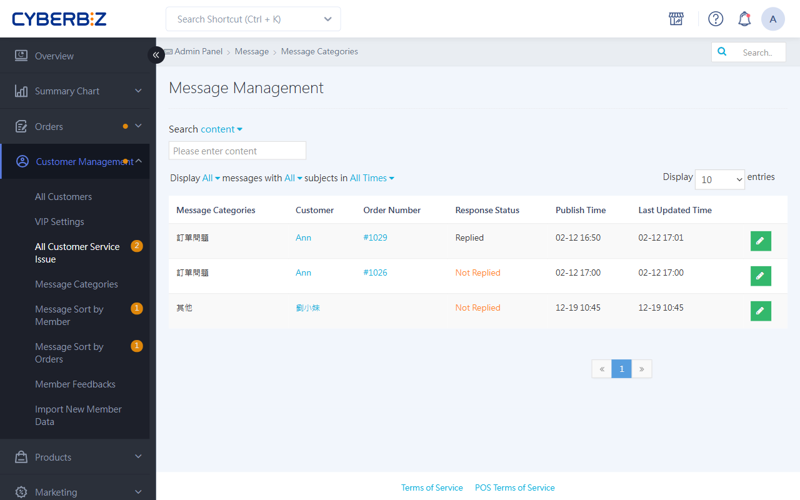
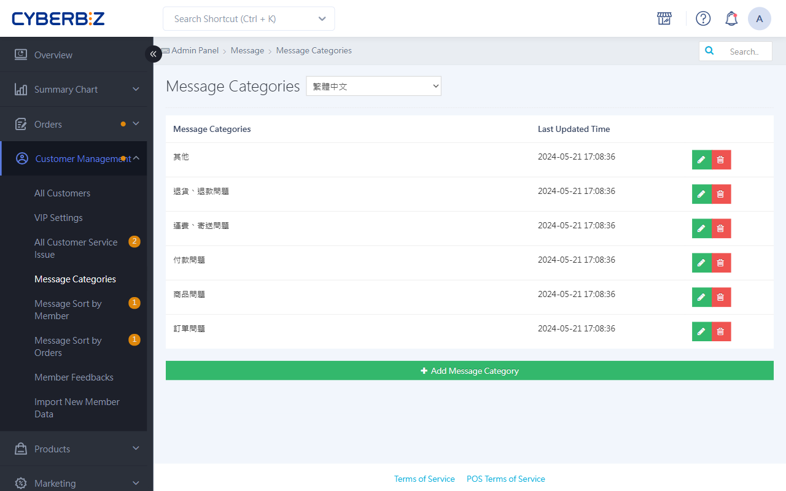

# Member Customer Service System

Learn how to configure the built-in customer service Q&A system on your website, including setting inquiry topics, handling messages from members and visitors, and managing consultation Message within orders.
{ .subtitle }

{ .hero-page }

!!! tip "Use Cases"
    - **Route Inquiries Efficiently**: Set up topics such as "Shipping Status" and "Return or Exchange Request" so customer service staff can quickly identify the main issue.
    - **Build a Communication History**: Message is linked to the member account, allowing staff to review previous communication details even when the assigned agent changes.
    - **Improve Services with Data**: Export and analyze common inquiries to improve product descriptions or build an FAQ.

## 1. Feature Overview

The website customer service Q&A system includes the following communication channels:

1.  **Contact Us (Site-Wide)**: Visitors can submit a message through the form whether or not they are logged in.
2.  **Order Inquiry (Members Only)**: Members can leave a message about a **specific order** on the order details page. Message is automatically labeled with the order number.

## 2. Storefront Setup And Interaction Scenarios

The following sections explain the **Customer Service Q&A** interaction flow:

### 1. Contact Us Form

=== "Customer Perspective"

    Click **Contact Store** in the website navigation bar or footer. Select an inquiry topic, enter a name, email address, and inquiry Content, then submit the form.
    > **Contact Store** is the default system text. Merchants can change this name manually. After setup, make sure the page also instructs Customer to click the specified text so the consultation path is clear.

    

=== "Merchant Perspective"

    - **Notification**: An orange dot appears next to **Members** in the left menu.
    - **Handling the Inquiry**: Go to **Customer Management > 所有客服問題** and click :lucide-pencil: to reply.

### 2. Order-Specific Inquiry

=== "Customer Perspective"

    After logging in as a member, go to **Order Lookup**. Enter a question in **Send Message to Store** at the bottom of the order details.

    

=== "Merchant Perspective"

    - **Notification**: An orange dot appears next to **Members** in the left menu.
    - **Handling the Inquiry**: Go to **Customer Management > 所有客服問題** and click :lucide-pencil: to reply.
      > The relevant **Order Number** is automatically added to the Message. Click it to view the order Content directly.

## 3. Set Up Customer Service Topics

Before accepting storefront messages, set up inquiry categories to route Message appropriately.

1. Log in to the admin panel and go to **Customer Management > Message Categories**.
2. Click **Add Message Category**.
3. **Topic Name**: Enter the item to Display in the storefront menu, such as Shipping Status, Wholesale Inquiry, or Refund Request.
4. Click **Save**.

## 4. Message Replies And Management

### 1. Reply To Member Inquiries

1. Go to **Customer Management > 所有客服問題**.
2. Click **Edit** for the item awaiting a reply.
3. Enter text in the reply field.
4. **Choose the Correct Action**:
    - **Click Save**: Send the reply Content. The system sends a notification email to the member.
    - **Click Close Case**: This only marks the status as **Replied** and removes the admin notification count. It **does not save or send MessageContent**.

!!! warning "Operational Restrictions"
    After you click **Save** to send a reply Content, the system **does not allow it to be edited or deleted**. Make sure the Content is correct before sending.

### 2. Handle Visitor (Non-Member) Messages

1. If the system cannot find a member account associated with the visitor's email address, go to **Customer Management > Member Feedbacks**.
2. Use the contact information left by the Customer to reply outside the system, such as by manually sending an email or Phone.

### 3. Export Records For Analysis

1. Go to **Customer Management > 客服問題 – 依會員分類**.
2. Select the members whose records you want to analyze.
3. Click **選擇操作 > 匯出客服** at the top of the page. The system generates an Excel file for download and analysis.

## Frequently Asked Questions

??? quote "Why does the Customer say they cannot see my reply after I click **Close Case**?"
    **Close Case** changes the management status in the admin panel. Use it for issues resolved through another channel, such as Phone. To display reply text to the Customer on the website, enter the reply and click **Save**.

??? quote "Where can Customer view reply records?"
    Members can log in to the website and go to **我的帳戶 > 詢問紀錄** to view the All exchanged with the customer service center in the Content.

??? quote "Can an Message sent by mistake be recalled?"
    The system currently does not support recalling or editing customer service replies after they are sent. Create a **Standard Reply Template** or a **Pre-Reply Checklist** to reduce errors.

??? quote "Why can I only see **Issue Management** instead of the **All Customer Service Issues** menu in the admin panel?"
    The system dynamically changes this path to simplify the management interface based on **whether any issues are awaiting a reply**:

    - **When an issue is awaiting a reply**: Go to **Customer Management > 所有客服問題** to handle it.
    - **When no issues are awaiting a reply**: The menu automatically changes to **Issue Management**. 