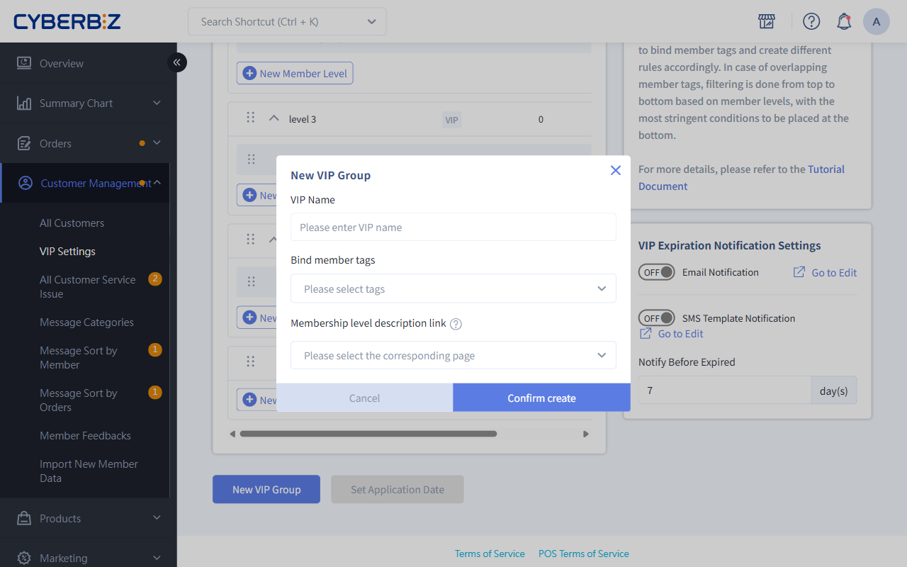

# Create Exclusive VIP Groups

Use the VIP group Tags feature to bind Tags to specific customer segments and set exclusive VIP rules for segmented customer management and targeted marketing.
{ .subtitle }

{ .hero-page }

## Feature Overview

The "VIP Group Tags" feature lets merchants apply a set of tier rules separate from the "All VIP" rules to members with a specific **member Tags**. This is useful for managing specific customer segments, such as employees, KOLs, and high-value customers.

### VIP Type Differences

1.  **All VIP**: Applies to all members who are not assigned to a specific group.
2.  **VIP Group**: Binds a specific **member Tags** and is available only to members with that Tags.

## Procedure

### Step 1: Create A VIP Group And Bind An Tags

1. Log in to the admin panel and go to **Customer Management > VIP Settings**.
2. Click the **Version In Editing** tab.
3. Click **New VIP Group**.
4. From the **Bind Member Tags** drop-down menu, select a previously created member Tags.
5. Set the tier thresholds and benefits for the group.

### Step 2: Adjust Group Order

1. On the VIP Settings list page, find the ordering controls on the right.
2. Drag the groups or adjust their numbers so that their priorities match your business strategy.
3. Click **Save Order**.

## How It Works And Evaluation Rules

### 1. Recalculation Triggers
The system recalculates a member's VIP tier in the following situations:

*   **Tags Changes**: When a merchant **adds** or **removes** an Tags bound to a VIP group for a member.
*   **Valid Order**: When the member places a new valid order.

### 2. Priority And Order
If a member has multiple customer Tags values, and these Tags values are bound to different VIP groups:

*   **Order Determines Priority**: The system uses the **order** of the VIP list in the admin panel.
*   **Evaluation Logic**: The system evaluates groups upward from the **bottom** of the list. The first eligible group determines the rules that apply to the member.
*   **Recommendation**: Place the group with the strictest requirements and highest benefits at the bottom of the list.

### 3. Determine Member Eligibility
The system checks the Upgrade requirements for the lowest tier, or entry tier, in the VIP group.

- **Meets the Threshold:** The member formally enters the VIP group and receives the corresponding tier based on their spending. The member can be upgraded directly to the highest tier.
- **Does Not Meet the Threshold:** Even if the member has an Tags, the system determines that they are not eligible for the group's VIP status. The member retains their existing status, such as All VIP or regular member, until the next trigger event when their spending meets the threshold.

!!! tip "Key Concept"
    An Tags only grants eligibility for an **entry ticket**, not a **direct pass**. The member must have the Tags and also meet the group's spending threshold before the system formally Upgrade them as a VIP in that group.

## Calculation Rules When Adding Or Removing An Tags

When a merchant manually adjusts a member's Tags, the system uses the following calculation logic:

| Action | Calculation Logic | Validity Start Date |
| :--- | :--- | :--- |
| **Add Tags** | Treated as a **valid order** event. The system looks back from the current time to evaluate the threshold within the validity period. | Starts on the **date the Tags is added**. |
| **Remove Tags** | Treated as an **invalid order** event. The system looks back to the most recent valid event for the calculation. | Starts on the date of the most recent valid event. |

!!! warning "Risks of Manual Adjustments"
    Do not frequently "remove Tags and then add Tags" for members to test the logic. Adding an Tags triggers a new lookback calculation. If the member's spending is insufficient during the new lookback period, the member may be unexpectedly Downgrade.

## FAQ

??? quote "Why does a member with an Tags not enter the corresponding VIP group?"
    Check whether the member meets the Upgrade threshold for the "lowest tier" in the VIP group. Even with a bound Tags, the member must meet the spending threshold, either for a single purchase or cumulative spending, before they are formally Upgrade.

??? quote "Can I delete an Tags that is currently used by a VIP group?"
    No. An Tags can be deleted only when all of the following conditions are met: no customers use it, no products use it, **no VIP group is bound to it**, and no member-exclusive products use it.

