# Set Up Exclusive VIP Offers

Set up exclusive discounts, bonus rewards, and tiered pricing for VIP members, and learn how they can be combined with store-wide marketing campaigns.
{ .subtitle }

[:lucide-tag:{ title="適用方案" }](../../../resources/conventions#適用方案) | Expert / All PLUS / Enterprise
{ .doc-badge }

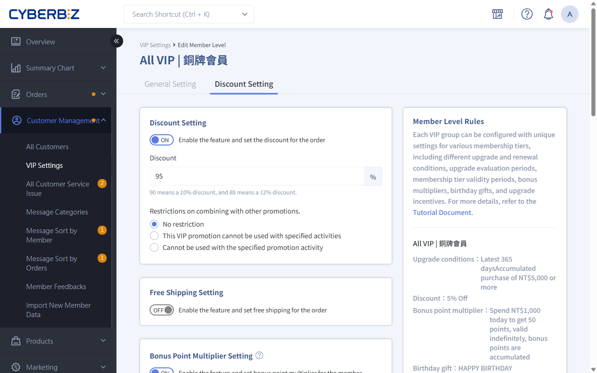{ .hero-page }

The core appeal of a VIP program lies in its sense of exclusivity and tangible rewards. The new VIP system provides a variety of offer combinations to help you design differentiated benefits that members value.

## VIP Offer Combination Rules

When setting up VIP offers, define how each offer can be combined with selected marketing campaigns. The system provides three stacking rules with different levels of restriction:

- **No Limit**

    VIP offers can be applied in addition to all campaign offers.

- **Combine Except for Campaign Items (Product-Level Exclusion)**

    If an individual product already receives a discount from a selected campaign, the VIP offer no longer applies to that product. Other products in the order that are not part of the campaign remain unaffected.

- **No Offer When a Campaign Applies (Order-Level Exclusion)**

    If the cart contains any product eligible for a selected campaign, the VIP offer is removed from the entire order.

When setting up each offer, select the appropriate combination rule whenever the **Combination Rules with Other Marketing Campaigns** field appears.

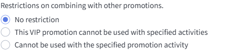{ .screenshot }

!!! info "bonus points Toggle"
    To perbonus points, first go to **Marketing > 全館折扣-紅利 & 優惠券** and [turn on the bonus points feature](../../marketing/bonus-and-gifts/setup-bonus-points/#操作流程).

## 1. Discount Offer

1. Enter the **Specified Discount**. When a member in this VIP tier places an order, the specified discount applies to the entire order.

    > Set the discount value from 1 to 99. For example, 90 means 9% of list price, and 70 means 7% of list price.

2. **Set Combination Rules with Other Marketing Campaigns**

    First select the [**Combination Rule**](#vip-優惠併用規則), then select the marketing campaigns to which this rule applies from the list.

    Marketing campaigns available for combination rules:

    - Member-Exclusive Price
    - Single-Product Discount
    - Mix-and-Match Discount (Bundle Offer Discount)
    - Choose-Your-Own Discount
    - Multi-Level Product Category Discount (Advanced Product Category Discount)
    - store-wide discount

{ .screenshot }

## 2. Free Shipping On Orders

1. Enter the **Free Shipping Threshold**. When a member in this VIP tier reaches the threshold, free shipping applies to the entire order.

2. **Set Combination Rules with Other Marketing Campaigns**

    First select the [**Combination Rule**](#vip-優惠併用規則), then select the marketing campaigns to which this rule applies from the list.

    Marketing campaigns available for combination rules:

    - Member-Exclusive Price
    - Single-Product Discount
    - Mix-and-Match Discount (Bundle Offer Discount)
    - Choose-Your-Own Discount
    - Multi-Level Product Category Discount (Advanced Product Category Discount)
    - store-wide discount

{ .screenshot }

## 3. Bonus Multiplier Settings

### Before You Begin

*   **Stacking per:** If you set both the "Store-Wide Bonus per" and "Additional VIP Bonus," members receive **both** when they place an order.

### Setup

Enter the **Spending Threshold, per Bonus Amount, and Validity Period**. After a member in this VIP tier places an order, the member receives additional bonus points.

{ .screenshot }

## 4. Birthday Gift Settings

### Send Schedule

- **Send Time**: By default, the system sends the month's birthday gift on the first day of that month.
- **Send Early**: Set a custom **send the birthday gift N Days in Advance** value.

    The system determines eligibility based on the member's tier at the time of sending. If the send time is earlier than the member's Upgrade date, the member cannot receive the post-Upgrade tier's birthday gift. Based on your store's VIP policy, you can manually send the birthday gift to the member.

    !!! example "Example Scenario"
        Customer A's birthday is in May, and the customer Upgrade to VIP1 on Apr 27.
        If the system is set to send the month's birthday gift five days in advance, the VIP1 May birthday gift is sent on Apr 26.
        The system sent the May birthday gift on Apr 26. At that time, Customer A had not yet Upgrade and therefore could not receive the VIP1 birthday gift.

- **Processing Time**: At 5:00 a.m. on the scheduled day, the system starts checking eligible members and sends the rewards in sequence.

    > The exact time members receive the birthday gift may vary slightly depending on system processing time.

- **Notification Time**: If birthday gift notifications are enabled in **Push Notifications > Email Notification Template** or the **SMS Notification Template**, the system sends all notifications to members at 12:00 noon that day.

### Member Claim Rules

- **Registration During the Birthday Month**: If the first VIP tier threshold is NT$0, a member who registers during the member's birthday month is assigned that tier and issued the birthday gift immediately, regardless of the **send the birthday gift N Days in Advance** setting.
- **One-Time Claim Rule**: During the birthday gift send cycle, from the early send date through the end of the birthday month, each member may claim **one VIP birthday gift** only. The reward is not sent again if the member Upgrade during this period.

### Related Actions

- **Stacking per**: If you set a store-wide member birthday gift in **Marketing > 全館折扣-紅利&優惠券**, customers receive **both**. Plan the birthday gift issuance policy carefully.
- **Delete birthday gift**: Go to **Customer Management > All Customers**, click the member's profile, then [manually revoke](../manage-member-profiles.md#任務四資產配置) the coupon or bonus points.

### Setup

1. Enter the **birthday gift Name and Number of Days to Send per in Advance**. Members in this VIP tier receive the birthday gift on the specified date.

    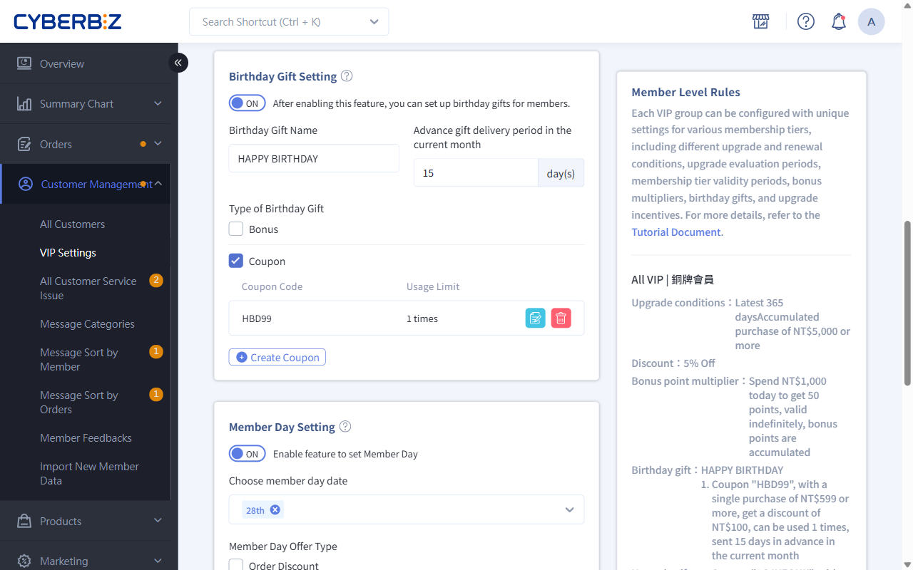{ .screenshot }

2. Select the birthday gift type. You can select all types:

    === "Bonus"

        Enter the **perbonus points Amount and Validity Period**.

        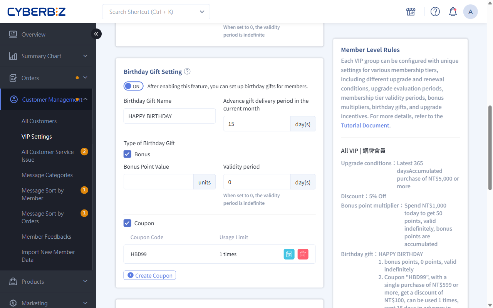{ .screenshot }

    === "coupon"

        1. Click **Create Coupon**.

            > You can add multiple coupon.

        2. Select the coupon type:

            - Amount
            - Percentage
            - Gift **(Enterprise Plan Only)**

                !!! info "VIP Gift Voucher Rules"
                    1. **Product Binding Rule**: Each gift voucher can be linked to only one product, and a variant cannot be specified.
                    2. **Setting Up Multiple Gifts**: To per multiple different items at once, create a separate gift voucher for each item.
                    3. **Send Mechanism**: The system sends all linked gift vouchers. Customers cannot select one gift to claim on the storefront.

                    → See the [complete gift voucher specifications](../../marketing/coupon/gift-coupon-spec/#使用須知).

        3. Set the relevant parameters.
        4. **Set Combination Rules with Other Marketing Campaigns**

            First select the [**Combination Rule**](#vip-優惠併用規則), then select the marketing campaigns to which this rule applies from the list.

            Marketing campaigns available for combination rules:

            - Member-Exclusive Price
            - Single-Product Discount
            - Mix-and-Match Discount (Bundle Offer Discount)
            - Choose-Your-Own Discount
            - Multi-Level Product Category Discount (Advanced Product Category Discount)
            - store-wide discount
            - VIP Discount Offer (VIP Discount)
            - Add-On Purchase
            - Referral Code Discount

        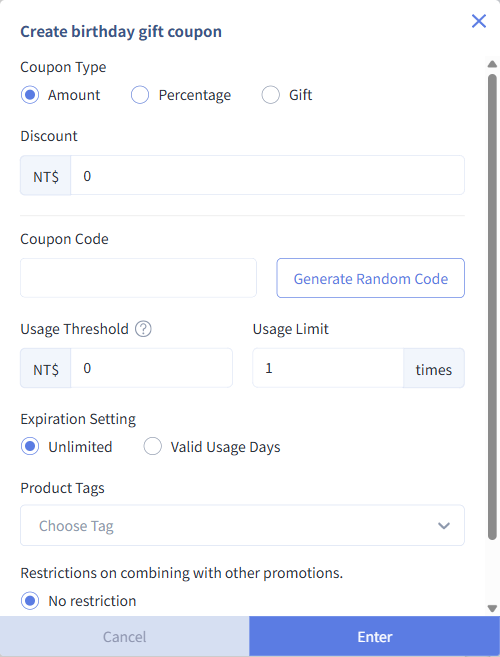{ .screenshot }

## 5. Member Day Settings

### Before You Begin

*   **Valid Date Restriction**: If a Member Day falls outside the valid date range for a month, the Member Day feature is not enabled for that month.

    > For example, if you set the 30th of every month as Member Day, the Member Day campaign is not automatically applied in February because February has no more than 29 days, or 28 days in a non-leap year.

*   **Exclude Other VIP Offers**: Other VIP offers are not included in calculations on Member Day.

    - If Member Day **Order Discount** is enabled, the **Discount Setting** setting does not apply on Member Day.
    - If Member Day **Free Shipping Setting** is enabled, the **Free Shipping Setting** setting does not apply on Member Day.
    - If Member Day **Bonus** is enabled, the **Bonus Point Multiplier Setting** do not apply on Member Day.

### Setup

1. Select a Member Day.

    !!! info "Plans Supporting **Multiple Member Days per Month**"
        This feature is available only on the **Enterprise Plan**. Select multiple dates so members receive a Member Day gift on each selected date of the month.

    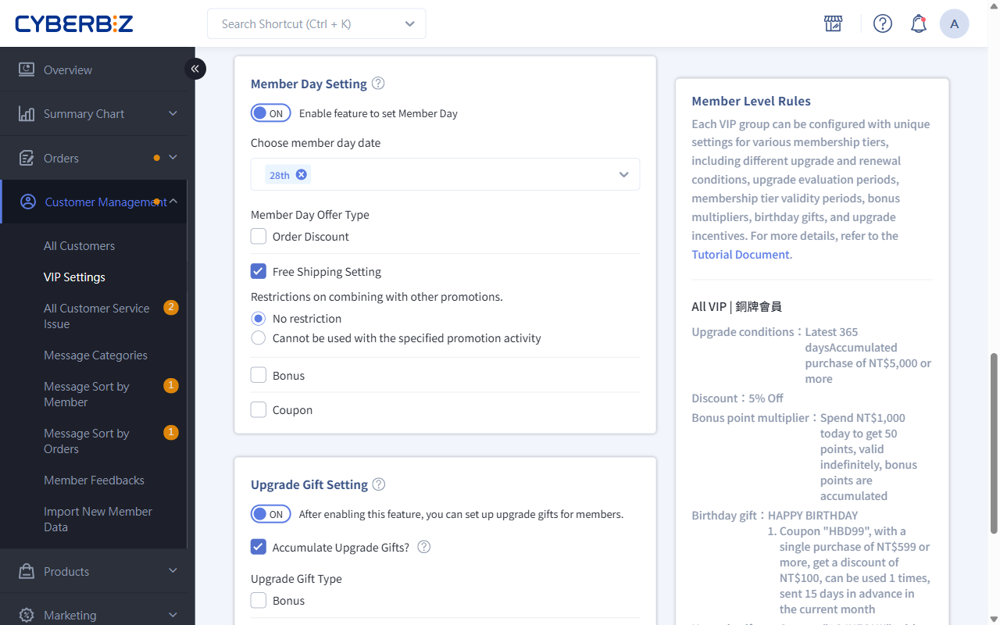{ .screenshot }

2. Select a Member Day gift:

    === "Order Discount"

        1. Enter the **Specified Discount**. When a member in this VIP tier places an order, the specified discount applies to the entire order.

            > Set the discount value from 1 to 99. For example, 90 means 9% of list price, and 70 means 7% of list price.

        2. **Set Combination Rules with Other Marketing Campaigns**

            First select the [**Combination Rule**](#vip-優惠併用規則), then select the marketing campaigns to which this rule applies from the list.

            Marketing campaigns available for combination rules:

            - Member-Exclusive Price
            - Single-Product Discount
            - Mix-and-Match Discount (Bundle Offer Discount)
            - Choose-Your-Own Discount
            - Multi-Level Product Category Discount (Advanced Product Category Discount)
            - store-wide discount

          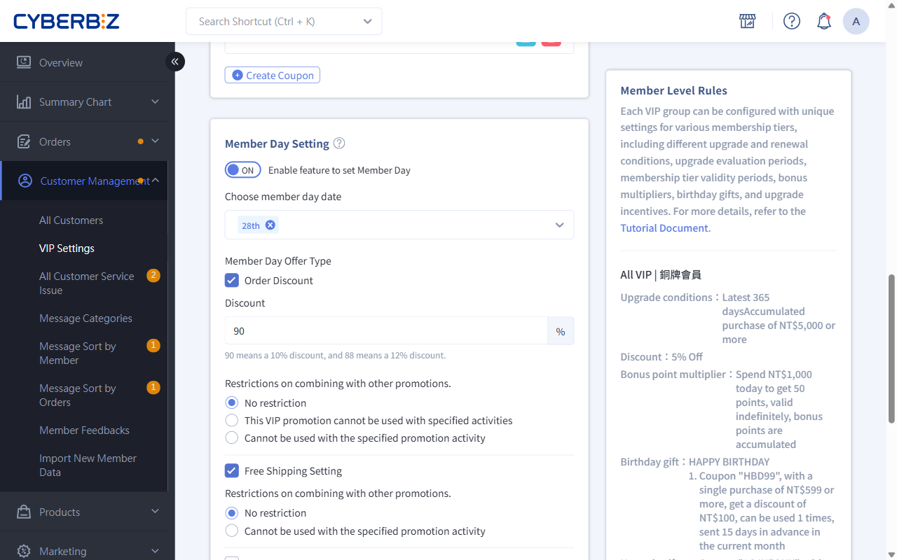{ .screenshot }

    === "Free Shipping on Orders"

        1. Enter the **Free Shipping Threshold**. When a member in this VIP tier reaches the threshold, free shipping applies to the entire order.

        2. **Set Combination Rules with Other Marketing Campaigns**

            First select the [**Combination Rule**](#vip-優惠併用規則), then select the marketing campaigns to which this rule applies from the list.

            Marketing campaigns available for combination rules:

            - Member-Exclusive Price
            - Single-Product Discount
            - Mix-and-Match Discount (Bundle Offer Discount)
            - Choose-Your-Own Discount
            - Multi-Level Product Category Discount (Advanced Product Category Discount)
            - store-wide discount

          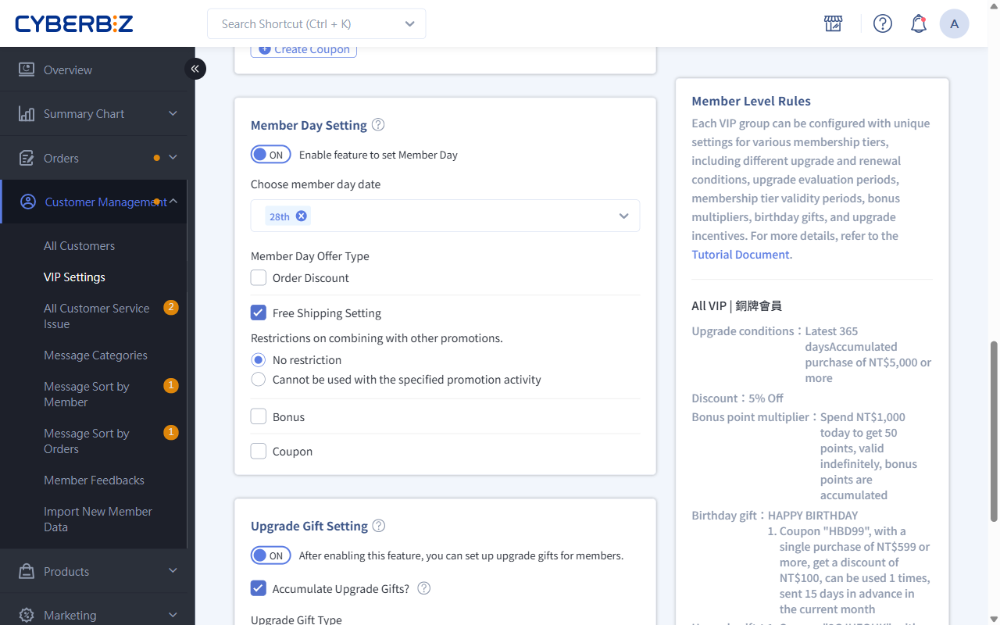{ .screenshot }

    === "Bonus"

        Set the **Spending Threshold, per Bonus, Validity Period, and Cumulative Reward Rule**. Purchases made on Member Day Amountperbonus points based on the order.

        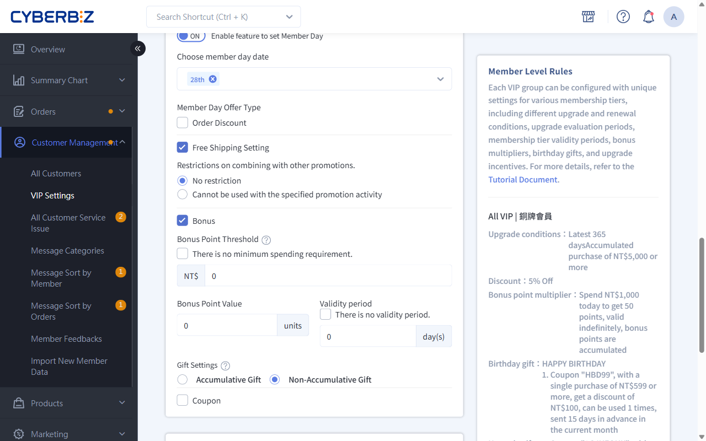{ .screenshot }

    === "coupon"

        1. Click **Create Coupon**.

        2. Select the coupon type:

            - Amount
            - Percentage
            - Gift **(Enterprise Plan Only)**

                !!! info "VIP Gift Voucher Rules"
                    1. **Product Binding Rule**: Each gift voucher can be linked to only one product, and a variant cannot be specified.
                    2. **Setting Up Multiple Gifts**: To per multiple different items at once, create a separate gift voucher for each item.
                    3. **Send Mechanism**: The system sends all linked gift vouchers. Customers cannot select one gift to claim on the storefront.

                    → See the [complete gift voucher specifications](../../marketing/coupon/gift-coupon-spec/#使用須知).

        3. Set the relevant parameters.
        4. **Set Combination Rules with Other Marketing Campaigns**

            First select the [**Combination Rule**](#vip-優惠併用規則), then select the marketing campaigns to which this rule applies from the list.

            Marketing campaigns available for combination rules:

            - Member-Exclusive Price
            - Single-Product Discount
            - Mix-and-Match Discount (Bundle Offer Discount)
            - Choose-Your-Own Discount
            - Multi-Level Product Category Discount (Advanced Product Category Discount)
            - store-wide discount
            - VIP Discount Offer (VIP Discount)
            - Add-On Purchase
            - Referral Code Discount

          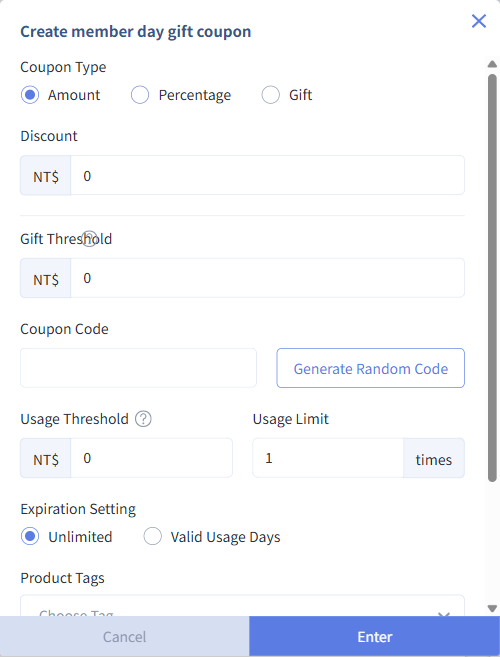{ .screenshot }

## 6. Upgrade Gift Settings

### Before You Begin

*   **Send Quantity:** The Upgrade gift for each tier can only be per once during the membership validity period.
*   **Switching Between the Old and New Versions:** Applying the new VIP version to members from the old VIP version does not trigger the Upgrade gift.

### Setup

1. Choose whether to send gifts cumulatively when a member Upgrade across multiple tiers and issue the Upgrade gift for each tier.
2. Select an Upgrade gift.

    === "Bonus"

        Set the **per Bonus and Validity Period**. After the member Upgrade on Member Day, the member receives bonus points.

    === "coupon"

        1. Click **Create Coupon**.

            > You can add multiple coupon.

        2. Select the coupon type:

            - Amount
            - Percentage
            - Gift **(Enterprise Plan Only)**

                !!! info "VIP Gift Voucher Rules"
                    1. **Product Binding Rule**: Each gift voucher can be linked to only one product, and a variant cannot be specified.
                    2. **Setting Up Multiple Gifts**: To per multiple different items at once, create a separate gift voucher for each item.
                    3. **Send Mechanism**: The system sends all linked gift vouchers. Customers cannot select one gift to claim on the storefront.

                    → See the [complete gift voucher specifications](../../marketing/coupon/gift-coupon-spec/#使用須知).

        3. Set the relevant parameters.

        4. **Set Combination Rules with Other Marketing Campaigns**

            First select the [**Combination Rule**](#vip-優惠併用規則), then select the marketing campaigns to which this rule applies from the list.

            Marketing campaigns available for combination rules:

            - Member-Exclusive Price
            - Single-Product Discount
            - Mix-and-Match Discount (Bundle Offer Discount)
            - Choose-Your-Own Discount
            - Multi-Level Product Category Discount (Advanced Product Category Discount)
            - store-wide discount
            - VIP Discount Offer (VIP Discount)
            - Add-On Purchase
            - Referral Code Discount

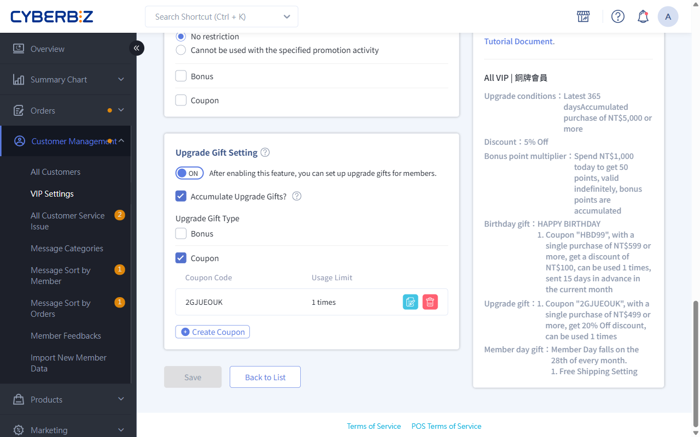{ .screenshot } 