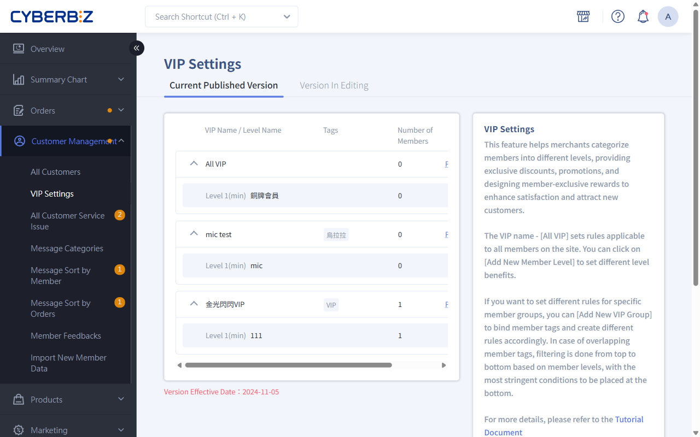
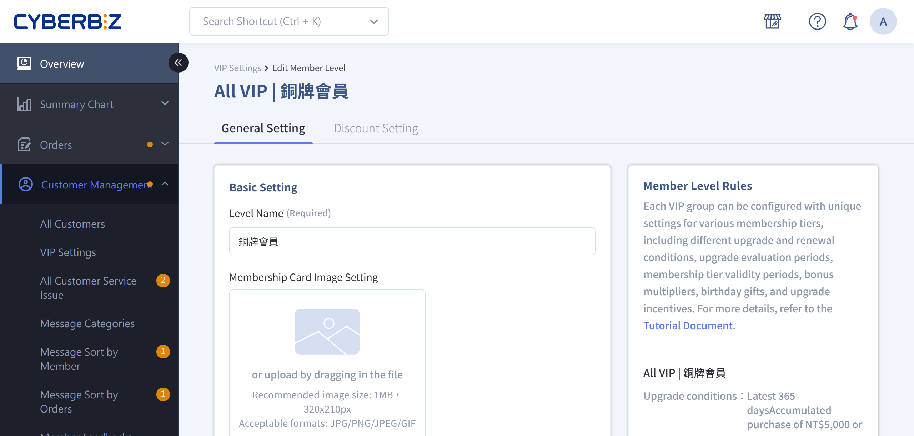
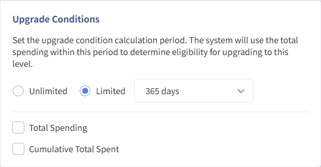
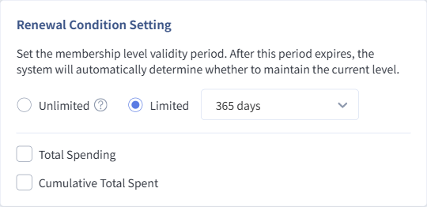

# Set Up A Store-Wide VIP Program

Set up VIP membership tiers, Upgrade thresholds, and Renewal requirements step by step to build a membership program that reflects your store's brand identity.
{ .subtitle }

{ .hero-page }

After completing the initial planning, start building the VIP tier structure in the admin panel. This guide walks you through the entire process, from naming tiers to setting thresholds.

## Step 1: Configure Basic Information

Go to **Customer Management > VIP Settings** in the admin panel, then click **New Member Level** under **Store-Wide VIP**.

=== "Other Versions"

    1.  **Level Name**: Enter an easy-to-understand name, such as Silver Member or Premium VIP.
    2.  **Membership Period**: Use the same membership period for all tiers to simplify management. A common period is 365 days.
    3.  **Membership Card Image**: This image appears in the storefront Member Center and reinforces your brand identity.
        *   **Recommended Dimensions**: 320x210px (up to 1MB).

    

=== "Enterprise Plan"

    1.  **Level Name**: Enter an easy-to-understand name, such as Silver Member or Premium VIP.
    2.  **Membership Card Image**: This image appears in the storefront Member Center and reinforces your brand identity.
        *   **Recommended Dimensions**: 320x210px (up to 1MB).

    

## Step 2: Set The Upgrade Threshold

=== "Other Versions"

    The Upgrade threshold determines how members qualify for this tier.

    *   **Total Spending**: The amount a customer spends in a single checkout. This option is suitable for advancing high-spending customers directly to the tier.
    *   **Total Spend During the Membership Period**: The total of all valid orders within the period you set, such as the past 365 days.

    

=== "Enterprise Plan"

    1. Set the **Upgrade Condition Calculation Period**

        - **Limited Period (Default)**: Select the number of days from the drop-down menu.
        - **Unlimited**: Use the member's complete history as the calculation period for the Upgrade requirements.

    2. Set the **Upgrade Requirement Threshold**

        - **Total Spending**: The amount a customer spends in a single checkout within the period you set.
        - **Total Spend During the Membership Period**: The total of all valid orders within the period you set.

    !!! tip "Create a Cumulative Upgrade Mechanism"
        - **Setup**: Set the Upgrade period to **No Expiration**
        - **How It Works**: The system automatically checks all transactions since the member's **first order on the website**. It then determines Upgrade eligibility based on the threshold you set:
            - Single-purchase total: Checks whether any single order placed since the member's first order on the website meets the threshold.
            - Total spend during the membership period: Checks whether the member's total spend since their first order on the website meets the threshold.

    

!!! note "Evaluation Priority"
    If you set both single-purchase and cumulative thresholds, the system uses the result **most favorable to the customer** for the Upgrade evaluation.

## Step 3: Set The Renewal Threshold

=== "Other Versions"

    The Renewal requirements determine whether a member retains their current tier after the membership period ends.

    *   **Total Spending**: The amount a customer spends in a single checkout. This option is suitable for advancing high-spending customers directly to the tier.
    *   **Total Spend During the Membership Period**: The total of all valid orders within the period you set, such as the past 365 days.

    

=== "Enterprise Plan"

    1. Set the **Membership Tier Validity Period**

        The **Membership Tier Validity Period** is the tier's **Membership Period**. The system also uses purchase records from this period to determine whether the member meets the **Renewal Eligibility** requirements.

        - **Limited Period (Default)**: Select the number of membership days from the drop-down menu.
        - **Unlimited**: The membership period does not expire, and the system does not check Renewal eligibility. `

    2.  Set the **Renewal Requirement Threshold**

        Based on the Membership Tier Validity Period set in the previous step, complete the Renewal threshold as follows:

        - **Limited Period (Default)**: **You must enter the Renewal threshold**. If no Renewal threshold is set, the system does not evaluate the Renewal requirements when the membership period expires, and the member loses VIP status.
        - **Unlimited**: You do not need to enter the Renewal threshold. The system does not perform the Renewal check, so the Renewal requirement threshold does not take effect.

        Set the thresholds:

        - **Total Spending**: The amount a customer spends in a single checkout within the period you set.
        - **Total Spend During the Membership Period**: The total of all valid orders within the period you set.

    !!! tip "Create a Permanent Renewal Mechanism"
        - **Setup**: Set the Renewal period to **No Expiration**
        - **How It Works**: The system does not perform an **expiration Renewal check** for this tier. Once a member Upgrade to this tier, the system does not downgrade the member because of an Renewal check.

        :lucide-triangle-alert: If a member has an invalid order, such as a canceled or returned order, the Downgrade mechanism still runs, and the member may still undergo Downgrade processing.

    

!!! note "Evaluation Priority"
    If you set both single-purchase and cumulative thresholds, the system uses the result **most favorable to the customer** for the Upgrade evaluation. 