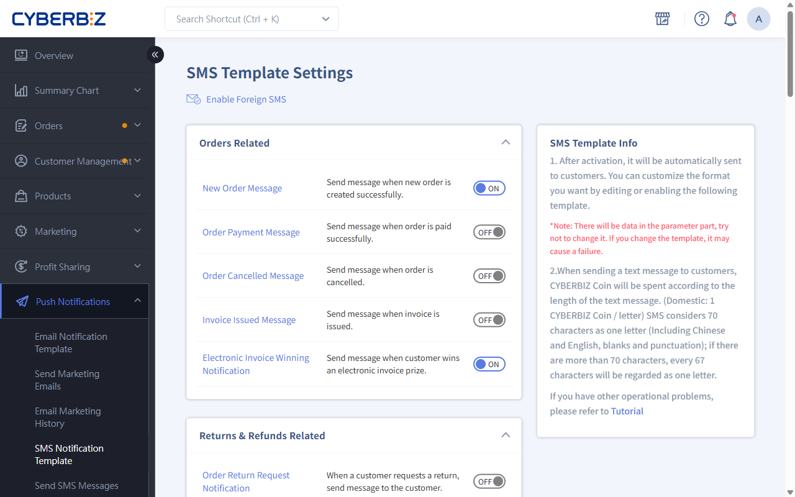
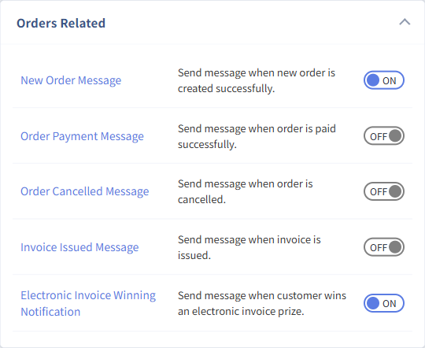

{ .hero-page }

## About SMS Notification Templates

**SMS notification templates** automatically send preset SMS notifications to customers in specific situations (such as when an order is placed, a package arrives at a store, or a member registers), making your service faster and improving the customer experience.

!!! warning "Avoid SMS blocking (filtering)"

	To keep carriers from treating your SMS as advertising or phishing and blocking it, **avoid the following keywords** in templates:

	- Words such as "LINE", "加賴" (add on LINE), "連結" (link), "點擊連結" (click the link), "股票" (stocks), "領取" (claim), and "點擊領取" (click to claim).

## Path And Page Overview

!!! path "Admin path: In the CYBERBIZ admin, click **Push Notifications > SMS Notification Template**."

- **Page features**:

	- **Template categories**: SMS templates are grouped by situation: orders, returns, shipping, customers, messages, POS, subscription orders, e-tickets, and other.

	- **On/off switch**: Each template has an **ON/OFF switch** on the right, so you decide whether that reminder is enabled.

	- **International SMS**: Click the **Send international SMS** option to turn sending to international numbers on or off.

!!! info "The categories and templates available to you depend on your *plan* or *feature settings*."

## Edit An SMS

1. In the list, click the **SMS title** you want to edit to open the editor.
2. **Editing notes**:

	- **Variables**: Tags in the body wrapped in **{{ }}** (such as `{{shop_name}}` and `{{order_number}}`) are filled in with system data automatically. **Don't change their spelling or format**, or the SMS may fail to send.
	- **Symbols**: **Don't use emoji** or other special symbols in the body, or the SMS may display incorrectly.
3. When you're done, click **Save** to apply the changes right away.

## Key Scenarios

- **Arrival-at-store notification**: When a convenience store pickup order changes to "Arrived at store", an SMS is automatically sent.

	- **7-Eleven**: Sent on days 1 and 4 after arrival.
	- **FamilyMart**: Sent on days 1 and 3 after arrival.
	- **T-Cat store pickup**: Sent on day 1 after arrival.

	!!! info "Supported carriers"
		Arrival notifications are supported for these carriers:

		- **ECPay**: 7-Eleven / FamilyMart.

		- **CYBERBIZ integration (B2C/C2C)**: 7-Eleven, FamilyMart, Hi-Life.

		- **Chilled/frozen shipping**: FamilyMart frozen, Hi-Life frozen, T-Cat store pickup (ambient/chilled/frozen).

- **Unpaid reminder**: Send an SMS reminder a set number of days after the customer orders. Reminders stop automatically once the customer pays.
- **Account activation notification**: If you turn on mobile verification, members get an SMS with a verification link when they register.

## FAQ

??? quote "Why was my SMS split into several messages?"
	If the content exceeds the character limit, it's automatically split into several messages. Note that variables (such as `{{order_number}}`) are replaced with real values when sent, which can push the total over the limit and cause a split.

??? quote "A customer says they didn't get the "arrived at store" SMS. How do I troubleshoot?"

	1. **Check your balance**: Make sure you have enough CYBER coins in the admin's top-up center.
	2. **Check the shipping status**: The SMS is sent only when the status changes to "Arrived at store". Cross-border and unsupported carriers aren't covered.
	3. **Check the tags**: Make sure the template doesn't contain emoji and the `{{ }}` variable format isn't broken.
	4. **Blocking**: Check whether the customer's phone has filtering apps (such as Whoscall), or whether the content contains keywords such as "LINE" or "連結" (link) that carriers block.

??? quote "Can I send SMS to customers abroad?"
	Yes. In the SMS templates page, turn on **Send international SMS**.

??? quote "After I edit an SMS template, does it apply to existing orders?"
	Yes. SMS notifications use the latest template content at the moment the trigger is met (such as a status change). Once you save your changes, all later notifications use the new content.

??? quote "Why does checkout still show "Send verification code" when members log in, even though the notification template is off?"

    Whether "Send verification code" appears depends on whether **mobile verification** is turned on, not on the notification template. Once verification is on, checkout shows the option; if the matching notification template is off, no verification SMS is sent.

    [Set up two-step email and mobile verification for customers :lucide-arrow-right:](../website-management/setup-customer-email-phone-verification/)