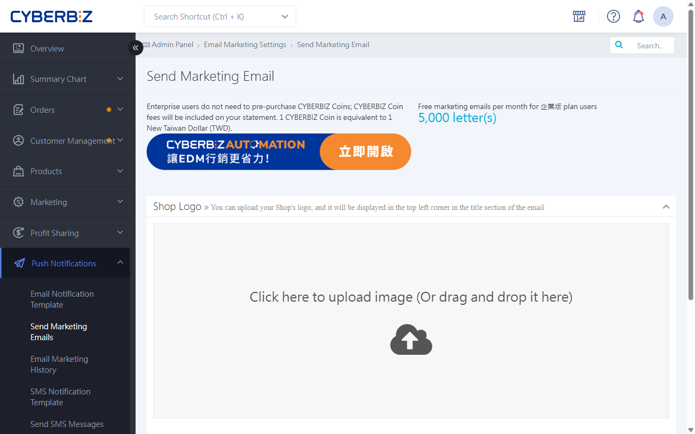
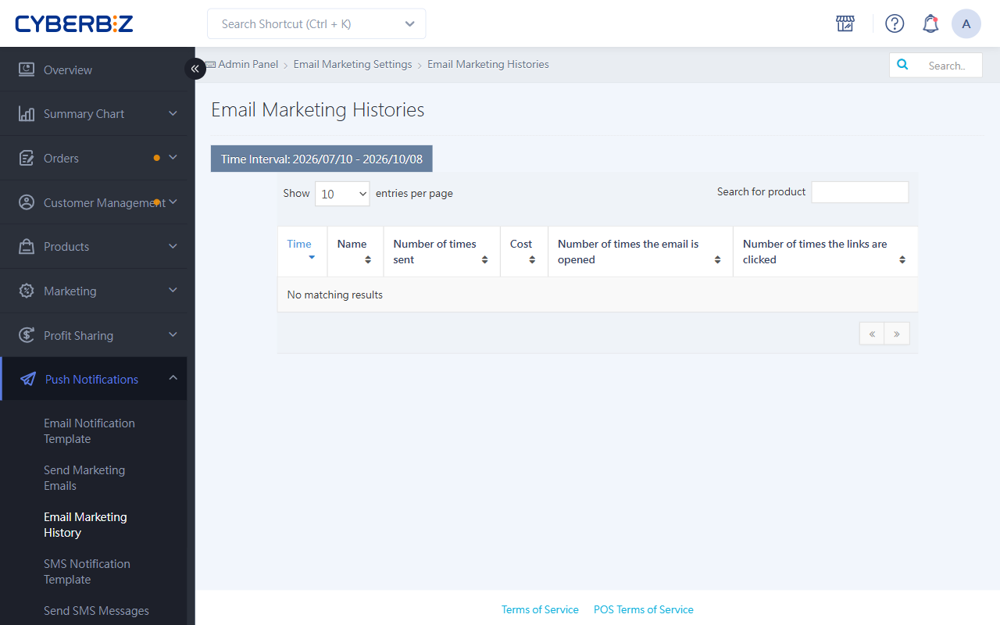

{ .hero-page }

## What Is An EDM Newsletter?

**EDM (email newsletter marketing)** is a key tool for email marketing. Send news or promotions to build brand loyalty and increase conversions.

## What Are The EDM Sending Limits?

*   **Recipients**: EDMs can only be sent to website members who have registered and opted in to newsletters.

## Create EDM Content

1. **Open the page**: Log in to the CYBERBIZ admin and go to **Push Notifications > Send Marketing Emails**.
2. **Edit the content**: Click **Add EDM** or the **edit icon** :lucide-pencil: in the list to open the editor and set the following:

    *   **EDM logo**: Recommended size is **448×167px**.
    *   **EDM title**: Keep it to **25 characters** or fewer and **don't use emoji**, so it displays in full on phones.
    *   **EDM images**:
        *   Recommended image width is **560px**; height is unlimited.
        *   Each EDM can have up to **3** images, with a combined size of no more than **2MB**.
        *   If you add image links, use the original URL (including UTM parameters) so you can track performance.
    *   **Text**: HTML and CSS are supported. Again, **don't use emoji or special symbols**.

---

## Choose EDM Recipients

After you edit the title and content, click the EDM name to open **Choose recipients**:

-  **Send a test to admins**: We strongly recommend sending a test to admins before the real send to check the content (test emails also count toward your EDM send count).
-  **Send by group**: Send to members with a specific member tag.

    

-  **Send by Excel import**: Import a list of email addresses. To exclude unregistered customers (such as those who didn't register at checkout), filter the list before you import it.
    *   *Note: Don't leave any spaces in the Excel cells, or the upload may fail.*

    

---

## View EDM Performance

After sending, go to **Send Marketing Emails > EDM紀錄** to see performance.

*   **Key metrics**: Open rate and link clicks.
*   **Update time**: Data isn't real time. It's updated **daily at 1:30 AM**.

## Next Steps

- :lucide-zap:{ .lg }
  [__AUTOMATION__](../app-market/automation/automation-push-flow.md){ title="使用 AUTOMATION 建立自動化推播流程" }
  Set up EDMs that are automatically sent to VIP customers, potential loyal customers, or inactive customers.

## FAQ

??? quote "Why didn't I receive my test email?"
    Check your spam folder first. Also, titles with too many sensitive words (such as "instant cash", "get rich", "on sale", or "$$$") are easily flagged as advertising by mail servers. Remove special symbols from the title before sending.

??? quote "Why can't I use emoji in the title or body?"
    Email apps (such as Outlook, Gmail, and iPhone Mail) decode emoji differently, so emoji often show up as garbled characters (such as ?? or [X]) for recipients, which looks unprofessional.

??? quote "Why does Excel import of a list fail?"

    1. Spaces in cells: Hidden spaces before or after an email address cause read errors.
    2. Wrong format: Make sure the file is .xlsx or .csv and the email column is formatted correctly.
    3. Duplicates: Duplicate email addresses in the same list are removed automatically.

