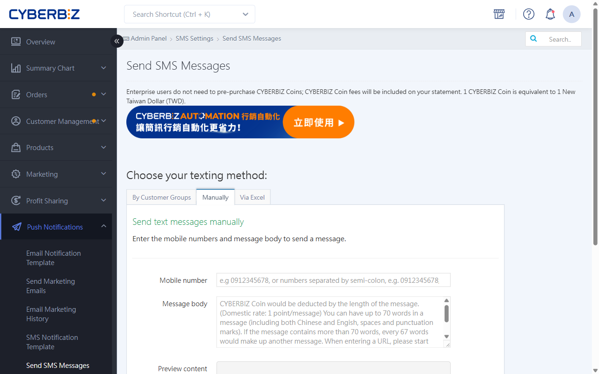

{ .hero-page }

## About SMS Notifications

In CYBERBIZ, you can use SMS to send marketing messages and order notifications to members, or invite them to add your LINE Official Account.

## SMS Sending Rules

To make sure your SMS messages are delivered, read the following rules before sending.

### URL Rules

To make sure URLs in your SMS are recognized and open correctly, follow these format requirements:

- **Format**: URLs must start with `http://` or `https://`.
- **Spacing**: Put one half-width space before and after the URL so it isn't joined to the surrounding text and misread.
- **Allowed domains**: For security and delivery rates, only the following URLs are allowed in SMS:
    - Your store's official URL
    - cyb.ec short links
    - lin.ee official LINE links

---

### Keywords And Blocking

!!! warning "Important"
    Avoid highly sensitive words such as "LINE", "加賴" (add on LINE), "領取" (claim), "股票" (stocks), and "點擊連結" (click the link). If a carrier blocks your SMS because it contains sensitive words or a badly formatted URL, it won't be delivered.

## Three Ways To Send SMS

!!! info "Before you start"
    - **Standard edition** users must first [top up CYBER coins](../website-management/points-deposits.md#operate-cyber-coin-deposit){ title="CYBER 幣儲值中心使用指南" }.
    - **PLUS / Enterprise edition users** can send SMS without topping up CYBER coins.

Log in to the CYBERBIZ admin, go to **Push Notifications > Send SMS Messages**, and choose the sending method that fits your needs:

- :lucide-users:{ .ig }
  [__Send to customer groups__](#send-to-customer-groups)
- :lucide-pencil:{ .ig }
  [__Send manually__](#send-manually)
- :lucide-file-spreadsheet:{ .ig }
  [__Send by Excel import__](#send-by-excel-import)

### Send To Customer Groups

Use customer groups to filter members by customer tag and send them all the same SMS. This works well for batch sends such as VIP offers and event announcements.

1. **Open the page**: Go to **Push Notifications > Send SMS Messages** and select the **Send to customer groups** tab.
2. **Choose recipients**: In the **Customer group** drop-down, select the **customer tag** to send to.
3. **Write the message**: Enter your text in the **SMS content** field and keep an eye on the character count on the right.
4. **Preview**: Click **Preview** and check on the right how the SMS looks, including the store name added automatically.
5. **Send**: When everything looks right, click **Send**, then click **OK** in the pop-up.

!!! warning "Who can receive it"
    When you send by customer tag, only "website members" receive it (customers in the customer/member list, whether or not their accounts are activated).

---

### Send Manually

Enter website members' mobile numbers and the message directly. Use this for one-off or small notifications.

1. **Open the page**: Go to **Push Notifications > Send SMS Messages** and click the **send manually** tab.
2. **Enter numbers**: Enter the recipients in the **Mobile number** field. Local and international formats are supported:
    - One number: Enter the 10 digits (for example, 0912345678).
    - Several numbers: Separate them with a **semicolon ( ; )**.
    - International: International format is supported (for example, +886900123456).
3. **Write the message**: Enter your text in the **SMS content** field.
4. **Preview**: Click **Preview** and check the text and layout in the **SMS preview** area on the right.
5. **Send**: When everything looks right, click **Send**, then click **OK** in the confirmation window.

---

### Send By Excel Import

Upload an Excel list to send SMS in bulk. Two modes are supported:

| Mode | Description | Required columns |
| :--- | :--- | :--- |
| Send the same content to everyone | Everyone gets the same message; you enter the content on the page | Column A: mobile number |
| Send different content to each person | Each person gets their own message; you enter the content in Excel | Column A: mobile number, column B: SMS content |

??? example "SMS recipient list template"

    

=== "Same content"

    Everyone gets the same message; you enter the content on the page.

    1. 1. **Prepare the list**: Go to **Push Notifications Send SMS Messages** > Excel import, download the template, and enter mobile numbers in column A.
    2. **Choose the mode**: Select "send the same content to everyone" and upload the completed Excel file.
    3. **Write the message**: Enter your text in the **SMS content** field.
    4. **Preview**: Click **Preview** and check the number count and text in the SMS preview.
    5. **Send**: When everything looks right, click **Send**, then click **OK** in the pop-up.

    

=== "Different content"

    Each person gets their own message; you enter the content directly in Excel.

    1. 1. **Prepare the list**: Go to **Push Notifications Send SMS Messages** > Excel import, download the template, and fill it in:
        - Column A, mobile number: the recipient's number.
        - Column B, SMS content: the full message for that recipient.
    2. **Choose the mode**: Select "send different content to each person" and upload the completed file.
    3. **Check the data**: The system reads the file automatically. Check that each mobile number matches its content on screen.
    4. **Send**: Click **Send**, then click **OK** in the confirmation pop-up.

    !!! warning "Note: If column B is empty, that row will fail to send or cause a system error."

    

## Next Steps

- :lucide-message-square-text:{ .lg }
  [__Manage SMS notification templates__](manage-sms-templates-v2.md){ title="設定與管理簡訊通知樣板" }
  Customize the SMS that is automatically sent, with short links to save characters.

- :lucide-zap:{ .lg }
  [__Automated SMS__](../app-market/automation/automation-push-flow.md#簡訊發送設定)
  Use AUTOMATION to build automated SMS flows for one-time or recurring sends.

- :lucide-history:{ .lg }
  [__Look up SMS sending history__](track-sms-records.md){ title="查詢與追蹤簡訊發送紀錄" }
  Look up SMS history, including time, recipient, content, and cost.

- :lucide-user-plus:{ .lg }
  [__LINE OA friend invitations__](send-line-friend-invitation.md){ title="發送 LINE 加入好友邀請" }
  Send an SMS with a friend link to members who haven't linked LINE OA.

- :lucide-bell-ring:{ .lg }
  [__Unpaid order reminders__](../orders/order-settings/unpaid-reminder-settings.md){ title="設定未付款提醒" }
  Send 3 SMS reminders at set intervals to remind customers to pay.

- :lucide-package:{ .lg }
  [__Product recommendation notifications__](../app-market/storepal/configure-global-settings-and-attribution.md#簡訊通知開關){ title="全站功能與業績歸因設定" }
  Edit the product recommendation SMS that store staff send to customers.

## FAQ

??? quote "How do I send SMS?"

    You can send SMS in three ways:

    1. **Send to customer groups**: Filter members by customer tag and send to all of them
    2. **send manually**: Enter mobile numbers directly
    3. **Send by Excel import**: Upload an Excel file to send in bulk

??? quote "What if an SMS fails to send?"

    If an SMS fails because of a "wrong number" or a "carrier issue", it won't be delivered. To avoid failures, make sure:

    - Mobile numbers are complete 10-digit numbers
    - You avoid highly sensitive words (such as "LINE", "加賴" (add on LINE), and "股票" (stocks))
    - URLs are formatted correctly (starting with http:// or https://)

