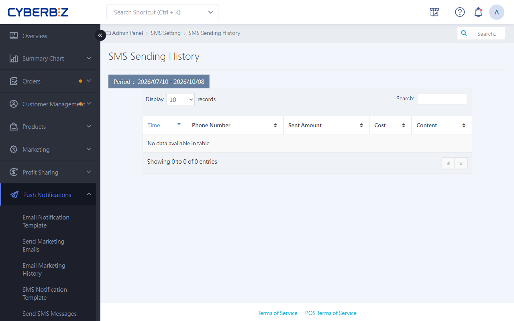

{ .hero-page }

## About SMS Sending History

The SMS Sending History page shows your store's SMS history, including send time, recipient mobile number, message content, and cost.

## Open The Page

Log in to the CYBERBIZ admin and go to **Push Notifications > SMS Sending History**.

## Filter And Search

### Date Range

- Shows the last 90 days of records by default
- Click the date field to set a custom range

---

### Keyword Search

The search box supports two types of search:

| Search by | Example | Notes |
| :--- | :--- | :--- |
| Message content | Order shipped | Enter the start of the message |
| Mobile number | 0912345678 | Enter the full number |

!!! warning "Note"
    - Enter the full mobile number. Partial numbers return no results.
    - Message content only matches the beginning of the text. For example, searching "Order" finds "Order shipped" but not "Your order".

## Columns

| Column | Description |
| :--- | :--- |
| Created at | When the SMS was sent |
| Mobile number | Recipient's mobile number |
| Send count | Number of times this SMS was sent |
| Cost | CYBER coins deducted for this send |
| Message content | The SMS text that was sent |

!!! warning "Note"
    Each search shows up to 10,000 records. For large amounts of data, narrow the date range and search in parts.

## Next Steps

- :lucide-message-square-plus:{ .lg }
  [__Set up and send SMS__](send-sms-notifications-v2.md){ title="設定與發送簡訊通知" }
   Learn the three ways to send SMS (customer group, manual, and Excel import).

- :lucide-message-square-text:{ .lg }
  [__Manage SMS notification templates__](manage-sms-templates-v2.md){ title="設定與管理簡訊通知樣板" }
  Customize the SMS that is automatically sent in specific situations.

## FAQ

??? quote "Why can't I find records after entering a member's mobile number?"

    Make sure you entered the **full 10-digit number**. The system doesn't support partial search (for example, only the last four digits), and the number can't contain spaces or hyphens `-`.

??? quote "What if an SMS fails to send?"

    If an SMS fails because of a "wrong number" or a "carrier issue", it won't be delivered. For details, see the [SMS sending rules](send-sms-notifications-v2.md#sms-sending-rules){ title="設定與發送簡訊通知" }.

??? quote "How far back can I search?"

    The last **90 days** of records are shown by default. For older data, set a custom range in [Date range](#date-range){ data-preview }.

