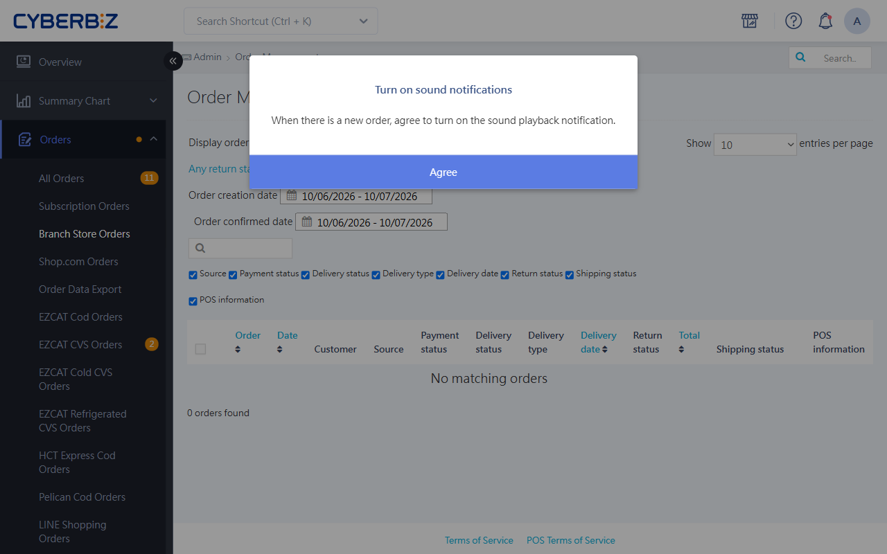

# Prepare and Accept Quick Delivery Orders

Guides store staff to identify, prepare, and accept Quick Delivery orders so delivery stays prompt.
{ .subtitle }

[:lucide-tag:{ title="Available Plans" }](../../resources/conventions#適用方案) | All PLUS / Enterprise
{ .doc-badge }

{ .hero-page }

!!! tip "Use Cases"
	- **Accept orders in store in real time**: When a shopper places a Quick Delivery order, store staff should respond right away and check stock.
	- **Check delivery limits**: Before accepting, make sure the products meet the delivery partner's size and weight rules.

---

## Before You Start

- **Payment status limit**: Quick Delivery doesn't support **cash on delivery**. Only **Payment Received** orders can be shipped.
- **System notifications**: Keep the admin **Branch Store Orders** tab open to get the new order sound and pop-up notifications.
- **Size limits**: You need to judge whether products exceed the delivery partner's (Pandago / Uber Direct) limits. If they do, we recommend **splitting the order**.
- **Time limits**: Quick Delivery is about immediate delivery. We recommend accepting and preparing the order within 10–30 minutes after it's placed.

## Steps

### Identify and Accept New Orders

1. Sign in to the CYBERBIZ admin and go to **Orders > Branch Store Orders**.
2. Keep the page open. When a new order is placed, the system plays a new order sound and shows a pop-up.
3. Click **Got It** in the pop-up to close the notification.
    { .screenshot }

4. Click the **Order Number** to open the details page, and check the product types, quantities, and stock.
5. Click **Preparing**.
    { .screenshot }

!!! info "What the System Does"
    After the order status changes to **Preparing**:

    - The system automatically sends the shopper a **Quick Delivery confirmation email**.
    - The shopper can no longer cancel the order.

## Delivery Size Rules

Before you prepare products for an order, make sure the packed size meets the following rules:

| Delivery Partner | Size Limit (L x W x H) | Weight Limit | Notes |
| :--- | :--- | :--- | :--- |
| **Pandago** | - On the scooter floorboard: 30 x 60 x 40 cm (about 2 cuft) - In the insulated bag: 40 x 40 x 20 cm | Up to 20 kg total | You can use both the floorboard space and the insulated bag |
| **Uber Direct** | - On the scooter floorboard: 30 x 60 x 40 cm - In the insulated bag: 40 x 40 x 40 cm | Up to 13 kg total | You can use both the floorboard space and the insulated bag |

---

## FAQ

??? quote "Why don't I hear the new order sound?"
    Make sure you're signed in to the admin and the **Orders > Branch Store Orders** page is open (you can switch to other tabs, but don't close it). Also check whether the browser tab is muted and your computer volume is on.

??? quote "A shopper says they chose the wrong store. Can I change it for them?"
    No. The store and delivery address of a Quick Delivery order are linked. If the address is wrong or the wrong store was chosen, we recommend agreeing with the shopper to cancel the order and having them place a new order with the correct address or store.

??? quote "The order status is **Unpaid**. Can I click Preparing first?"
    No. Wait until the status changes to **Payment Received** before processing. Because Quick Delivery doesn't support cash on delivery, make sure payment is complete before you start, to avoid payment collection issues later.

