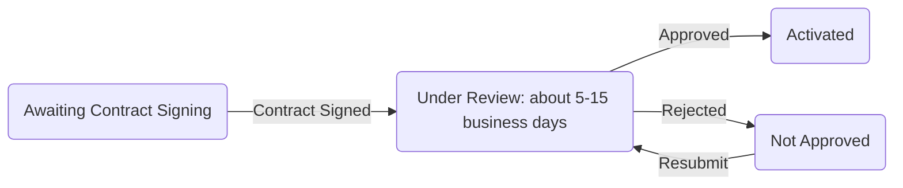
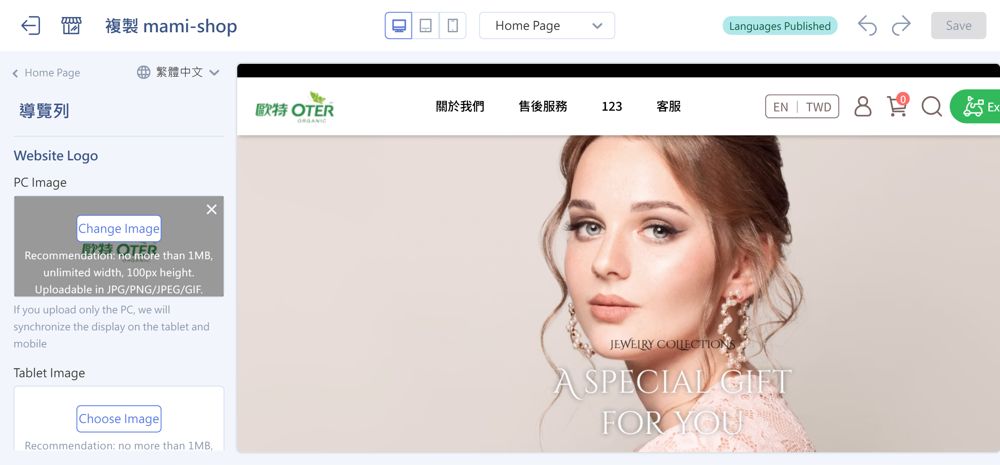
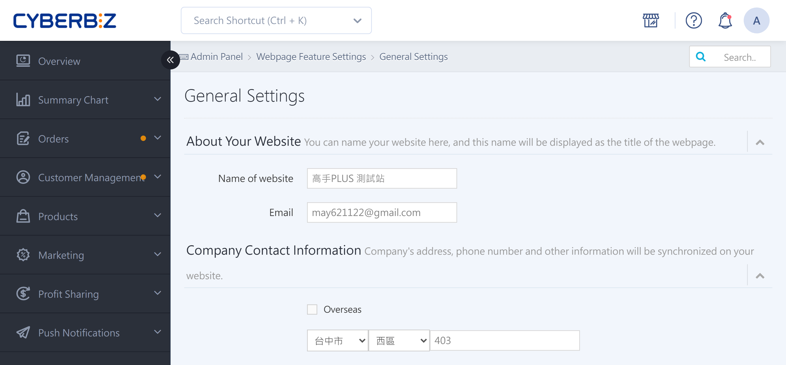
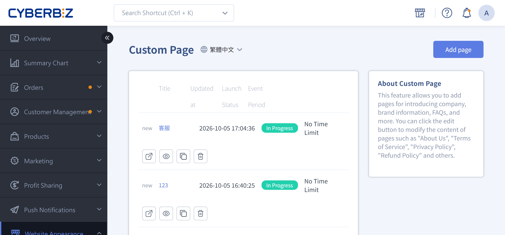
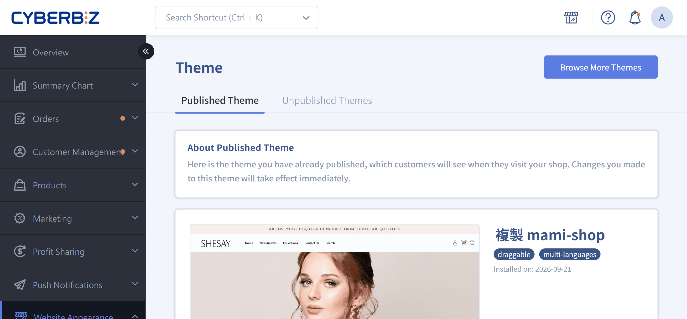

{ title="Apply for CYBERBIZ PAYMENTS" .hero-page }

## About CYBERBIZ PAYMENTS { #intro-cyb-payments }

**CYBERBIZ PAYMENTS** is a **payment collection and disbursement service** provided by CYBERBIZ. It supports credit cards and a variety of payment methods, giving merchants and customers a **fast, secure, and convenient** transaction experience.

### Core Advantages and Security Protections

- **International Security Certification**: Certified to **PCIDSS Level 1**, ensuring every transaction meets international credit card security standards.

- **Automatic Activation of Mobile Payments**:

    - When a merchant activates the service, the system **automatically enables Google Pay and Apple Pay**.
    - Processing fees are usually the same as for one-time credit card payments, and no additional application is required.

- **Reduce Fraud Risk**: You can set a [3D verification threshold](setup-credit-card-3d-verification.md){ title="Set Credit Card 3D Verification Threshold" }.
    - Transactions above the threshold require SMS verification on the customer's phone. Transactions below the threshold use background authorization.
    - If a dispute arises, liability typically rests with the cardholder.

---

### Supported Payment Methods

After activation, merchants can enable the following payment tools:

| Category | Payment Method | Description |
|---|---|---|
| Credit Card | Visa / Mastercard / JCB | Supports one-time payment |
| UnionPay Card | UnionPay |  |
| Mobile Payment | Apple Pay / Google Pay | Same rate as credit cards, no additional application required |
| Buy Now, Pay Later | AFTEE | Customers only need mobile verification to check out |
| Convenience Store Payment | 7-11 / FamilyMart | After placing an order, get a barcode on your phone and scan it at the store to pay |
| ATM Transfer | Virtual ATM | After you receive a dedicated virtual account number, pay by transfer through online banking or a physical ATM |

---

### Automated Management Features

- **Automatic Refunds**: When an order status changes to "Returned," the system automatically triggers the refund process for credit cards, mobile payments, AFTEE, and JKOPay.

- **Automatic Settlement Confirmation**

    - **Standard and PLUS Plans** Merchants can set an amount threshold so the system automatically confirms settlements and avoids payout delays.
    - **Enterprise Plan** does not support this automatic feature.

- **Automatic Debt Collection**: If a statement shows a negative balance (refund amount greater than payout amount), merchants can link a credit card so the system automatically collects the outstanding amount.

## Before You Apply

Before you submit a payment application, complete the following:

- A storefront website that loads properly.
- A recognizable brand or company name.
- At least one listed product or service.

!!! info "The risk control team reviews your website content to determine whether your store identity and products or services can be clearly identified."

## How to Apply for CYBERBIZ PAYMENTS

After you meet the eligibility requirements, the system provides an application entry point. You will be notified through:

- **Admin pop-up announcement**
- **Email notification**

Or apply directly through the admin path:

**Payment and Logistics > Payment Settings > CYBERBIZ PAYMENTS > Apply now**

## Application Process

The following shows the **common structure of the application process**. The steps you need to complete depend on your plan.

### Step 1: Basic Website Setup

Complete the basic website information for risk control review.

For details, see [Complete Website Setup](#完成網站建置)

---

### Step 2: Store Information and Contract Processing

1. Log in to the CYBERBIZ admin dashboard and go to **Payment and Logistics > Payment Settings > CYBERBIZ PAYMENTS > Apply now**.

    

2. Fill in **Company Information**, **Person in Charge Information**, and **Bank Account Information**.

    

3. Complete **KYC Identity Verification**.

    

4. Confirm that store setup is complete.

    

5. After you submit the application, confirm that the contract is signed. Then proceed to the [review process](#審核流程).

## Review Process

After the application is submitted and meets the review requirements, it proceeds through the following steps.

### Review Status Descriptions

- **Awaiting Contract Signing**: Complete the contract signing. Review does not start until the contract is signed. For updates, contact your sales representative.
- **Under Review**: The risk control team reviews the website and store information. Estimated review time is about **5–15 business days**.
- **Not approved**: The system notifies you through an admin announcement and email. Correct the information as instructed, then resubmit.
- **Activated**: After review is approved, the system automatically activates the **CYBERBIZ PAYMENTS** service. You will be notified through an admin announcement and email after activation.

## Complete Website Setup

### Set up Website Logo

1. Log in to the CYBERBIZ admin dashboard and go to  **Website Appearance > Theme Setting > Detail Settings > Navigation Bar**
2. Upload and set a website logo. We recommend using your brand logo for recognition.

{ title="Set Up Website Logo" }

- :lucide-menu:{ .lg }
  [__Menu and Navigation Settings__](../website-appearance/navigation/setup-menus-navigation.md#導覽列外觀設定-navbar){ title="Navigation Bar Appearance Settings" }

---

### Set up Website Name

1. Log in to the CYBERBIZ admin dashboard and go to **Website Management > General > Name of website**
2. Enter a website name. We recommend using your **brand name or company name** instead of only a URL or English words, so users can easily recognize the site.
3. Click **Save** to apply the changes.

{ title="Set Up Website Name" }

- :lucide-globe:{ .lg }
  [__Set Up Basic Website Information__](../website-management/setup-store-basic-info.md#operate-general-preferences-company-info){ title="Set Up Website Name and Company Contact Information" }

---

### List at Least One Product or Service

!!! path "Admin path:**Products > All Products > Add Product**"

Listed products or services must include:

- **Product images**: Clearly show the product's appearance or content.
- **Clear pricing**: Helps users understand the price.
- **Product description or service details**: Provide a detailed description that shows features and value.

!!! note "For detailed setup steps, see [Add and Update Products](../products/create-and-manage/create-update-products.md)"

- :lucide-package:{ .lg }
  [__Add and Update Products__](../products/create-and-manage/create-update-products.md#operate-product-create-basic){ title="Add a Product: Basic Settings" }

---

### Set up the "About Us" Page

1. Log in to the CYBERBIZ admin dashboard and go to **Website Appearance > Customized Pages Management**.
2. Click **About Us** to open the edit page, or click **Add Page** to create a new page.
3. Click **Text Editor** to edit the page text, or click **Add Block** to add different block styles.

{ title="Edit the About Us Page" }

- :lucide-file-text:{ .lg }
  [__Set Up and Manage Custom Pages__](../website-appearance/pages-and-content/custom-pages.md#operate-custom-pages-edit){ title="Edit Page Content" }

---

### Set up Contact Information

1. Log in to the CYBERBIZ admin dashboard and go to **Website Appearance > Theme Setting > Detail Settings > Footer**.
2. Click **Contact Information** to edit it, or click **Add Block** and select **Contact Information** to add it.

{ title="Set Up Footer Contact Information" }

- :lucide-phone:{ .lg }
  [__Menu and Navigation Settings__](../website-appearance/navigation/setup-menus-navigation.md#聯絡資訊與自訂文字){ title="Contact Information and Custom Text" }

## Next Steps

- :lucide-shield-check:{ .lg }     
  [__Set Up Credit Card 3D Verification Threshold__](setup-credit-card-3d-verification.md){ title="Set Up Credit Card 3D Verification Threshold" }  
  Set a 3D verification threshold to safeguard transactions.
- :simple-applepay:{ .lg }     
  [__Set Up Apple Pay__](setup-apple-pay.md){ title="Set Up Apple Pay" }  
  Enable the Apple Pay payment option.
- :lucide-clock:{ .lg }     
  [__Set Up AFTEE__](setup-aftee.md){ title="Set Up AFTEE" }  
  Enable the AFTEE buy now, pay later payment option.

## Frequently Asked Questions

??? quote "What are the requirements to apply for CYBERBIZ PAYMENTS?"
    - The website must load properly.
    - The brand or company name must be clearly recognizable.
    - At least one product or service must be listed.
    - Complete the contract signing.

??? quote "How long does review take after applying?"
    - Review takes about **5–15 business days**, depending on store information completeness and risk control review.
    - Review status is sent through admin announcements and email.

??? quote "What should I do if my application is not approved?"
    1. Based on the system notification or admin announcement, correct the information that was not approved.
    2. Log in to the admin dashboard and resubmit your application.
    3. The application re-enters the review process and waits for risk control review.

??? quote "Can I start accepting payments right after activation?"
    - After activation, you can accept payments through supported payment methods, including credit cards, mobile payments, convenience store payments, ATM transfers, and buy now, pay later.

??? quote "Do mobile payments require a separate application?"
    No. After CYBERBIZ PAYMENTS is activated, the system **automatically enables Google Pay and Apple Pay**. Processing fees are usually the same as for one-time credit card payments.

??? quote "Can I set a credit card 3D verification threshold?"
    Yes. See [Set Up Credit Card 3D Verification Threshold](setup-credit-card-3d-verification.md){ title="Set Up Credit Card 3D Verification Threshold" }. Transactions above the threshold require SMS verification. Transactions below the threshold use background authorization.

??? quote "Will incomplete product information affect the review?"
    Yes. Product images, pricing, and product or service descriptions must be complete. Otherwise, risk control may request additional documents, which extends the review time.

??? quote "Can the contract be signed online?"
    Yes. The system provides online signing. The review process starts only after signing is complete.
