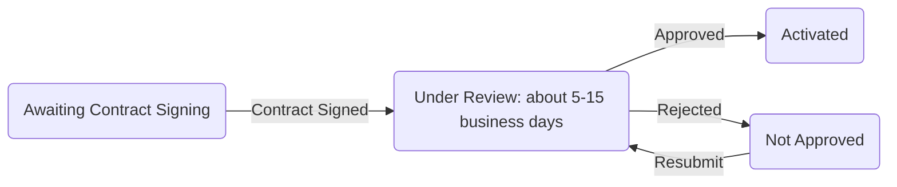
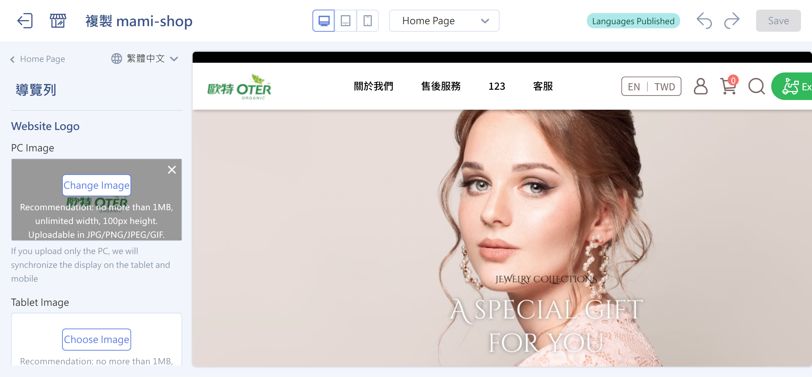
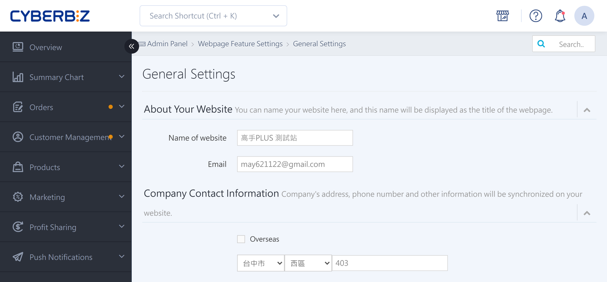
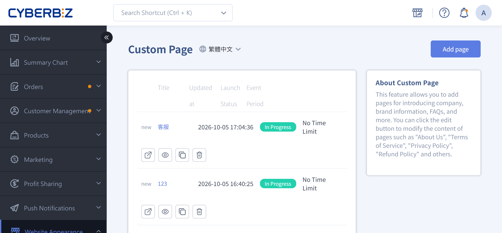
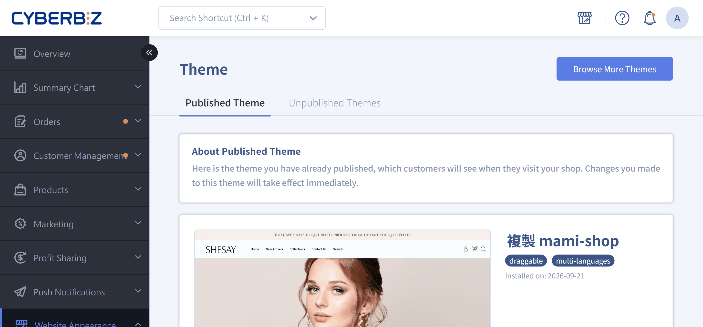

{ title="Apply for CYBERBIZ PAYMENTS" .hero-page }

## CYBERBIZ PAYMENTS Overview { #intro-cyb-payments }

**CYBERBIZ PAYMENTS** is a **payment collection and disbursement service** provided by CYBERBIZ. It supports credit cards and multiple payment methods, giving merchants and customers a **fast, secure, and convenient** transaction experience.

### Core Advantages and Security Assurance

- **International Security Certification**: Certified to **PCI DSS Level 1**, ensuring every transaction meets international credit card security standards.

- **Automatic Mobile Payment Activation**:

    - When a merchant activates the service, the system **automatically enables Google Pay and Apple Pay**.
    - Transaction fees are usually the same as for one-time credit card payments, and no additional application is required.

- **Reduced Fraud Risk**: You can set a [3D verification threshold](setup-credit-card-3d-verification.md){ title="Set Credit Card 3D Verification Threshold" }.
    - Transactions above the threshold require mobile SMS verification. Transactions below the threshold use background authorization.
    - If a dispute occurs, liability usually falls on the cardholder.

---

### Supported Payment Methods

After activation, merchants can enable the following payment options:

| Category | Payment Method | Description |
|---|---|---|
| Credit Card | Visa / Mastercard / JCB | One-time payment supported |
| UnionPay Card | UnionPay |  |
| Mobile Payment | Apple Pay / Google Pay | Same rates as credit cards; no additional application required |
| Buy Now, Pay Later | AFTEE | Customers only need mobile verification to check out |
| Convenience Store Barcode | 7-11 / FamilyMart | After placing an order, get a barcode on your phone and scan it at the store to pay |
| Convenience Store Payment Code | 7-11 / FamilyMart / Hi-Life | After placing an order, get a payment code and print a payment slip at the in-store kiosk to pay |
| ATM Transfer | Virtual ATM | After receiving a dedicated virtual account, pay via internet banking or a physical ATM transfer |

---

### Automated Management Features

- **Automatic Refunds**: When an order status changes to "Returned," the system automatically triggers the refund process for credit cards, mobile payments, AFTEE, and JKOPay.

- **Automatic Payment Confirmation**

    - **Standard and PLUS Editions** merchants can set an amount threshold, and the system automatically confirms payments to avoid disbursement delays.
    - **Enterprise Edition** does not support this automatic feature.

- **Automatic Debt Deduction**: If the statement shows a negative balance (refunds exceed disbursements), merchants can link a credit card so the system automatically deducts the debt.

## Prerequisites Before Applying

Before submitting a payment application, complete the following:

- A storefront website that loads normally
- A recognizable brand or company name
- At least one listed product or service

!!! info "The risk control team reviews the website content to determine whether your store identity and products can be clearly identified."

## How to Apply for CYBERBIZ PAYMENTS

After a merchant meets the eligibility requirements, the system provides an application entry point. Notifications are sent in the following ways:

- **Admin Pop-up Notice**
- **Email Notification**

Or apply directly through the following admin path:

**Payment and Logistics > Payment Settings > CYBERBIZ PAYMENTS > Apply now**

## Application Process

The following shows the **common application framework**. The steps you need to complete depend on your plan.

### Step 1: Complete Basic Website Setup

Complete the basic website information settings for risk control review.

For details, see [Complete Website Setup](#完成網站建置)

---

### Step 2: Store Information and Contract Processing

1. Log in to the CYBERBIZ admin dashboard and go to **Payment and Logistics > Payment Settings > CYBERBIZ PAYMENTS > Apply now**
2. Follow the on-screen prompts to enter your store information and related details.
3. After you submit the application, confirm that the contract has been signed. The review process starts only after signing is complete.

For details, see [Review Process Overview](#審核流程).

## Review Process

After the application is submitted and meets the review requirements, it proceeds through the following process.

### Review Status Descriptions

- **Awaiting Contract Signing**: Complete the contract signing. The review does not proceed until the contract is signed. For updates, contact your sales representative.
- **Under Review**: The risk control team reviews the website and store information. The review is expected to take about **5–15 business days**.
- **Not Approved**: The system notifies you through an admin announcement and email. Correct the information as instructed and resubmit.
- **Activated**: After approval, the system automatically activates the **CYBERBIZ PAYMENTS** service and notifies you through an admin announcement and email.

## Complete Website Setup

### Set up Site Logo

1. Log in to the CYBERBIZ admin dashboard and go to  **Website Appearance > Theme Setting > Detail Settings > Navigation Bar**
2. Upload and set the site logo. We recommend using your brand logo to keep it recognizable.

{ title="Set Up Site Logo" }

- :lucide-menu:{ .lg }
  [__Menu and Navigation Bar Settings__](../website-appearance/navigation/setup-menus-navigation.md#導覽列外觀設定-navbar){ title="Navigation Bar Appearance Settings" }

---

### Set up Site Name

1. Log in to the CYBERBIZ admin dashboard and go to **Website Management > General > Name of website**
2. Enter the site name. We recommend using your **brand name or company name** and avoiding URLs or English-only names so users can easily recognize the site.
3. Click **Save** to apply your changes.

{ title="Set Up Site Name" }

- :lucide-globe:{ .lg }
  [__Basic Site Information Settings__](../website-management/setup-store-basic-info.md#operate-general-preferences-company-info){ title="Set Up Site Name and Company Contact Information" }

---

### Publish at Least One Product or Service

!!! path "Admin path: **Products > All Products > Add Product**"

Listed products or services must include:

- **Product images**: Clearly show the product's appearance or content.
- **Clear pricing**: Helps users understand the price.
- **Product description or service details**: Provide a detailed description that highlights features and value.

!!! note "For detailed setup steps, see [Add and Update Products](../products/create-and-manage/create-update-products.md)"

- :lucide-package:{ .lg }
  [__Add and Update Products__](../products/create-and-manage/create-update-products.md#operate-product-create-basic){ title="Add Product: Basic Settings" }

---

### Set up the About Us Page

1. Log in to the CYBERBIZ admin dashboard and go to **Website Appearance > Customized Pages Management**.
2. Click **About Us** to open the edit page, or click **Add Page** to create a new page.
3. Click **Text Editor** to edit the page text, or click **Add Block** to add different block styles.

{ title="Edit About Us Page" }

- :lucide-file-text:{ .lg }
  [__Set Up and Manage Custom Pages__](../website-appearance/pages-and-content/custom-pages.md#operate-custom-pages-edit){ title="Edit Page Content" }

---

### Set up Contact Information

1. Log in to the CYBERBIZ admin dashboard and go to **Website Appearance > Theme Setting > Detail Settings > Footer**.
2. Click **Contact Information** to edit it, or click **Add Block** and select **Contact Information** to add it.

{ title="Set Up Footer Contact Information" }

- :lucide-phone:{ .lg }
  [__Menu and Navigation Bar Settings__](../website-appearance/navigation/setup-menus-navigation.md#聯絡資訊與自訂文字){ title="Contact Information and Custom Text" }

## Next Steps

- :lucide-shield-check:{ .lg }     
  [__Set Up Credit Card 3D Verification Threshold__](setup-credit-card-3d-verification.md){ title="Set Up Credit Card 3D Verification Threshold" }  
  Set the 3D verification threshold to help protect transactions.
- :simple-applepay:{ .lg }     
  [__Set Up Apple Pay__](setup-apple-pay.md){ title="Set Up Apple Pay" }  
  Enable the Apple Pay payment option.
- :lucide-credit-card:{ .lg }     
  [__Set Up Google Pay__](setup-google-pay.md){ title="Set Up Google Pay" }  
  Enable the Google Pay payment option.
- :lucide-clock:{ .lg }     
  [__Set Up AFTEE__](setup-aftee.md){ title="Set Up AFTEE" }  
  Enable the AFTEE buy-now-pay-later payment option.
- :lucide-hash:{ .lg }     
  [__Pay with Convenience Store Payment Code__](../orders/order-settings/cvs-code-payment.md){ title="Pay with Convenience Store Payment Code" }  
  Enable convenience store payment codes. Customers print a payment slip at a 7-11, FamilyMart, or Hi-Life kiosk to complete payment.
- :lucide-barcode:{ .lg }     
  [__Pay with Convenience Store Barcode__](../orders/order-settings/cvs-barcode-payment.md){ title="Pay with Convenience Store Barcode" }  
  Enable convenience store barcode payments. Customers scan a barcode on their phone at 7-11 or FamilyMart to pay.

## Frequently Asked Questions

??? quote "What are the requirements to apply for CYBERBIZ PAYMENTS?"
    - The website must load normally.
    - The brand or company name is clearly identifiable.
    - At least one product or service is listed.
    - Contract signing is complete.

??? quote "How long does the review take after applying?"
    - The review takes about **5–15 business days**, depending on store information completeness and risk control review.
    - Review status updates are sent through admin announcements and email.

??? quote "What should I do if my application is not approved?"
    1. Correct the information that did not pass, based on system notifications or admin announcements.
    2. Log in to the admin dashboard and resubmit the application.
    3. The application re-enters the review process and waits for risk control review.

??? quote "Can I start accepting payments right after activation?"
    - After activation, you can accept payments through supported methods, including credit cards, mobile payments, convenience store barcodes, convenience store payment codes, ATM transfers, and buy-now-pay-later.

??? quote "Is a separate application required for mobile payments?"
    No. After CYBERBIZ PAYMENTS is activated, the system **automatically enables Google Pay and Apple Pay**. Transaction fees are usually the same as for one-time credit card payments.

??? quote "Can I set a credit card 3D verification threshold?"
    Yes. See [Set Credit Card 3D Verification Threshold](setup-credit-card-3d-verification.md){ title="Set Credit Card 3D Verification Threshold" }. Transactions above the threshold require SMS verification. Transactions below the threshold use background authorization.

??? quote "Does incomplete product information affect the review?"
    Yes. Product images, prices, and product or service descriptions must be complete. Otherwise, risk control may request additional documents, which extends the review time.

??? quote "Can I sign the contract online?"
    Yes. The system provides online signing. The review starts only after signing is complete.
