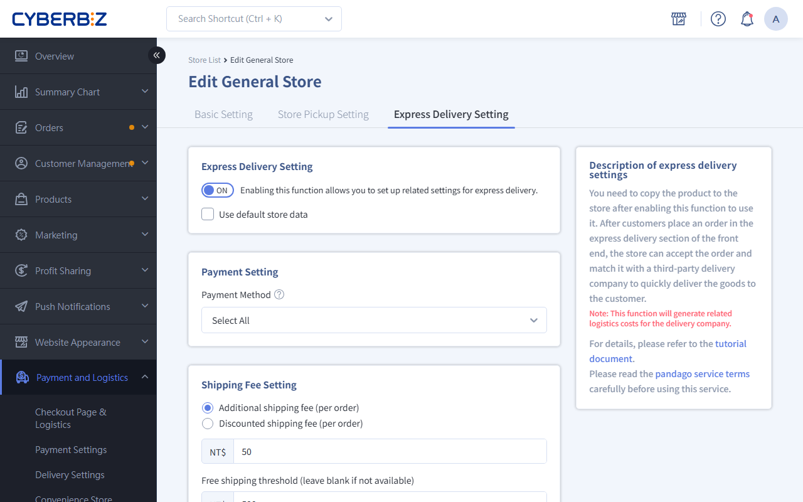
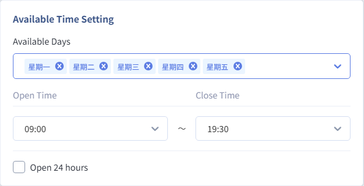

# Enable Store Quick Delivery Service

Complete the store Quick Delivery (CYBERBIZ NOW) setup, including enabling the feature, order acceptance times, delivery fee rules, and delivery information management.
{ .subtitle }

[:lucide-tag:{ title="Applicable Plans" }](../../resources/conventions#適用方案) | All PLUS / Enterprise
{ .doc-badge }

!!! info "Version Differences"
    "Quick Delivery" is an optional module in the PLUS plan (choose 2 of 11). Merchants must confirm the module is selected before it can be used. The Enterprise plan includes this feature by default.

{ .hero-page }

## Usage Notes

Before configuring store settings, make sure to complete the following basic setup and review the related data linkage rules:

- **Create a Store**: First, create the store information in **Payment and Logistics > Store Pickup Settings**, then configure it.
- **Store Address Accuracy**: The delivery range is calculated automatically by the delivery system based on the store address (about a 3-5 km radius). An incorrect address will prevent delivery.
- **Copy Settings**: If you have multiple stores, you can use **Use default store data** to quickly sync delivery fees and order acceptance times.
- **Delete a Store**: If you delete a store, its store settings and associated products will also be deleted.

## Procedure

### Step 1: Enable Store Quick Delivery

1. Log in to the CYBERBIZ admin dashboard and go to **Payment and Logistics > Store Pickup Settings**.
2. Find the store you want to configure, then click **Edit** on the right.
3. Switch to the **Express Delivery Setting** tab.
4. Turn the **Enable Quick Delivery** toggle to `ON`.

### Step 2: Set Order Acceptance Times and Delivery Fee Rules

1. **Payment Setting**: Click the menu, then select the payment methods to allow (for example, credit card or LINE Pay).
2. **Delivery Fee Rules**:

    - **Field Descriptions**

        - **Add-On / Deduction**: Add or subtract an amount from the base delivery fee (for example, a surcharge for remote areas).
        - **Free Shipping Threshold**: Enter the order amount that qualifies for free shipping. Leave blank if you do not offer free shipping.

    - **Delivery Fee Calculation**

        | Setting Item | Delivery Fee at Customer Checkout |
        | :--- | :--- |
        | **Add-On Fee** | Actual Pandago or Uber Direct fee + add-on fee |
        | **Deduction Fee** | Actual Pandago or Uber Direct fee - deduction fee |
        | **Free Shipping Threshold** | When the merchandise total reaches the threshold, the total delivery fee = 0 |

    - **Delivery Fee Adjustment Scope**

        Add-on or deduction only adjusts the delivery fee that customers see at checkout. The actual delivery fee CYBERBIZ charges merchants does not change.

3. **Order Acceptance Hours**:
    - **Accept Orders All Day**: Applies to stores open 24 hours a day.
    - **Custom Order Hours**: We recommend setting order hours to end 1-2 hours before store closing time (for example, if the store closes at 22:00, set order hours to end at 20:00) to leave time to process final orders.

{ .screenshot }

### Step 3: Set Delivery Contact and Notes

1. Enter **Contact phone number** so delivery drivers can contact the store.
2. In the **Notes Information** field, enter instructions for the driver (for example, the store is in the B1 food court of the department store, or take the east elevator up).

### Step 4: Manage Store Order (For Multiple Stores)

If multiple stores have Quick Delivery enabled, you can control the display order on the storefront:

1. Return to the **Payment and Logistics > Store Pickup Settings** list page.
2. In the list, adjust the order using the following methods:
    - **Drag to Sort**: Click and hold the left mouse button on a store field, then move it up or down to adjust its position.
    - **Enter a Number**: Enter a number directly in the sort field. The smaller the number, the higher the store appears in the list.

## Frequently Asked Questions

??? quote "How is the Quick Delivery range calculated?"
    The delivery provider automatically calculates the delivery range based on the store address, typically 3-5 km. If a customer enters an address outside this range, Quick Delivery will not be available at checkout.

??? quote "Why can't some stores enable this feature?"
    Check the following: 1. The store address is complete and correct. 2. A third-party delivery provider serves the area. 3. CYBERBIZ has approved your application and activated the NOW feature.

??? quote "What should I do if store staff cannot accept orders in time?"
    If the store is temporarily short-staffed, go to the store settings and temporarily switch **Enable Quick Delivery** to `關閉`, then turn it back on when the situation improves.

??? quote "What should I do if a product is out of stock?"
    If you discover a product is out of stock after accepting an order, contact the customer right away to explain, then cancel the order in the admin dashboard and arrange a refund to maintain customer satisfaction.

## Next Steps

- :lucide-copy-plus:{ .lg }   
  [__Copy Products to the Quick Delivery Store__](../../products/copy-products-to-quick-delivery-stores.md)       
  Sync products suitable for real-time delivery to the store section.

- :lucide-layout-template:{ .lg }     
  [__Set Up the Quick Delivery Storefront Page__](../../website-appearance/setup-quick-delivery-frontend-entry.md)  
  Configure the storefront entry point and visual template.

- :lucide-clipboard-check:{ .lg }     
  [__Process Quick Delivery Orders__](../../orders/store-pickup-orders.md)  
  Learn how store staff pick items and match orders with drivers.

