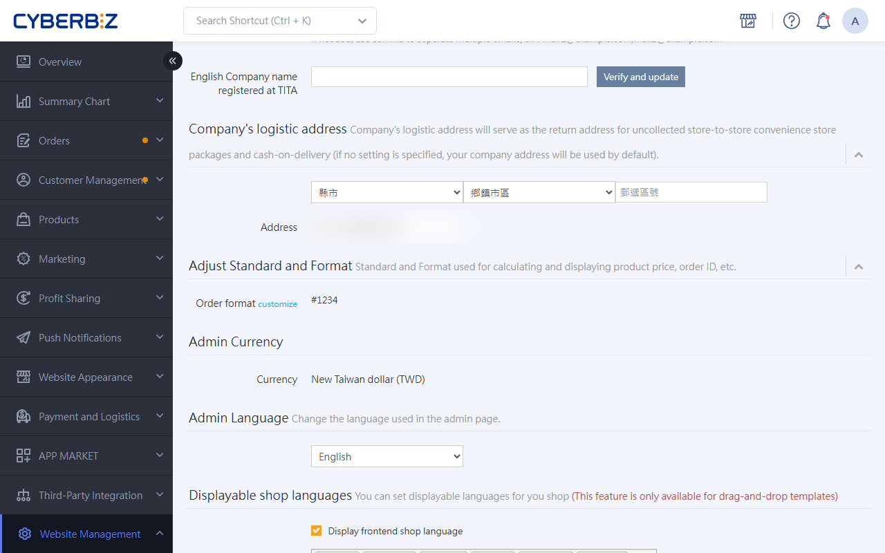

# DHL Cross-Border Logistics

Integrate DHL international express through the CYBERBIZ admin to generate English shipping labels and commercial invoices, with home pickup and automated shipment tracking.
{ .subtitle }

[:lucide-layers:{ title="Applicable Product" }](../../resources/conventions#適用產品) | EC Website
[:lucide-tag:{ title="Applicable Plan" }](../../resources/conventions#適用方案) | PLUS / Enterprise 
[:lucide-layers:{ title="Applicable Product" }](../../resources/conventions#適用產品) | Cross-Border Ecommerce (North America / Japan / Southeast Asia)
[:lucide-tag:{ title="Applicable Plan" }](../../resources/conventions#適用方案) | Pro / Business
{ .doc-badge }

## Usage Notes { #prerequisites-dhl }

- **Service Restriction**: Currently only supports **shipping from Taiwan to overseas destinations**.
- **English Requirement**: All customs information (sender, recipient, product names) must be entered in **English only**.
- **Batch Restriction**: Because cross-border information must be verified one by one, **batch printing** of shipping labels is currently **not supported**.
- **Power of Attorney**: Before use, complete the **Long-Term Power of Attorney** application to ensure smooth export customs clearance.
- **Recommendation**: We recommend using this feature with the **Multi-Country** feature so the system can automatically carry English product information into the shipping label details and improve efficiency. For questions, contact CYBERBIZ Customer Support.

## Prerequisite Setup { #operate-dhl-setup }

### Step 1: Apply for a Long-Term Power of Attorney { #operate-dhl-poa }

Apply through the [Long-Term Power of Attorney Online Application Process](https://drive.google.com/file/d/1_zj4H9feFFECoCSGi-GUtfG8h-REsekP/view).

### Step 2: Verify Your Company's English Name { #operate-dhl-verify-name }

1. Log in to the CYBERBIZ admin and go to **Website Management > General**.
2. Find the **English Company name registered at TITA** field.
3. Enter your company's official English name as registered in [Business Registration](https://findbiz.nat.gov.tw/fts/query/QueryBar/queryInit.do).
4. Once saved, this field is locked, and the system automatically uses this name on customs documents.

### Step 3: Set up English Sender Information { #operate-dhl-sender }

1. Go to **Payment and Logistics > DHL Shipping Label > Basic Information Setting**.
2. Enter the sender's address and contact information in **English**.
    - **Sender Name**: We recommend filling in your **brand name** as the customs declarant.
    - **Sender Address**: DHL currently supports only shipments exported from Taiwan. Fill in a Taiwan address.
    - **Sender Company Name**: For the company handling export customs, fill in the English company name registered with the Bureau of Foreign Trade as an import/export business.

### Step 4: Set up Logistics and Shipping Fees { #operate-dhl-fee }

1. Go to **Payment and Logistics > Delivery Settings** and select the **Custom Logistics** tab.
2. Click **Create Custom Logistics**.
3. **Basic Settings**:
    - **Shipping Rule Name**: Name the logistics method. The name must not match any other custom logistics method.

        > Example: DHL Logistics

    - **Shipping Regions**: Region settings apply at the **County** level. You cannot configure individual **townships/districts** separately.
    - **Shipping temperature zone**: Select **Room Temperature**.
    - **Shipping Method**: Select **Self-Shipping**.
    - **Payment Method**: Select **Non-Custom Cash on Delivery**.

        > If you have integrated another payment gateway, you can select **Custom cash on delivery**.

4. **Shipping Fee Settings**: Set shipping fees based on **order amount** and **order weight**.
    - **Fee Priority**: If an order meets multiple shipping fee conditions, the system automatically applies the most favorable one (that is, the lowest amount).
    - **Display Threshold**: The order amount must meet the configured starting threshold. If it does not, the system automatically hides this logistics option on the checkout page.
    - **No Amount Limit**: To allow use at any amount, set the **starting amount** of any condition range to NT$0.
    - **View Statement Details**: CYBERBIZ first collects estimated shipping fees in CYBER coins. You can view them in the CYBER coin usage details on your statement. The actual fees may differ. Adjustments based on the shipping fees DHL actually collects are listed on the statement for that period. See [DHL Shipping Rates and Fees](https://docs.google.com/spreadsheets/d/1sNWNmiE23DXg9mvtTuLs7o0GO0apycaOFIa-Ya35Eaw/edit?usp=sharing).

        { .small-image }

### Step 5: Link Products to Logistics { #operate-dhl-bind-product }

1. Go to **Products > All Products** and select the target products.
2. Open the **Settings** tab.
3. **Shipping Method** : Select **Self-Shipping**.
4. **Logistics link status**: Select the DHL logistics method (the name you set in Step 3).

## Order Shipping Operations { #operate-dhl-ship }

### Step 1: Create Shipping Labels { #operate-dhl-create-waybill }

1. Go to **Orders > All Orders** and select the orders to ship.
2. Select **Actions > Create DHL Shipping Label**.

    

3. **Verify Basic Information**: Confirm that all fields are filled in **English**.
    - **Recipient Address**: Required. Otherwise, waybills cannot be generated.
    - **Recipient Phone Country Code**: For the **Taiwan Site (EC)**, the system does not automatically fill in the country code. Merchants must enter the correct phone country code manually (for example, 886). The cross-border site automatically fills it in based on the customer's input.

    

### Step 2: Fill In Customs Information and Taxes { #operate-dhl-customs }

1. **Verify Product Details**:
    - **Required Field Check**:
        - **Product and Variant Names**: Enter in **English**.
        - **Manufacturer Country**: Select the country of origin.
        - **Gross Weight (KG)**: Total weight of the package and its contents, including the outer box and cushioning materials.
        - **Net Weight (KG)**: Weight of the product itself, excluding outer packaging and cartons.
    - **Product Summary**: Briefly and clearly describe all products in the order, including product name, material, and use.
        - If the order contains multiple products, list the most valuable product first.
        - Correct example: pearl earrings, blouse, ceramic tray.
        - Vague example: gifts, tools.
2. **Add Shipment Insurance (Optional)**: Covers loss or damage to the shipment caused by external factors.
    - This is an optional add-on service that incurs additional fees. Decide whether to insure based on the product value and your risk tolerance.
    - **Product declared value**: We recommend entering the total order value including shipping fees. If any incident occurs during transit, you will receive full compensation.
    - **Insurance Fee (Excl. Tax)**: NT$400 or 2% of the declared total value, whichever is higher.

    

3. **Fill In Package Information**:
    - **Package name**: Enter any name. This does not affect customs declaration. Enter in English.
    - **Add package information**: If a single order must be split into multiple boxes, you can add packages.
    - **Package notes**: Required. If there are no special instructions, fill in **N/A**.

    

4.  **Set Up Tax Collection Method**:
    - **Delivered Duty Unpaid (DDU)**: The customer pays the customs duties and handling fees.
    - **Delivered Duty Paid (DDP)**: The merchant pays the customs duties and handling fees.
        - **Handling Fee**: Per order, NT$720. This fee is charged when you create the shipping label. If no subsequent import taxes apply, the NT$720 handling fee is refunded and listed as an adjustment on the shipping statement.
        - **Taxes**: After shipment, the taxes DHL actually advances are charged to you and listed as an adjustment on the shipping statement.
5. **Pickup Schedule**:
    - **Pickup Date**: Select a time slot within 7 days from today.
    - **Pickup Time**: Monday through Friday, 10:00 to 17:00.
        - For same-day pickup, book before 14:00 that day.
    - **Pickup Contact**: Provide the name and phone number of the person the DHL driver can contact when picking up the package.

    

6. Select **Calculate shipping fee**, then **Create shipping label**.
    - **Real-Time Rate Retrieval**: The system retrieves the latest real-time quote from DHL. The calculation takes about 1–2 minutes.
    - **Estimated Shipping Fee**: Amounts are displayed and billed in New Taiwan Dollars (TWD).
    - **Estimated delivery date**: Dates provided are for reference only. Actual delivery timing depends on the logistics provider's operations and customs clearance.

    

### Step 3: Print Shipping Documents { #operate-dhl-print }

1. Click **Download Fulfillment**.
    - `Delivery Status` will automatically change to `Shipped`.
2. Unzip the shipping documents and print the details.
3. Shipping preparation is complete.
    - **DHL_Commercial_Invoice**: Commercial invoice, 3 copies in total. Sign each copy. Place 1 copy inside the package and give the other 2 copies to the driver at pickup.
    - **DHL_waybill**: Shipment waybill, 4 copies in total. Attach 3 copies to the outer box of the package and give the remaining 1 copy to the driver.
    - **Picking_list**: Picking list. For internal use only. No need to include it with the shipment.
    - **Fulfillment_details**: Shipping label details. For the merchant's records. No need to include it with the shipment.

### Step 4: Formal Customs Declaration (Optional) { #operate-dhl-declare }

 1. Formal customs declaration is required if any of the following conditions applies.
    - Total product value > NT$50,000
    - Single-box package weight > 70 kg
    - Longest package side > 120 cm
2. Prepare the information needed for customs declaration.
    - [Export Customs Declaration Checklist](https://drive.google.com/drive/folders/1XNBEuxjvoQa--rcfnt93_m8zt9A1DHyp)
    - The following shipping documents (download and print)
        - DHL_Commercial_Invoice(Commercial Invoice)
        - DHL_waybill(Shipment Waybill)
        - Picking_list(Picking List)
    - [Re-Export Case Vendor Affidavit](https://drive.google.com/file/d/1AqEnDkTezsDO1c0VHtBw70MdfB3EA-Lw/view)(Optional)
        - Attach if the exported products are not domestic goods (not made in Taiwan).
    - [Foreign Goods Re-Export Origin Certificate Application Pledge](https://docs.google.com/document/d/14qSuAAZjMfPp0eXTWCZYTH6sozcgmjmD/edit?rtpof=true&sd=true&tab=t.0)(Optional)
        - Attach if the exported products are not domestic goods and you need an origin certificate.
3. Stamp all of the above documents with three seals (company seal, small seal, and invoice seal), then send them to the documentation department. The documentation department email addresses for each region are as follows:
    - Neihu: tpeesyisa@dhl.com
    - Zhonghe: tpewscisa@dhl.com
    - Taoyuan: TWCKWISA@dhl.com
    - Hsinchu: twhcyisa@dhl.com
    - Taichung: twtxwisa@dhl.com
    - Tainan: TWTNWISA@dhl.com
    - Kaohsiung: twkhyisa@dhl.com

## FAQ { #faq-dhl }

??? quote "What should I do if an order's delivery shows a Shipping Exception?"
    If the delivery status shows an exception, the system locks the status until the issue is resolved. We recommend that merchants look up the detailed cause on the DHL website using the tracking number, or contact CYBERBIZ Customer Support for help.

