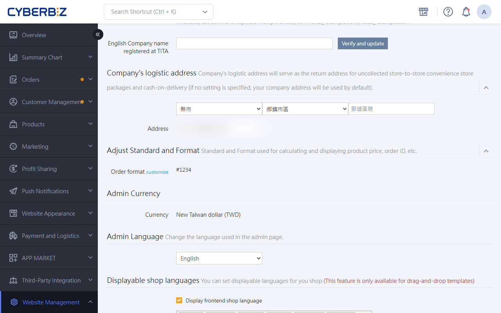

# LINEX Cross-Border Logistics

LINEX offers flexible cross-border logistics solutions. Merchants can choose "Home Pickup" or "Self-Delivery to Warehouse" based on their needs, and the back office automatically generates the waybills and documents required for customs declaration.
{ .subtitle }

[:lucide-layers:{ title="Applicable Product" }](../../resources/conventions#適用產品) | EC Website
[:lucide-tag:{ title="Applicable Plan" }](../../resources/conventions#適用方案) | PLUS / Enterprise 
[:lucide-layers:{ title="Applicable Product" }](../../resources/conventions#適用產品) | Cross-Border E-Commerce (North America / Japan / Southeast Asia)
[:lucide-tag:{ title="Applicable Plan" }](../../resources/conventions#適用方案) | Pro / Business
{ .doc-badge }

## Usage Notes { #prerequisites-linex }

- **Service Scope**: Only supports **shipments from Taiwan to overseas**.
- **Batch Restriction**: Because customs information must be verified one by one, **batch printing** of waybills is currently **not supported**.
- **Operation Tip**: We recommend using this feature together with the **Multi-Country** feature. This allows the system to automatically pull English product information into waybill details, improving efficiency. For assistance, contact CYBERBIZ customer service.
- **Printer Recommendation**: We recommend a laser printer for printing waybills to reduce delivery errors caused by information recognition issues.

## Prerequisite Setup { #operate-linex-setup }

### Step 1: Verify Company English Name { #operate-linex-verify-name }

1. Log in to the CYBERBIZ back office and go to **Website Management > General**.
2. Find the **English Company name registered at TITA** field.
3. Enter your company's official English name as registered with [Business Registration](https://findbiz.nat.gov.tw/fts/query/QueryBar/queryInit.do).
4. Once saved, this field is locked. The system automatically uses this name in customs documents.

{ .screenshot }

### Step 2: Set up Shipping Mode and Sender { #operate-linex-mode-sender }

1. Go to **Payment and Logistics > LINEX Shipping Label**.
2. **Select Mode**: Check **Pickup Appointment** or **Self Delivery**.
    - **Cannot be changed after saving**. Choose carefully.

    { .screenshot }

3. **Basic Information**: Enter the sender information you use most often.
    - Must be in **English**. It is filled in automatically when you create a waybill.

    { .screenshot }

### Step 3: Set up Logistics and Shipping Fees { #operate-linex-fee }

1. Go to **Payment and Logistics > Delivery Settings** and select the **Custom Logistics** tab.
2. Click **Create Custom Logistics**.
3. **Basic Settings**:
    - **Shipping Rule Name**: Name this logistics option. The name must not match any other custom logistics option.

        > Example: LINEX Logistics

    - **Shipping Regions**: Regions can be set down to the **County** level. Settings cannot be configured for specific **townships/districts**.
    - **Payment Method**: Select **Non-Custom Cash on Delivery**.

        > If you have another payment gateway integrated, you can select **Custom cash on delivery**.

4. **Shipping Fee Settings**: Set shipping fees based on **order amount** and **order weight**.

    - **Fee Priority**: If an order meets multiple shipping fee conditions, the system automatically applies the **most favorable condition (lowest amount)** to calculate the fee.
    - **Display Threshold**: The order amount must meet the configured starting threshold. If not, the system automatically hides this logistics option at checkout.
    - **No Amount Limit**: To allow use at any order amount, set the **starting amount** of any condition range to NT$0.

{ .screenshot }

## Detailed Shipping Mode Rules { #specs-linex-modes }

Merchants must comply with the following rules based on the mode selected when the service was activated:

=== "Pickup Appointment (LINEX picks up at your location)"

    - **Pickup Date**:
        - Appointments made before 13:30 on the same day are picked up that day. Others are picked up the next day.
        - Weekend pickups are not available. Appointments are limited to business days.
    - **Pickup Time**:
        - Same-day pickup: 12:00 – 16:00 time window.
        - Next-day pickup: 13:00–17:00 time window.
    - **Related Fees**:
        - **Empty Trip Fee**: If the driver arrives and there are no goods to ship, a **NT$100 per trip** fee applies.
        - **Document Processing Fee**: If the package exterior or documents do not meet requirements, a **NT$50 per carton** processing fee applies.
    - **Change Restriction**: Reply to the automated system email by **12:00 noon** on the appointment day to contact LINEX customer service to change. Late changes will be processed on the next business day.

=== "Self-Delivery (merchant ships to LINEX warehouse)"

    - **Delivery Address**: No. 49, Lane 18, Section 3, Changxing Road, Luzhu District, Taoyuan City 338.
    - **Contact Phone**: 02-77557177 #710.
    - **Cutoff Time**: Shipments must arrive by **16:00**. Late shipments will be processed on the next business day.
    - **Service Hours**: Monday to Friday 9:30–12:00 and 13:30–19:00.

## Order Shipping Operations { #operate-linex-ship }

### Step 1: Create Waybill { #operate-linex-create-waybill }

1. Go to **Orders > All Orders** and select the orders to ship.
2. Click **Actions > Create LINEX Shipping Label**.

    { .screenshot }

3. **Verify Basic Information**: Confirm that all fields are filled in **English**.

    { .screenshot }

### Step 2: Enter Customs Information and Taxes { #operate-linex-customs }

1. **Verify Product Details**:
    - **Required Field Check**: **Product Name**, **Quantity**, and **Weight** must be filled in, and values cannot be 0.

        > **Product Name**: Enter in **English**.

    - **Product Content Summary**: Briefly and clearly describe all products in the order, including product name, material, and use.
        - If the order contains multiple products, list the most valuable product first.
        - Correct example: pearl earrings, blouse, ceramic tray.
        - Vague example: gifts, tools.

2.  **Set Tax Collection Method**:
    - **Delivered Duty Unpaid (DDU)**: The consumer pays customs clearance taxes and handling fees.
    - **Delivered Duty Paid (DDP)**: The merchant pays customs clearance taxes and handling fees.

    { .screenshot }

3. **Select Customs Method**:
    - **Simple Declaration(Sample)**: Free on Board (FOB) value ≤ NT$50,000.
    - **Simple Declaration(Sale)**: FOB value ≤ NT$50,000, and zero-rate tax must be declared for exported goods.
    - **Formal Declaration**: FOB value > NT$50,000.

    { .screenshot }

    !!! info "Fields Required for Pickup Appointment Mode"
        If you select **Pickup Appointment** as the pickup mode, make sure to complete the following fields:

        - **Pickup Time**: Refer to the LINEX pickup policy and select a time within the delivery service window.
        - **Pickup note**: This field is **required**. Do not leave it blank.

        { .small-image }

### Step 3: Print Waybill Documents and POA { #operate-linex-print }

1. After confirming **Calculate shipping fee** is correct, click **Create shipping label**.
    - `Delivery Status`will automatically change to `Shipped`.
2. Unzip the waybill documents and print the details.
3. Attach the **LINEX_waybill** and **orders_printed_details** files to the package surface.
4. If the merchant has not signed a **long-term power of attorney** with LINEX, each shipment must include a completed [POA template](https://drive.google.com/file/d/1MwQ04jG3eDJUY33zORsszPYRXPvRTt6J/view).
    - Refer to LINEX for the latest template. For a blank form, contact LINEX customer service.

{ .screenshot }

## Frequently Asked Questions { #faq-linex }

??? quote "How do I track my package status?"
    Go to the [LINEX package tracking website](https://tracking.hub-ez.com/Tracking/Tracking) and enter the waybill number to search.

